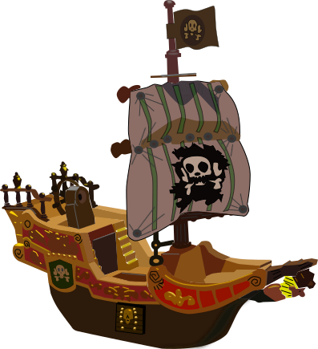

 GRAND LINE · PERSONAL LEARNING LOG

# 大模型学习航海日志

## 向着理解的尽头出发。

这不是一份已经完成的答案，而是我的航海记录：从 Transformer 出发，经过训练、推理、评测、RAG 和 Agent，一点一点找到属于自己的理解。

<a class="md-button md-button--primary" href="notes/transformer/">登上第一艘船</a><a class="md-button" href="roadmap/">查看航海图</a>

LOG 001NEW WORLDLEARNING IN PROGRESS

THE LITTLE RESEARCHER

THE LOGBOOK

## 每一个概念， 都是一座岛。

有些岛屿适合停下来读论文，有些适合亲手实现，还有些只有在踩坑之后才会出现。这个网站记录我走过的路线，也记录我还没有想明白的海域。

ISLAND 01◎
<h3>Transformer Island</h3>
从 Token、Attention 到 KV Cache，先建立模型内部结构的地图。
<a href="notes/transformer/">靠岸阅读 ↗</a>

ISLAND 02∿
<h3>Training Sea</h3>
预训练、SFT、LoRA、DPO 与 GRPO，观察训练信号如何改变模型。
<a href="notes/training/">靠岸阅读 ↗</a>

ISLAND 03⌁
<h3>Systems Port</h3>
推理、量化、RAG、工具和 Agent，把模型带到真实世界。
<a href="notes/inference/">靠岸阅读 ↗</a>

LATEST LOGS
<h2>航海日志</h2>
<i></i> 仍在探索

LOG 001
FOUNDATION<h3><a href="notes/transformer/">Transformer 全貌</a></h3>
先看清整艘船，再拆开每一个零件。

↗

LOG 002
PROJECT READING<h3><a href="projects/agentic-rl-lab/">Agentic RL Lab 阅读记录</a></h3>
一个项目如何把训练、环境、成本和失败都写进学习过程。

↗

LOG 003
NEXT DESTINATION<h3><a href="notes/transformer/">Token 与 Embedding</a></h3>
下一站：文字进入 Transformer 之前发生了什么。

↗

✦
<strong>没有终点，只有下一座岛。</strong> 修改 GitHub 仓库中的 Markdown 后，航海日志会自动更新到网页版。

