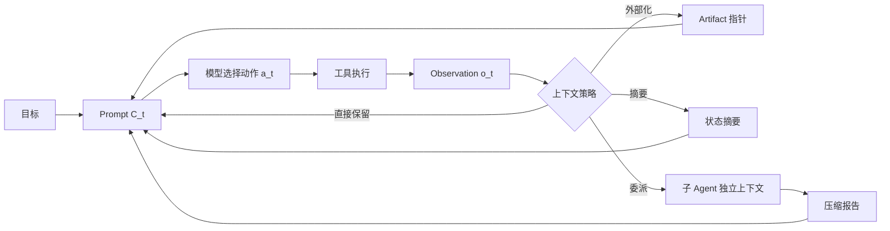

# 01. 上下文工程：Agent 到底应该看到什么

> 本章基于知乎作者魔法学院的Chilia的文章《[万字长文解析Agent框架中的上下文管理策略](https://zhuanlan.zhihu.com/p/2012088406826562496)》重构整理。原文版权归作者所有；本章为学习笔记扩展，不复刻原文。

## 1. 从 Prompt Engineering 到 Context Engineering

Prompt Engineering 常处理一个相对静态的问题：

```text
给模型一段指令
→ 希望它输出更符合要求的答案
```

Agent 的情况不同。它会在多轮执行中不断接收新 Observation：

```text
用户目标
→ 模型选择工具
→ 工具执行
→ 返回文件、网页、日志或错误
→ 新信息影响下一步工具选择
→ 重复数十甚至数百轮
```

因此 Context Engineering 关心的不是一句 Prompt 写得够不够漂亮，而是：

> 在每一个时间步，怎样从不断增长的信息池中挑出最值得让模型看到的工作集？

## 2. 三个最容易混淆的概念

| 概念 | 问题 | 例子 |
| --- | --- | --- |
| Context Window | 模型最多能接收多少 token | 128K、200K 或更大输入上限 |
| Active Context | 当前轮真正传给模型的 token | System Prompt、目标、最近日志、当前状态 |
| External State | Agent 能访问但当前没放入 Prompt 的信息 | 文件、数据库、网页、完整 transcript、Memory |

一个模型支持长窗口，不表示它应该在每轮读完整项目、全部日志和所有历史消息。

```text
可容纳
≠
值得放入
```

## 3. Agent Loop 中上下文如何增长

设第 \(t\) 轮输入为 \(C_t\)，模型基于它选择动作 \(a_t\)：

\[
a_t\sim\pi_\theta(\cdot\mid C_t)
\]

工具或环境给出 Observation \(o_t\)，最朴素的更新是：

\[
C_{t+1}=C_t\oplus(a_t,o_t)
\]

其中 \(\oplus\) 表示直接追加。

这在前几轮没问题，但若每次 `Read`、`Bash`、网页抓取都带来很长输出，\(C_t\) 会快速膨胀。更危险的是：Agent 无法提前知道一段看似普通的日志，会不会在十轮之后成为定位 bug 的关键证据。



## 4. 为什么“上下文越长越好”是错误直觉

长上下文至少带来四种成本。

### 4.1 计算成本

输入越长，Prefill 需要处理的 token 越多。即使使用了高效 Attention 内核，长输入仍会增加：

```text
首字延迟 TTFT
输入 token 费用
显存或 KV 状态占用
批处理调度压力
```

### 4.2 注意力竞争

模型不具有人类式“自动忽略无关历史”的确定机制。大量旧日志、失败尝试、过时计划和重复结果会与当前关键状态竞争注意力。

不要把这种现象简单解释为“模型记忆力差”。更准确的说法是：

```text
当前决策信号密度下降
→ 模型更难定位真正影响下一步的变量
```

### 4.3 状态冲突

长会话里可能同时存在：

```text
旧计划：修改 middleware 顺序
新发现：问题其实在 token refresh
旧工具输出：已经失效的测试结果
新工具输出：当前分支的真实状态
```

如果没有显式状态管理，模型可能复活旧计划、重复已撤销修改或依据过期 Observation 行动。

### 4.4 工具输出污染

工具结果不像自然语言对话那样天然精炼。一个命令可能返回：

```text
10,000 行 build log
压缩过的 JSON
二进制转储
完整网页 DOM
依赖树
```

这些内容即使与最终答案没有直接关系，也可能占据大部分上下文预算。

## 5. 上下文工程的目标函数

将所有可用信息记为 \(\mathcal I_t\)，当前可选上下文为 \(C\subseteq\mathcal I_t\)。一个概念性目标是：

\[
C_t^*=\arg\max_{C\subseteq\mathcal I_t}
\mathbb E[U(a_t)\mid C]
-\lambda\cdot \operatorname{Cost}(C)
-\mu\cdot \operatorname{Risk}(C)
\]

这不是一个可直接求解的真实优化程序，而是一套设计语言。

| 项 | 问题 |
| --- | --- |
| \(U(a_t)\) | 这段信息会不会让下一步动作更正确？ |
| `Cost` | 它要消耗多少 token、Prefill、延迟和费用？ |
| `Risk` | 不保留会不会丢证据？保留会不会制造噪声或泄露权限？ |

因此，好的上下文管理不追求：

```text
最短上下文
```

也不追求：

```text
最全上下文
```

而是追求：

```text
当前决策所需的最小高信号工作集
```

## 6. 四层信息模型

在工程中，可以把信息按“是否应立即进入 Prompt”和“是否可恢复”分类。

| 层级 | 内容 | 为什么存在 |
| --- | --- | --- |
| 稳定前缀 | 系统规则、工具 schema、项目规范 | 每轮都需要，且应利于缓存复用 |
| 活跃工作集 | 当前目标、最近状态、待办、关键 Observation | 直接决定下一步行动 |
| 可检索工件 | 完整日志、文件、网页、数据库结果 | 信息不能丢，但没有必要每轮都读 |
| 长期知识 | 用户偏好、项目经验、Skill、跨任务记忆 | 只在相关时注入 |

这四层的关系不是简单按时间排序。

例如一条三天前的错误日志，如果当前正在修同一故障，可能应回到活跃工作集；一条刚刚生成、但只含无关安装进度的日志，可能应直接外部化甚至丢弃。

## 7. 上下文选择的五个判断维度

面对新信息 \(x\)，可以逐项判断：

| 维度 | 要问的问题 |
| --- | --- |
| 直接性 | 下一步是否必须精确引用它？ |
| 可恢复性 | 能否通过文件、URL、ID 或工具重新获得？ |
| 持久价值 | 它是否对未来任务也有可迁移价值？ |
| 时效性 | 当前状态变化后，它是否已经过期？ |
| 风险 | 是否包含秘密、无可信来源内容、Prompt Injection 或不应跨任务共享的数据？ |

根据结果选择：

```text
直接保留
→ 外部化并保留指针
→ 生成可恢复摘要
→ 写入长期 Memory
→ 委派给子 Agent
→ 丢弃
```

## 8. 一个代码 Agent 的具体例子

任务：

```text
修复支付服务的 token refresh 失败。
```

Agent 先执行：

```text
rg -n "refresh|token|session" src tests
pytest tests/auth -q
```

得到的信息可能有：

| 信息 | 处理策略 | 原因 |
| --- | --- | --- |
| 当前失败栈的 20 行关键异常 | 放入活跃工作集 | 下一步要定位问题 |
| 2 MB 完整测试日志 | 保存到 artifact | 需要时可回溯，但不应塞进 Prompt |
| `refresh.ts` 的相关 150 行 | 当前读取并保留 | 正在修改该文件 |
| 已证实的项目规范“session 写回必须经 repository” | 长期项目状态 | 后续修改都要遵守 |
| 一小时前被撤销的 middleware 方案 | 摘要保留失败原因 | 防止重复尝试 |

这就是 Context Engineering 的实际形态：不是一项单独模型能力，而是 Agent Harness 的信息生命周期设计。

## 9. 评测什么

不要只比较最终任务成功率。一个“把上下文删短”的方案可能更快，但也可能只是删掉难题证据。

| 维度 | 指标 |
| --- | --- |
| 质量 | Success Rate、Pass@k、任务得分 |
| 预算 | 平均输入 token、最大上下文长度 |
| 延迟 | TTFT、端到端耗时 |
| 成本 | 输入、缓存输入、输出、工具调用费用 |
| 恢复性 | 被压缩后找回关键证据的成功率 |
| 稳定性 | 长程任务后期表现、重复行动率、循环率 |
| 安全 | 敏感信息跨任务泄露率、污染上下文被执行的比例 |

## 10. 高频问题

### Q1：上下文管理和 Agent Memory 是同一个问题吗？

**回答：**不是。上下文管理决定本轮 Prompt 的工作集；Memory 决定哪些信息跨轮、跨任务保存。Memory 只有被筛选为当前相关时，才会进入上下文。

### Q2：是否应把所有工具输出保存在对话历史中？

**回答：**不应。关键局部输出保留在活跃工作集，完整原始内容应外部化并保留可恢复指针。否则长期 Agent 会迅速被工具输出淹没。

### Q3：长窗口是否能取代上下文工程？

**回答：**不能。长窗口缓解容量上限，但不能自动解决噪声、过期状态、成本、缓存失效和权限隔离问题。

## 11. 本章结论

> 上下文不是被动累积的聊天记录，而是 Agent 为下一步决策维护的受预算约束工作集。

后续四章分别讨论：信息如何可逆外部化、不得不丢失细节时如何可恢复压缩、复杂任务如何隔离上下文，以及已经选择的上下文如何通过缓存更高效地计算。
