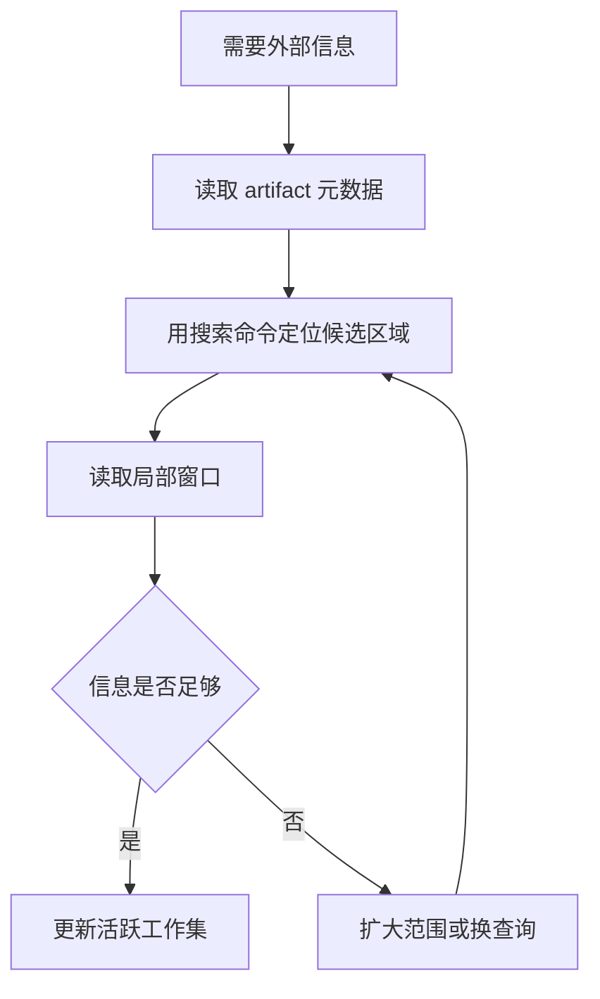

# 02. 可逆卸载与按需检索：信息离开 Prompt，但不能离开系统

> 本章基于知乎作者魔法学院的Chilia的文章《[万字长文解析Agent框架中的上下文管理策略](https://zhuanlan.zhihu.com/p/2012088406826562496)》重构整理。原文版权归作者所有；本章为学习笔记扩展，不复刻原文。

## 1. 为什么“截断”是最危险的默认策略

长工具输出最常见的处理方式是：

```text
只保留前 2,000 token
```

它省 token，但本质上是不可逆删除。

假设 Agent 执行测试得到 20,000 行日志：

```text
前 500 行：大量 warning
中间：依赖下载信息
末尾：AssertionError: refresh token was not persisted
```

若只保留开头，下一步模型会看到一堆 warning，却失去真正的失败原因。更糟的是，Agent 当下无法预知哪一行会在后续十轮中成为关键证据。

因此上下文卸载的基本原则是：

> 长内容可以离开 Prompt，但原始内容应留在可定位、可验证、可重新读取的外部位置。

## 2. Compaction 与 Truncation 的区别

| 操作 | 原始内容是否保留 | 是否可恢复 | 适用性 |
| --- | ---: | ---: | --- |
| Truncation | 否 | 否 | 极低价值、可完全丢弃的输出 |
| Compaction / Offload | 是 | 是 | 日志、网页、文件、工具结果 |
| Summarization | 通常需另存原文 | 条件可恢复 | 长会话、复杂状态交接 |
| Memory extraction | 只保留可迁移经验 | 不等于恢复原文 | 跨任务长期知识 |

很多系统将“压缩”统称为 compaction，但工程上最好进一步区分：

```text
Offload：完整内容移到外部，Prompt 留引用
Summary：将内容有损压缩为状态描述
Truncate：直接删除
```

## 3. 文件系统为什么适合做 Agent 的外部工作记忆

文件系统具备几个关键性质：

| 特性 | 对 Agent 的意义 |
| --- | --- |
| 大容量 | 不受上下文窗口限制 |
| 持久化 | 不会因一次 compaction 消失 |
| 随机访问 | 可通过路径、offset、行号局部读取 |
| 原始性 | 可保存完整日志、代码、JSON、网页快照 |
| 工具可操作 | `rg`、`grep`、`jq`、`head`、`tail`、SQL 等可渐进探索 |

Manus 将文件系统视为外部上下文的一种核心载体：网页可以由 URL 代表，文档可以由路径代表，完整内容需要时再重新加载。详见 Manus 的 [Context Engineering for AI Agents](https://www.manus.im/blog/Context-Engineering-for-AI-Agents-Lessons-from-Building-Manus)。

### 3.1 一个 Artifact Reference 的最小 schema

```json
{
  "artifact_id": "pytest-auth-017",
  "kind": "test-log",
  "uri": "file:///tmp/pytest-auth-017.log",
  "created_at": "2026-10-22T10:40:00+08:00",
  "producer": "pytest tests/auth -q",
  "content_hint": "3 failures, likely refresh token persistence",
  "retrieval_hints": [
    "rg -n \"AssertionError|refresh token\" /tmp/pytest-auth-017.log",
    "tail -n 160 /tmp/pytest-auth-017.log"
  ],
  "integrity": "sha256:...",
  "access_scope": "project"
}
```

这段结构化信息可以直接进入上下文，而 4 MB 日志不必进入。

## 4. 渐进式读取，而不是一次性重新加载

外部化不意味着每次需要信息时重新读整个文件。更合理的是分层读取：



例如定位一次测试失败：

```bash
rg -n "AssertionError|refresh token|persist" /tmp/pytest-auth-017.log
sed -n '418,470p' /tmp/pytest-auth-017.log
```

而不是：

```bash
cat /tmp/pytest-auth-017.log
```

前者将模型本身变成检索策略的制定者：先提出假设，再根据局部结果调整查询。

## 5. JIT Retrieval：推理过程中生成检索动作

Just-in-Time Retrieval 的流程是：

```text
当前任务状态
→ 模型判断缺少什么信息
→ 模型生成检索命令
→ 工具返回局部证据
→ 模型决定下一步检索或行动
```

例如排查一个代码 bug：

```text
1. rg 搜函数定义
2. rg 搜函数调用位置
3. Read 相关函数附近 120 行
4. 执行最小复现测试
5. 根据失败栈回到某个调用点
```

这个过程类似人类工程师查代码：我们不需要事先把整个仓库记住，但需要知道如何查、先查什么、何时扩大范围。

## 6. JIT Retrieval 与 RAG 不应对立

| 场景 | 首选策略 | 原因 |
| --- | --- | --- |
| 版本稳定的知识库、政策文档、FAQ | RAG | 语义召回快，用户问题通常直接对应文段 |
| 代码仓库、Git 状态、构建日志 | JIT Retrieval | 内容动态、精确路径和局部依赖很重要 |
| PDF、扫描件、多模态档案 | 混合 | 先索引/抽取，再由 Agent 按需打开原件 |
| 数据库与表格 | SQL / schema-aware tool | 结构化查询比 chunk 召回更可靠 |
| 长对话历史 | 摘要 + transcript 检索 | 既要传递状态，也要能找回精确细节 |

RAG 的典型风险包括：

```text
chunk 边界不符合任务语义
embedding 对代码符号、行号、版本差异不敏感
索引未更新，召回了旧状态
Top-K 中混入大量表面相似但无关内容
```

JIT Retrieval 的典型风险包括：

```text
模型不会写有效查询
工具权限不足
多轮搜索导致额外延迟
错误的早期假设让搜索空间不断偏离
```

因此实践中通常是混合系统：RAG 提供候选入口，Agent 用工具打开原始工件做精确确认。

## 7. 何时写入长期 Memory，而不是只外部化

外部 Artifact 保存的是“事实原件”；Memory 保存的是“未来可复用的压缩经验”。

例如：

```text
原始日志：/tmp/pytest-auth-017.log
```

应外部化。

而下面这条可以考虑写入项目 Memory：

```text
本项目中 refresh token 更新后必须通过 SessionRepository.save() 持久化；
只更新内存对象会导致下一轮请求继续使用旧 token。
```

写入长期 Memory 前，至少检查：

| 检查 | 问题 |
| --- | --- |
| 正确性 | 是否已经通过测试或证据确认？ |
| 泛化性 | 是一次性细节，还是可复用规则？ |
| 时效性 | 会不会随分支、版本或环境变化失效？ |
| 来源 | 能否追溯到文件、日志或 commit？ |
| 权限 | 能否跨用户、跨项目保存和召回？ |

## 8. 实现骨架

下面是一个概念性伪代码：

```python
def handle_tool_result(result, task_state):
    if result.token_count <= task_state.inline_budget:
        return ActiveContext.add(result)

    artifact = persist(result)
    pointer = summarize_pointer(
        artifact=artifact,
        hint=extract_high_signal_hint(result),
        retrieval_hints=build_retrieval_hints(result),
    )
    return ActiveContext.add(pointer)


def retrieve_artifact(pointer, question):
    query = plan_local_query(pointer, question)
    excerpt = run_tool(query)
    return excerpt
```

真正系统中还需要：

```text
artifact 生命周期清理
内容哈希与版本
敏感数据脱敏
路径权限与租户隔离
搜索失败回退策略
是否应把局部证据升级到 Memory 的判断
```

## 9. 失败模式

### 9.1 只有路径，没有检索提示

```text
结果已保存：/tmp/log.txt
```

这对模型帮助有限。它仍不知道文件中有什么、该从何查起。

### 9.2 摘要声称结论，但没有原始工件

```text
认证模块有 bug。
```

没有日志、文件和行号，后续无法验证或恢复。

### 9.3 将所有内容都写入长期 Memory

这会把一次性的日志、临时路径、错误猜测长期化，造成检索污染。

### 9.4 只依赖向量检索处理精确代码问题

对于函数签名、行号、版本差异、异常文本，符号搜索与工具访问通常更可靠。

## 10. 高频问题

### Q1：文件系统是否一定比向量库好？

**回答：**不是。文件系统适合保存原始可验证工件，JIT 工具检索适合动态、结构化、精确定位的问题。向量库适合海量静态文档的语义召回。实践中通常组合使用。

### Q2：外部化后，模型怎么知道何时要去读文件？

**回答：**指针必须携带内容提示、来源和检索建议；模型根据当前任务状态决定是否需要补证据。若只保留路径，不提供语义线索，外部化会变成不可用的遗忘。

### Q3：是不是所有长工具输出都应保存？

**回答：**不一定。应根据可恢复价值、调试价值、权限、存储成本和是否可能复用判断。无关进度条、重复安装信息可以直接丢弃。

## 11. 本章结论

> 可逆卸载的目标不是减少信息，而是将“完整证据”从昂贵的 Prompt 工作集迁移到可定位的外部工件，并让 Agent 能按需、渐进地重新读取它。

下一章讨论：当外部化仍不足以控制上下文时，怎样使用有损摘要，同时不让 Agent 因压缩而失去任务状态。
