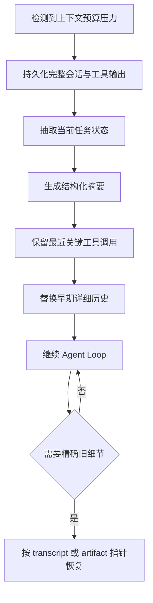

# 03. 可恢复摘要与压缩：让 Agent 忘掉细节，但不失去继续工作的能力

> 本章基于知乎作者魔法学院的Chilia的文章《[万字长文解析Agent框架中的上下文管理策略](https://zhuanlan.zhihu.com/p/2012088406826562496)》重构整理。原文版权归作者所有；本章为学习笔记扩展，不复刻原文。

## 1. 摘要为什么是最后手段

摘要会把：

```text
精确代码
完整工具输出
原始错误栈
消息顺序
细粒度决策理由
```

压缩成自然语言状态描述。

它能释放窗口，但代价是细节丢失。因此应优先顺序是：

```text
先外部化可恢复工件
→ 再缩小活跃工作集
→ 确实接近窗口上限时才摘要
```

摘要不是“更聪明的截断”，而是有损压缩。若没有原始 transcript 或 artifact 作为后备，它会让 Agent 永久失忆。

## 2. Compaction 的正确流程



关键点：**摘要之前先持久化，摘要之后仍可检索。**

## 3. 什么是“可继续执行”的摘要

对 Agent 而言，摘要不是会议纪要，而是下一轮的执行状态机快照。

一个建议 schema：

```yaml
goal:
  user_intent: "修复 refresh token 在重启后失效的问题"
  success_criteria:
    - "auth e2e tests pass"
    - "token 重启后仍可读取"
constraints:
  - "不得修改公开 API"
confirmed_facts:
  - fact: "refresh.ts 未调用 SessionRepository.save"
    evidence: "artifact://pytest-auth-017#L418-L466"
current_state:
  branch: "fix/token-refresh"
  modified_files:
    - "src/auth/refresh.ts"
failed_attempts:
  - action: "调整 middleware 顺序"
    outcome: "登录 e2e 回归，已撤销"
pending_tasks:
  - "检查 saveSession 的调用位置"
  - "运行 auth e2e 子集"
artifacts:
  - "artifact://pytest-auth-017"
  - "artifact://session-transcript-42"
next_action_hint: "先读取 refresh.ts 的 60-130 行"
```

这比一段散文式摘要更适合 Agent，因为它明确区分：

```text
什么已确认
什么只是尝试过
什么尚未完成
精确细节在哪里恢复
```

## 4. 为什么要保留最近行动

即使有结构化摘要，也建议保留最近几次完整工具调用和结果。

原因是当前执行具有局部连续性：

```text
刚修改了什么文件？
刚执行的命令是什么？
当前错误是修改前还是修改后产生的？
工具输出中的路径、变量名和行号是什么？
```

一个常见布局是：

```text
[稳定前缀]
项目规则、工具 schema

[compaction summary]
结构化长期状态

[recent window]
最后 N 次行动、工具结果和用户消息
```

其中 `N` 不应是固定魔法数字，而应按 token 预算、任务类型和工具输出长度动态控制。

## 5. 自动触发与手动触发

压缩通常有两种触发方式：

| 类型 | 触发条件 | 优点 | 风险 |
| --- | --- | --- | --- |
| 自动 compaction | 接近上下文阈值 | 不依赖用户、避免硬截断 | 可能在不合适时机丢失局部连续性 |
| 手动 compaction | 用户或 Agent 显式决定 | 可在阶段边界整理状态 | 依赖系统会主动判断 |

好的自动策略不应只看 token 数，还应考虑：

```text
当前是否正在执行不可中断的局部调试？
是否已经有完整 artifact backup？
最近是否出现关键失败或用户约束？
是否刚完成一个自然任务阶段？
```

## 6. Handoff 与 Compaction 的区别

| 方式 | 是否同一会话连续 | 主要产物 | 适合场景 |
| --- | ---: | --- | --- |
| Compaction | 是 | 压缩摘要 + 最近上下文 | 常规长对话、逐步开发 |
| Handoff | 否或近似否 | 交接文档 / 状态包 | 超长任务、跨班次、跨 Agent、上下文已严重污染 |

Handoff 可以把 Agent 放进一个更干净的上下文窗口：

```text
旧会话：保留完整记录与产物
→ 生成 handoff artifact
→ 新会话：只加载项目规则、handoff、必要 artifact 指针
```

优点是减少历史噪声；缺点是新会话缺少隐含语气、局部直觉和未写入 handoff 的细节。

## 7. 摘要失败的四种模式

### 7.1 只写结论，不写证据

```text
认证模块实现错误。
```

问题：后续 Agent 无法确认是哪一段、是否已修复、是否只是猜测。

### 7.2 把猜测写成事实

```text
根因是 Redis 缓存失效。
```

如果这只是尚未验证的假设，后续 Agent 会把它当作锚点，忽略其它可能性。

应该写成：

```text
假设：Redis TTL 与现象一致，尚未验证；
下一步：检查 SessionRepository 的 setex 调用。
```

### 7.3 忘记记录失败尝试

若摘要只保存成功路径，Agent 容易再次执行已验证失败的操作。

### 7.4 只留摘要，不留原始历史

这是最危险的情况。出现精确代码、命令、路径或行号需求时，系统无法恢复，只能让模型猜。

## 8. 摘要质量如何评测

可以构造“恢复任务”而非只用人工主观评价：

| 测试 | 问题 |
| --- | --- |
| Fact recovery | 摘要后能否找回此前已确认的关键事实？ |
| State continuation | 新 Agent 能否从摘要继续完成未完成任务？ |
| Failure avoidance | 是否会重复执行已知失败尝试？ |
| Artifact retrieval | 是否能根据摘要指针读回精确日志/代码？ |
| Hallucination rate | 摘要是否引入原历史不存在的事实？ |

一个合格摘要不是“读起来顺”，而是让新一轮 Agent 能正确恢复任务状态。

## 9. 简化实现骨架

```python
def compact(session):
    backup = persist_full_transcript(session)
    state = extract_state(session)
    summary = summarize(
        goal=state.goal,
        facts=state.confirmed_facts,
        attempts=state.failed_attempts,
        pending=state.pending_tasks,
        artifacts=[backup, *state.artifacts],
    )
    recent = select_recent_critical_events(session.events)
    return build_new_context(summary=summary, recent=recent)
```

真实系统中还需要验证：

```text
backup 是否写入成功
摘要中的 artifact 指针是否可访问
敏感数据是否被正确脱敏和隔离
摘要前后的任务状态是否一致
```

## 10. 高频问题

### Q1：摘要应该每轮都做吗？

**回答：**不应该。频繁摘要会不断损失细节、增加模型调用和状态漂移。应在上下文压力较高、任务阶段自然结束或准备交接时进行。

### Q2：摘要与长期 Memory 有什么不同？

**回答：**摘要保存当前会话的执行状态，通常服务于继续当前任务；长期 Memory 保存跨任务可复用经验。一个会话摘要不应因为内容多就自动进入长期 Memory。

### Q3：能否让模型直接“记住”之前的聊天？

**回答：**模型本身不会跨独立 API 请求永久记住历史。系统必须显式传入上下文、摘要、Memory 或外部工件引用。

## 11. 本章结论

> 摘要的正确目标不是最大程度缩短历史，而是在丢失细节后仍能通过清晰状态字段和可恢复工件，继续完成同一个任务。

下一章讨论如何让大量探索不进入主上下文：通过子 Agent 隔离工作区，并以证据化报告而非完整轨迹回传结果。
