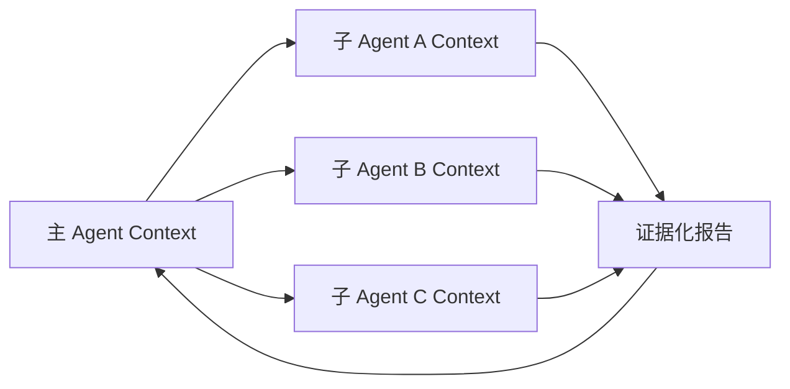
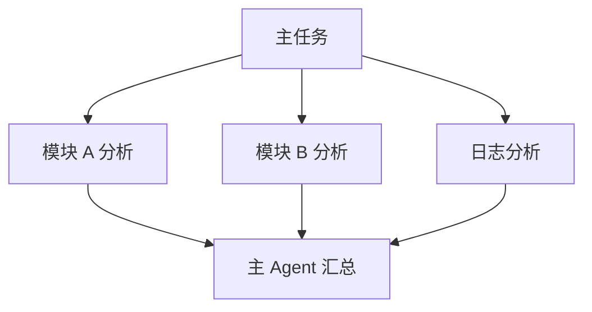
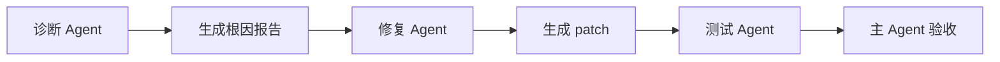

# 04. 上下文隔离与子 Agent：把高 token 探索留在局部工作区

> 本章基于知乎作者魔法学院的Chilia的文章《[万字长文解析Agent框架中的上下文管理策略](https://zhuanlan.zhihu.com/p/2012088406826562496)》重构整理。原文版权归作者所有；本章为学习笔记扩展，不复刻原文。

## 1. 子 Agent 的核心价值不是“多一个模型”

复杂任务常被理解为：

```text
主 Agent 不够聪明
→ 多开几个 Agent
→ 并行做事
```

但从上下文管理角度，更重要的价值是：

> 将高 token、局部且探索性强的推理过程隔离在独立工作区，避免主 Agent 的上下文被细节淹没。

例如主任务是：

```text
修复支付系统的 token refresh 问题，并补充回归测试。
```

主 Agent 可以委派：

```text
子 Agent A：定位 token refresh 调用链
子 Agent B：分析测试失败日志
子 Agent C：检查 SessionRepository 的持久化语义
```

每个子 Agent 都可能读取几十个文件、执行多次搜索和测试，但主 Agent 最终只需得到少量可验证的结论。

## 2. 主 Agent 与子 Agent 的上下文边界



理想状态下，主 Agent 不接收：

```text
全部搜索命令
每一段文件正文
完整思考过程
所有失败尝试的原始日志
```

而接收：

```text
结论
证据位置
置信度与未确认点
生成或修改的 artifact
建议下一步
```

这是“上下文隔离”而不是“把工作丢给别人”。

## 3. 子 Agent 返回结果的交付契约

一个有用的 Subagent Result 应当是结构化的：

```yaml
task:
  objective: "定位 refresh token 未持久化的调用链"
status: completed
findings:
  - claim: "refresh.ts 只更新内存对象，没有调用 SessionRepository.save"
    confidence: high
    evidence:
      - "src/auth/refresh.ts#L74-L103"
      - "tests/auth/refresh.test.ts#L51-L87"
artifacts:
  - "artifact://subagent-a-search-log"
open_questions:
  - "save() 是否会触发额外审计事件，需要检查 repository 实现"
recommended_next_action:
  - "读取 src/session/repository.ts 的 90-150 行"
```

这比返回：

```text
我看了一下，可能是 refresh.ts 的问题。
```

强得多，因为主 Agent 可以验证、引用和继续执行。

## 4. 并行委派与链式委派

### 4.1 并行委派

适合子任务几乎独立：



使用条件：

```text
子任务没有严格先后依赖
每个任务可以独立验证
结果汇总时不会产生大规模冲突
并行成本低于等待成本
```

例子：

```text
同时分析三个服务模块
同时比较三种实现方案
同时审查安全、性能和测试覆盖
```

### 4.2 链式委派

适合下游任务必须使用上游产物：



例子：

```text
先定位性能瓶颈
→ 再设计优化 patch
→ 最后验证 benchmark 与回归测试
```

链式委派的风险是上游错误会传递。因此上游报告必须提供证据，而不是只给结论。

## 5. 为什么不允许无限嵌套子 Agent

若子 Agent 可以无限生成子 Agent：

```text
主 Agent
→ 子 Agent
→ 孙 Agent
→ 曾孙 Agent
→ ...
```

会引入：

| 风险 | 后果 |
| --- | --- |
| 预算失控 | token、工具调用、并发数不可预测 |
| 责任不清 | 无法回答“哪个 Agent 做了这个修改” |
| 上下文碎片化 | 关键事实分散在多个不可见分支 |
| 重复探索 | 多个分支做相同搜索 |
| 安全扩大 | 每一层都可能获得工具或文件权限 |

更稳健的设计通常是：

```text
主 Agent 可创建有限层级的子 Agent
子 Agent 默认不能继续创建子 Agent
或必须由主 Agent 显式批准递归委派
```

这也是许多 coding-agent 系统采用浅层委派结构的原因。

## 6. Claude Code 风格的上下文隔离

Claude Code 的公开设计中，Subagent 可以在独立上下文内执行文件读取、探索或修改任务，再向主任务返回结果。其价值不只是并发，而是让主上下文不必容纳所有探索过程。参见 Anthropic 的 [How and when to use subagents in Claude Code](https://claude.com/blog/subagents-in-claude-code)。

一个合理的主 Agent 责任边界：

| 主 Agent 保留 | 子 Agent 处理 |
| --- | --- |
| 用户最终目标 | 局部探索问题 |
| 任务分解 | 大量文件与日志读取 |
| 全局预算 | 独立实验或查询 |
| 跨模块冲突处理 | 证据收集与局部报告 |
| 最终修改与验收 | 可选的局部 patch |

主 Agent 的上下文应保存“任务图”，不是保存“每个子任务的全过程”。

## 7. Context Isolation 不等于 Memory Isolation

这是一个常见混淆。

```text
Context Isolation：
让不同任务拥有独立的短期工作上下文。

Memory Isolation：
限制长期记忆是否可以跨用户、跨项目、跨权限域共享。
```

例如一个子 Agent 可以读项目 A 的机密配置。即使它只把简短结论返回主 Agent，也不代表这条结论可以写入跨项目可检索的长期 Memory。

工程上应为每条返回结果标记：

```text
来源任务
项目/租户范围
权限级别
保留期限
是否允许升级为长期 Memory
```

## 8. 多 Agent 的成本模型

多 Agent 并不免费。设：

\[
T_{\operatorname{total}}
=\max_i T_i+T_{\operatorname{merge}}
\]

并行时总等待时间由最慢子任务加上汇总时间决定；成本则近似为：

\[
\operatorname{Cost}_{\operatorname{total}}
=\sum_i\operatorname{Cost}_i+\operatorname{Cost}_{\operatorname{merge}}
\]

因此委派应满足：

```text
子任务的独立价值
>
启动、协调、汇总和重复探索的额外成本
```

小任务、单文件修改、精确已有信息查询，通常不值得启动 Subagent。

## 9. 失败模式

### 9.1 主 Agent 接收完整子 Agent transcript

这会把隔离重新变成污染。应该返回 artifact 指针和压缩报告。

### 9.2 子 Agent 只给结论，没有证据

主 Agent 无法判断其正确性，只能盲目信任一个新的语言模型输出。

### 9.3 并行任务重复

若三个子 Agent 都去搜索 `auth`，不仅浪费成本，还会制造互相冲突的报告。主 Agent 应分配互斥的子目标。

### 9.4 子 Agent 直接做高风险修改

对于删除、迁移、权限变更、生产部署等操作，子 Agent 最好只给计划和 patch 建议，由主 Agent 或用户进行最终验收。

## 10. 高频问题

### Q1：什么时候值得创建子 Agent？

**回答：**当子任务有明确边界、独立探索量大、结果可用短报告交付，并且并行或隔离带来的收益超过额外调用成本时。

### Q2：子 Agent 的结果是否应该直接加入主 Prompt？

**回答：**应该加入经过压缩和结构化后的报告，不应直接加入完整 transcript。报告必须包含结论、证据、未确认点与 artifact 指针。

### Q3：多 Agent 能否替代上下文管理？

**回答：**不能。子 Agent 本身也会产生长上下文和工具输出；它只是把问题拆到多个局部工作区。每个子 Agent 仍需要外部化、摘要和缓存策略。

## 11. 本章结论

> 子 Agent 的上下文隔离价值，不在于让多个模型同时“思考”，而在于将局部高 token 探索封装成可验证、可引用、低 token 的交付物，让主 Agent 保持对全局目标的清晰控制。

下一章讨论另一个层面：当上下文已经选对后，怎样通过 KV Cache 和 Prompt Cache 避免反复计算相同前缀。
