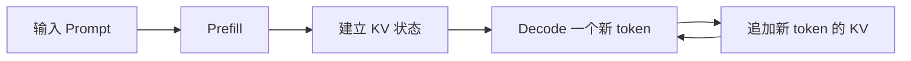
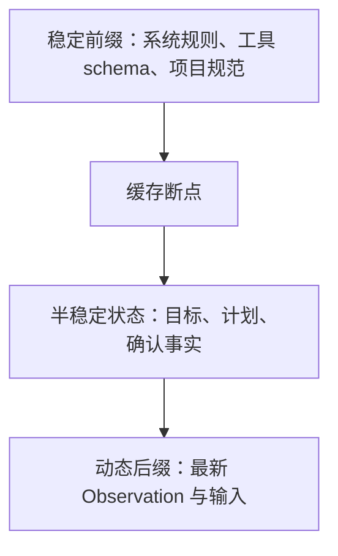

# 05. KV Cache 与 Prompt Cache：同样的上下文不要重复计算

> 本章基于知乎作者魔法学院的Chilia的文章《[万字长文解析Agent框架中的上下文管理策略](https://zhuanlan.zhihu.com/p/2012088406826562496)》重构整理。原文版权归作者所有；本章为学习笔记扩展，不复刻原文。

## 1. 为什么缓存属于上下文管理

上下文管理有两个层次：

| 层次 | 核心问题 | 方法 |
| --- | --- | --- |
| 信息层 | 什么信息值得进入当前 Prompt？ | 外部化、检索、摘要、委派、Memory |
| 计算层 | 已经确定要进入 Prompt 的内容怎样少算？ | KV Cache、Prompt Cache、Prefix Layout |

所以缓存不回答：

```text
这段日志是否相关？
这条 Memory 是否应该注入？
```

缓存只回答：

```text
这段前缀和上一次足够相同吗？
如果相同，能否复用已有计算？
```

因此：

> 上下文工程负责“选对信息”，缓存负责“少算重复信息”。

## 2. Prefill 与 Decode

假设输入 Prompt 是：

```text
The quick brown fox
```

生成下一个 token `jumps` 前，模型必须先处理整个输入序列，计算每个位置的隐藏状态以及后续 Attention 所需的信息。这个阶段称为 **Prefill**。

之后逐 token 生成：

```text
jumps → over → the → lazy → dog
```

每生成一个 token 的过程称为 **Decode**。



长 Agent 任务中，输入上下文常远长于模型每轮输出，因此 Prefill 往往主导：

```text
TTFT
输入 token 成本
多轮总延迟
```

## 3. KV Cache：一次生成内部的缓存

Self-Attention 中，当前位置需要读取历史 token 的 Key 和 Value。

设第 \(t\) 个 token 的表示为 \(x_t\)：

\[
k_t=x_tW_K,
\qquad
v_t=x_tW_V
\]

生成第 \(t+1\) 个 token 时，若重新计算前 \(t\) 个 token 的 \(K,V\)，会造成重复工作。KV Cache 保存历史的：

\[
K_{1:t},\quad V_{1:t}
\]

新 token 到来时，只需要计算：

\[
k_{t+1},\quad v_{t+1}
\]

然后追加到缓存。

```text
KV Cache 解决：
一次连续生成过程中，历史 token 不要重复算。
```

它通常是推理引擎的内部机制，应用开发者未必直接控制其内容布局。

## 4. Prompt Cache：多次请求之间的缓存

Agent 的问题不止是生成一段连续文本，而是反复发起 API 请求：

```text
第 1 轮：系统规则 + 工具定义 + 用户任务
→ 调工具

第 2 轮：系统规则 + 工具定义 + 用户任务 + Observation 1
→ 调工具

第 3 轮：系统规则 + 工具定义 + 用户任务 + Observation 1 + Observation 2
→ 调工具
```

前三部分每轮都相同。如果每次请求都重新 Prefill 整个前缀，长任务会非常慢。

Prompt Cache / Prefix Cache 的理想行为：

```text
第一次请求：
对稳定前缀执行 Prefill，并保存可复用状态

后续请求：
稳定前缀未变
→ 复用前缀状态
→ 只 Prefill 新追加的 Observation
```

| 概念 | 作用范围 | Agent 工程关注点 |
| --- | --- | --- |
| KV Cache | 一次 Decode 内 | 每生成一个 token 不重复处理历史 token |
| Prompt Cache | 多次 API 请求之间 | 稳定前缀避免重复 Prefill |
| Response Cache | 直接返回旧答案 | 只适合幂等、确定性请求 |
| Memory | 跨任务保存语义经验 | 相关时才进入 Prompt，不是计算缓存 |

## 5. 为什么 Agent 特别依赖 Prompt Cache

Agent Loop 常具有：

```text
输入上下文很长
每轮输出很短
工具调用轮数很多
```

以 Coding Agent 为例，每轮都可能重复发送：

```text
System Prompt
工具 JSON schema
CLAUDE.md / 项目约束
当前任务
历史状态
```

如果稳定部分可缓存，新增的通常只有：

```text
最新工具输出
最近 patch
当前错误
本轮用户消息
```

因此缓存命中对长程 Agent 的价值通常体现在：

```text
更低 TTFT
更低输入成本
更高吞吐
更长可承受任务长度
```

Anthropic 的 [Prompt Caching 文档](https://platform.claude.com/docs/en/build-with-claude/prompt-caching) 说明，可缓存前缀可以覆盖 `tools`、`system` 和 `messages` 中直到指定 `cache_control` block 的内容；具体 TTL、可缓存长度和计费规则可能更新，应以当前官方文档为准。

## 6. 缓存友好的 Prompt 布局

一个典型布局：

```text
[稳定前缀：优先缓存]
System Prompt
安全策略
工具 schema
项目规则 / CLAUDE.md
稳定项目摘要

[半稳定区]
当前任务目标
已确认约束
当前计划

[动态后缀]
最新 Observation
最近命令结果
当前错误
当前用户补充
```



核心原则：

> **稳定内容前置，变化内容后置。**

## 7. Prefix 为什么会失效

缓存的精确匹配语义取决于服务商实现，但下列模式普遍不利于复用：

### 7.1 在前缀插入动态字段

```text
System Prompt
当前时间：2026-10-22 10:00:01
本轮 UUID：abc123
工具定义
```

下一轮时间与 UUID 变化，前缀就不稳定。

更好的布局：

```text
System Prompt
工具定义
项目规则
...
最新状态：当前时间、UUID、动态 Observation
```

### 7.2 非确定性 JSON 序列化

以下两段 JSON 语义相同，但字节序不同：

```json
{"timeout": 30, "retries": 3}
```

```json
{"retries": 3, "timeout": 30}
```

若工具 schema、配置对象或 state serialization 每轮键顺序不稳定，就会破坏前缀复用。

建议：

```python
json.dumps(obj, sort_keys=True, separators=(",", ":"))
```

具体格式取决于系统，但目标是让同一语义状态产生稳定字节序列。

### 7.3 反复改写早期历史

如果每轮都回头编辑 Prompt 前部的项目摘要、工具定义或历史消息，整个 prefix 会频繁变化。

更稳健的做法：

```text
稳定前缀尽量不动
新状态以 append-only event 追加
需要大规模重组时，在明确的 compaction checkpoint 集中处理
```

这不是说历史永远不能改，而是说不要将“持续整理历史”实现成“每轮改写缓存前缀”。

## 8. 缓存与摘要如何配合

摘要可能会破坏缓存，因为它会替换前部历史。

一个较好的策略是：

```text
日常轮次：
稳定 prefix + append 最新 Observation
→ 最大化缓存命中

触发 compaction：
备份完整历史
→ 生成新的结构化摘要
→ 开始新的 session prefix
→ 接受一次缓存重建成本
```

也就是说，compaction 是一种受控的 cache invalidation。不要每轮小改摘要；宁可在预算压力或阶段边界时一次性重建。

## 9. 怎样观测缓存是否真的带来收益

建议至少记录：

| 指标 | 用途 |
| --- | --- |
| Cache hit rate | 稳定前缀有多少请求被复用 |
| Cached input tokens | 每次实际复用多少 token |
| Prefix churn | 前缀发生变化的频率与原因 |
| TTFT | 缓存命中与未命中的首字延迟差异 |
| Input cost | 常规输入与缓存输入的成本差异 |
| Compaction frequency | 是否过于频繁重建上下文 |

一个常见误区是只看平均请求延迟。若工具执行时间远大于模型推理时间，缓存收益可能被掩盖；应分别记录：

```text
模型 TTFT
模型生成时间
工具执行时间
端到端总时间
```

## 10. 缓存与 Memory 的边界

| 属性 | Prompt Cache | Memory |
| --- | --- | --- |
| 目的 | 少做重复计算 | 保存可复用语义经验 |
| 是否判断信息价值 | 否 | 是，应判断正确性与相关性 |
| 生命周期 | 分钟到会话级，依服务而定 | 跨会话、跨任务或长期 |
| 失效原因 | 前缀变化、TTL、缓存策略 | 信息过期、冲突、权限变化 |
| 典型内容 | 工具定义、系统规则、稳定历史 | 用户偏好、项目经验、Skill、知识 |

最短的区分：

```text
Cache：这段内容是否已经算过？
Memory：这段内容是否值得记住？
Context Management：这段内容现在是否值得看？
```

## 11. 高频问题

### Q1：KV Cache 与 Prompt Cache 是同一个东西吗？

**回答：**不完全相同。KV Cache 通常指一次生成过程中复用历史 token 的 Attention 状态；Prompt Cache 指多次请求间复用稳定前缀的处理结果。后者往往建立在类似的中间状态复用上，但 API 层的生命周期与控制方式不同。

### Q2：为什么上下文只追加、不修改有利于缓存？

**回答：**因为后续请求可以保留前一轮的大部分字节前缀，只在末尾追加新 Observation。若不断重写前部内容，稳定 prefix 会被破坏，服务端更难复用先前计算。

### Q3：缓存命中是否会改变模型回答质量？

**回答：**理论上缓存只复用相同前缀的计算，不应改变相同请求的语义结果。实际质量变化通常来自 Prompt 布局、摘要、工具输出或检索策略改变，而不是缓存本身。

## 12. 本章结论

> 缓存不负责记住知识，也不负责选择上下文；它负责让已经被证明值得保留的稳定前缀，不必在每一轮 Agent Loop 中重新 Prefill。

完整的上下文管理因此是两层协作：信息层决定“看什么”，计算层决定“怎么少算”。
