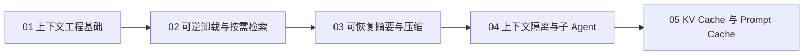

# Agent 上下文管理专题

!!! quote "来源与改写说明"
    本专题基于知乎作者 **魔法学院的Chilia** 的文章《[万字长文解析Agent框架中的上下文管理策略](https://zhuanlan.zhihu.com/p/2012088406826562496)》整理与扩展。原文版权归作者所有；本专题不转载或复刻原文，而是按个人学习笔记的目标重新组织概念，补充实现边界、决策规则和工程评测方法。

上下文管理不是简单的“删历史”或“加摘要”。它研究的是：一个长程 Agent 在有限窗口、有限延迟和有限成本下，如何维护一个支持下一步正确行动的工作集。



## 学习目标

学习完本专题，应该能回答：

```text
Context Window、活跃工作集、Memory 和 Cache 分别是什么？
一段长日志应该直接塞进 Prompt、写入文件、做摘要，还是丢弃？
RAG 与 Just-in-Time Retrieval 分别适合什么环境？
摘要为什么必须可恢复？应保留哪些字段？
多 Agent 为什么能减少主上下文负担，又会引入哪些成本？
KV Cache、Prompt Cache 与 Agent Memory 为什么不是同一个东西？
如何同时评测任务质量、token 成本、TTFT、缓存命中与恢复能力？
```

## 章节导航

| 章节 | 核心主题 | 学完后应能做到 |
| --- | --- | --- |
| [01. 上下文工程基础](01-context-engineering.md) | 工作集、信息分层、上下文预算 | 解释 Agent 为什么不能把所有历史都放进 Prompt |
| [02. 可逆卸载与按需检索](02-offload-retrieval.md) | Artifact、文件系统、JIT Retrieval、RAG 边界 | 为日志、代码、网页与数据库设计可恢复检索路径 |
| [03. 可恢复摘要与压缩](03-summarization-compaction.md) | 摘要 schema、compaction、handoff | 设计不会让 Agent 失忆的压缩流程 |
| [04. 上下文隔离与子 Agent](04-context-isolation.md) | 委派、并行、链式任务、交付契约 | 让子 Agent 隔离高 token 探索而不淹没主 Agent |
| [05. KV Cache 与 Prompt Cache](05-context-caching.md) | Prefill、Decode、KV Cache、稳定前缀 | 区分缓存与记忆，并设计缓存友好的 Prompt 布局 |

## 总体模型：上下文是受预算约束的决策输入

在时间步 \(t\)，Agent 可访问的全部信息记作 \(\mathcal I_t\)：

```text
用户目标
历史消息
工具输出
代码文件
网页内容
外部 Memory
子 Agent 报告
运行环境状态
```

但真正进入本轮模型的只是其中一个子集 \(C_t\)：

\[
C_t^*=\arg\max_{C\subseteq \mathcal I_t}
\mathbb E\bigl[U(a_t)\mid C\bigr]
-\lambda\cdot \operatorname{Cost}(C)
-\mu\cdot \operatorname{Risk}(C)
\]

可以把这个式子理解成：

| 项 | 含义 |
| --- | --- |
| \(U(a_t)\) | 当前上下文对下一步行动质量的帮助 |
| \(\operatorname{Cost}(C)\) | token、Prefill、TTFT、费用、工具调用成本 |
| \(\operatorname{Risk}(C)\) | 漏掉事实、噪声干扰、过期状态、权限泄露的风险 |

因此，目标不是最大化 token 数，而是最大化：

> **单位上下文预算带来的有效决策信息。**

## 四层信息架构


| 层级 | 典型内容 | 生命周期 | 是否默认放入 Prompt |
| --- | --- | --- | ---: |
| 稳定前缀 | System Prompt、工具 schema、项目规则 | 长 | 是 |
| 活跃工作集 | 当前目标、最近 Observation、待办与状态 | 短 | 是 |
| 可检索工件 | 长日志、文件、网页、完整工具结果 | 中到长 | 否，按需读取 |
| 长期知识 | 用户偏好、经验、Skill、Memory | 长 | 否，条件注入 |

这四层不是不同的数据库产品，而是不同的信息处理策略。

## 推荐学习顺序

```text
先读 01：知道“为什么不能全塞 Prompt”
→ 读 02：理解信息怎样不丢失地离开 Prompt
→ 读 03：理解不得不压缩时怎样保留恢复能力
→ 读 04：理解复杂任务怎样通过委派隔离上下文
→ 读 05：理解同样的上下文如何更快、更便宜地处理
```

## 与其他专题的连接

| 相关主题 | 与上下文管理的关系 |
| --- | --- |
| [Transformer 推理](../transformer/04-decoder-inference.md) | Prefill、Decode、KV Cache 的底层机制 |
| [RAG 与 Agent](../rag-agents.md) | RAG 是“外部信息如何被召回”的一种方案 |
| [UMEM](../../paper-notes/agent-self-evolution/memory/umem.md) | 长期 Memory 如何形成与更新，不等于本轮上下文如何组装 |
| [RRSI](../../paper-notes/agent-self-evolution/rsi/rrsi.md) | Agent Harness 中的 Prompt、Memory 和上下文策略也可被演化 |

## 参考资料

1. 魔法学院的Chilia，《[万字长文解析Agent框架中的上下文管理策略](https://zhuanlan.zhihu.com/p/2012088406826562496)》。本专题的初始材料来源，版权归原作者。
2. Manus, [Context Engineering for AI Agents: Lessons from Building Manus](https://www.manus.im/blog/Context-Engineering-for-AI-Agents-Lessons-from-Building-Manus)。
3. Anthropic, [Prompt Caching](https://platform.claude.com/docs/en/build-with-claude/prompt-caching)。
4. OpenAI, [Context Engineering - Short-Term Memory Management with Sessions](https://developers.openai.com/cookbook/examples/agents_sdk/session_memory)。
5. Anthropic, [How and when to use subagents in Claude Code](https://claude.com/blog/subagents-in-claude-code)。
