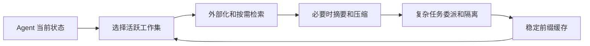
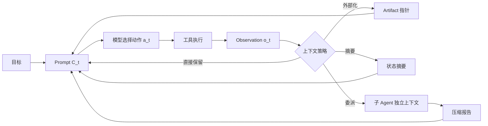
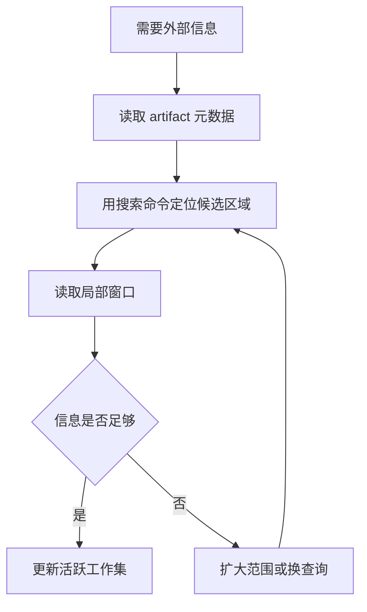
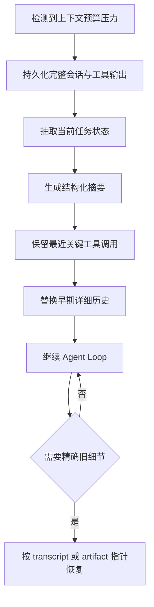
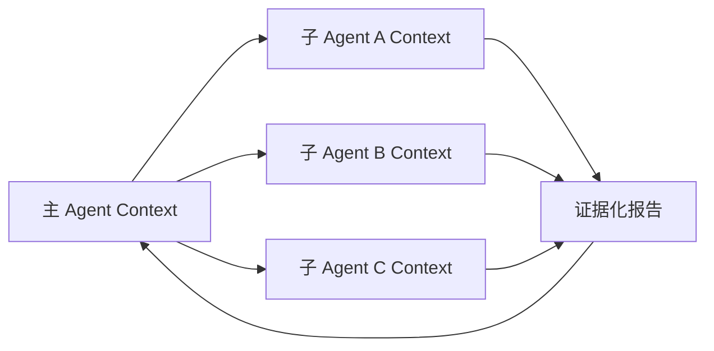
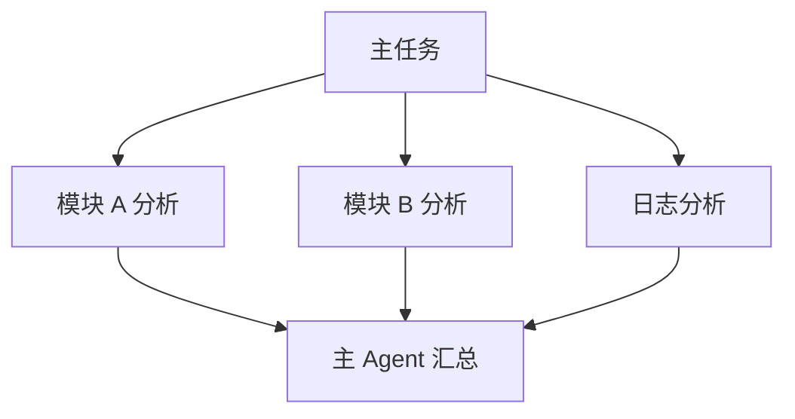
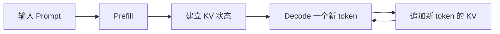
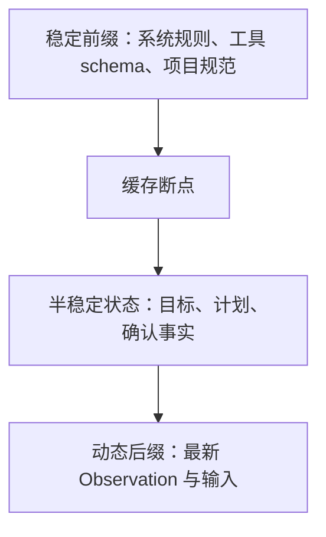
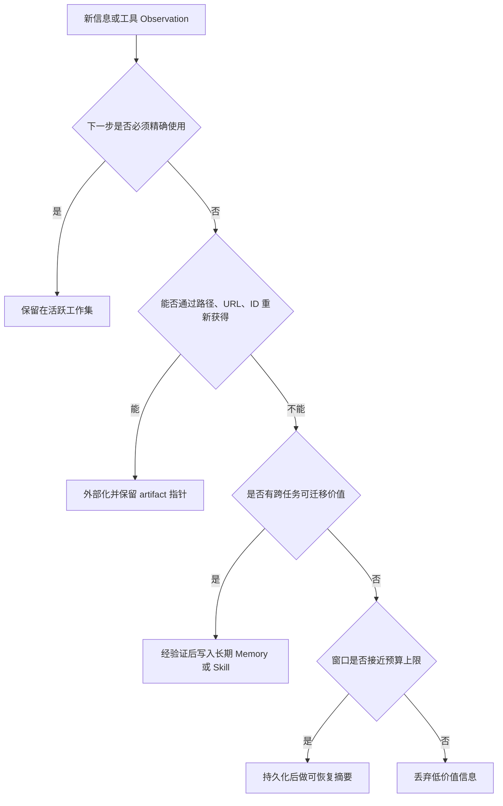

# Agent 上下文管理：从工作集选择到缓存布局

!!! quote "来源与改写说明"
    本笔记基于知乎作者 **魔法学院的Chilia** 的文章《[万字长文解析Agent框架中的上下文管理策略](https://zhuanlan.zhihu.com/p/2012088406826562496)》整理与扩展。原文版权归作者所有；本文不转载或复刻原文，而是按个人学习笔记的目标重新组织概念，补充实现边界、决策规则和工程评测方法。

这是一篇完整笔记。它从长程 Agent 的上下文预算问题出发，依次解释四种核心策略：

```text
可逆卸载与按需检索
可恢复摘要与 Compaction
上下文隔离与子 Agent
KV Cache 与 Prompt Cache
```

建议按顺序阅读：前两部分解决“信息怎样离开 Prompt 但不丢失”，第三部分解决“复杂探索怎样不污染主上下文”，最后一部分解决“已经选定的信息怎样少算”。


## 一、上下文工程：工作集、预算与信息分层

### 1. 从 Prompt Engineering 到 Context Engineering

Prompt Engineering 常处理一个相对静态的问题：

```text
给模型一段指令
→ 希望它输出更符合要求的答案
```

Agent 的情况不同。它会在多轮执行中不断接收新 Observation：

```text
用户目标
→ 模型选择工具
→ 工具执行
→ 返回文件、网页、日志或错误
→ 新信息影响下一步工具选择
→ 重复数十甚至数百轮
```

因此 Context Engineering 关心的不是一句 Prompt 写得够不够漂亮，而是：

> 在每一个时间步，怎样从不断增长的信息池中挑出最值得让模型看到的工作集？

### 2. 三个最容易混淆的概念

| 概念 | 问题 | 例子 |
| --- | --- | --- |
| Context Window | 模型最多能接收多少 token | 128K、200K 或更大输入上限 |
| Active Context | 当前轮真正传给模型的 token | System Prompt、目标、最近日志、当前状态 |
| External State | Agent 能访问但当前没放入 Prompt 的信息 | 文件、数据库、网页、完整 transcript、Memory |

一个模型支持长窗口，不表示它应该在每轮读完整项目、全部日志和所有历史消息。

```text
可容纳
≠
值得放入
```

### 3. Agent Loop 中上下文如何增长

设第 \(t\) 轮输入为 \(C_t\)，模型基于它选择动作 \(a_t\)：

\[
a_t\sim\pi_\theta(\cdot\mid C_t)
\]

工具或环境给出 Observation \(o_t\)，最朴素的更新是：

\[
C_{t+1}=C_t\oplus(a_t,o_t)
\]

其中 \(\oplus\) 表示直接追加。

这在前几轮没问题，但若每次 `Read`、`Bash`、网页抓取都带来很长输出，\(C_t\) 会快速膨胀。更危险的是：Agent 无法提前知道一段看似普通的日志，会不会在十轮之后成为定位 bug 的关键证据。



### 4. 为什么“上下文越长越好”是错误直觉

长上下文至少带来四种成本。

#### 4.1 计算成本

输入越长，Prefill 需要处理的 token 越多。即使使用了高效 Attention 内核，长输入仍会增加：

```text
首字延迟 TTFT
输入 token 费用
显存或 KV 状态占用
批处理调度压力
```

#### 4.2 注意力竞争

模型不具有人类式“自动忽略无关历史”的确定机制。大量旧日志、失败尝试、过时计划和重复结果会与当前关键状态竞争注意力。

不要把这种现象简单解释为“模型记忆力差”。更准确的说法是：

```text
当前决策信号密度下降
→ 模型更难定位真正影响下一步的变量
```

#### 4.3 状态冲突

长会话里可能同时存在：

```text
旧计划：修改 middleware 顺序
新发现：问题其实在 token refresh
旧工具输出：已经失效的测试结果
新工具输出：当前分支的真实状态
```

如果没有显式状态管理，模型可能复活旧计划、重复已撤销修改或依据过期 Observation 行动。

#### 4.4 工具输出污染

工具结果不像自然语言对话那样天然精炼。一个命令可能返回：

```text
10,000 行 build log
压缩过的 JSON
二进制转储
完整网页 DOM
依赖树
```

这些内容即使与最终答案没有直接关系，也可能占据大部分上下文预算。

### 5. 上下文工程的目标函数

将所有可用信息记为 \(\mathcal I_t\)，当前可选上下文为 \(C\subseteq\mathcal I_t\)。一个概念性目标是：

\[
C_t^*=\arg\max_{C\subseteq\mathcal I_t}
\mathbb E[U(a_t)\mid C]
-\lambda\cdot \operatorname{Cost}(C)
-\mu\cdot \operatorname{Risk}(C)
\]

这不是一个可直接求解的真实优化程序，而是一套设计语言。

| 项 | 问题 |
| --- | --- |
| \(U(a_t)\) | 这段信息会不会让下一步动作更正确？ |
| `Cost` | 它要消耗多少 token、Prefill、延迟和费用？ |
| `Risk` | 不保留会不会丢证据？保留会不会制造噪声或泄露权限？ |

因此，好的上下文管理不追求：

```text
最短上下文
```

也不追求：

```text
最全上下文
```

而是追求：

```text
当前决策所需的最小高信号工作集
```

### 6. 四层信息模型

在工程中，可以把信息按“是否应立即进入 Prompt”和“是否可恢复”分类。

| 层级 | 内容 | 为什么存在 |
| --- | --- | --- |
| 稳定前缀 | 系统规则、工具 schema、项目规范 | 每轮都需要，且应利于缓存复用 |
| 活跃工作集 | 当前目标、最近状态、待办、关键 Observation | 直接决定下一步行动 |
| 可检索工件 | 完整日志、文件、网页、数据库结果 | 信息不能丢，但没有必要每轮都读 |
| 长期知识 | 用户偏好、项目经验、Skill、跨任务记忆 | 只在相关时注入 |

这四层的关系不是简单按时间排序。

例如一条三天前的错误日志，如果当前正在修同一故障，可能应回到活跃工作集；一条刚刚生成、但只含无关安装进度的日志，可能应直接外部化甚至丢弃。

### 7. 上下文选择的五个判断维度

面对新信息 \(x\)，可以逐项判断：

| 维度 | 要问的问题 |
| --- | --- |
| 直接性 | 下一步是否必须精确引用它？ |
| 可恢复性 | 能否通过文件、URL、ID 或工具重新获得？ |
| 持久价值 | 它是否对未来任务也有可迁移价值？ |
| 时效性 | 当前状态变化后，它是否已经过期？ |
| 风险 | 是否包含秘密、无可信来源内容、Prompt Injection 或不应跨任务共享的数据？ |

根据结果选择：

```text
直接保留
→ 外部化并保留指针
→ 生成可恢复摘要
→ 写入长期 Memory
→ 委派给子 Agent
→ 丢弃
```

### 8. 一个代码 Agent 的具体例子

任务：

```text
修复支付服务的 token refresh 失败。
```

Agent 先执行：

```text
rg -n "refresh|token|session" src tests
pytest tests/auth -q
```

得到的信息可能有：

| 信息 | 处理策略 | 原因 |
| --- | --- | --- |
| 当前失败栈的 20 行关键异常 | 放入活跃工作集 | 下一步要定位问题 |
| 2 MB 完整测试日志 | 保存到 artifact | 需要时可回溯，但不应塞进 Prompt |
| `refresh.ts` 的相关 150 行 | 当前读取并保留 | 正在修改该文件 |
| 已证实的项目规范“session 写回必须经 repository” | 长期项目状态 | 后续修改都要遵守 |
| 一小时前被撤销的 middleware 方案 | 摘要保留失败原因 | 防止重复尝试 |

这就是 Context Engineering 的实际形态：不是一项单独模型能力，而是 Agent Harness 的信息生命周期设计。

### 9. 评测什么

不要只比较最终任务成功率。一个“把上下文删短”的方案可能更快，但也可能只是删掉难题证据。

| 维度 | 指标 |
| --- | --- |
| 质量 | Success Rate、Pass@k、任务得分 |
| 预算 | 平均输入 token、最大上下文长度 |
| 延迟 | TTFT、端到端耗时 |
| 成本 | 输入、缓存输入、输出、工具调用费用 |
| 恢复性 | 被压缩后找回关键证据的成功率 |
| 稳定性 | 长程任务后期表现、重复行动率、循环率 |
| 安全 | 敏感信息跨任务泄露率、污染上下文被执行的比例 |

### 10. 高频问题

#### Q1：上下文管理和 Agent Memory 是同一个问题吗？

**回答：**不是。上下文管理决定本轮 Prompt 的工作集；Memory 决定哪些信息跨轮、跨任务保存。Memory 只有被筛选为当前相关时，才会进入上下文。

#### Q2：是否应把所有工具输出保存在对话历史中？

**回答：**不应。关键局部输出保留在活跃工作集，完整原始内容应外部化并保留可恢复指针。否则长期 Agent 会迅速被工具输出淹没。

#### Q3：长窗口是否能取代上下文工程？

**回答：**不能。长窗口缓解容量上限，但不能自动解决噪声、过期状态、成本、缓存失效和权限隔离问题。

### 11. 本章结论

> 上下文不是被动累积的聊天记录，而是 Agent 为下一步决策维护的受预算约束工作集。

后续四章分别讨论：信息如何可逆外部化、不得不丢失细节时如何可恢复压缩、复杂任务如何隔离上下文，以及已经选择的上下文如何通过缓存更高效地计算。

## 二、可逆卸载与按需检索

### 1. 为什么“截断”是最危险的默认策略

长工具输出最常见的处理方式是：

```text
只保留前 2,000 token
```

它省 token，但本质上是不可逆删除。

假设 Agent 执行测试得到 20,000 行日志：

```text
前 500 行：大量 warning
中间：依赖下载信息
末尾：AssertionError: refresh token was not persisted
```

若只保留开头，下一步模型会看到一堆 warning，却失去真正的失败原因。更糟的是，Agent 当下无法预知哪一行会在后续十轮中成为关键证据。

因此上下文卸载的基本原则是：

> 长内容可以离开 Prompt，但原始内容应留在可定位、可验证、可重新读取的外部位置。

### 2. Compaction 与 Truncation 的区别

| 操作 | 原始内容是否保留 | 是否可恢复 | 适用性 |
| --- | ---: | ---: | --- |
| Truncation | 否 | 否 | 极低价值、可完全丢弃的输出 |
| Compaction / Offload | 是 | 是 | 日志、网页、文件、工具结果 |
| Summarization | 通常需另存原文 | 条件可恢复 | 长会话、复杂状态交接 |
| Memory extraction | 只保留可迁移经验 | 不等于恢复原文 | 跨任务长期知识 |

很多系统将“压缩”统称为 compaction，但工程上最好进一步区分：

```text
Offload：完整内容移到外部，Prompt 留引用
Summary：将内容有损压缩为状态描述
Truncate：直接删除
```

### 3. 文件系统为什么适合做 Agent 的外部工作记忆

文件系统具备几个关键性质：

| 特性 | 对 Agent 的意义 |
| --- | --- |
| 大容量 | 不受上下文窗口限制 |
| 持久化 | 不会因一次 compaction 消失 |
| 随机访问 | 可通过路径、offset、行号局部读取 |
| 原始性 | 可保存完整日志、代码、JSON、网页快照 |
| 工具可操作 | `rg`、`grep`、`jq`、`head`、`tail`、SQL 等可渐进探索 |

Manus 将文件系统视为外部上下文的一种核心载体：网页可以由 URL 代表，文档可以由路径代表，完整内容需要时再重新加载。详见 Manus 的 [Context Engineering for AI Agents](https://www.manus.im/blog/Context-Engineering-for-AI-Agents-Lessons-from-Building-Manus)。

#### 3.1 一个 Artifact Reference 的最小 schema

```json
{
  "artifact_id": "pytest-auth-017",
  "kind": "test-log",
  "uri": "file:///tmp/pytest-auth-017.log",
  "created_at": "2026-10-22T10:40:00+08:00",
  "producer": "pytest tests/auth -q",
  "content_hint": "3 failures, likely refresh token persistence",
  "retrieval_hints": [
    "rg -n \"AssertionError|refresh token\" /tmp/pytest-auth-017.log",
    "tail -n 160 /tmp/pytest-auth-017.log"
  ],
  "integrity": "sha256:...",
  "access_scope": "project"
}
```

这段结构化信息可以直接进入上下文，而 4 MB 日志不必进入。

### 4. 渐进式读取，而不是一次性重新加载

外部化不意味着每次需要信息时重新读整个文件。更合理的是分层读取：



例如定位一次测试失败：

```bash
rg -n "AssertionError|refresh token|persist" /tmp/pytest-auth-017.log
sed -n '418,470p' /tmp/pytest-auth-017.log
```

而不是：

```bash
cat /tmp/pytest-auth-017.log
```

前者将模型本身变成检索策略的制定者：先提出假设，再根据局部结果调整查询。

### 5. JIT Retrieval：推理过程中生成检索动作

Just-in-Time Retrieval 的流程是：

```text
当前任务状态
→ 模型判断缺少什么信息
→ 模型生成检索命令
→ 工具返回局部证据
→ 模型决定下一步检索或行动
```

例如排查一个代码 bug：

```text
1. rg 搜函数定义
2. rg 搜函数调用位置
3. Read 相关函数附近 120 行
4. 执行最小复现测试
5. 根据失败栈回到某个调用点
```

这个过程类似人类工程师查代码：我们不需要事先把整个仓库记住，但需要知道如何查、先查什么、何时扩大范围。

### 6. JIT Retrieval 与 RAG 不应对立

| 场景 | 首选策略 | 原因 |
| --- | --- | --- |
| 版本稳定的知识库、政策文档、FAQ | RAG | 语义召回快，用户问题通常直接对应文段 |
| 代码仓库、Git 状态、构建日志 | JIT Retrieval | 内容动态、精确路径和局部依赖很重要 |
| PDF、扫描件、多模态档案 | 混合 | 先索引/抽取，再由 Agent 按需打开原件 |
| 数据库与表格 | SQL / schema-aware tool | 结构化查询比 chunk 召回更可靠 |
| 长对话历史 | 摘要 + transcript 检索 | 既要传递状态，也要能找回精确细节 |

RAG 的典型风险包括：

```text
chunk 边界不符合任务语义
embedding 对代码符号、行号、版本差异不敏感
索引未更新，召回了旧状态
Top-K 中混入大量表面相似但无关内容
```

JIT Retrieval 的典型风险包括：

```text
模型不会写有效查询
工具权限不足
多轮搜索导致额外延迟
错误的早期假设让搜索空间不断偏离
```

因此实践中通常是混合系统：RAG 提供候选入口，Agent 用工具打开原始工件做精确确认。

### 7. 何时写入长期 Memory，而不是只外部化

外部 Artifact 保存的是“事实原件”；Memory 保存的是“未来可复用的压缩经验”。

例如：

```text
原始日志：/tmp/pytest-auth-017.log
```

应外部化。

而下面这条可以考虑写入项目 Memory：

```text
本项目中 refresh token 更新后必须通过 SessionRepository.save() 持久化；
只更新内存对象会导致下一轮请求继续使用旧 token。
```

写入长期 Memory 前，至少检查：

| 检查 | 问题 |
| --- | --- |
| 正确性 | 是否已经通过测试或证据确认？ |
| 泛化性 | 是一次性细节，还是可复用规则？ |
| 时效性 | 会不会随分支、版本或环境变化失效？ |
| 来源 | 能否追溯到文件、日志或 commit？ |
| 权限 | 能否跨用户、跨项目保存和召回？ |

### 8. 实现骨架

下面是一个概念性伪代码：

```python
def handle_tool_result(result, task_state):
    if result.token_count <= task_state.inline_budget:
        return ActiveContext.add(result)

    artifact = persist(result)
    pointer = summarize_pointer(
        artifact=artifact,
        hint=extract_high_signal_hint(result),
        retrieval_hints=build_retrieval_hints(result),
    )
    return ActiveContext.add(pointer)


def retrieve_artifact(pointer, question):
    query = plan_local_query(pointer, question)
    excerpt = run_tool(query)
    return excerpt
```

真正系统中还需要：

```text
artifact 生命周期清理
内容哈希与版本
敏感数据脱敏
路径权限与租户隔离
搜索失败回退策略
是否应把局部证据升级到 Memory 的判断
```

### 9. 失败模式

#### 9.1 只有路径，没有检索提示

```text
结果已保存：/tmp/log.txt
```

这对模型帮助有限。它仍不知道文件中有什么、该从何查起。

#### 9.2 摘要声称结论，但没有原始工件

```text
认证模块有 bug。
```

没有日志、文件和行号，后续无法验证或恢复。

#### 9.3 将所有内容都写入长期 Memory

这会把一次性的日志、临时路径、错误猜测长期化，造成检索污染。

#### 9.4 只依赖向量检索处理精确代码问题

对于函数签名、行号、版本差异、异常文本，符号搜索与工具访问通常更可靠。

### 10. 高频问题

#### Q1：文件系统是否一定比向量库好？

**回答：**不是。文件系统适合保存原始可验证工件，JIT 工具检索适合动态、结构化、精确定位的问题。向量库适合海量静态文档的语义召回。实践中通常组合使用。

#### Q2：外部化后，模型怎么知道何时要去读文件？

**回答：**指针必须携带内容提示、来源和检索建议；模型根据当前任务状态决定是否需要补证据。若只保留路径，不提供语义线索，外部化会变成不可用的遗忘。

#### Q3：是不是所有长工具输出都应保存？

**回答：**不一定。应根据可恢复价值、调试价值、权限、存储成本和是否可能复用判断。无关进度条、重复安装信息可以直接丢弃。

### 11. 本章结论

> 可逆卸载的目标不是减少信息，而是将“完整证据”从昂贵的 Prompt 工作集迁移到可定位的外部工件，并让 Agent 能按需、渐进地重新读取它。

下一章讨论：当外部化仍不足以控制上下文时，怎样使用有损摘要，同时不让 Agent 因压缩而失去任务状态。

## 三、可恢复摘要与 Compaction

### 1. 摘要为什么是最后手段

摘要会把：

```text
精确代码
完整工具输出
原始错误栈
消息顺序
细粒度决策理由
```

压缩成自然语言状态描述。

它能释放窗口，但代价是细节丢失。因此应优先顺序是：

```text
先外部化可恢复工件
→ 再缩小活跃工作集
→ 确实接近窗口上限时才摘要
```

摘要不是“更聪明的截断”，而是有损压缩。若没有原始 transcript 或 artifact 作为后备，它会让 Agent 永久失忆。

### 2. Compaction 的正确流程



关键点：**摘要之前先持久化，摘要之后仍可检索。**

### 3. 什么是“可继续执行”的摘要

对 Agent 而言，摘要不是会议纪要，而是下一轮的执行状态机快照。

一个建议 schema：

```yaml
goal:
  user_intent: "修复 refresh token 在重启后失效的问题"
  success_criteria:
    - "auth e2e tests pass"
    - "token 重启后仍可读取"
constraints:
  - "不得修改公开 API"
confirmed_facts:
  - fact: "refresh.ts 未调用 SessionRepository.save"
    evidence: "artifact://pytest-auth-017#L418-L466"
current_state:
  branch: "fix/token-refresh"
  modified_files:
    - "src/auth/refresh.ts"
failed_attempts:
  - action: "调整 middleware 顺序"
    outcome: "登录 e2e 回归，已撤销"
pending_tasks:
  - "检查 saveSession 的调用位置"
  - "运行 auth e2e 子集"
artifacts:
  - "artifact://pytest-auth-017"
  - "artifact://session-transcript-42"
next_action_hint: "先读取 refresh.ts 的 60-130 行"
```

这比一段散文式摘要更适合 Agent，因为它明确区分：

```text
什么已确认
什么只是尝试过
什么尚未完成
精确细节在哪里恢复
```

### 4. 为什么要保留最近行动

即使有结构化摘要，也建议保留最近几次完整工具调用和结果。

原因是当前执行具有局部连续性：

```text
刚修改了什么文件？
刚执行的命令是什么？
当前错误是修改前还是修改后产生的？
工具输出中的路径、变量名和行号是什么？
```

一个常见布局是：

```text
[稳定前缀]
项目规则、工具 schema

[compaction summary]
结构化长期状态

[recent window]
最后 N 次行动、工具结果和用户消息
```

其中 `N` 不应是固定魔法数字，而应按 token 预算、任务类型和工具输出长度动态控制。

### 5. 自动触发与手动触发

压缩通常有两种触发方式：

| 类型 | 触发条件 | 优点 | 风险 |
| --- | --- | --- | --- |
| 自动 compaction | 接近上下文阈值 | 不依赖用户、避免硬截断 | 可能在不合适时机丢失局部连续性 |
| 手动 compaction | 用户或 Agent 显式决定 | 可在阶段边界整理状态 | 依赖系统会主动判断 |

好的自动策略不应只看 token 数，还应考虑：

```text
当前是否正在执行不可中断的局部调试？
是否已经有完整 artifact backup？
最近是否出现关键失败或用户约束？
是否刚完成一个自然任务阶段？
```

### 6. Handoff 与 Compaction 的区别

| 方式 | 是否同一会话连续 | 主要产物 | 适合场景 |
| --- | ---: | --- | --- |
| Compaction | 是 | 压缩摘要 + 最近上下文 | 常规长对话、逐步开发 |
| Handoff | 否或近似否 | 交接文档 / 状态包 | 超长任务、跨班次、跨 Agent、上下文已严重污染 |

Handoff 可以把 Agent 放进一个更干净的上下文窗口：

```text
旧会话：保留完整记录与产物
→ 生成 handoff artifact
→ 新会话：只加载项目规则、handoff、必要 artifact 指针
```

优点是减少历史噪声；缺点是新会话缺少隐含语气、局部直觉和未写入 handoff 的细节。

### 7. 摘要失败的四种模式

#### 7.1 只写结论，不写证据

```text
认证模块实现错误。
```

问题：后续 Agent 无法确认是哪一段、是否已修复、是否只是猜测。

#### 7.2 把猜测写成事实

```text
根因是 Redis 缓存失效。
```

如果这只是尚未验证的假设，后续 Agent 会把它当作锚点，忽略其它可能性。

应该写成：

```text
假设：Redis TTL 与现象一致，尚未验证；
下一步：检查 SessionRepository 的 setex 调用。
```

#### 7.3 忘记记录失败尝试

若摘要只保存成功路径，Agent 容易再次执行已验证失败的操作。

#### 7.4 只留摘要，不留原始历史

这是最危险的情况。出现精确代码、命令、路径或行号需求时，系统无法恢复，只能让模型猜。

### 8. 摘要质量如何评测

可以构造“恢复任务”而非只用人工主观评价：

| 测试 | 问题 |
| --- | --- |
| Fact recovery | 摘要后能否找回此前已确认的关键事实？ |
| State continuation | 新 Agent 能否从摘要继续完成未完成任务？ |
| Failure avoidance | 是否会重复执行已知失败尝试？ |
| Artifact retrieval | 是否能根据摘要指针读回精确日志/代码？ |
| Hallucination rate | 摘要是否引入原历史不存在的事实？ |

一个合格摘要不是“读起来顺”，而是让新一轮 Agent 能正确恢复任务状态。

### 9. 简化实现骨架

```python
def compact(session):
    backup = persist_full_transcript(session)
    state = extract_state(session)
    summary = summarize(
        goal=state.goal,
        facts=state.confirmed_facts,
        attempts=state.failed_attempts,
        pending=state.pending_tasks,
        artifacts=[backup, *state.artifacts],
    )
    recent = select_recent_critical_events(session.events)
    return build_new_context(summary=summary, recent=recent)
```

真实系统中还需要验证：

```text
backup 是否写入成功
摘要中的 artifact 指针是否可访问
敏感数据是否被正确脱敏和隔离
摘要前后的任务状态是否一致
```

### 10. 高频问题

#### Q1：摘要应该每轮都做吗？

**回答：**不应该。频繁摘要会不断损失细节、增加模型调用和状态漂移。应在上下文压力较高、任务阶段自然结束或准备交接时进行。

#### Q2：摘要与长期 Memory 有什么不同？

**回答：**摘要保存当前会话的执行状态，通常服务于继续当前任务；长期 Memory 保存跨任务可复用经验。一个会话摘要不应因为内容多就自动进入长期 Memory。

#### Q3：能否让模型直接“记住”之前的聊天？

**回答：**模型本身不会跨独立 API 请求永久记住历史。系统必须显式传入上下文、摘要、Memory 或外部工件引用。

### 11. 本章结论

> 摘要的正确目标不是最大程度缩短历史，而是在丢失细节后仍能通过清晰状态字段和可恢复工件，继续完成同一个任务。

下一章讨论如何让大量探索不进入主上下文：通过子 Agent 隔离工作区，并以证据化报告而非完整轨迹回传结果。

## 四、上下文隔离与子 Agent

### 1. 子 Agent 的核心价值不是“多一个模型”

复杂任务常被理解为：

```text
主 Agent 不够聪明
→ 多开几个 Agent
→ 并行做事
```

但从上下文管理角度，更重要的价值是：

> 将高 token、局部且探索性强的推理过程隔离在独立工作区，避免主 Agent 的上下文被细节淹没。

例如主任务是：

```text
修复支付系统的 token refresh 问题，并补充回归测试。
```

主 Agent 可以委派：

```text
子 Agent A：定位 token refresh 调用链
子 Agent B：分析测试失败日志
子 Agent C：检查 SessionRepository 的持久化语义
```

每个子 Agent 都可能读取几十个文件、执行多次搜索和测试，但主 Agent 最终只需得到少量可验证的结论。

### 2. 主 Agent 与子 Agent 的上下文边界



理想状态下，主 Agent 不接收：

```text
全部搜索命令
每一段文件正文
完整思考过程
所有失败尝试的原始日志
```

而接收：

```text
结论
证据位置
置信度与未确认点
生成或修改的 artifact
建议下一步
```

这是“上下文隔离”而不是“把工作丢给别人”。

### 3. 子 Agent 返回结果的交付契约

一个有用的 Subagent Result 应当是结构化的：

```yaml
task:
  objective: "定位 refresh token 未持久化的调用链"
status: completed
findings:
  - claim: "refresh.ts 只更新内存对象，没有调用 SessionRepository.save"
    confidence: high
    evidence:
      - "src/auth/refresh.ts#L74-L103"
      - "tests/auth/refresh.test.ts#L51-L87"
artifacts:
  - "artifact://subagent-a-search-log"
open_questions:
  - "save() 是否会触发额外审计事件，需要检查 repository 实现"
recommended_next_action:
  - "读取 src/session/repository.ts 的 90-150 行"
```

这比返回：

```text
我看了一下，可能是 refresh.ts 的问题。
```

强得多，因为主 Agent 可以验证、引用和继续执行。

### 4. 并行委派与链式委派

#### 4.1 并行委派

适合子任务几乎独立：



使用条件：

```text
子任务没有严格先后依赖
每个任务可以独立验证
结果汇总时不会产生大规模冲突
并行成本低于等待成本
```

例子：

```text
同时分析三个服务模块
同时比较三种实现方案
同时审查安全、性能和测试覆盖
```

#### 4.2 链式委派

适合下游任务必须使用上游产物：


例子：

```text
先定位性能瓶颈
→ 再设计优化 patch
→ 最后验证 benchmark 与回归测试
```

链式委派的风险是上游错误会传递。因此上游报告必须提供证据，而不是只给结论。

### 5. 为什么不允许无限嵌套子 Agent

若子 Agent 可以无限生成子 Agent：

```text
主 Agent
→ 子 Agent
→ 孙 Agent
→ 曾孙 Agent
→ ...
```

会引入：

| 风险 | 后果 |
| --- | --- |
| 预算失控 | token、工具调用、并发数不可预测 |
| 责任不清 | 无法回答“哪个 Agent 做了这个修改” |
| 上下文碎片化 | 关键事实分散在多个不可见分支 |
| 重复探索 | 多个分支做相同搜索 |
| 安全扩大 | 每一层都可能获得工具或文件权限 |

更稳健的设计通常是：

```text
主 Agent 可创建有限层级的子 Agent
子 Agent 默认不能继续创建子 Agent
或必须由主 Agent 显式批准递归委派
```

这也是许多 coding-agent 系统采用浅层委派结构的原因。

### 6. Claude Code 风格的上下文隔离

Claude Code 的公开设计中，Subagent 可以在独立上下文内执行文件读取、探索或修改任务，再向主任务返回结果。其价值不只是并发，而是让主上下文不必容纳所有探索过程。参见 Anthropic 的 [How and when to use subagents in Claude Code](https://claude.com/blog/subagents-in-claude-code)。

一个合理的主 Agent 责任边界：

| 主 Agent 保留 | 子 Agent 处理 |
| --- | --- |
| 用户最终目标 | 局部探索问题 |
| 任务分解 | 大量文件与日志读取 |
| 全局预算 | 独立实验或查询 |
| 跨模块冲突处理 | 证据收集与局部报告 |
| 最终修改与验收 | 可选的局部 patch |

主 Agent 的上下文应保存“任务图”，不是保存“每个子任务的全过程”。

### 7. Context Isolation 不等于 Memory Isolation

这是一个常见混淆。

```text
Context Isolation：
让不同任务拥有独立的短期工作上下文。

Memory Isolation：
限制长期记忆是否可以跨用户、跨项目、跨权限域共享。
```

例如一个子 Agent 可以读项目 A 的机密配置。即使它只把简短结论返回主 Agent，也不代表这条结论可以写入跨项目可检索的长期 Memory。

工程上应为每条返回结果标记：

```text
来源任务
项目/租户范围
权限级别
保留期限
是否允许升级为长期 Memory
```

### 8. 多 Agent 的成本模型

多 Agent 并不免费。设：

\[
T_{\operatorname{total}}
=\max_i T_i+T_{\operatorname{merge}}
\]

并行时总等待时间由最慢子任务加上汇总时间决定；成本则近似为：

\[
\operatorname{Cost}_{\operatorname{total}}
=\sum_i\operatorname{Cost}_i+\operatorname{Cost}_{\operatorname{merge}}
\]

因此委派应满足：

```text
子任务的独立价值
>
启动、协调、汇总和重复探索的额外成本
```

小任务、单文件修改、精确已有信息查询，通常不值得启动 Subagent。

### 9. 失败模式

#### 9.1 主 Agent 接收完整子 Agent transcript

这会把隔离重新变成污染。应该返回 artifact 指针和压缩报告。

#### 9.2 子 Agent 只给结论，没有证据

主 Agent 无法判断其正确性，只能盲目信任一个新的语言模型输出。

#### 9.3 并行任务重复

若三个子 Agent 都去搜索 `auth`，不仅浪费成本，还会制造互相冲突的报告。主 Agent 应分配互斥的子目标。

#### 9.4 子 Agent 直接做高风险修改

对于删除、迁移、权限变更、生产部署等操作，子 Agent 最好只给计划和 patch 建议，由主 Agent 或用户进行最终验收。

### 10. 高频问题

#### Q1：什么时候值得创建子 Agent？

**回答：**当子任务有明确边界、独立探索量大、结果可用短报告交付，并且并行或隔离带来的收益超过额外调用成本时。

#### Q2：子 Agent 的结果是否应该直接加入主 Prompt？

**回答：**应该加入经过压缩和结构化后的报告，不应直接加入完整 transcript。报告必须包含结论、证据、未确认点与 artifact 指针。

#### Q3：多 Agent 能否替代上下文管理？

**回答：**不能。子 Agent 本身也会产生长上下文和工具输出；它只是把问题拆到多个局部工作区。每个子 Agent 仍需要外部化、摘要和缓存策略。

### 11. 本章结论

> 子 Agent 的上下文隔离价值，不在于让多个模型同时“思考”，而在于将局部高 token 探索封装成可验证、可引用、低 token 的交付物，让主 Agent 保持对全局目标的清晰控制。

下一章讨论另一个层面：当上下文已经选对后，怎样通过 KV Cache 和 Prompt Cache 避免反复计算相同前缀。

## 五、KV Cache 与 Prompt Cache

### 1. 为什么缓存属于上下文管理

上下文管理有两个层次：

| 层次 | 核心问题 | 方法 |
| --- | --- | --- |
| 信息层 | 什么信息值得进入当前 Prompt？ | 外部化、检索、摘要、委派、Memory |
| 计算层 | 已经确定要进入 Prompt 的内容怎样少算？ | KV Cache、Prompt Cache、Prefix Layout |

所以缓存不回答：

```text
这段日志是否相关？
这条 Memory 是否应该注入？
```

缓存只回答：

```text
这段前缀和上一次足够相同吗？
如果相同，能否复用已有计算？
```

因此：

> 上下文工程负责“选对信息”，缓存负责“少算重复信息”。

### 2. Prefill 与 Decode

假设输入 Prompt 是：

```text
The quick brown fox
```

生成下一个 token `jumps` 前，模型必须先处理整个输入序列，计算每个位置的隐藏状态以及后续 Attention 所需的信息。这个阶段称为 **Prefill**。

之后逐 token 生成：

```text
jumps → over → the → lazy → dog
```

每生成一个 token 的过程称为 **Decode**。



长 Agent 任务中，输入上下文常远长于模型每轮输出，因此 Prefill 往往主导：

```text
TTFT
输入 token 成本
多轮总延迟
```

### 3. KV Cache：一次生成内部的缓存

Self-Attention 中，当前位置需要读取历史 token 的 Key 和 Value。

设第 \(t\) 个 token 的表示为 \(x_t\)：

\[
k_t=x_tW_K,
\qquad
v_t=x_tW_V
\]

生成第 \(t+1\) 个 token 时，若重新计算前 \(t\) 个 token 的 \(K,V\)，会造成重复工作。KV Cache 保存历史的：

\[
K_{1:t},\quad V_{1:t}
\]

新 token 到来时，只需要计算：

\[
k_{t+1},\quad v_{t+1}
\]

然后追加到缓存。

```text
KV Cache 解决：
一次连续生成过程中，历史 token 不要重复算。
```

它通常是推理引擎的内部机制，应用开发者未必直接控制其内容布局。

### 4. Prompt Cache：多次请求之间的缓存

Agent 的问题不止是生成一段连续文本，而是反复发起 API 请求：

```text
第 1 轮：系统规则 + 工具定义 + 用户任务
→ 调工具

第 2 轮：系统规则 + 工具定义 + 用户任务 + Observation 1
→ 调工具

第 3 轮：系统规则 + 工具定义 + 用户任务 + Observation 1 + Observation 2
→ 调工具
```

前三部分每轮都相同。如果每次请求都重新 Prefill 整个前缀，长任务会非常慢。

Prompt Cache / Prefix Cache 的理想行为：

```text
第一次请求：
对稳定前缀执行 Prefill，并保存可复用状态

后续请求：
稳定前缀未变
→ 复用前缀状态
→ 只 Prefill 新追加的 Observation
```

| 概念 | 作用范围 | Agent 工程关注点 |
| --- | --- | --- |
| KV Cache | 一次 Decode 内 | 每生成一个 token 不重复处理历史 token |
| Prompt Cache | 多次 API 请求之间 | 稳定前缀避免重复 Prefill |
| Response Cache | 直接返回旧答案 | 只适合幂等、确定性请求 |
| Memory | 跨任务保存语义经验 | 相关时才进入 Prompt，不是计算缓存 |

### 5. 为什么 Agent 特别依赖 Prompt Cache

Agent Loop 常具有：

```text
输入上下文很长
每轮输出很短
工具调用轮数很多
```

以 Coding Agent 为例，每轮都可能重复发送：

```text
System Prompt
工具 JSON schema
CLAUDE.md / 项目约束
当前任务
历史状态
```

如果稳定部分可缓存，新增的通常只有：

```text
最新工具输出
最近 patch
当前错误
本轮用户消息
```

因此缓存命中对长程 Agent 的价值通常体现在：

```text
更低 TTFT
更低输入成本
更高吞吐
更长可承受任务长度
```

Anthropic 的 [Prompt Caching 文档](https://platform.claude.com/docs/en/build-with-claude/prompt-caching) 说明，可缓存前缀可以覆盖 `tools`、`system` 和 `messages` 中直到指定 `cache_control` block 的内容；具体 TTL、可缓存长度和计费规则可能更新，应以当前官方文档为准。

### 6. 缓存友好的 Prompt 布局

一个典型布局：

```text
[稳定前缀：优先缓存]
System Prompt
安全策略
工具 schema
项目规则 / CLAUDE.md
稳定项目摘要

[半稳定区]
当前任务目标
已确认约束
当前计划

[动态后缀]
最新 Observation
最近命令结果
当前错误
当前用户补充
```



核心原则：

> **稳定内容前置，变化内容后置。**

### 7. Prefix 为什么会失效

缓存的精确匹配语义取决于服务商实现，但下列模式普遍不利于复用：

#### 7.1 在前缀插入动态字段

```text
System Prompt
当前时间：2026-10-22 10:00:01
本轮 UUID：abc123
工具定义
```

下一轮时间与 UUID 变化，前缀就不稳定。

更好的布局：

```text
System Prompt
工具定义
项目规则
...
最新状态：当前时间、UUID、动态 Observation
```

#### 7.2 非确定性 JSON 序列化

以下两段 JSON 语义相同，但字节序不同：

```json
{"timeout": 30, "retries": 3}
```

```json
{"retries": 3, "timeout": 30}
```

若工具 schema、配置对象或 state serialization 每轮键顺序不稳定，就会破坏前缀复用。

建议：

```python
json.dumps(obj, sort_keys=True, separators=(",", ":"))
```

具体格式取决于系统，但目标是让同一语义状态产生稳定字节序列。

#### 7.3 反复改写早期历史

如果每轮都回头编辑 Prompt 前部的项目摘要、工具定义或历史消息，整个 prefix 会频繁变化。

更稳健的做法：

```text
稳定前缀尽量不动
新状态以 append-only event 追加
需要大规模重组时，在明确的 compaction checkpoint 集中处理
```

这不是说历史永远不能改，而是说不要将“持续整理历史”实现成“每轮改写缓存前缀”。

### 8. 缓存与摘要如何配合

摘要可能会破坏缓存，因为它会替换前部历史。

一个较好的策略是：

```text
日常轮次：
稳定 prefix + append 最新 Observation
→ 最大化缓存命中

触发 compaction：
备份完整历史
→ 生成新的结构化摘要
→ 开始新的 session prefix
→ 接受一次缓存重建成本
```

也就是说，compaction 是一种受控的 cache invalidation。不要每轮小改摘要；宁可在预算压力或阶段边界时一次性重建。

### 9. 怎样观测缓存是否真的带来收益

建议至少记录：

| 指标 | 用途 |
| --- | --- |
| Cache hit rate | 稳定前缀有多少请求被复用 |
| Cached input tokens | 每次实际复用多少 token |
| Prefix churn | 前缀发生变化的频率与原因 |
| TTFT | 缓存命中与未命中的首字延迟差异 |
| Input cost | 常规输入与缓存输入的成本差异 |
| Compaction frequency | 是否过于频繁重建上下文 |

一个常见误区是只看平均请求延迟。若工具执行时间远大于模型推理时间，缓存收益可能被掩盖；应分别记录：

```text
模型 TTFT
模型生成时间
工具执行时间
端到端总时间
```

### 10. 缓存与 Memory 的边界

| 属性 | Prompt Cache | Memory |
| --- | --- | --- |
| 目的 | 少做重复计算 | 保存可复用语义经验 |
| 是否判断信息价值 | 否 | 是，应判断正确性与相关性 |
| 生命周期 | 分钟到会话级，依服务而定 | 跨会话、跨任务或长期 |
| 失效原因 | 前缀变化、TTL、缓存策略 | 信息过期、冲突、权限变化 |
| 典型内容 | 工具定义、系统规则、稳定历史 | 用户偏好、项目经验、Skill、知识 |

最短的区分：

```text
Cache：这段内容是否已经算过？
Memory：这段内容是否值得记住？
Context Management：这段内容现在是否值得看？
```

### 11. 高频问题

#### Q1：KV Cache 与 Prompt Cache 是同一个东西吗？

**回答：**不完全相同。KV Cache 通常指一次生成过程中复用历史 token 的 Attention 状态；Prompt Cache 指多次请求间复用稳定前缀的处理结果。后者往往建立在类似的中间状态复用上，但 API 层的生命周期与控制方式不同。

#### Q2：为什么上下文只追加、不修改有利于缓存？

**回答：**因为后续请求可以保留前一轮的大部分字节前缀，只在末尾追加新 Observation。若不断重写前部内容，稳定 prefix 会被破坏，服务端更难复用先前计算。

#### Q3：缓存命中是否会改变模型回答质量？

**回答：**理论上缓存只复用相同前缀的计算，不应改变相同请求的语义结果。实际质量变化通常来自 Prompt 布局、摘要、工具输出或检索策略改变，而不是缓存本身。

### 12. 本章结论

> 缓存不负责记住知识，也不负责选择上下文；它负责让已经被证明值得保留的稳定前缀，不必在每一轮 Agent Loop 中重新 Prefill。

完整的上下文管理因此是两层协作：信息层决定“看什么”，计算层决定“怎么少算”。

## 六、整体决策框架

四种方法不是互斥方案。面对一段新信息时，建议依次判断：



缓存并不参与“是否值得看”的判断。只有信息层已经决定保留某段稳定前缀后，缓存才负责让它不必被重复 Prefill。

## 七、参考资料

1. 魔法学院的Chilia，《[万字长文解析Agent框架中的上下文管理策略](https://zhuanlan.zhihu.com/p/2012088406826562496)》。本文的初始材料来源，版权归原作者。
2. Manus, [Context Engineering for AI Agents: Lessons from Building Manus](https://www.manus.im/blog/Context-Engineering-for-AI-Agents-Lessons-from-Building-Manus)。
3. Anthropic, [Prompt Caching](https://platform.claude.com/docs/en/build-with-claude/prompt-caching)。
4. OpenAI, [Context Engineering - Short-Term Memory Management with Sessions](https://developers.openai.com/cookbook/examples/agents_sdk/session_memory)。
5. Anthropic, [How and when to use subagents in Claude Code](https://claude.com/blog/subagents-in-claude-code)。