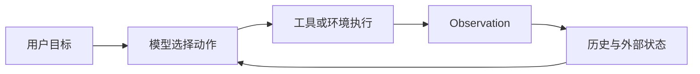
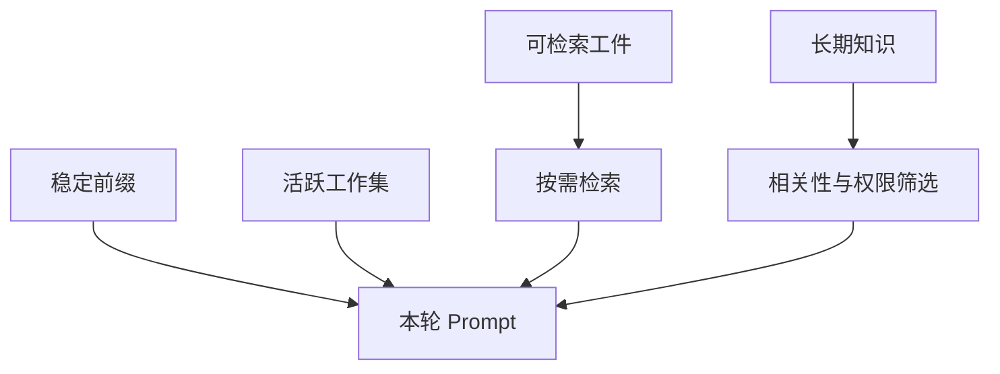
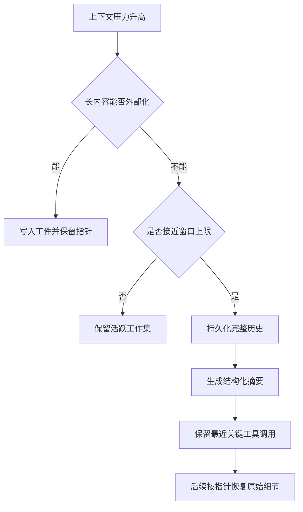
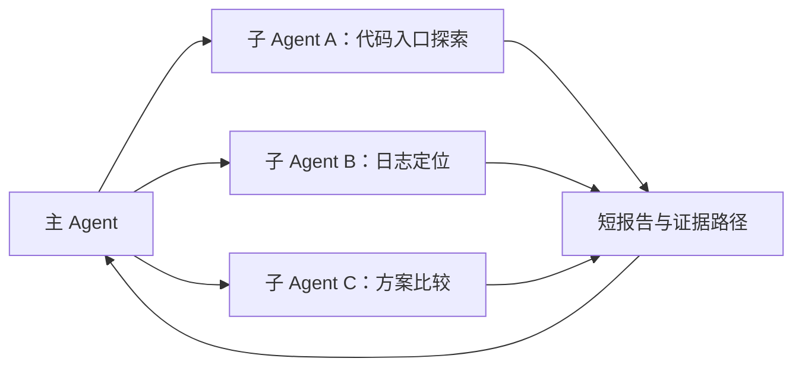
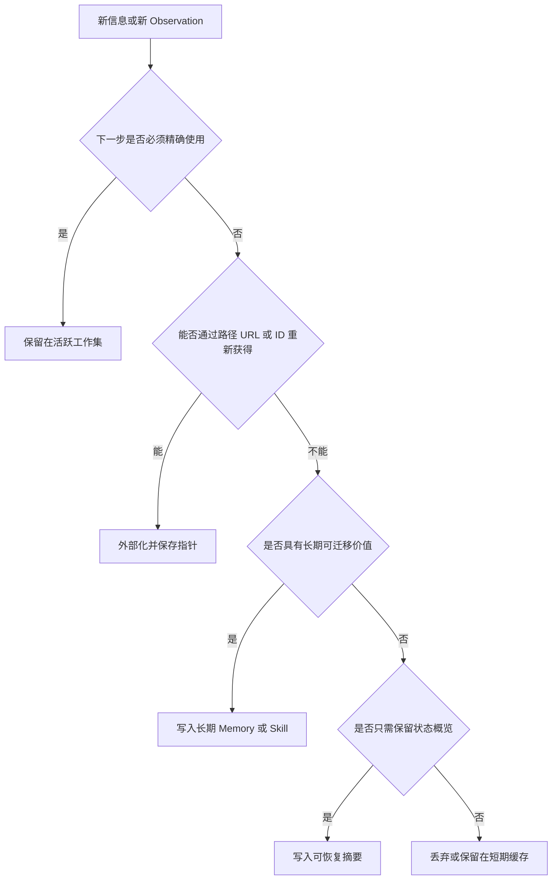

# Agent 上下文管理：把上下文当作受预算约束的工作集

!!! quote "来源与改写说明"
    本笔记基于知乎作者 **魔法学院的Chilia** 的文章《[万字长文解析Agent框架中的上下文管理策略](https://zhuanlan.zhihu.com/p/2012088406826562496)》整理与扩展。原文版权归作者所有；本文不转载或复刻原文，而是按个人学习笔记的目标重新组织概念、补充工程边界，并加入自己的结构化解释。

上下文管理不是“把对话截短”这么简单，而是决定：在有限 token、有限延迟和有限成本下，Agent 在下一步行动前究竟应该看到什么。

对于长程 Agent，一个更有用的目标是：

\[
C_t^*=\arg\max_{C\subseteq \mathcal I_t}
\mathbb E\bigl[U(a_t)\mid C\bigr]
-\lambda\cdot \operatorname{Cost}(C)
-\mu\cdot \operatorname{Risk}(C)
\]

其中：

- \(\mathcal I_t\)：当前可用信息，包括对话、工具输出、文件、记忆、子 Agent 报告；
- \(C_t\)：真正放进本轮模型输入的上下文；
- \(U(a_t)\)：下一步行动带来的任务效用；
- `Cost`：token、Prefill、延迟与工具调用成本；
- `Risk`：遗漏关键事实、引入噪声、让模型误解状态的风险。

因此，上下文工程追求的不是“上下文越长越好”，而是：

> 用尽量小、尽量稳定、可恢复且与当前决策相关的信息集合，支持下一步正确行动。

## 1. 为什么长程 Agent 一定需要上下文管理

Agent 循环会不断积累状态：



每一次工具调用都可能返回：

```text
长日志
网页正文
源代码片段
表格或 JSON
错误栈
子 Agent 报告
```

如果所有 Observation 都追加到 messages，通常会同时出现四类问题：

| 问题 | 表现 | 后果 |
| --- | --- | --- |
| 窗口耗尽 | 输入持续增长 | 任务被迫中断或频繁压缩 |
| 注意力稀释 | 关键信号被大量旧内容淹没 | 检索、规划和工具选择变差 |
| 推理成本上升 | 每轮都需要重新处理长历史 | TTFT、延迟和费用增加 |
| 状态漂移 | 旧计划、失败尝试和重复输出反复出现 | Agent 容易循环、误判或重复行动 |

“模型支持 128K、200K 或更长窗口”只说明它能接收这些 token，并不说明这些 token 都是有效工作记忆。工程上应区分：

```text
Context window：模型的输入容量上限
Effective context：本轮真正有助于决策的信息量
```

## 2. 一个实用的上下文分层

不要把所有信息当成同一种“记忆”。建议分成四层：

| 层级 | 保存什么 | 是否直接注入当前 Prompt | 典型载体 |
| --- | --- | ---: | --- |
| 稳定前缀 | 系统规则、工具 schema、项目约束 | 是 | System prompt、tool definitions |
| 活跃工作集 | 当前目标、最近 Observation、下一步状态 | 是 | Recent messages、task state |
| 可检索工件 | 长日志、文件、网页、完整工具输出 | 按需 | 文件系统、对象存储、数据库 |
| 长期知识 | 可迁移偏好、经验、Skill、摘要索引 | 条件注入 | Memory Bank、知识库、Skill Library |



这张图的关键是：**外部信息不应因为存在，就自动进入 Prompt。** 它必须经过任务相关性、时效性、权限和预算筛选。

## 3. 四种核心策略

原始文章将上下文管理归纳为四条主线。更适合工程决策的表述如下：

1. 可逆卸载与按需检索；
2. 可恢复摘要；
3. 上下文隔离与委派；
4. Prefix / KV 缓存布局。

它们不是互斥方案，而是同一个 Agent Loop 中不同层级的组合。

## 4. 可逆卸载：把文件系统当作外部工作记忆

### 4.1 不要直接截断长 Observation

最粗暴的方式是：

```text
工具输出太长
→ 截断前 N 行
→ 只保留截断内容
```

问题是截断是不可逆的。错误栈可能出现在末尾，某个配置项可能在中段，后续推理需要的证据可能被永久丢掉。

更稳健的做法是：

```text
完整原始输出写入外部工件
→ 上下文只保留指针、元数据和少量摘要
→ Agent 在需要时逐步读取
```

例如：

```text
工具输出已保存：/tmp/build-2026-10-22.log
大小：4.8 MB
关键信号：测试失败，疑似涉及 auth middleware
下一步建议：先 rg "AssertionError|auth middleware" 该文件
```

这不是简单“把内容扔到磁盘”，而是把上下文从**内容复制**变成**可定位引用**。

### 4.2 一个可恢复工件应包含什么

建议将外部工件描述成结构化指针：

```json
{
  "artifact_id": "build-log-017",
  "path": "/tmp/build-2026-10-22.log",
  "kind": "shell-log",
  "created_by": "run_tests",
  "summary": "3 个测试失败，均涉及 auth middleware",
  "retrieval_hints": [
    "rg -n \"AssertionError|auth middleware\" /tmp/build-2026-10-22.log",
    "tail -n 120 /tmp/build-2026-10-22.log"
  ],
  "integrity": "sha256:..."
}
```

其中最有价值的字段不是长摘要，而是：

```text
在哪里
由什么工具产生
如何局部读取
是否可信、是否过期
```

### 4.3 JIT Retrieval 与预检索 RAG

预检索 RAG 的典型流程是：

```text
用户问题
→ 向量检索 Top-K chunks
→ 拼进 Prompt
→ 模型回答
```

它适合资料相对静态、查询模式稳定、召回质量可离线调优的知识库。

但在代码库、文件系统、长日志和动态工具环境中，Agent 常需要 **Just-in-Time Retrieval**：

```text
先根据当前状态提出一个查找假设
→ 用 rg / find / jq / head / tail / SQL 验证
→ 根据局部结果决定下一步查询
```

| 维度 | 预检索 RAG | JIT Retrieval |
| --- | --- | --- |
| 检索时机 | 推理前一次性 | 推理过程中逐步发生 |
| 优势 | 快、适合稳定知识库 | 精确、可适应动态状态 |
| 风险 | chunk、embedding、索引过期 | 依赖模型会用工具、可能多步搜索 |
| 适合对象 | 文档知识库、FAQ、规范 | 代码、日志、文件、数据库、运行环境 |

结论不是“RAG 应被抛弃”，而是：

> 在可精确访问的工作环境中，优先让 Agent 用工具按需读取原始工件；在无法直接访问或需要语义召回时，再使用 RAG 作为补充。

Manus 的公开文章也强调：网页正文可以由 URL 替代、文件正文可以由路径替代，之后再按需重载。详见其 [Context Engineering for AI Agents](https://www.manus.im/blog/Context-Engineering-for-AI-Agents-Lessons-from-Building-Manus)。

## 5. 可恢复摘要：有损压缩只能作为受控降级

当上下文接近上限、且无法继续通过卸载减小时，才需要摘要。

摘要本质上是有损压缩：

```text
完整工具输出、精确代码、失败细节
→ 被压缩为自然语言状态说明
```

因此错误的策略是：

```text
窗口满了
→ 只留一段摘要
→ 丢弃原始历史
```

更合理的顺序是：



### 5.1 摘要不应只写“发生了什么”

一个能继续驱动 Agent 的摘要至少应覆盖：

| 区域 | 应保留的信息 |
| --- | --- |
| 目标 | 用户最终目标、成功标准、禁止事项 |
| 已确认事实 | 已验证结论，带来源路径或工具调用编号 |
| 当前状态 | 已修改文件、运行环境、任务阶段、分支状态 |
| 失败与排除项 | 什么尝试过、为什么失败、不要重复什么 |
| 待办 | 未完成子任务、依赖关系、下一步动作 |
| 可恢复引用 | transcript、日志、文件、网页或 artifact 指针 |

一个差摘要：

```text
已经检查了代码，发现认证有问题，继续修复。
```

一个更可执行的摘要：

```text
目标：修复 API token 刷新失败。
已确认：src/auth/refresh.ts 在 token 过期后没有写回 session；
证据：/tmp/test-017.log 的 418-466 行；
已尝试：修改 middleware 顺序，导致 e2e 登录回归，已撤销；
当前待办：检查 refresh.ts 的 saveSession 调用，并只运行 auth e2e 子集；
原始会话：/tmp/session-017.jsonl。
```

### 5.2 摘要后的“回忆”必须是可恢复的

摘要不是长期真相源，而是导航页。精确变量名、报错行、代码片段、原始工具输出需要时，应从持久化 transcript 或 artifact 重新读取。

这与 OpenAI 在 [Session Memory](https://developers.openai.com/cookbook/examples/agents_sdk/session_memory) 中介绍的“trimming + compression”思想一致：长程任务需要同时保留连续性与上下文预算。

## 6. 上下文隔离：不要让主 Agent 吞下所有探索过程

复杂任务可以拆给子 Agent，但子 Agent 的价值不只是并行，更是**隔离大量中间上下文**。



主 Agent 应接收的不是每个子 Agent 的完整思考和所有工具输出，而是：

```text
结论
证据引用
不确定点
产物路径
建议的下一步
```

### 6.1 并行与链式委派

| 模式 | 适用场景 | 例子 |
| --- | --- | --- |
| 并行委派 | 子任务互不依赖 | 分别分析三个模块、三个方案、三份日志 |
| 链式委派 | 后续任务依赖前项产物 | 先定位性能瓶颈，再基于报告设计优化 |

### 6.2 委派边界

子 Agent 不应无约束地再生成子 Agent，否则会产生：

```text
嵌套深度失控
上下文与预算不可预测
任务责任不清
结果难以追溯
```

建议让主 Agent 保持：

```text
全局目标
预算分配
任务依赖图
最终验收
```

子 Agent 保持：

```text
局部目标
独立工作上下文
证据化交付物
```

Anthropic 的 [subagents 说明](https://claude.com/blog/subagents-in-claude-code) 也将 subagent 定义为独立执行读文件、探索或修改任务的工作单元；适合将高 token 的探索从主上下文剥离。

## 7. 缓存：区分 KV Cache、Prefill 和 Prompt Cache

这一部分最容易混淆。

### 7.1 Prefill

在生成第一个输出 token 前，模型需要先处理输入序列，并建立后续注意力所需的状态。这个输入处理阶段通常称为 **Prefill**。

长 Prompt 下，Prefill 往往是首字延迟（TTFT）的主要来源之一。

### 7.2 KV Cache

在一次自回归生成过程中，模型会缓存历史 token 的 Key/Value 表示，避免生成每个新 token 时重新计算全部历史。这是模型推理内部的 KV Cache。

### 7.3 API Prompt Cache

多轮 Agent 还会面对另一个问题：每一次新请求都带着几乎相同的系统提示、工具定义和历史前缀。部分服务商提供的 Prompt Cache 会复用可缓存前缀的处理结果，以减少重复 Prefill。

它和底层 KV Cache 有关，但从 API 使用者视角应区分：

| 概念 | 作用范围 | Agent 工程关注点 |
| --- | --- | --- |
| KV Cache | 单次解码过程 | 生成新 token 时复用历史注意力状态 |
| Prompt Cache | 多次 API 请求之间 | 复用稳定前缀，减少重复 Prefill、成本与 TTFT |
| Response Cache | 直接复用完整响应 | 适合确定性、幂等请求，不适合状态变化的 Agent Loop |

Anthropic 的 [Prompt Caching 文档](https://platform.claude.com/docs/en/build-with-claude/prompt-caching)说明，缓存前缀可覆盖 `tools`、`system` 和 `messages` 中直到指定 `cache_control` block 的内容；有效期限和可缓存长度依服务与模型配置而异，应以当前官方文档为准。

## 8. 为缓存设计 Prompt：稳定前缀，动态后缀

一个适合多轮 Agent 的请求布局通常是：

```text
[稳定且可缓存]
系统规则
工具 schema
项目固定说明
稳定的安全约束

[半稳定]
任务目标
已确认项目状态
可长期复用的摘要

[动态且不可缓存]
最新 Observation
当前工具结果
本轮用户输入
```

缓存命中依赖于供应商的具体语义，但通用工程原则是：

1. 将经常变化的时间戳、随机 ID、临时调试文本移到动态后缀；
2. 对 JSON、工具定义和配置采用确定性序列化；
3. 不要反复重写稳定历史；更正信息时追加新的事件或状态记录；
4. 将稳定的 system prompt、工具定义与项目约束放在前部；
5. 记录 cache hit、cached input tokens、TTFT 和 prefix 变化原因。

一个常见反模式：

```text
每轮在 system prompt 顶部插入当前时间、会话 UUID、动态统计信息
→ 整个前缀变化
→ Prompt Cache 难以复用
```

另一个反模式：

```text
为“整理历史”而原地改写早期 messages
→ 缓存前缀不稳定
→ 成本与首字延迟反复回到高位
```

更好的做法是：保留稳定前缀，新增结构化状态事件，并在必要时做一次受控 compaction。

## 9. 一套可执行的决策规则

面对一段新信息，不要先问“要不要塞进 Prompt”，而应按以下顺序判断：



可以进一步整理成表：

| 信息类型 | 首选动作 | 原因 |
| --- | --- | --- |
| 当前报错、待执行命令、最近 patch | 保留在工作集 | 下一步需要精确使用 |
| 大型日志、网页、原始 JSON | 外部化 + 指针 | 可恢复，避免占满窗口 |
| 已验证的用户偏好、稳定项目约束 | 长期记忆 | 未来任务可能复用 |
| 已完成的探索过程 | 子 Agent 报告 + artifact | 主 Agent 不需保存完整过程 |
| 旧尝试、失败路径 | 摘要保留失败原因 | 避免重复犯错 |
| 无关且不可复用输出 | 丢弃 | 减少噪声 |

## 10. 评测上下文管理：不要只看任务成功率

一个上下文策略应至少同时评估：

| 维度 | 指标示例 |
| --- | --- |
| 任务质量 | Success Rate、Pass@k、人工或自动评审 |
| 上下文效率 | 平均输入 token、Prefill token、compaction 次数 |
| 延迟 | TTFT、端到端时延、工具等待时间 |
| 成本 | input / cached input / output token、工具费用 |
| 可恢复性 | 摘要后找回关键证据的成功率 |
| 稳定性 | 长程任务后期成功率、重复行动率、schema error 率 |
| 缓存 | hit rate、prefix churn、cache invalidation 原因 |

建议做至少四个对照：

```text
完整 append-only history
外部化 + JIT retrieval
摘要但无原始工件回溯
外部化 + 可恢复摘要 + 缓存稳定前缀
```

否则很难判断某个系统变快，是因为真正选到了更好的上下文，还是因为单纯删掉了任务所需信息。

## 11. 常见误区

### 误区 1：窗口更长，就不需要管理上下文

长窗口降低了硬性截断频率，但不会自动解决噪声、注意力稀释、Prefill 成本、状态冲突和缓存失效。

### 误区 2：摘要就是记忆

摘要只是压缩后的工作状态；它不应替代可定位的原始工件。精确代码、日志和证据应保存在可恢复位置。

### 误区 3：RAG 总比工具检索高级

RAG 和工具检索解决的问题不同。对动态代码库和日志，路径、命令和局部查询常比预切块向量库更可控；对大规模静态知识库，RAG 仍然有价值。

### 误区 4：多 Agent 一定更强

多 Agent 会隔离上下文，也会增加协调、重复探索和结果汇总成本。只有子任务边界清楚、输出可验证、主 Agent 不吞入全部中间历史时，隔离才真正减少总上下文负担。

### 误区 5：缓存只是推理服务层的事

缓存命中率直接受 Prompt 组织方式影响。系统提示、工具 schema、JSON 序列化和上下文更新策略都属于 Agent 设计的一部分。

## 12. 高频问题

### Q1：什么时候应该摘要，什么时候应该写文件？

**回答：**能重新读取的长内容优先写文件或外部存储，并在 Prompt 中保留指针；摘要只用于释放窗口、传递任务状态。摘要前必须持久化原始内容，避免不可逆丢失。

### Q2：JIT Retrieval 会不会比 RAG 更慢？

**回答：**单次检索未必更快，因为它可能需要多轮工具调用；但它能减少无关文本注入，并针对当前状态逐步缩小范围。在代码、日志和运行环境中，端到端任务效率可能更好。静态文档知识库仍常适合 RAG。

### Q3：上下文摘要怎样避免遗漏关键信息？

**回答：**不要要求摘要“记住所有细节”。应要求它记录目标、已确认事实、失败原因、待办、精确 artifact 指针和检索提示；原始 transcript 或工具输出必须可恢复。

### Q4：Prompt Cache 最重要的实践原则是什么？

**回答：**让高频复用内容形成稳定前缀，把 Observation、时间、临时 ID 和当前输入放在后缀。不要为了整理历史反复改写前部内容；对结构化数据使用确定性序列化。

### Q5：上下文管理和 Agent Memory 有什么区别？

**回答：**上下文管理关注本轮模型输入的工作集选择与预算；Memory 关注跨轮、跨任务保留哪些经验。Memory 只有经过相关性、时效性和权限筛选后，才可能成为当前上下文的一部分。

## 13. 最终框架

可以把上下文管理压缩为一句工程原则：

> 活跃上下文只保留支持下一步行动的最小高信号工作集；其余信息要么可逆外部化、要么以可恢复摘要保存、要么通过隔离委派留在子任务中，并让稳定前缀尽可能复用缓存。

这套原则同时回答了四个现实问题：

```text
模型下一步应该看到什么？
完整证据应该存在哪里？
什么时候压缩，压缩后怎么找回？
怎样让长程 Agent 的质量、成本和延迟同时可控？
```

## 参考与延伸

1. 魔法学院的Chilia，《[万字长文解析Agent框架中的上下文管理策略](https://zhuanlan.zhihu.com/p/2012088406826562496)》。本文的初始材料来源，版权归原作者。
2. Manus, [Context Engineering for AI Agents: Lessons from Building Manus](https://www.manus.im/blog/Context-Engineering-for-AI-Agents-Lessons-from-Building-Manus)。
3. Anthropic, [Prompt Caching](https://platform.claude.com/docs/en/build-with-claude/prompt-caching)。
4. OpenAI, [Context Engineering - Short-Term Memory Management with Sessions](https://developers.openai.com/cookbook/examples/agents_sdk/session_memory)。
5. Anthropic, [How and when to use subagents in Claude Code](https://claude.com/blog/subagents-in-claude-code)。
