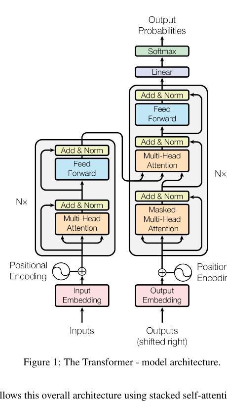
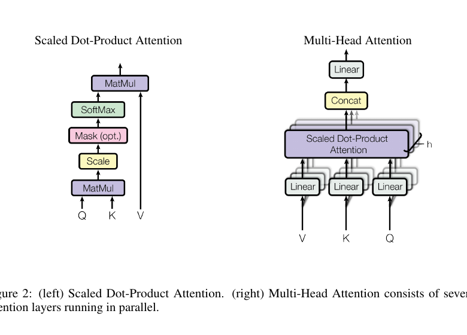

# 01 · Transformer 全貌

<div class="chapter-meta"><span>TRACK · TRANSFORMER</span><span>CHAPTER · 01</span><span>STATUS · FOUNDATION</span></div>

<p class="chapter-lead">这一章不急着推导 Q、K、V，也不要求马上手写 Attention。我们先回答一个更重要的问题：一个 Transformer 到底是什么？一段文字进入模型以后，经过哪些阶段，最后为什么能够生成下一个 token？</p>

!!! abstract "本章核心结论"
    Transformer 不是一个单独的“注意力层”，而是一种由 token 表示、位置/顺序信息、Self-Attention、前馈网络、残差连接和归一化共同组成的可堆叠网络结构。现代 GPT 类大模型通常采用 Decoder-only Transformer，通过自回归的 next-token prediction 学习语言。

## 1. 先从一个问题开始

假设我们给模型一句话：

```text
The cat sat on the mat
```

我们希望模型预测下一个 token。对人来说，这句话有顺序、有上下文，也有词语之间的关系：`cat` 是谁在 `sat`，`mat` 是动作发生的位置。

模型并不能直接理解字符串。它需要把这段文字转换成向量，再通过多层神经网络逐步形成上下文表示，最后输出词表中每个 token 的分数。

最简化的路径是：

```text
文本
  ↓
Tokenizer
  ↓
token ids
  ↓
Embedding + position information
  ↓
多个 Transformer Blocks
  ↓
Logits over vocabulary
  ↓
下一个 token 的概率
```

这条路径就是后面所有章节的主线。

## 2. Transformer 解决了什么问题？

Transformer 之前，序列建模长期由 RNN、LSTM 等循环结构主导。循环结构每次处理一个位置，需要把前一步的 hidden state 传给下一步：

{ .paper-figure }

> 来源：Vaswani et al., *Attention Is All You Need*, Figure 1。原论文：[arXiv:1706.03762](https://arxiv.org/abs/1706.03762)。图中展示的是原始 Encoder–Decoder Transformer，不是现代 Decoder-only LLM 的完整结构。

这种方式有两个明显限制：

1. **计算难以完全并行**：训练时，位置之间存在严格的时间依赖。
2. **长距离关系不容易保留**：距离很远的 token 需要经过许多步传递信息。

2017 年的论文 *Attention Is All You Need* 提出了 Transformer。它的关键思想是：让序列中的位置通过 Attention 直接建立关系，而不是只能依赖一步一步的循环传递。

!!! note "不要把它理解成“Attention 取代了一切”"
    Transformer 的核心是 Attention，但一个完整的 Transformer Block 还包含 Feed-Forward Network、Residual Connection 和 Normalization。Attention 负责让位置之间交换信息，FFN 负责对每个位置的表示做进一步的非线性变换。

## 3. 一张图看懂 Transformer

下面的图先忽略具体张量维度，只看信息流：

{ .paper-figure }

> 来源：Vaswani et al., *Attention Is All You Need*, Figure 2。原论文：[arXiv:1706.03762](https://arxiv.org/abs/1706.03762)。这张图先作为后续 Attention 章节的预告，本章只记录它在整体结构中的位置。

这张图里最容易被忽略的是：**Transformer 不是直接从文字生成文字**。它中间经过了很多层连续向量表示。每一层都在重新组织上下文信息，使得当前位置的表示包含越来越丰富的语义和关系。

## 4. 一个 Transformer Block 里面有什么？

把一个 Block 展开，可以得到：

{ .paper-figure }

> 来源：Vaswani et al., *Attention Is All You Need*, Figure 1。这里重点观察一个 Block 如何重复堆叠，以及 Encoder、Decoder 两侧的子层差异。

不同模型在顺序上会有差异。例如现代 LLM 常见 Pre-Norm 结构，会在 Attention 或 FFN 前进行 RMSNorm；原始论文常被画成 Post-Norm。阅读具体模型代码时，不能只凭“Transformer Block”这个名字假设内部顺序完全相同。

### 4.1 Self-Attention

Self-Attention 允许一个位置查看同一序列中的其他位置，并根据当前内容决定应该关注谁。

例如：

```text
The animal didn't cross the street because it was tired.
```

模型需要判断 `it` 更可能指向什么。Attention 并不是用一个固定窗口写死规则，而是根据输入内容动态计算不同位置之间的权重。

后续章节会详细解释：

- Query、Key、Value 的角色；
- `QK^T` 为什么能表示匹配程度；
- Softmax 如何变成权重；
- Causal Mask 如何阻止模型看到未来 token。

### 4.2 Feed-Forward Network

Attention 主要负责位置之间的信息交互。FFN 则对每个位置的向量独立地进行更深的非线性变换。

可以先用一个直觉理解：

```text
Attention：从别人那里收集信息
FFN：消化和变换当前位置已经收集到的信息
```

现代模型通常会使用 GELU 或 SwiGLU 一类的激活结构，而不是简单的单层线性变换。

### 4.3 Residual Connection

残差连接把输入直接加回子层输出：

```text
output = input + sublayer(input)
```

它带来两个重要好处：

- 让信息可以沿着较短路径跨越许多层；
- 让梯度更容易向前传播，降低深层网络训练困难。

### 4.4 Normalization

Normalization 用来控制隐藏状态的数值分布，使训练更加稳定。传统 Transformer 常见 LayerNorm，现代 LLM 中常见 RMSNorm。

这里先记住一个边界：Normalization 并不是让模型“理解得更好”的独立模块，而是帮助整个深层网络更稳定地学习。

## 5. Encoder、Decoder 和 Decoder-only

“Transformer”并不只指一种架构。原始论文提出的是 Encoder-Decoder 结构，但后来出现了三条主要路线。

### 5.1 Encoder-only

Encoder 可以让一个位置同时查看序列中其他位置，适合得到输入文本的整体表示。

代表模型：BERT。

{ .paper-figure }

> 来源：Vaswani et al., *Attention Is All You Need*, Figure 1。这里把原论文结构和现代 Decoder-only 模型的差别作为阅读笔记记录下来。

BERT 的预训练任务是 Masked Language Modeling：随机遮住部分 token，让模型根据左右两侧上下文恢复它们。

适合的任务包括：

- 文本分类；
- 语义匹配；
- 命名实体识别；
- 文本向量表示。

### 5.2 Encoder-Decoder

Encoder 先读取输入，Decoder 再基于 Encoder 的表示逐步生成输出。Decoder 中通常包含对 Encoder 输出的 Cross-Attention。

代表模型：原始 Transformer、T5。

这里先不再绘制二次示意图，直接对照上面的论文 Figure 1：

- 左侧是 Encoder stack：输入经过 Embedding 和 Position Encoding 后，进入重复堆叠的 Self-Attention 与 Feed-Forward 子层。
- 右侧是 Decoder stack：除了 Masked Self-Attention 和 Feed-Forward，还包含连接 Encoder 输出的 Cross-Attention。
- 图顶部的 Linear + Softmax 把 Decoder 最后的隐藏状态映射为输出 token 概率。

后续读论文时，我需要特别区分：**原始论文的 Decoder 是 Encoder–Decoder 结构中的 Decoder，不等于今天 GPT 类模型所说的 Decoder-only。**

它很适合输入和输出都具有明确边界的转换任务，例如机器翻译、摘要和文本到文本任务。

### 5.3 Decoder-only

Decoder-only 模型只保留 Decoder 堆栈中的 Self-Attention 和 FFN，并使用 Causal Mask，保证每个位置只能看到自己和左侧的 token。

代表模型：GPT 系列以及许多现代通用大语言模型。

Decoder-only 的整体思想可以直接从论文 Figure 1 的右半部分抽象出来：保留 Decoder 侧的 Masked Self-Attention 和 Feed-Forward，去掉接收 Encoder 输出的 Cross-Attention。

需要注意：这是一种学习上的结构对照，不把原始论文 Figure 1 误称为 GPT 的完整架构。现代模型还会使用 RoPE、RMSNorm、SwiGLU、GQA 等改进。

它把各种任务统一成“给定前缀，预测后续 token”：

```text
翻译：Translate Chinese to English: ...
问答：Question: ... Answer: ...
代码：def fibonacci(n): ...
推理：Problem: ... Solution: ...
```

这也是 Decoder-only 架构非常强大的原因之一：不同任务都可以表现为同一种 next-token prediction 接口。

## 6. 为什么现代大模型常用 Decoder-only？

这里不能简单说“Decoder-only 一定更好”。更准确的说法是：它非常适合通过大规模文本预训练获得通用生成能力，并且训练目标、推理接口和任务格式比较统一。

它的主要特点是：

1. **目标简单统一**：预测下一个 token。
2. **训练容易并行**：虽然生成时是自回归的，但训练时可以用 causal mask 一次计算整段序列。
3. **任务格式灵活**：问答、代码、翻译、推理都可以转成文本序列。
4. **扩展路径清晰**：增加层数、隐藏维度、数据量和训练 token 数即可形成规模化路线。

代价也很明确：

- 生成过程天然是逐 token 的；
- 长上下文会带来计算和 KV Cache 显存压力；
- 模型可能学会表面上的语言模式，但不代表每个任务上都可靠。

## 7. 从输入到输出：一个完整例子

假设输入是：

```text
The capital of France is
```

模型大致经历以下步骤：

### Step 1：Tokenization

字符串被切分成 token，并转换成整数 id：

```text
[The, capital, of, France, is]
        ↓
[101, 2398, 310, 9821,  is_id]
```

真实 tokenizer 可能按子词切分，所以一个人类词不一定对应一个 token。

### Step 2：Embedding

每个 token id 从 embedding table 中查出一个向量：

```text
id 101  → vector e1
id 2398 → vector e2
id 310  → vector e3
...
```

模型后续处理的不是整数，而是这些向量。

### Step 3：加入位置关系

Attention 本身并不知道 token 的先后顺序，因此模型需要通过位置编码、RoPE 或其他机制注入顺序信息。

### Step 4：经过多层 Block

每一层都会让 token 表示与上下文交互，并经过 FFN 变换。最后一个位置的隐藏状态会包含“当前前缀可能接什么”的信息。

### Step 5：映射到词表

最后一个隐藏状态经过线性层投影到词表大小：

```text
hidden state [d_model]
        ↓ Linear
logits [vocabulary_size]
```

对 `Paris`、`London`、`Berlin` 等 token 都会得到一个分数。经过 softmax 后，得到概率分布。

### Step 6：选择下一个 token

模型可以选择概率最高的 token，也可以使用 temperature、top-k 或 top-p 采样。假设选出了 `Paris`：

```text
The capital of France is Paris
```

然后把 `Paris` 接到输入后面，继续预测下一个 token。

## 8. 训练和生成不是同一件事

这是初学者很容易混淆的地方。

### 训练阶段

训练时通常已经知道完整序列：

```text
The capital of France is Paris .
```

模型可以并行计算每个位置的 next-token loss，只是用 Causal Mask 保证位置不能看到自己的答案或未来信息。

```text
输入：The capital of France is Paris
目标：capital of France is Paris .
```

### 生成阶段

生成时，模型只知道当前已经产生的前缀：

```text
The capital of France is
```

它预测一个 token，追加后再预测下一个：

```text
... is → Paris
... Paris → .
```

训练可以高度并行，生成却通常是自回归的。这种差异会影响推理速度、KV Cache 设计和服务系统。

## 9. 现代 LLM 中的 Transformer

你在不同模型代码中可能看到这些名字：

| 组件 | 作用 | 这一专题中的位置 |
| --- | --- | --- |
| Tokenizer | 把文本变成 token ids | 输入阶段 |
| Embedding | 把 id 变成向量 | 输入表示 |
| RoPE | 注入相对位置关系 | Attention 相关 |
| RMSNorm | 稳定隐藏状态 | Block 内部 |
| GQA / MQA | 减少 K/V 头数量 | Attention 优化 |
| SwiGLU | 改进 FFN 表达能力 | FFN 内部 |
| MoE | 让每个 token 只激活部分专家 | Block 变体 |
| KV Cache | 缓存历史 K/V | 推理阶段 |

这些组件并不是脱离 Transformer 的新东西，而是围绕 Transformer 主体做出的结构改进和系统优化。

## 10. 论文路线

### 必读原始论文

<div class="paper-card" markdown>

**[Attention Is All You Need](https://arxiv.org/abs/1706.03762)**  · Vaswani et al., 2017

Transformer 的原始论文。重点看 Figure 1 的 Encoder-Decoder 总体结构、scaled dot-product attention、multi-head attention 和 positional encoding。

</div>

### 推荐的后续论文

- **[BERT: Pre-training of Deep Bidirectional Transformers for Language Understanding](https://arxiv.org/abs/1810.04805)**：理解 Encoder-only 和 Masked Language Modeling。
- **[Language Models are Few-Shot Learners](https://arxiv.org/abs/2005.14165)**：理解 Decoder-only 模型规模化后展现出的 few-shot 能力。
- **[RoFormer: Enhanced Transformer with Rotary Position Embedding](https://arxiv.org/abs/2104.09864)**：下一阶段理解 RoPE。
- **[GLU Variants Improve Transformer](https://arxiv.org/abs/2002.05202)**：理解 SwiGLU 等 FFN 变体。

!!! tip "论文怎么读"
    第一遍不需要读懂所有公式。先看摘要、Figure 1、模型结构、训练目标和实验设置。读完后尝试用自己的话画出模型数据流，再回头读公式。

## 11. 常见误解

### 误解一：Transformer 就等于 Attention

Attention 只是核心子层。没有 FFN、残差和归一化，不能称为完整的 Transformer Block。

### 误解二：Decoder 一定比 Encoder 高级

它们优化目标不同。Encoder 擅长构建双向表示，Decoder 擅长自回归生成。选择取决于任务。

### 误解三：Decoder-only 训练时也只能一个 token 一个 token 地算

生成时是逐 token 的；训练时可以对整段序列并行计算，只要使用 Causal Mask。

### 误解四：模型最后输出的是一个答案

模型最后输出的是词表上的 logits 或概率分布。答案是经过解码策略逐步采样出来的。

### 误解五：参数越大，模型就一定越可靠

规模通常能提升能力上限，但数据质量、训练目标、评测方式、推理设置和任务本身都会影响最终行为。

## 12. 本章小结

现在可以把 Transformer 记成五层结构：

```text
1. 文本表示：Tokenizer + Embedding
2. 顺序信息：Position information
3. 信息交互：Self-Attention
4. 表示变换：Feed-Forward Network
5. 深层训练：Residual + Normalization + stacked Blocks
```

对现代 Decoder-only LLM，还要加上：

```text
Causal Mask
→ next-token prediction
→ autoregressive generation
→ KV Cache
```

下一章我们会从输入端开始，详细解释 Tokenizer、token id、Embedding、张量形状，以及一段文本进入 Transformer 之前到底发生了什么。

## 自测问题

1. Transformer 和 RNN 在信息交互方式上有什么根本区别？
2. 一个完整 Transformer Block 至少包含哪些组件？
3. Encoder-only、Encoder-Decoder、Decoder-only 分别适合什么类型的任务？
4. 为什么 Decoder-only 模型可以把问答、翻译和代码生成统一成同一种训练目标？
5. 训练阶段和生成阶段为什么一个可以并行、一个通常需要逐 token 进行？
6. KV Cache 应该属于 Transformer 的基础结构，还是推理阶段的系统优化？为什么？

如果这些问题还不能顺畅回答，不必急着进入下一章，可以重新看第 3、5、8 节，并尝试自己画一遍数据流。
