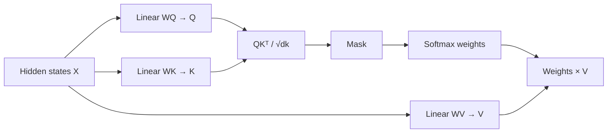
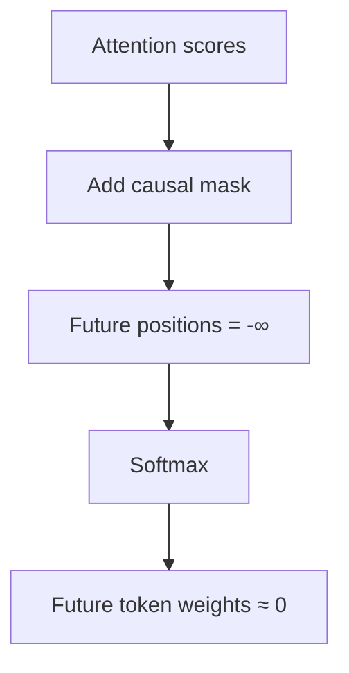
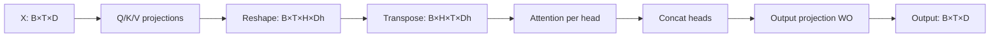

# 第二章 Attention、Mask 与位置编码

本章集中处理 Transformer 最核心的计算：一个位置如何读取其他位置的信息，以及模型如何知道 token 的顺序。

## 1. Attention 的计算对象

设输入隐藏状态为：

\[
X \in \mathbb{R}^{B \times T \times D}
\]

其中：

- \(B\)：batch size；
- \(T\)：序列长度；
- \(D\)：模型隐藏维度。

通过三个线性投影得到：

\[
Q=XW_Q,\qquad K=XW_K,\qquad V=XW_V
\]

\[
W_Q,W_K,W_V\in\mathbb{R}^{D\times D}
\]

Q、K、V 都来自同一组隐藏状态，但使用不同的可学习投影。



## 2. Q、K、V 的学习理解

| 表示 | 作用 | 注意 |
| --- | --- | --- |
| Query | 当前位置提出查询 | 不是固定语义上的“问题” |
| Key | 当前位置提供匹配线索 | 与 Query 计算兼容程度 |
| Value | 当前位置信息的实际内容 | 按权重被聚合 |

计算可以拆成两步：

\[
S=QK^\top
\]

先用 Q、K 得到“应该关注谁”；再用权重聚合 V：

\[
O=\operatorname{softmax}(S)V
\]

因此，V 不参与 score 的直接计算，是因为它承担的是内容传递，而 Q/K 承担的是匹配。

## 3. Scaled Dot-Product Attention

论文中的公式：

\[
\operatorname{Attention}(Q,K,V)=
\operatorname{softmax}\left(\frac{QK^\top}{\sqrt{d_k}}\right)V
\]

### 3.1 为什么需要缩放

若 \(q_i,k_i\) 独立且方差为 1，则点积：

\[
q\cdot k=\sum_{i=1}^{d_k}q_i k_i
\]

其方差随 \(d_k\) 增大。score 过大时，Softmax 进入饱和区，概率分布接近 one-hot，梯度变小。因此使用：

\[
\frac{QK^\top}{\sqrt{d_k}}
\]

控制 score 的尺度。

### 3.2 张量形状

单头情况下：

\[
Q\in\mathbb{R}^{T_q\times d_k},
K\in\mathbb{R}^{T_k\times d_k},
V\in\mathbb{R}^{T_k\times d_v}
\]

因此：

\[
QK^\top\in\mathbb{R}^{T_q\times T_k}
\]

最终输出：

\[
O\in\mathbb{R}^{T_q\times d_v}
\]

多头情况下：

\[
Q,K,V\in\mathbb{R}^{B\times H\times T\times D_h}
\]

\[
QK^\top\in\mathbb{R}^{B\times H\times T_q\times T_k}
\]

## 4. Mask

### 4.1 Causal Mask

Decoder-only 模型要求位置 \(t\) 不能读取未来位置 \(j>t\)：

\[
M_{ij}=\begin{cases}
0,&j\le i\\
-\infty,&j>i
\end{cases}
\]

最终 score：

\[
S=\frac{QK^\top}{\sqrt{d_k}}+M
\]



### 4.2 Padding Mask

batch 中的序列需要补齐：

```text
序列 A：我 喜欢 机器 学习
序列 B：我 喜欢 <pad> <pad>
```

Padding Mask 屏蔽 `<pad>` 位置。Causal Mask 解决“不能看未来”，Padding Mask 解决“不能看补齐位置”，两者在工程中可能合并。

## 5. Multi-Head Attention

设模型维度 \(D\)，head 数量 \(H\)，单 head 维度 \(D_h\)：

\[
D=H\times D_h
\]

流程：



多个 Head 的价值是让模型在不同投影子空间中建模关系；不能把每个 Head 固定解释成一个确定的语言学功能。

## 6. 位置编码

Attention 是 permutation-equivariant：如果只改变输入 token 的排列而没有提供位置，模型无法区分顺序。因此需要位置机制。

### 6.1 Sinusoidal Position Encoding

原始论文使用：

\[
PE_{(pos,2i)}=\sin\left(pos/10000^{2i/d_{model}}\right)
\]

\[
PE_{(pos,2i+1)}=\cos\left(pos/10000^{2i/d_{model}}\right)
\]

通常将它加到 Embedding 上：

\[
X_0=E+PE
\]

### 6.2 Learned Position Embedding

学习一个位置参数矩阵：

\[
P\in\mathbb{R}^{T_{max}\times D}
\]

输入为：

\[
X_0=E+P
\]

优点是实现简单；限制是最大长度通常与训练时的位置表相关。

### 6.3 RoPE

RoPE 不直接把位置向量加到隐藏状态，而是对 Q、K 的二维子空间做位置相关旋转。二维形式：

\[
R(\theta)=
\begin{bmatrix}
\cos\theta&-\sin\theta\\
\sin\theta&\cos\theta
\end{bmatrix}
\]

位置 \(m\) 的 Query 和位置 \(n\) 的 Key 分别旋转后，它们的内积会包含相对位置 \(m-n\) 的信息。

这也是 RoPE 常作用在 Q/K 而不是 V 上的原因：位置关系需要影响 Attention score，而 V 是被聚合的内容。

参考：[RoFormer: Enhanced Transformer with Rotary Position Embedding](https://arxiv.org/abs/2104.09864)。

## 7. 复杂度

标准 Self-Attention 的 score 矩阵是 \(T\times T\)：

\[
\text{时间复杂度}=O(T^2D)
\]

\[
\text{空间复杂度}=O(T^2)
\]

这解释了为什么长上下文会显著增加成本，也解释了 FlashAttention、稀疏 Attention 和线性 Attention 等方向的重要性。

## 8. 高频面试题：为什么 Attention 要分成 Q/K/V？

**标准答案：**

Q、K、V 分别承担匹配和内容传递两个功能。Q 与 K 通过点积计算当前位置之间的兼容程度，Softmax 后得到注意力权重，再使用这些权重对 V 进行加权聚合。将匹配空间和内容空间分开，模型可以学习“如何查询”和“查询后传递什么”两种不同的表示。

**解释：**

如果只有一种向量同时承担匹配和内容，模型的关系判断与信息传递会被绑定，表达空间更受限制。Q/K/V 的三个投影让模型能够分别学习查询模式、匹配特征和被读取内容。

## 9. 高频面试题：Causal Mask 和 Padding Mask 有什么区别？

**标准答案：**

Causal Mask 用于自回归建模，屏蔽当前位置右侧的未来 token；Padding Mask 用于变长 batch，屏蔽补齐产生的 `<pad>` token。前者约束时间方向，后者约束无效输入位置，工程中可以合并成一个最终的 Attention Mask。

**追问：为什么 Encoder 通常不使用 Causal Mask？**

Encoder 的目标是构造输入的双向表示，一个位置通常需要同时利用左右上下文；如果使用 Causal Mask，就会失去双向建模能力。

## 10. 高频面试题：Self-Attention 的复杂度为什么是二次的？

**标准答案：**

序列长度为 \(T\) 时，Q 与 K 的乘积会生成 \(T\times T\) 的位置关系矩阵，因此标准 Self-Attention 的时间复杂度近似为 \(O(T^2D)\)，注意力矩阵的空间复杂度为 \(O(T^2)\)。

**解释：**

不是 Q 或 K 单独导致二次复杂度，而是每个 Query 需要和所有 Key 计算关系。长上下文优化的核心之一，就是减少或避免显式处理完整的 \(T\times T\) 矩阵。

## 11. 手写题：Scaled Dot-Product Attention

```python
import math
import torch
import torch.nn.functional as F

def scaled_dot_product_attention(q, k, v, mask=None):
    # q: [B, H, Tq, Dh]
    # k: [B, H, Tk, Dh]
    # v: [B, H, Tk, Dh]
    scores = q @ k.transpose(-2, -1)
    scores = scores / math.sqrt(q.size(-1))

    if mask is not None:
        scores = scores.masked_fill(~mask, float("-inf"))

    weights = F.softmax(scores, dim=-1)
    output = weights @ v
    return output, weights
```

检查点：

- Softmax 必须在 Key 维度执行；
- mask 最后两个维度应与 `[T_q,T_k]` 对齐；
- 输出形状为 `[B,H,T_q,D_h]`；
- 不能把 `q @ k` 写成不带转置的乘法。

## 12. 本章总结

\[
\operatorname{Attention}(Q,K,V)=
\operatorname{softmax}\left(\frac{QK^\top+M}{\sqrt{d_k}}\right)V
\]

Attention 的完整路径是：

```text
Q/K 投影
→ QKᵀ 得到匹配分数
→ 缩放
→ 加 Mask
→ Softmax 得到权重
→ 加权聚合 V
→ 多头合并
→ 输出投影
```
