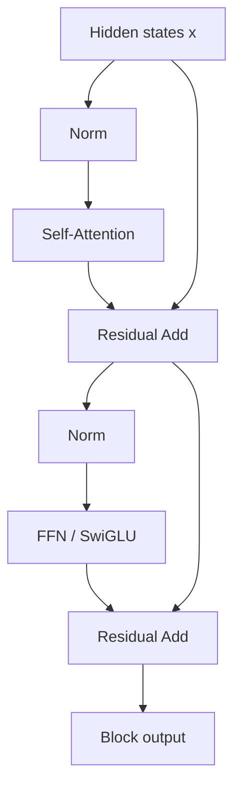
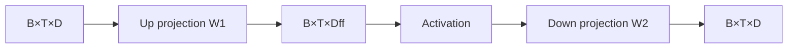
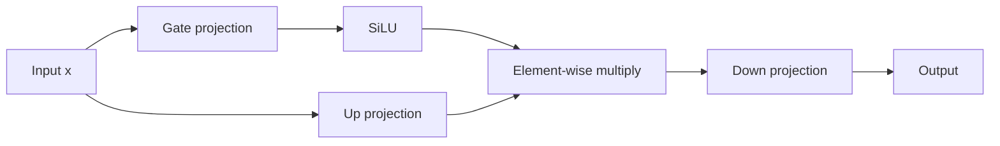
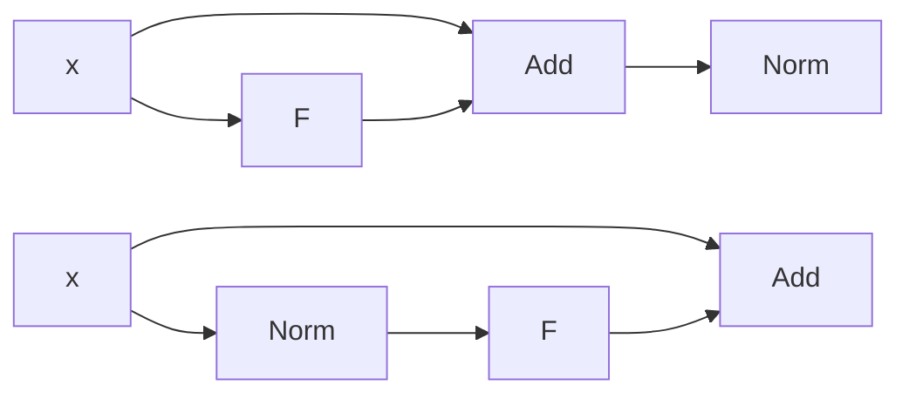
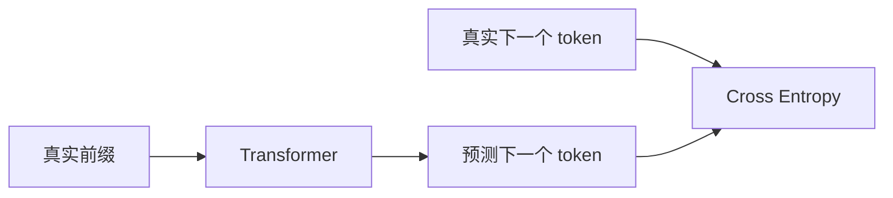

# 第三章 Transformer Block、FFN 与训练目标

本章把 Attention 放回完整的 Transformer Block，并解释模型如何通过 next-token prediction 学习。

## 1. Transformer Block 的职责分工



Attention 与 FFN 的分工：

```text
Attention：token 间的信息交换
FFN：单个 token 内部的非线性变换
```

如果输入为：

\[
X\in\mathbb{R}^{B\times T\times D}
\]

标准 Block 的输出仍然是：

\[
Y\in\mathbb{R}^{B\times T\times D}
\]

保持形状不变是为了让多个 Block 可以直接堆叠，并让残差分支可以进行逐元素相加。

## 2. FFN

传统 FFN：

\[
\operatorname{FFN}(x)=\sigma(xW_1+b_1)W_2+b_2
\]

其中：

\[
W_1\in\mathbb{R}^{D\times D_{ff}},\qquad
W_2\in\mathbb{R}^{D_{ff}\times D}
\]

张量流程：



先升维再降维的原因：

1. 在更大的特征空间中进行非线性组合；
2. 提升单个位置内部的表达能力；
3. 最终回到 `D`，保证可以和残差分支相加。

## 3. SwiGLU

一种常见写法：

\[
\operatorname{SwiGLU}(x)=
\left(\operatorname{SiLU}(xW_{gate})\odot xW_{up}\right)W_{down}
\]

其中：

- `gate` 分支生成门控权重；
- `up` 分支提供待筛选的特征；
- \(\odot\) 是逐元素乘法；
- `down` 分支把中间维度投影回模型维度。



普通 ReLU FFN 与 SwiGLU 的区别不是简单的激活函数替换。SwiGLU 同时引入了两路投影和门控乘法。

## 4. 残差连接

残差连接：

\[
y=x+F(x)
\]

反向传播：

\[
\frac{\partial y}{\partial x}=I+\frac{\partial F(x)}{\partial x}
\]

其中 \(I\) 提供直接的梯度路径。

它的作用：

- 保留已有表示；
- 让子层学习增量变化；
- 缓解深层网络优化困难；
- 支持大量 Block 堆叠。

残差连接不能单独保证训练稳定，初始化、归一化、学习率和残差缩放也会影响结果。

## 5. LayerNorm 与 RMSNorm

### 5.1 LayerNorm

对于单个 token 的隐藏向量 \(x\in\mathbb{R}^{D}\)：

\[
\mu=\frac{1}{D}\sum_{i=1}^{D}x_i
\]

\[
\sigma^2=\frac{1}{D}\sum_{i=1}^{D}(x_i-\mu)^2
\]

\[
\operatorname{LN}(x)=
\gamma\odot\frac{x-\mu}{\sqrt{\sigma^2+\epsilon}}+\beta
\]

对 `[B,T,D]` 输入，LayerNorm 通常沿最后的 `D` 维，对每个 token 独立计算。

### 5.2 RMSNorm

\[
\operatorname{RMS}(x)=\sqrt{\frac{1}{D}\sum_{i=1}^{D}x_i^2+\epsilon}
\]

\[
\operatorname{RMSNorm}(x)=\gamma\odot\frac{x}{\operatorname{RMS}(x)}
\]

RMSNorm 去掉了 LayerNorm 的均值中心化，只保留尺度归一化。参考：[Root Mean Square Layer Normalization](https://arxiv.org/abs/1910.07467)。

| 方法 | 是否减均值 | 是否缩放 | 常见场景 |
| --- | --- | --- | --- |
| LayerNorm | 是 | 是 | 原始 Transformer、部分 Encoder |
| RMSNorm | 否 | 是 | 许多现代 LLM |

## 6. Pre-Norm 与 Post-Norm

Post-Norm：

\[
y=\operatorname{Norm}(x+F(x))
\]

Pre-Norm：

\[
y=x+F(\operatorname{Norm}(x))
\]



Pre-Norm 通常提供更直接的残差路径，深层训练更容易；Post-Norm 更接近原始论文结构，对初始化和学习率更敏感。不能绝对地说某一方案在所有模型和配方下都更好。

## 7. Next-token Prediction

Decoder-only LLM 的训练目标是预测下一个 token。

给定序列：

```text
I like machine learning
```

输入与标签错位：

```text
输入：I like machine
标签：like machine learning
```

形式化表示：

\[
\mathcal{L}(\theta)=
-\sum_{t=1}^{T}\log p_\theta(x_t\mid x_{<t})
\]

批量交叉熵：

\[
\mathcal{L}_{CE}=-\frac{1}{N}\sum_{i=1}^{N}\log p_\theta(y_i\mid x_i)
\]

模型输出：

\[
\text{logits}\in\mathbb{R}^{B\times T\times V}
\]

labels：

\[
\text{labels}\in\mathbb{R}^{B\times T}
\]

训练时可以并行计算所有位置，是因为完整序列已经存在；Causal Mask 只限制每个位置可以读取的上下文。

## 8. Teacher Forcing

训练时，位置 \(t\) 的输入通常使用真实历史 token，而不是模型自己上一步生成的 token：



这叫 Teacher Forcing。它训练效率高，但造成训练时使用真实历史、推理时使用模型历史的差异，这种差异称为 exposure bias。

## 9. LM Head 与权重共享

最后的隐藏状态：

\[
H\in\mathbb{R}^{B\times T\times D}
\]

经过 LM Head：

\[
Z=HW_{lm}+b
\]

\[
Z\in\mathbb{R}^{B\times T\times V}
\]

部分模型使用 weight tying：

\[
W_{lm}=E^\top
\]

这样可以减少参数，并让输入 Embedding 和输出词表投影共享表示空间，但不是所有模型都必须共享。

## 10. 高频面试题：FFN 为什么先升维再降维？

**标准答案：**

FFN 先把 `[B,T,D]` 投影到更高维的 `[B,T,D_ff]`，在更大的特征空间中进行激活和非线性组合，再投影回 `[B,T,D]`。升维提供更强的单 token 表达能力，降维保证输出能与残差分支相加。

**解释：**

Attention 负责位置之间的信息交换，FFN 负责当前位置内部的表示加工。二者分工不同，不能把 FFN 理解为 Attention 的重复。

## 11. 高频面试题：Pre-Norm 和 Post-Norm 有什么区别？

**标准答案：**

Post-Norm 是先计算残差加法再归一化：

\[
\operatorname{Norm}(x+F(x))
\]

Pre-Norm 是先归一化子层输入，再与残差相加：

\[
x+F(\operatorname{Norm}(x))
\]

Pre-Norm 的恒等残差路径更直接，通常更容易训练深层模型；Post-Norm 更接近原始 Transformer，但对训练配方更敏感。

**追问：Pre-Norm 是否一定效果更好？**

不是。训练稳定性和最终效果是不同维度，最终结果还依赖初始化、学习率、warm-up、深度和残差缩放。

## 12. 高频面试题：为什么训练可以并行？

**标准答案：**

训练样本中的完整 token 序列和目标已经存在，模型可以一次性对所有位置计算 Q/K/V 和 logits。Causal Mask 只限制信息可见性，不要求计算必须逐 token 执行。因此训练阶段可并行，生成阶段因为未来 token 未知，通常需要逐 token 自回归。

## 13. 手写题：Pre-Norm Transformer Block

```python
class PreNormBlock(nn.Module):
    def forward(self, x, attention_mask=None):
        x = x + self.attn(self.norm1(x), attention_mask)
        x = x + self.mlp(self.norm2(x))
        return x
```

检查点：

- Norm 是否位于子层之前；
- 残差是否与子层输出相加；
- Block 输入输出最后一维是否一致；
- Attention 和 MLP 是否都保留残差路径。

## 14. 本章总结

\[
\text{Transformer Block}
=\text{Attention}+\text{Residual}+\text{Norm}+\text{FFN}
\]

现代 Decoder-only Block 常见路径：

```text
RMSNorm
→ Causal Self-Attention / GQA
→ Residual Add
→ RMSNorm
→ SwiGLU
→ Residual Add
```

训练目标：

\[
\max_\theta\sum_t\log p_\theta(x_t\mid x_{<t})
\]
