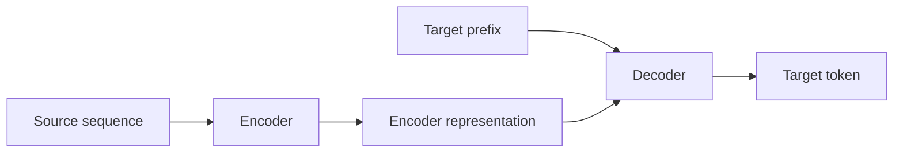
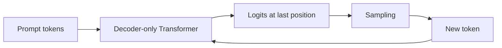
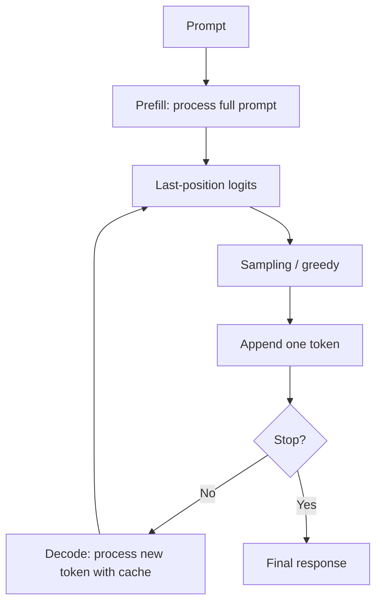
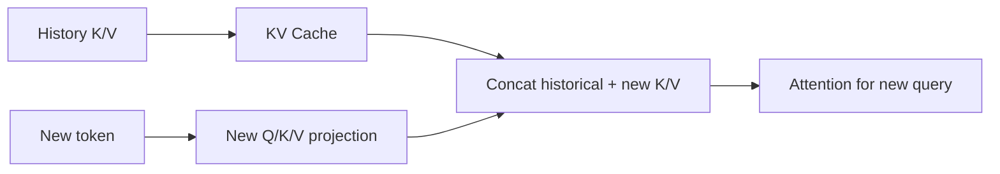

# 第四章 Decoder-only、生成与 KV Cache

本章把 Transformer 结构连接到 GPT 类模型的实际生成过程。

## 1. 原始 Transformer Decoder 到 Decoder-only

原始 Transformer：



Decoder-only LLM：



Decoder-only 通常移除：

- Encoder；
- Encoder-Decoder Cross-Attention。

保留并强化：

- Causal Self-Attention；
- FFN；
- Residual；
- Normalization；
- 自回归 next-token prediction。

## 2. 训练阶段和生成阶段

### 2.1 训练阶段

完整序列：

```text
The capital of France is Paris
```

错位目标：

```text
输入：The capital of France is
标签：capital of France is Paris
```

一次 Forward 可以得到所有位置的 logits：

\[
Z\in\mathbb{R}^{B\times T\times V}
\]

Causal Mask 确保位置 \(t\) 只能读取 \(0\) 到 \(t\) 的 token。

### 2.2 生成阶段



生成是自回归的：下一个 token 依赖当前前缀，而新 token 又会成为下一步的前缀。

## 3. Prefill 与 Decode

| 阶段 | 输入 | 主要计算 | 常见瓶颈 |
| --- | --- | --- | --- |
| Prefill | 整个 prompt | 并行处理输入、建立 KV Cache | 计算和显存带宽 |
| Decode | 通常一个新 token | 使用历史 Cache 生成下一 token | 内存带宽、同步和调度 |

Prefill 的序列长度可能很长，适合矩阵并行；Decode 每步新增 token 少，但需要读取大量历史 KV Cache。

## 4. 为什么需要 KV Cache

没有 Cache 时，第 \(t\) 步生成会把完整前缀重新送入模型，历史 token 的 K/V 会被重复计算。

有 Cache 时：

```text
第一次：计算 prompt 的 K/V，并保存
之后：只计算新 token 的 Q/K/V
      读取历史 K/V Cache
      拼接当前 K/V
      计算当前 Query 对全部历史的 Attention
```



为什么缓存 K/V，不缓存 Q？

- 历史 Query 在后续 Decode 中不会再作为新的查询使用；
- 每一步真正需要的是当前 token 的 Query；
- 历史 Key/Value 会被当前 Query 反复读取。

## 5. KV Cache 形状和显存

设：

- \(L\)：Layer 数；
- \(B\)：batch size；
- \(H_{kv}\)：K/V head 数；
- \(T\)：缓存序列长度；
- \(D_h\)：head dimension；
- \(s\)：每个元素字节数。

每层每个 K/V 的形状：

\[
[B,H_{kv},T,D_h]
\]

K 和 V 各保存一份，因此近似显存：

\[
\text{KV bytes}=2\times L\times B\times H_{kv}\times T\times D_h\times s
\]

以 BF16 为例，\(s=2\)。KV Cache 随序列长度、batch、层数线性增长。

## 6. 采样策略

模型输出 logits，不是直接输出文本。先得到概率：

\[
p_i=\frac{e^{z_i/\tau}}{\sum_j e^{z_j/\tau}}
\]

其中 \(\tau\) 是 Temperature。

### Temperature

- \(\tau<1\)：分布更尖锐，更确定；
- \(\tau>1\)：分布更平坦，更随机；
- \(\tau=1\)：不改变原始 softmax 温度。

### Greedy

选择最大概率 token：

\[
x_t=\arg\max_i p_i
\]

结果稳定，但多样性低。

### Top-k

只保留概率最高的 k 个 token，再重新归一化。

### Top-p / Nucleus Sampling

从高到低累加概率，保留累计概率达到 \(p\) 的最小 token 集合。

## 7. 推理指标

### TTFT

Time To First Token：从请求开始到第一个 token 产生的时间。通常受 Prefill 影响较大。

### TPOT

Time Per Output Token：输出阶段每个 token 的平均生成时间。

### Throughput

单位时间生成的 token 数，常用：

```text
tokens / second
```

### Latency 与吞吐的冲突

更大 batch 往往提高吞吐，但会增加单请求等待时间和显存压力；在线服务需要在并发、延迟和吞吐之间权衡。

## 8. 高频面试题：为什么 KV Cache 不缓存 Q？

**标准答案：**

Decode 阶段每一步只有当前新 token 的 Query 会发起一次查询，历史 Query 不会在后续步骤中再次作为查询使用；而历史 Key/Value 会被后续每一个新 Query 读取。因此缓存历史 K/V 能避免重复计算，缓存 Q 的收益很小。

**解释：**

每一步的计算逻辑是：

\[
Q_{new}\times [K_{history};K_{new}]^\top
\]

\[
\operatorname{softmax}(\cdot)[V_{history};V_{new}]
\]

需要历史的是 K/V，不是历史 Q。

## 9. 高频面试题：Prefill 和 Decode 有什么区别？

**标准答案：**

Prefill 处理完整输入 prompt，可以并行计算所有 prompt token，并建立 KV Cache；Decode 每次通常只处理一个新 token，读取历史 KV Cache 并生成下一个 token。Prefill 通常更偏计算密集，Decode 更容易受显存带宽和 Cache 读取影响。

## 10. 高频面试题：KV Cache 显存如何计算？

**标准答案：**

如果模型有 \(L\) 层、batch 为 \(B\)、K/V head 数为 \(H_{kv}\)、序列长度为 \(T\)、head dimension 为 \(D_h\)，每个元素占 \(s\) 字节，则：

\[
\text{KV bytes}=2LBH_{kv}TD_hs
\]

前面的 2 来自 K 和 V 两份缓存。

**追问：GQA 为什么节省显存？**

因为 GQA 减少 \(H_{kv}\)，而 Query Head 数可以保持较多，因此 KV Cache 按 K/V head 数下降。

## 11. 高频面试题：为什么 Decode 往往受显存带宽限制？

**标准答案：**

Decode 每步新增 token 数很少，但需要读取多层、较长历史的 KV Cache。此时矩阵计算量相对有限，数据搬运和显存读取占比提高，算术强度较低，因此常表现为 memory-bandwidth bound。

## 12. 手写题：贪心生成

```python
@torch.no_grad()
def greedy_generate(model, input_ids, eos_id, max_new_tokens):
    for _ in range(max_new_tokens):
        logits = model(input_ids).logits
        next_token = logits[:, -1, :].argmax(dim=-1, keepdim=True)
        input_ids = torch.cat([input_ids, next_token], dim=-1)
        if torch.all(next_token == eos_id):
            break
    return input_ids
```

工程版本还需要加入：

- `past_key_values`；
- attention mask 更新；
- position ids；
- batch 中不同样本的结束处理；
- sampling 策略；
- 最大上下文长度检查。

## 13. 本章总结

```text
Prompt
→ Prefill
→ 建立 KV Cache
→ 读取最后位置 logits
→ 采样一个 token
→ 只计算新 token 的 Decode
→ 读取历史 K/V
→ 重复直到停止
```

生成效率的核心问题：

```text
减少重复计算
减少 KV Cache 读取和占用
提高 Decode 阶段的内存访问效率
```
