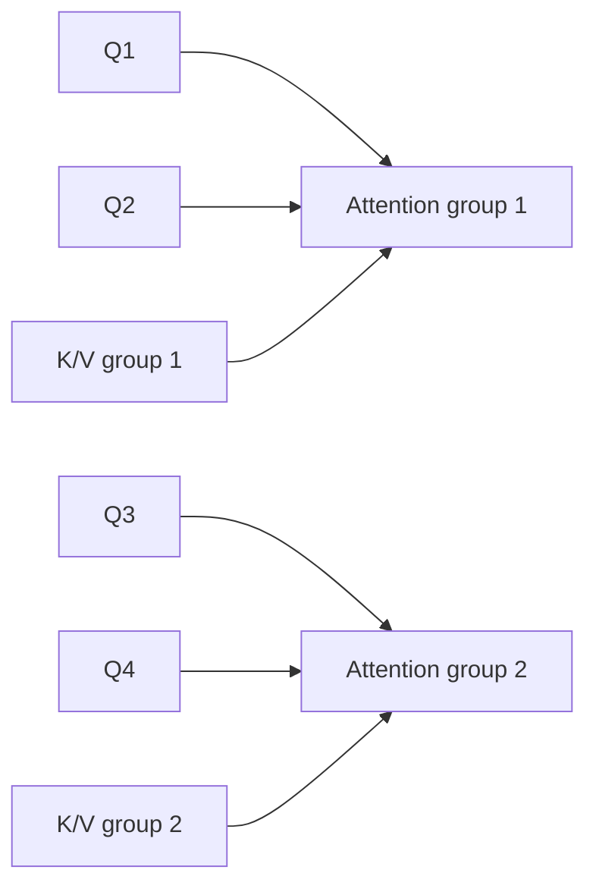
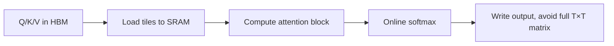
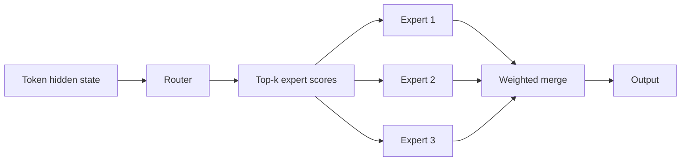
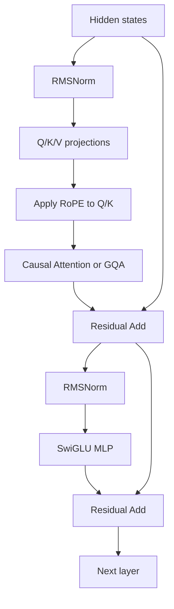

# 第五章 现代 Transformer 变体与真实模型实现

本章把原始 Transformer 与现代 LLM 的常见结构改造放在一起比较，并给出阅读真实模型源码的路径。

## 1. 原始结构与现代结构对比

| 部件 | 原始 Transformer | 现代 Decoder-only LLM |
| --- | --- | --- |
| 总体架构 | Encoder–Decoder | Decoder-only 常见 |
| Self-Attention | MHA | MHA / GQA / MQA |
| 位置编码 | Sinusoidal | RoPE 等 |
| 归一化 | LayerNorm | RMSNorm 常见 |
| FFN | ReLU FFN | SwiGLU 等 |
| Attention 计算 | 标准实现 | FlashAttention 等 Kernel |
| 参数结构 | Dense | Dense / MoE |
| 推理缓存 | 未重点展开 | KV Cache |

现代 LLM 仍然是 Transformer 家族，但不是简单复制原始论文。

## 2. MHA、MQA、GQA

### MHA

每个 Query Head 都有独立的 Key 和 Value Head：

```text
Hq = Hk = Hv
```

### MQA

所有 Query Head 共享一组 K/V：

```text
Hk = Hv = 1
```

### GQA

多个 Query Head 共享一组 K/V Head：

```text
1 < Hkv < Hq
```



GQA 的核心收益是减少历史 K/V 的数量，从而降低 KV Cache 显存和带宽压力；代价是 K/V 表示空间减少，可能带来质量变化，需要通过训练或从 MHA checkpoint 转换适配。

参考：[GQA: Training Generalized Multi-Query Transformer Models from Multi-Head Checkpoints](https://arxiv.org/abs/2305.13245)。

## 3. FlashAttention

标准实现可能显式产生完整 Attention 矩阵：

\[
S=QK^\top\in\mathbb{R}^{T\times T}
\]

FlashAttention 的重点不是改变公式，而是通过 tiling、分块和 IO-aware 计算减少 GPU memory hierarchy 中的读写。



对比：

| 项目 | 普通实现 | FlashAttention |
| --- | --- | --- |
| 数学目标 | Scaled Dot-Product Attention | 相同或等价 |
| 中间矩阵 | 可能显式保存 \(T\times T\) | 分块计算，减少显式存储 |
| 主要收益 | 实现简单 | 减少 HBM 读写和显存占用 |
| 主要限制 | 长序列成本高 | 依赖专门 Kernel 和硬件 |

参考：[FlashAttention](https://arxiv.org/abs/2205.14135)。

## 4. MoE

Dense FFN 对每个 token 激活同一组参数。MoE 将 FFN 替换为多个 Expert，由 Router 选择少数 Expert：



Router 可以输出：

\[
p(x)=\operatorname{softmax}(xW_r)
\]

选择 Top-k Expert 后：

\[
y=\sum_{i\in TopK(x)}p_i(x)\operatorname{Expert}_i(x)
\]

优势：

- 总参数量可以很大；
- 每个 token 只激活部分 Expert；
- 在相近计算预算下获得更高容量。

代价：

- Expert 负载可能不均衡；
- 需要 load balancing loss；
- 多卡之间存在 Expert 通信；
- 路由、容量和调度更复杂。

## 5. RoPE、RMSNorm、SwiGLU 在 Block 中的位置



这张图适合用于读 Llama/Qwen 类源码时定位模块，但不同模型的 Norm 顺序、Bias、RoPE 实现、残差缩放可能不同。

## 6. 阅读一个真实模型的 forward

建议按以下路径读源码：

```text
input_ids
  ↓
Embedding
  ↓
position_ids / RoPE cache
  ↓
DecoderLayer × N
  ├─ input_layernorm
  ├─ q_proj / k_proj / v_proj
  ├─ RoPE
  ├─ attention / cache update
  ├─ residual add
  ├─ post_attention_layernorm
  ├─ mlp / SwiGLU
  └─ residual add
  ↓
final norm
  ↓
lm_head
  ↓
logits
```

阅读源码时建议逐个记录：

| 需要确认的项目 | 典型问题 |
| --- | --- |
| Norm | Pre-Norm 还是 Post-Norm？LayerNorm 还是 RMSNorm？ |
| Q/K/V | 是否合并成一个 QKV projection？ |
| Head | 是 MHA、GQA 还是 MQA？ |
| Position | RoPE 作用在哪些张量？ |
| MLP | GELU、SwiGLU 还是其他门控结构？ |
| Cache | Cache 保存什么，shape 如何变化？ |
| LM Head | 是否和 Embedding 权重共享？ |

## 7. 高频面试题：MHA、MQA、GQA 有什么区别？

**标准答案：**

MHA 为每个 Query Head 配置独立的 K/V Head；MQA 让所有 Query Head 共享一组 K/V；GQA 让多个 Query Head 分组共享一组 K/V。三者主要差别在于 K/V head 数量，GQA 是表达能力和 KV Cache 成本之间的折中。

**解释：**

KV Cache 保存 K/V，因此：

\[
\text{Cache size}\propto H_{kv}
\]

减少 K/V head 可以直接减少缓存大小，但可能影响模型质量。

## 8. 高频面试题：FlashAttention 改变了 Attention 的公式吗？

**标准答案：**

FlashAttention 主要改变计算和内存访问方式，而不是 Attention 的数学目标。它使用分块计算和 online softmax，避免显式保存完整的 \(T\times T\) 注意力矩阵，减少 GPU HBM 读写和显存占用。

**追问：为什么只是改变 IO 就能加速？**

GPU 计算并不总是瓶颈。标准 Attention 的中间矩阵读写会频繁访问较慢的高带宽显存；FlashAttention 尽量在更快的片上存储中完成块内计算，减少数据搬运。

## 9. 高频面试题：MoE 为什么能扩大总参数量而不同比例增加计算量？

**标准答案：**

MoE 为每个 token 设置多个 Expert，但 Router 只选择 Top-k 个 Expert 进行计算。因此总参数量是所有 Expert 参数之和，而单个 token 的激活计算只涉及少数 Expert。它能够提高模型容量，但会引入路由负载不均衡和跨设备通信问题。

## 10. 高频面试题：如何从源码中确认一个模型是 GQA？

**标准答案：**

查看 Query Head 数和 Key/Value Head 数：如果 `num_key_value_heads` 小于 `num_attention_heads`，通常就是 GQA；如果 K/V head 为 1，通常是 MQA；如果三者相等，则是 MHA。还要检查 Q/K/V reshape 后的 head 维度和 repeat 或 expand 逻辑。

## 11. 手写题：计算 KV Cache 显存

```python
def kv_cache_bytes(num_layers, batch, kv_heads,
                    seq_len, head_dim, bytes_per_elem):
    return (
        2 * num_layers * batch * kv_heads
        * seq_len * head_dim * bytes_per_elem
    )
```

其中最容易漏掉的是：

- K 和 V 两份，因此乘 2；
- Layer 数量；
- batch size；
- GQA 中应使用 K/V head 数，而不是 Query head 数；
- BF16/FP16 通常每元素 2 bytes，FP32 为 4 bytes。

## 12. 现代 Transformer 的取舍

```text
更大上下文
→ 更大的 Attention / KV Cache 成本
→ 需要 RoPE scaling、FlashAttention、GQA、PagedAttention 等优化

更大参数容量
→ 更高计算和通信成本
→ 可以使用 MoE 控制每 token 的激活计算

更深网络
→ 更强表达能力
→ 更依赖 Norm、Residual、初始化和训练配方
```

现代架构不是“组件越多越好”，而是在表达能力、稳定性、显存、带宽、通信和吞吐之间做取舍。

## 13. 本章总结

现代 Decoder-only Transformer 可以抽象为：

\[
\text{Block}(x)=x+\operatorname{MLP}\left(
\operatorname{Norm}\left(x+\operatorname{Attention}(\operatorname{Norm}(x))\right)
\right)
\]

具体实现会将 Attention 替换为 MHA/GQA/MQA，将位置机制替换为 RoPE，将 MLP 替换为 SwiGLU 或 MoE，并在推理时配合 KV Cache 和 FlashAttention。
