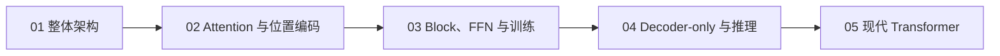

# Transformer 学习专题

> 学习主线：从整体数据流进入 Attention，再把 Attention 放回 Block 和训练流程，最后学习 Decoder-only 推理和现代 LLM 的工程变体。

## 章节导航

| 章节 | 核心主题 | 学完后应能做到 |
| --- | --- | --- |
| [01. 整体架构](01-big-picture.md) | 原始论文、三类架构、数据流、张量形状 | 读懂 Transformer 主体结构和一次前向传播 |
| [02. Attention 与位置编码](02-attention-position.md) | Q/K/V、Scaled Dot-Product、Mask、MHA、RoPE | 推导并解释 Attention，辨析不同 Mask 和位置方案 |
| [03. Block、FFN 与训练](03-block-training.md) | FFN/SwiGLU、Residual、Norm、Next-token loss | 读懂现代 Decoder Block 和训练目标 |
| [04. Decoder-only 与推理](04-decoder-inference.md) | 自回归生成、Prefill/Decode、KV Cache、采样 | 解释生成过程、缓存成本和推理指标 |
| [05. 现代 Transformer](05-modern-variants.md) | MHA/GQA/MQA、FlashAttention、MoE、真实模型 | 比较架构取舍并追踪真实模型 forward |

## 公式显示说明

本专题使用 LaTeX 数学定界符。行内公式写作 `\( ... \)`，独立公式写作：

\[
\operatorname{Attention}(Q,K,V)=\operatorname{softmax}\left(\frac{QK^\top}{\sqrt{d_k}}\right)V
\]

章节中的论文图、结构图和 Mermaid 流程图用于配合解释；图表旁注明来源或说明为概念流程图。
