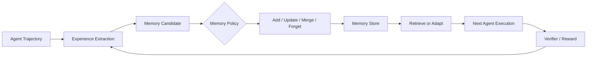

# 01. 记忆演化：经验如何成为可继承状态

> 本方向研究的不是“Agent 是否拥有聊天记录”，而是经验如何被提炼、存储、检索、修订、遗忘，以及是否能在后续任务中稳定改善行为。

## 研究问题

传统 Memory Agent 往往采用：

```text
轨迹
→ LLM 摘要
→ 向量库 / 文本库
→ 下一次检索
```

这种做法的主要问题是：

- 成功经验与偶然现象难以区分；
- 失败轨迹可能被错误写入长期记忆；
- 记忆策略通常由人工规则决定；
- 文本记忆对当前模型行为的约束较弱；
- 难以判断记忆是否帮助了未见任务。

2026 年的工作开始将“记什么、如何管理、如何内化”本身作为优化对象。



## 论文地图

| 论文 | 记忆形态 | 更新方式 | 是否严格校企合作 |
| --- | --- | --- | --- |
| [UMEM](https://arxiv.org/abs/2602.10652) | 外部长期 Memory Bank | GRPO 优化记忆提取与管理 | 是：厦门大学 + 阿里国际 / 通义 |
| [TMEM](https://arxiv.org/abs/2606.04536) | 显式记忆 + LoRA Fast Weights | episode 内参数记忆 | 是：阿里/Qwen + 北京大学 |
| [MemRL](https://arxiv.org/abs/2601.03192) | Episodic Memory | 运行时强化学习 | 扩展参考 |
| [MemSkill](https://arxiv.org/abs/2602.02474) | Memory Skill | Memory lifecycle 演化 | 扩展参考 |
| [EvoMemBench](https://arxiv.org/abs/2605.18421) | Memory 能力评测 | 不直接更新 | 扩展参考，评测基准 |

## 1. UMEM：将记忆提取与管理作为策略学习

### 论文定位

**[UMEM: Unified Memory Extraction and Management Framework for Generalizable Memory](https://arxiv.org/abs/2602.10652)** 关注外部记忆系统的两个耦合问题：

```text
从轨迹中提炼什么记忆？
对新记忆执行什么管理动作？
```

论文将系统拆分为冻结的 Executor、Memory Bank 与可训练的 Mem-Optimizer。Mem-Optimizer 并不直接完成用户任务，而是产生记忆候选并决定记忆管理动作。

### 进化对象

```text
Memory content
+
Memory management policy
```

不是更新基础模型参数，也不是只对已有记忆做向量检索。

### 反馈与更新

UMEM 使用语义邻域来估计一条记忆对相近任务的边际价值，并通过 GRPO 优化记忆提取与管理策略。其核心目标是避免将“只对当前样本偶然有用”的信息保存为长期经验。

### 实验与证据

论文报告在多个 benchmark 上比较记忆基线，并在多轮交互任务中报告最高 10.67% 的提升。阅读该工作时，重点不应只看最终分数，而应检查：

```text
语义邻域如何定义？
奖励是否真的衡量跨任务记忆效用？
Memory Bank 的增长与淘汰如何控制？
```

### 适用边界

UMEM 适合长期、多任务、具备可验证结果的 Agent 场景。对于单次开放式聊天任务，记忆收益与记忆质量难以可靠区分。

## 2. TMEM：将经验写入参数记忆

### 论文定位

**[TMEM: Scaling Self-Evolving Agents via Parametric Memory](https://arxiv.org/abs/2606.04536)** 试图突破纯文本或检索记忆的限制。其核心观点是：如果经验只作为上下文附加，Agent 仍需在每次推理时重新理解并遵循经验；更强的适应方式是将经验写入 episode 内的参数状态。

### 进化对象

```text
显式记忆
→ 经验提炼数据
→ LoRA Fast Weights Δt
→ 当前 episode 的策略 π(θ0 + Δt)
```

形式上可写为：

\[
\pi_t = \pi(\theta_0 + \Delta_t)
\]

其中 \(\theta_0\) 是冻结基础模型参数，\(\Delta_t\) 是由当前 episode 经验产生的快速适应参数。

### 方法关键点

- 使用显式记忆形成监督信号；
- 使用 SVD 初始化降低在线 LoRA 适应成本；
- 用强化学习优化记忆提炼与参数更新；
- 在任务结束或新 episode 开始时重新控制 Fast Weights 生命周期。

### 实验与证据

论文涉及 LoCoMo、LongMemEval-S、多目标搜索与 CL-Bench 等任务。阅读时需要区分：

```text
短期 episode 内适应
vs
跨任务长期参数积累
```

TMEM 的重点主要是前者，不应直接等同于永久参数学习。

### 适用边界

参数记忆增强了适应能力，但也引入在线训练成本、版本隔离、灾难性偏移和回滚问题。它比外部 Memory Bank 更接近“学习”，但工程风险也更高。

## 3. MemRL：运行时强化学习更新 Episodic Memory

### 论文定位

**[MemRL: Self-Evolving Agents via Runtime Reinforcement Learning on Episodic Memory](https://arxiv.org/abs/2601.03192)** 将 episodic memory 的写入和使用放进运行时强化学习闭环。

### 主要思想

```text
当前任务
→ 使用 episodic memory
→ 获得环境反馈
→ 在运行时更新记忆策略
→ 后续任务使用更新后的记忆
```

该方向强调基础模型参数可以保持冻结，持续适应主要由记忆状态和记忆策略承担。

### 阅读重点

- 记忆条目如何表示；
- reward 如何归因到记忆写入或检索动作；
- 运行时 RL 是否会导致记忆污染；
- 与纯检索式 RAG memory 的差异是什么。

## 4. MemSkill：将“记忆方法”本身作为 Skill

### 论文定位

**[MemSkill: Learning and Evolving Memory Skills for Efficient Continual Learning](https://arxiv.org/abs/2602.02474)** 不将记忆视为静态存储，而将“如何抽取、压缩、更新、遗忘和检索记忆”定义为可演化的 Memory Skill。

### 研究价值

这一视角把问题从：

```text
Memory Bank 里有什么？
```

提升为：

```text
Agent 是否学会了一套管理经验的程序？
```

它适合与 UMEM 对读：UMEM 更强调可训练的统一记忆框架，MemSkill 更强调记忆操作的生命周期和可复用策略。

## 5. EvoMemBench：记忆演化是否真的可评估？

### 论文定位

**[EvoMemBench](https://arxiv.org/abs/2605.18421)** 是评测工作，不直接提出新的记忆更新算法。

它将 Agent Memory 按两条维度分类：

```text
时间范围：episode 内 / 跨 episode
记忆内容：知识型 / 执行型
```

### 为什么重要

记忆论文常只报告最终任务分数，却没有回答：

```text
记忆是否被正确提取？
记忆是否在后续行为中被调用？
记忆是否对未见任务有边际效用？
```

EvoMemBench 的意义在于将这些问题拆开评测。

## 横向比较

| 工作 | 更新位置 | 是否更新参数 | 最重要的验证问题 |
| --- | --- | ---: | --- |
| UMEM | 外部 Memory Bank 与管理策略 | 否 | 记忆能否跨相近任务泛化？ |
| TMEM | LoRA Fast Weights | 局部、episode 内 | 参数记忆是否稳定且可回滚？ |
| MemRL | Episodic Memory 策略 | 否 | reward 是否正确归因给记忆动作？ |
| MemSkill | Memory lifecycle skill | 通常否 | 记忆方法能否长期复用？ |
| EvoMemBench | 评测层 | 否 | 记忆改善究竟发生在哪个维度？ |

## 本方向的阅读判断

记忆演化的关键不是 Memory Bank 越大越好，而是：

```text
保留的信息是否有边际效用？
错误经验是否能被发现、修订或遗忘？
记忆是否在未见任务中带来可验证的收益？
```
