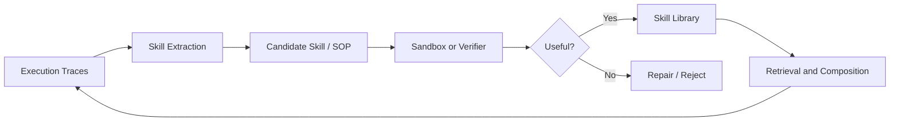
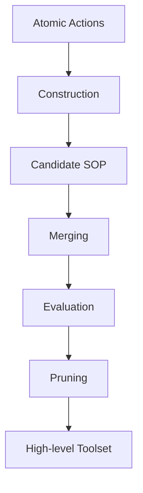
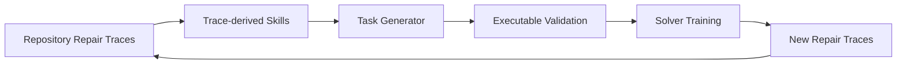

# 02. Skill 与 SOP 演化：从轨迹到可执行能力包

> 本方向关注如何将一次或多次执行轨迹转化为后续任务可直接调用的行为模块。核心对象不是普通文本提示，而是可执行 Skill、工具包、代码模块或 Standard Operating Procedure（SOP）。

## 研究问题

原子工具调用的组合空间很大：

```text
读取文件
→ 过滤数据
→ 调用 API
→ 写入结果
→ 重新验证
```

如果每次任务都从原子工具开始规划，Agent 会重复推理、反复犯错。Skill/SOP 演化的目标是：

```text
轨迹
→ 可复用操作程序
→ 验证
→ 入库
→ 检索与组合
→ 维护与淘汰
```



## 论文地图

| 论文 | 进化对象 | 核心机制 | 校企合作状态 |
| --- | --- | --- | --- |
| [EvoSOP](https://arxiv.org/abs/2607.07321) | SOP 与工具集 | 原子动作提炼、合并、评估、剪枝 | 是：人大 + 阿里 |
| [Socratic-SWE](https://arxiv.org/abs/2606.07412) | 编码 Agent Skill | 轨迹提炼 Skill、Skill 驱动任务生成 | 是：上交 + 阿里 |
| [MUSE-Autoskill](https://arxiv.org/abs/2605.27366) | Skill 生命周期 | 创建、记忆、管理、评估、修订 | 扩展参考 |
| [CoEvoSkills](https://arxiv.org/abs/2604.01687) | 多文件 Skill Package | Generator 与 Surrogate Verifier 共演化 | 扩展参考 |
| [SkillScriptBench](https://arxiv.org/abs/2610.04008) | 可执行 Skill Package | 脚本化 Skill 评测与修复 | 扩展参考，评测基准 |
| [SkillEvoReg](https://arxiv.org/abs/2609.30861) | Skill 更新策略 | 防止 Skill 过拟合与库膨胀 | 扩展参考，正则化研究 |

## 1. EvoSOP：从原子动作到标准作业流程

### 论文定位

**[EvoSOP](https://arxiv.org/abs/2607.07321)** 将 Agent 的多步工具调用过程提炼为 SOP。与单个工具函数不同，SOP 包含多个原子动作的有序组合和适用条件。

### 进化对象

```text
Atomic actions
→ SOP candidate
→ Toolset evolution
```

### 生命周期



### 方法意义

EvoSOP 的关键不是简单“保存成功轨迹”，而是将轨迹抽象为可复用、可调用、可维护的程序化行为单元。

### 实验阅读重点

- SOP 是否减少了后续任务的交互轮数；
- SOP 是否提升成功率；
- 合并和剪枝是否防止工具集冗余；
- SOP 是否可迁移到不同任务，而不是只复现训练轨迹。

## 2. Socratic-SWE：Skill 驱动的代码 Agent 课程生成

### 论文定位

**[Socratic-SWE](https://arxiv.org/abs/2606.07412)** 面向软件工程 Agent。它从历史代码修复轨迹中提炼结构化 Skill，再利用 Skill 生成新的、可执行验证的软件修复任务，进而训练 Solver。

### 闭环



### 进化对象

```text
Skill
→ 任务分布
→ Solver policy
```

它不是单纯 Skill Library，而是 Skill 对训练课程产生反向影响。

### 论文报告

论文报告经过三轮迭代后，SWE-bench Verified 达到 50.40%。阅读该结果时应重点检查：任务生成是否严格与训练集隔离、可执行验证是否可靠、以及改进是否迁移到未参与生成的新仓库问题。

## 3. MUSE-Autoskill：Skill 生命周期管理

### 论文定位

**[MUSE-Autoskill](https://arxiv.org/abs/2605.27366)** 把 Skill 视为长期资产，而不是一次性的 Prompt 片段。

它覆盖：

```text
Skill creation
→ memory
→ management
→ evaluation
→ reuse
→ refinement
```

### 阅读重点

这篇工作值得关注的不是某一条 Skill，而是 Skill 的生命周期治理：

- Skill 何时可以入库；
- Skill 是否需要版本号和测试；
- 失败时修改原 Skill 还是生成新 Skill；
- 相似 Skill 如何合并；
- 长期不使用或经常失败的 Skill 如何淘汰。

## 4. CoEvoSkills：Skill Generator 与 Verifier 共同演化

### 论文定位

**[CoEvoSkills](https://arxiv.org/abs/2604.01687)** 面向多文件、可执行的 Skill Package。它的难点是：真实 Skill 不只是文字说明，而可能是脚本、资源、依赖与目录结构的组合。

### 方法要点

```text
Skill Generator
↔ Surrogate Verifier
```

Generator 生成 Skill Package；Verifier 尝试判断或模拟其可执行性与任务效用；二者共同改进。

### 研究意义

这类设计试图缓解一个现实问题：受保护的真实测试答案通常不能直接暴露给 Skill 生成系统，因此需要替代性验证器，但替代验证器本身也可能产生偏差。

## 5. SkillScriptBench：Skill 的评测不应只看文本描述

**[SkillScriptBench](https://arxiv.org/abs/2610.04008)** 提出将 Skill 看作可执行 Package，而不是 Markdown 说明。

评测问题从：

```text
这个 Skill 的文字是否合理？
```

转向：

```text
该 Skill 是否能安装、执行、修复、组合和迁移？
```

这对于工具型 Agent 非常关键，因为文本上看似合理的 Skill 可能存在依赖、路径、权限和异常处理问题。

## 6. SkillEvoReg：Skill 演化的过拟合

**[SkillEvoReg](https://arxiv.org/abs/2609.30861)** 关注一个经常被忽略的问题：不断接受 Validation 有提升的 Skill，可能导致 Skill Library 对局部任务分布过拟合。

它提出从更新频率、Skill 复杂度和反事实效用等角度进行正则化。

该工作提醒：

```text
Skill 数量增加
≠
能力单调增长
```

## 横向比较

| 工作 | Skill 形式 | 是否执行验证 | 是否维护 Skill 库 | 主要风险 |
| --- | --- | ---: | ---: | --- |
| EvoSOP | SOP / 高阶工具 | 是 | 是 | 组合复杂度与冗余 |
| Socratic-SWE | 编码修复策略 | 是 | 间接 | 课程偏移与训练泄漏 |
| MUSE-Autoskill | 通用 Skill | 是 | 是 | 生命周期管理成本 |
| CoEvoSkills | 多文件 Package | Surrogate verifier | 是 | 验证器偏差 |
| SkillScriptBench | 评测对象 | 是 | 不适用 | benchmark 覆盖范围 |
| SkillEvoReg | 更新规则 | 依赖底层系统 | 是 | 过拟合与状态膨胀 |

## 本方向的阅读判断

Skill 演化是否可信，至少需要同时回答：

```text
Skill 能否执行？
Skill 是否比原子工具更有边际效用？
Skill 是否能够迁移到未见任务？
Skill 是否会导致库膨胀、冗余或错误继承？
```
