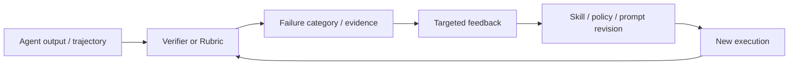
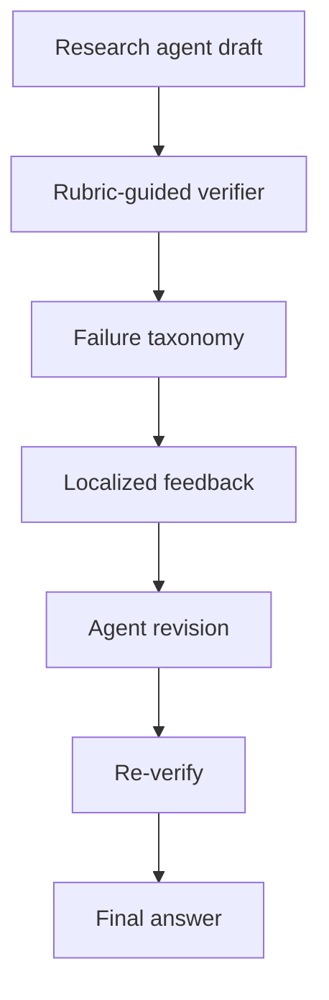

# 03. Verifier 与 Rubric 演化：让反馈成为可优化对象

> Agent 自进化的瓶颈往往不在“能否生成修改”，而在于“如何判断修改是否值得保留”。本方向将 Verifier、Rubric、证据链和过程奖励视为自进化闭环的关键组件。

## 研究问题

如果反馈只来自 Agent 自我评价，系统可能出现：

```text
答案流畅但无事实依据
错误反思被当作经验保存
reward hacking
对最终答案打分，却无法定位哪一步出错
```

因此，2026 年的工作开始研究：

```text
Verifier 是否可分解？
Rubric 是否可以自生成并持续修订？
证据是否可以作为训练信号？
反馈是否能被归因到具体行为步骤？
```



## 论文地图

| 论文 | 进化对象 | 反馈形式 | 校企合作状态 |
| --- | --- | --- | --- |
| [DeepVerifier](https://arxiv.org/abs/2601.15808) | Verifier、推理时反馈 | 失败类别与 rubric | 是：腾讯 AI Lab + 多所高校 |
| [RLCER](https://arxiv.org/abs/2602.10885) | Rubric / reward 规则 | 自演化 CoT rubric | 是：字节 Seed + NUS + 中科大 |
| [EVE-Agent](https://arxiv.org/abs/2605.22905) | 证据验证机制 | evidence-grounded feedback | 扩展参考 |
| [SkillSandbox](https://arxiv.org/abs/2610.10088) | Skill 入库验证 | 动态执行对照 | 扩展参考 |

## 1. DeepVerifier：推理时验证驱动的 Agent 修正

### 论文定位

**[DeepVerifier: Self-Evolving Deep Research Agents via Test-Time Rubric-Guided Verification](https://arxiv.org/abs/2601.15808)** 将深度研究 Agent 的错误拆分为可操作的失败类别，并通过 rubric 引导验证与反馈。

### 进化对象

```text
不是基础模型参数
不是长期 Skill Library
而是推理时的验证与修正过程
```

### 核心闭环



论文中将复杂研究任务的失败分为 5 大类、13 小类。其意义在于：将“答案不好”转化为更可归因的问题，例如证据不足、事实冲突、引用支撑不足或任务覆盖缺失。

### 主要结果

论文报告，相对 vanilla agent-as-judge 与一般 LLM judge，其 verifier 在元评测 F1 上有 12%–48% 的提升，并在 GAIA 与 XBench-DeepResearch 困难子集上报告 8%–11% 的推理时准确率提升。

### 阅读判断

重点不是“Verifier 分数更高”，而是：

```text
失败类别是否与真实错误一致？
反馈是否能定位到需要修改的步骤？
额外验证调用是否带来可接受的成本？
不同领域的 rubric 是否可以迁移？
```

## 2. RLCER：自演化 Rubric 的推理训练

### 论文定位

**[RLCER: Reinforcing Chain-of-Thought Reasoning with Self-Evolving Rubrics](https://arxiv.org/abs/2602.10885)** 位于 Agent 自进化与 Agentic RL 的交界处。

系统中同一策略模型承担两个角色：

```text
Reasoner：生成推理链和答案
Rubricator：生成并修订评价推理链质量的规则
```

### 进化对象

```text
CoT 评价标准 / Rubric
→ 更细粒度的 reward signal
→ Reasoner 的 RL 更新
```

### 关键问题

传统 outcome reward 只判断最终答案对错：

```text
正确 = 1
错误 = 0
```

RLCER 希望让 Rubric 提供过程级信号，例如：

```text
是否遗漏关键条件？
推理步骤是否自洽？
中间结论是否有依据？
答案是否和推理一致？
```

### 阅读判断

Rubric 自演化的风险是“评价标准迎合当前模型的输出风格”，因此必须考察：

- Rubric 是否被独立评测；
- 过程奖励是否和最终答案质量一致；
- 自生成 Rubric 是否存在自我确认偏差；
- 不同任务上的 reward 是否稳定。

## 3. EVE-Agent：以证据为中心的自进化

### 论文定位

**[EVE-Agent](https://arxiv.org/abs/2605.22905)** 的基本判断是：仅凭最终答案判断自生成数据质量不够，训练样本应携带可验证证据片段。

### 方法思想

```text
任务 / 问题
→ Agent 生成答案与证据
→ 验证证据对答案的边际支持
→ 形成可验证训练反馈
```

它将“证据是否实际支撑答案”变成反馈的一部分，试图缓解流畅答案但证据不足的问题。

## 4. SkillSandbox：Skill 是否应被继承？

### 论文定位

**[SkillSandbox](https://arxiv.org/abs/2610.10088)** 关注 Skill 生成后如何验证。它为候选 Skill 构建动态执行场景，并比较“使用 Skill”与“未使用 Skill”的实际表现。

### 核心问题

```text
Skill 看起来合理
≠
Skill 真的能执行并带来边际效用
```

### 研究价值

SkillSandbox 相当于为 Skill Library 增加入库门槛。它与 DeepVerifier 的共同点是：都强调自进化需要独立、可执行、可归因的验证机制。

## 横向比较

| 工作 | 反馈粒度 | 更新位置 | 主要风险 |
| --- | --- | --- | --- |
| DeepVerifier | 失败类别 / rubric | 推理时修正 | verifier 成本与领域迁移 |
| RLCER | CoT rubric | RL reward / 策略 | rubric 自我确认偏差 |
| EVE-Agent | 证据片段 | 训练样本与反馈 | 证据抽取质量 |
| SkillSandbox | 可执行对照 | Skill 入库决策 | sandbox 覆盖不充分 |

## 本方向的阅读判断

自进化系统中的反馈不应只满足“能给出一个分数”，还需要满足：

```text
可验证
可归因
与目标行为相关
能识别错误更新
能支持拒绝继承或回滚
```
