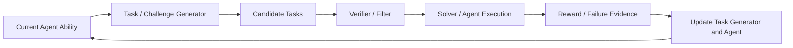
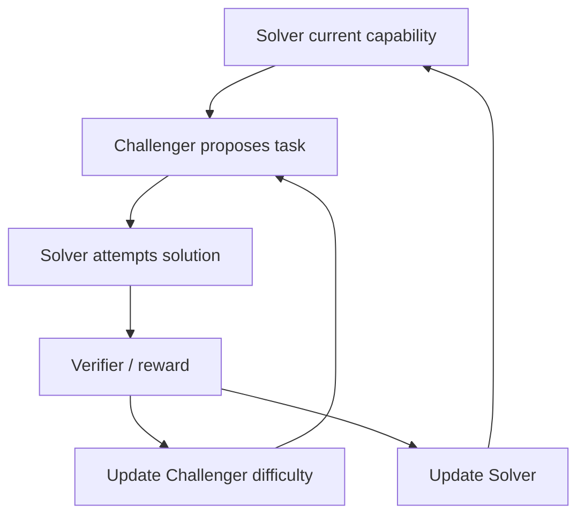

# 04. 自生成任务与 Self-Play：谁来构造下一轮学习环境

> 自进化不只需要更新经验或策略，还需要决定下一轮应该学习什么。任务生成、课程调度和角色共同演化是 2026 年的重要热点。

## 研究问题

如果训练任务固定，Agent 可能很快对既有数据分布过拟合；如果任务完全随机，又可能超出当前能力边界或缺乏验证条件。

自生成课程的目标是：

```text
任务足够难，能够暴露能力缺口
任务又必须可完成、可验证、可用于产生学习信号
```



## 论文地图

| 论文 | 角色结构 | 进化对象 | 校企合作状态 |
| --- | --- | --- | --- |
| [R-Zero](https://arxiv.org/abs/2508.05004) | Challenger + Solver | 任务课程与推理策略 | 是：腾讯 + 多所高校 |
| [Socratic-SWE](https://arxiv.org/abs/2606.07412) | Skill → Task → Solver | 代码修复任务课程 | 是：阿里 + 上交 |
| [Skill Self-Play](https://arxiv.org/abs/2607.22529) | Proposer + Solver + Skill Controller | 任务、Skill 与策略 | 扩展参考，开源项目 |
| [Native Evolution](https://arxiv.org/abs/2604.18131) | Explorer + knowledge use | 世界知识与后续策略 | 扩展参考 |
| [SAGE](https://arxiv.org/abs/2603.15255) | Challenger + Planner + Solver + Critic | 多角色课程与推理 | 扩展参考 |

## 1. R-Zero：Challenger 与 Solver 的共同演化

### 论文定位

**[R-Zero: Zero-Data Self-Evolving LLM Reasoning](https://arxiv.org/abs/2508.05004)** 研究在缺少人工标注数据的情况下，如何通过 Challenger 与 Solver 的交互生成课程并改善推理能力。

### 核心闭环



Challenger 的目标不是无限提高任务难度，而是生成接近 Solver 能力边界、同时仍可验证的任务。

### 进化对象

```text
任务分布 / 课程
+
Solver 推理策略
```

### 阅读判断

- Challenger 如何避免生成无解任务；
- 验证器如何保证奖励可信；
- 任务难度是否真正随 Solver 能力增长；
- 自生成任务是否与真实 benchmark 分布一致。

## 2. Socratic-SWE：Skill 驱动的真实代码任务生成

Socratic-SWE 在软件工程环境中提供了一种更具约束的课程生成方式：

```text
历史修复轨迹
→ 提炼 Skill
→ 根据 Skill 缺口生成仓库修复任务
→ 执行验证
→ 训练 Solver
```

它与 R-Zero 的区别是：R-Zero 更偏抽象推理任务的自生成；Socratic-SWE 使用真实代码仓库和执行验证约束课程质量。

## 3. Skill Self-Play：任务、Skill 与求解器共同演化

### 论文定位

**[Skill Self-Play](https://arxiv.org/abs/2607.22529)** 以 proposer、solver 和 skill controller 组成自博弈闭环。

### 关键思想

```text
Skill Library
→ 为任务生成提供能力边界
→ 生成新的可验证挑战
→ Solver 执行
→ 根据结果修订 Skill 与任务策略
```

它将 Skill 视为连接开放任务生成与可验证执行的中介层。

### 阅读判断

该方向特别需要检查：

```text
Proposer 是否只生成容易得分的任务？
Skill 是否只是记忆训练题？
Verifier 是否足以过滤无效任务？
Solver 的改进是否能迁移到外部 benchmark？
```

## 4. Native Evolution：未知环境中的知识形成

### 论文定位

**[Native Evolution](https://arxiv.org/abs/2604.18131)** 关注 Agent 在未知环境中自主探索、生成 world knowledge，并将其用于后续任务。

### 研究意义

它将自进化的重点从“已知 benchmark 上改进”转向：

```text
探索
→ 构造环境知识
→ 使用知识完成下游任务
```

这一方向与传统课程学习的区别在于，课程不一定由显式 Challenger 生成，而可能由环境交互本身诱发。

## 5. SAGE：多角色共同演化

### 角色分工

```text
Challenger：提出挑战
Planner：分解策略
Solver：执行求解
Critic：反馈与纠错
```

多角色结构试图将任务生成、规划、执行和评价拆分，避免由单一模型同时承担所有职责。

### 风险

多角色不自动等于有效自进化。若角色共享同一偏差、Verifier 不独立或任务分布退化，多 Agent 系统可能只是放大错误。

## 横向比较

| 工作 | 任务来源 | 验证方式 | 最主要的风险 |
| --- | --- | --- | --- |
| R-Zero | Challenger 自生成 | 任务 verifier / reward | 课程质量与能力边界失配 |
| Socratic-SWE | Skill 引导的真实仓库任务 | 执行测试 | 数据泄漏与仓库分布偏移 |
| Skill Self-Play | Proposer 生成 | 可验证任务机制 | proposer 迎合评分 |
| Native Evolution | 环境探索 | 下游任务表现 | 探索成本与知识可靠性 |
| SAGE | 多角色协作 | Critic / verifier | 角色偏差共振 |

## 本方向的阅读判断

课程演化是否可靠，关键不在于“任务是否越来越难”，而在于：

```text
任务是否处于能力边界？
任务是否可验证？
任务是否与目标分布相关？
更新是否由独立新鲜样本决定？
```
