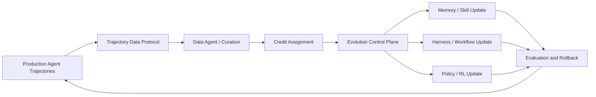
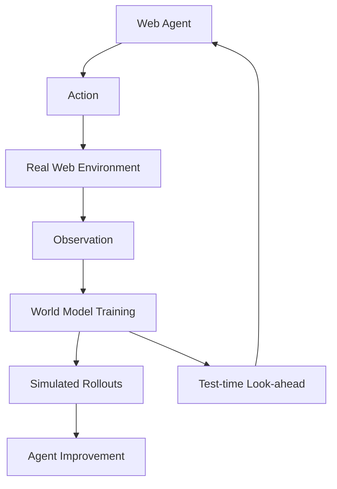

# 05. Agentic RL 与系统基础设施：从轨迹到可控更新

> Agent 自进化在企业环境中不仅是算法问题。要让真实工作流产生可用于更新的训练信号，需要轨迹协议、数据治理、信用分配、版本控制、回滚与持续评测。

## 研究问题

典型离线 RL 或后训练假设已经存在干净的数据集和明确奖励；生产 Agent 的真实情况通常是：

```text
轨迹来自异构工具与环境
任务长度不固定
错误与成功交织
反馈延迟或不完整
隐私、权限和安全约束存在
Memory、Skill、Harness、Policy 可同时变化
```

因此 Agentic RL 系统需要回答：

```text
什么轨迹可以进入训练？
信用如何分配到具体动作或模块？
何时更新 Memory、Skill、Harness 或权重？
如何验证和回滚更新？
```



## 论文地图

| 论文 | 系统对象 | 主要贡献 | 校企合作状态 |
| --- | --- | --- | --- |
| [Next-Generation Agentic RL Systems](https://arxiv.org/abs/2607.01120) | 轨迹、数据代理、演化控制平面 | 企业级自进化系统三层结构 | 是：蚂蚁 + 港科大 + 清华 |
| [WebEvolver](https://aclanthology.org/2025.emnlp-main.454/) | Web Agent + World Model | 共同演化的世界模型、推理时 look-ahead | 企业主导参考：腾讯 AI Lab |
| [AgentEvolver](https://arxiv.org/abs/2511.10395) | 任务、探索、信用分配 | Self-questioning、self-navigating、self-attributing | 企业主导参考：通义实验室 |
| [RLCER](https://arxiv.org/abs/2602.10885) | Reasoner + Rubricator | 自演化 rubric 形成过程级 RL 信号 | 是：字节 + 高校 |

## 1. Next-Generation Agentic RL Systems

### 论文定位

**[Next-Generation Agentic Reinforcement Learning Systems Enable Self-Evolving Agents](https://arxiv.org/abs/2607.01120)** 讨论企业级自进化 Agent 所需的系统基础设施，而不是仅提出单一优化算法。

### 三层结构

```text
1. Agent Trajectory Data Protocol
2. Data Agent
3. Evolution Control Plane
```

#### Agent Trajectory Data Protocol

目标是将真实 Agent 交互描述为可回放、可归因、可治理的数据对象，包括：

```text
状态
工具调用
环境 observation
中间推理或计划
反馈
权限与来源信息
```

#### Data Agent

负责将生产轨迹转换为可用于训练或分析的数据：

```text
过滤低质量轨迹
去除隐私与敏感信息
归纳任务与结果
标记失败类型
生成或聚合 reward 信号
```

#### Evolution Control Plane

决定更新什么、何时更新以及如何回滚：

```text
Memory
Skill
Tool Harness
Prompt / Workflow
Policy Weights
```

### 阅读判断

系统论文的核心不应只看“是否支持在线 RL”，还应检查：

- 轨迹是否能跨工具和跨版本重放；
- 训练数据如何治理；
- 更新是否有版本与回滚；
- 不同更新对象的评测是否分离；
- 线上反馈如何避免污染训练闭环。

## 2. WebEvolver：世界模型辅助的 Web Agent 改进

### 论文定位

**[WebEvolver](https://aclanthology.org/2025.emnlp-main.454/)** 提出 Web Agent 与 World Model 的共同演化。World Model 同时承担两类功能：

```text
生成额外交互数据
推理时预测未来网页 observation
```

### 方法结构



### 研究意义

真实网页交互成本高、状态变化快且难以反复探索。World Model 试图提供低成本模拟轨迹，但也引入模型偏差：若世界模型预测错误，可能把 Agent 引向不存在的网页状态。

## 3. AgentEvolver：探索与信用分配

### 论文定位

**[AgentEvolver](https://arxiv.org/abs/2511.10395)** 的三项机制：

```text
Self-questioning
Self-navigating
Self-attributing
```

分别对应：

| 模块 | 作用 |
| --- | --- |
| Self-questioning | 自主生成具有探索价值的任务或问题 |
| Self-navigating | 利用经验提高探索效率 |
| Self-attributing | 对轨迹中的不同动作进行细粒度 credit assignment |

### 研究意义

该工作强调 Agent 自进化不只是“保存经验”，还包括：

```text
找什么问题
如何探索
哪一步应得到正负信用
```

## 4. 在线更新对象的选择

在企业系统中，应避免将所有问题都交给参数更新。

| 问题类型 | 更合适的更新对象 |
| --- | --- |
| 单次工具错误 | Harness / Tool Wrapper |
| 可复用操作流程 | Skill / SOP |
| 长期用户偏好或上下文 | Memory |
| 某类任务的推理策略 | Prompt / Workflow / Policy |
| 大规模稳定能力缺口 | 参数训练 / 在线 RL |

这体现了 Evolution Control Plane 的价值：同一条轨迹不一定应该更新同一类组件。

## 5. 高频阅读问题

### 轨迹数据协议为什么重要？

因为没有统一轨迹表示，工具调用、环境状态、奖励和版本信息无法被可靠关联，后续难以回放、审计、做信用分配或进行数据治理。

### 为什么需要独立的控制平面？

因为 Memory、Skill、Prompt、Harness 和模型权重的更新成本、风险和回滚方式不同。将所有更新混在单一 Agent Loop 中，会导致难以定位退化原因。

### Web 世界模型的风险是什么？

世界模型可以降低探索成本，但也会带来 simulation bias；必须区分真实环境收益与模拟环境收益，并定期用真实网页交互校准。

## 本方向的阅读判断

企业级 Agent 自进化是否可信，取决于：

```text
轨迹是否可审计
反馈是否可归因
更新对象是否匹配问题类型
版本是否可回滚
线上收益是否经独立评测确认
```
