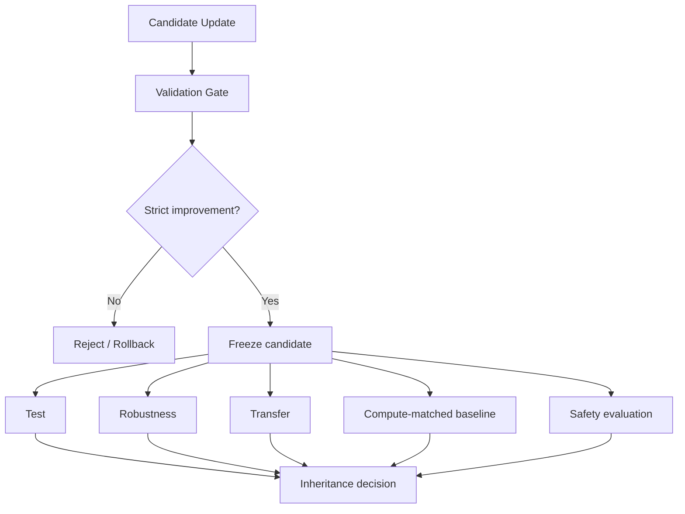

# 06. 评测、安全与反过拟合：如何证明 Agent 真的在进化

> 自进化论文最容易出现的误判是：将更多候选、更长轨迹、更多采样或验证集适配误认为能力提升。本方向关注选择、泛化、继承控制与长期安全。

## 研究问题

一个 Candidate Skill 或更新版本出现之后，至少需要区分：

```text
它被修改出来了吗？
它在 Validation 上变好了吗？
它在独立 Test 上变好了吗？
它对任务扰动仍然有效吗？
它能迁移到新任务吗？
它只是多用了 test-time computation 吗？
它是否带来长期安全风险？
```



## 论文地图

| 论文 | 关注点 | 主要贡献 | 校企合作状态 |
| --- | --- | --- | --- |
| [Rethinking Self-Evolving Agent Skills](https://arxiv.org/abs/2608.02636) | 反馈条件与多轮动态 | Validation/Test/Robustness/Transfer 与 test-time scaling 对照 | 已完成深度解读 |
| [EvoMemBench](https://arxiv.org/abs/2605.18421) | Memory 评测 | 记忆类型与时间尺度的统一评测 | 扩展参考 |
| [SkillEvoReg](https://arxiv.org/abs/2609.30861) | Skill 过拟合 | 更新正则、复杂度控制与反事实验证 | 扩展参考 |
| [SkillSandbox](https://arxiv.org/abs/2610.10088) | Skill 验证 | 动态 sandbox 对照 | 扩展参考 |
| [Selection Is Not Learning](https://arxiv.org/abs/2610.22029) | 继承选择 | 自生成任务可学习不等于更新值得继承 | 扩展参考 |
| Safety in Self-Evolving Agents | 长期安全 | 自进化风险分类与缓解 | 扩展参考，综述 |

## 1. Rethinking Self-Evolving Agent Skills

已完成单篇深度解读：[Agent Skill 自进化的反馈动力学：论文解读](../rethinking-self-evolving-agent-skills.md)。

其方法论价值包括：

```text
固定模型、优化器和验证规则
只改变反馈视图
使用 Validation 选择版本
使用独立 Test 报告结果
额外报告 Robustness、Transfer 与 test-time scaling 对照
```

论文观察到：388 个候选中只有 55 个形成新的 byte-distinct validation best，说明有效改进是稀疏的。

## 2. EvoMemBench：记忆能力的分解评测

**[EvoMemBench](https://arxiv.org/abs/2605.18421)** 关注 Memory Agent 应该如何被评测。

其核心划分：

| 维度 | 类型 |
| --- | --- |
| 时间范围 | episode 内 / 跨 episode |
| 信息类型 | 知识型 / 执行型 |

该框架提示：

```text
最终任务成功率上升
不等于记忆真的被正确提取和使用
```

需要拆开测试：记忆写入、记忆检索、记忆执行影响与跨任务泛化。

## 3. SkillEvoReg：Skill 演化为何会过拟合

**[SkillEvoReg](https://arxiv.org/abs/2609.30861)** 关注多轮 Skill 更新的典型风险：

```text
局部 Validation 提升
→ Skill 变得更复杂
→ 库中近似 Skill 增加
→ 未见任务收益下降
```

其研究方向包括：

- Skill dropout；
- 复杂度正则；
- 反事实效用检验；
- 更新频率控制。

核心判断是：

```text
更多 Skill
≠
更强的长期能力
```

## 4. SkillSandbox：入库前的动态验证

**[SkillSandbox](https://arxiv.org/abs/2610.10088)** 为候选 Skill 构建动态执行场景，并比较：

```text
使用 Skill 的任务表现
vs
不使用 Skill 的任务表现
```

这种边际对照比“Skill 描述看起来合理”更强，因为它要求 Skill 在执行层面证明效用。

## 5. Selection Is Not Learning

**[Selection Is Not Learning](https://arxiv.org/abs/2610.22029)** 针对自生成课程与 self-play 提出一个重要区分：

```text
某任务对当前模型可学习
≠
由该任务产生的参数更新值得继承
```

如果 Agent 只根据内部生成任务的 reward 继承更新，可能积累局部有效但外部无益的策略。该工作强调使用新鲜、独立评测任务决定更新是否继承。

## 6. 长期安全问题

自进化安全与单次 Agent 安全的区别在于，错误可以被持久化并跨任务传播：

```text
错误反思
→ 错误 Memory
→ 错误 Skill
→ 未来任务检索与复用
→ 长期行为漂移
```

需要关注：

- reward hacking；
- 记忆投毒与错误继承；
- Skill / SOP 权限扩大；
- verifier 被当前策略迎合；
- 自生成任务分布退化；
- 参数 Fast Weights 的不可解释偏移；
- 更新版本缺少回滚。

## 7. 建议的评测矩阵

| 层面 | 需要回答的问题 |
| --- | --- |
| Candidate | 是否真实不同于 Parent？ |
| Validation | 是否满足继承门槛？ |
| Test | 是否对独立测试有效？ |
| Robustness | 输入扰动后是否稳定？ |
| Transfer | 新任务或新分布上是否迁移？ |
| Compute control | 是否只是多采样或更多工具调用？ |
| Safety | 是否引入权限、隐私或长期污染风险？ |
| Rollback | 退化时能否回到已验证版本？ |

## 本方向的阅读判断

自进化系统的核心不是“能不能修改自己”，而是：

```text
谁有权决定更新被继承？
继承标准是否独立于训练反馈？
如何评估长期收益与长期风险？
```

没有这些机制的系统，更准确地说是自适应或搜索，而不足以证明稳定的持续进化。
