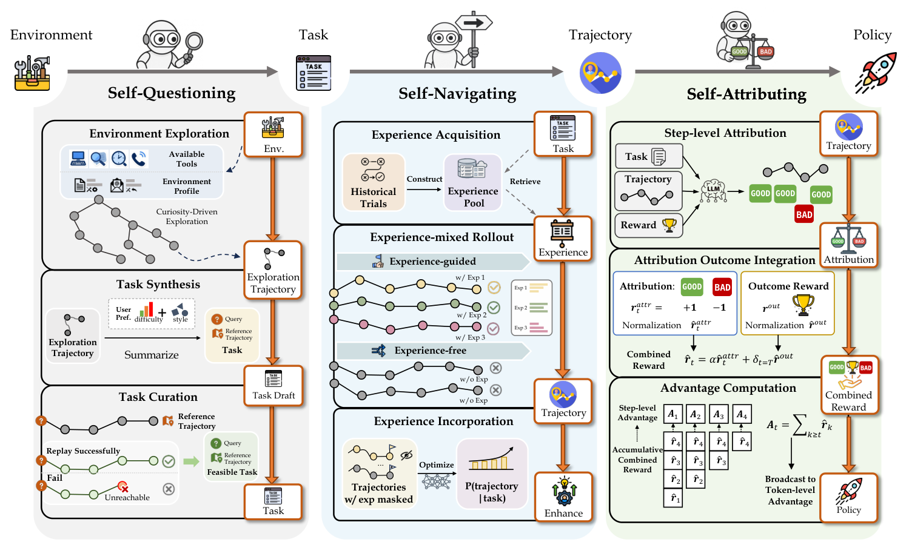
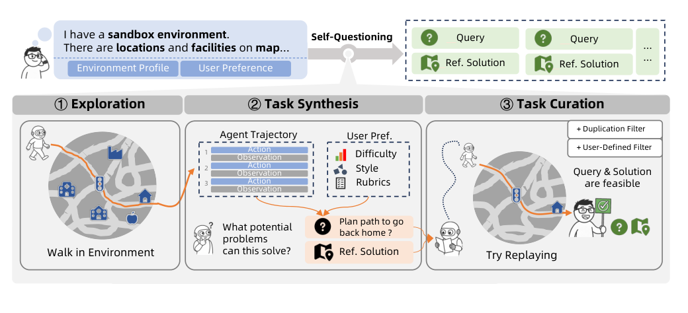

# AgentEvolver：把自进化拆成出题、导航和归因

> 论文：**[AgentEvolver: Towards Efficient Self-Evolving Agent System](https://arxiv.org/abs/2511.10395)**  
> 研究对象：Self-questioning、Self-navigating、Self-attributing，以及可扩展的 Agent RL 基础设施。  
> 核心观点：Agent 自进化并非一个单一优化问题，而是至少包含“探索什么”“如何复用经验”“长轨迹中哪一步值得奖励”三个瓶颈。

## 1. 三个瓶颈

传统 Agentic RL 往往假设任务、轨迹和 reward 已经存在。但真实环境中：

```text
训练任务不够多，也不一定覆盖能力缺口
长轨迹探索成本高，成功经验难以复用
最终奖励太稀疏，无法判断每一步的贡献
```

AgentEvolver 将它们分别交给三个机制：

| 机制 | 解决问题 |
| --- | --- |
| Self-questioning | 自己提出探索价值较高的任务 |
| Self-navigating | 用结构化经验引导轨迹探索 |
| Self-attributing | 为长轨迹中的动作分配细粒度 credit |

{ .paper-figure }

## 2. Self-questioning：不是随便生成任务

{ .paper-figure }

Self-questioning 包含 exploration、task synthesis 与 task curation。它先在环境中探索，再基于观察构造任务，而不是在脱离环境的 prompt 中凭空出题。

论文还比较不同任务来源：原始目标分布、合成训练分布和二者混合。Qwen2.5-14B 的结果中，混合分布在 AppWorld/BFCL 的平均 best@8 达到 74.6，高于原始目标 68.0 和纯合成 68.8，说明任务多样性与目标相关性需要同时保留。

## 3. Self-navigating：显式经验与探索-利用平衡

AgentEvolver 将过去有效的轨迹整理为自然语言经验，在当前任务中检索并指导部分 rollout。它并不要求所有 rollout 都遵循经验：

```text
一部分 rollout：经验引导，偏向 exploitation
另一部分 rollout：无经验或弱经验，保留 exploration
```

论文使用不对称的优化设置调节经验轨迹和探索轨迹的权重，避免模型过快锁定在当前经验库。

原文 Table 4 中：

| 设置 | AppWorld avg@4 | BFCL avg@4 | Overall avg@4 |
| --- | ---: | ---: | ---: |
| w/o RL zero-shot | 17.3 | 33.0 | 25.2 |
| + experience | 20.2 | 41.5 | 30.9 |
| RL baseline | 51.5 | 62.8 | 57.2 |
| Navigating（不做选择） | 53.1 | 60.3 | 56.7 |
| Navigating（完整） | **64.7** | **65.3** | **65.0** |

“有经验”不等于“全部使用经验”。不做选择的 Navigating 在总体上低于完整版本，说明经验召回、质量筛选和探索配比都重要。

## 4. Self-attributing：解决长轨迹 reward 稀疏

若只在最终步骤给成功/失败奖励，早期动作都获得相同的信用，导致：

```text
无关步骤也被正向强化
真正关键动作没有更强信号
长轨迹样本利用效率低
```

Self-attributing 为每个动作估计局部归因 reward，再与最终 outcome reward 结合：

\[
\hat r_t=\alpha\cdot\hat r_t^{\operatorname{attr}}
+\mathbb{1}_{t=T}\cdot\hat r^{\operatorname{out}}
\]

它不是完全替代最终奖励，而是把“该步骤对成功是否有贡献”的信号加进回报。

## 5. 主结果：三种机制的累积贡献

原文 Table 1：

| Backbone | 设置 | AppWorld best@8 | BFCL best@8 | Overall best@8 |
| --- | --- | ---: | ---: | ---: |
| Qwen2.5-7B | zero-shot | 5.6 | 42.4 | 24.0 |
|  | + Questioning | 40.3 | 60.6 | 50.5 |
|  | + Questioning & Navigating | 43.1 | 61.0 | 52.1 |
|  | + Questioning & Attributing | 43.7 | 65.3 | 54.5 |
|  | AgentEvolver | **51.2** | **69.0** | **60.1** |
| Qwen2.5-14B | zero-shot | 31.4 | 54.1 | 42.8 |
|  | AgentEvolver | **69.4** | **76.7** | **73.1** |

### 5.1 如何解读

- Questioning 带来最大的一次跳跃，说明训练任务数量与覆盖面确实是 Agent RL 的主要瓶颈；
- Navigating 和 Attributing 继续带来增益，且增益在不同 benchmark 上不同；
- 三者一起最好，支持它们是互补机制；
- 结果是 `best@8`，包含八次采样中的最好结果，不能直接等同单次部署成功率，需同时关注 avg@8。

## 6. Attribution 消融

原文 Table 5 中，Qwen2.5-14B 的 Overall best@8：

| 设置 | Overall best@8 |
| --- | ---: |
| 基础模型 | 41.5 |
| Attributing | **75.7** |
| 去掉 attribution reward | 71.7 |
| 去掉 outcome reward | 66.9 |

这表示细粒度 credit 与最终结果奖励都不可少。只保留 attribution reward 会失去与任务目标的最终锚点；只保留 outcome reward 则无法高效利用长轨迹。

## 7. 系统层含义

AgentEvolver 还强调工程基础设施：环境接口、轨迹格式、RL 栈和 context-managing template。其意义是：算法模块必须落在可收集、可重放和可评测的轨迹系统中，否则 Self-questioning 生成的任务、Self-navigating 的经验、Self-attributing 的细粒度 reward 很难协调。

## 8. 证据边界

论文支持：

1. 将任务生成、经验导航和动作归因分开优化可提高 AppWorld/BFCL 表现；
2. 合成任务与目标分布混合比单一来源更稳健；
3. 经验选择和归因 reward 具有独立消融贡献；
4. 细粒度奖励可以改善样本效率。

需要谨慎：

```text
best@8 包含额外测试时采样预算；
任务生成与目标 benchmark 的潜在重叠需要持续审查；
动作归因质量依赖归因模型/奖励设计；
合成任务的长期多轮稳定性仍受环境覆盖限制；
AppWorld/BFCL 的提升不自动外推到开放网页或真实企业流程。
```

## 9. 高频问题

### Q1：三项机制中哪个最重要？

**回答：**从 Table 1 看，Self-questioning 通常带来最大首轮收益，因为它扩大了训练任务供给；但完整系统优于只加任一模块，说明任务、探索和 credit assignment 是相互制约的。

### Q2：Self-navigating 是不是简单 RAG？

**回答：**它会检索经验，但核心还包括经验引导 rollout 的选择和探索-利用平衡。若把所有检索经验都直接拼入上下文，可能降低探索质量；论文的“w/o select”消融体现了这一点。

### Q3：细粒度 attribution 会不会错误归因？

**回答：**会。长轨迹里动作之间有依赖，局部奖励估计可能把后续结果错误归给早期动作。因此论文保留 outcome reward 作为锚点；生产系统还需独立审计和反事实验证。

## 10. 阅读结论

AgentEvolver 的价值是把模糊的“自进化”拆成三件可测的事：

> 自己发现训练任务、在执行中正确利用经验、把最终反馈分配给真正有贡献的动作。

这三个环节任一失效，长期 Agentic RL 都容易退化为低质量轨迹的循环放大。
