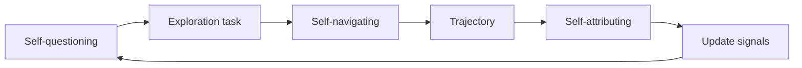

# AgentEvolver：探索、任务生成与信用分配

> 论文：**[AgentEvolver](https://arxiv.org/abs/2511.10395)**  
> 作者单位：通义实验室。  
> 方向：Self-questioning、Self-navigating、Self-attributing。

## 1. 研究问题

Agent 自进化常被简化为“从经验中学习”，但实际还需回答：

```text
下一步探索什么？
如何利用已有经验缩短探索？
长轨迹中哪个动作真正导致成功或失败？
```

## 2. 三项机制

| 模块 | 作用 |
| --- | --- |
| Self-questioning | 自主提出具有探索价值的问题或任务 |
| Self-navigating | 利用经验提高探索与路径选择效率 |
| Self-attributing | 对轨迹中不同动作进行细粒度 credit assignment |



## 3. 研究意义

AgentEvolver 将自进化拆成任务、探索和归因三个部分。其价值在于指出：仅保存成功/失败轨迹不足以形成有效更新，必须回答每一步对结果的贡献。

## 4. 阅读重点

- Self-questioning 产生的问题是否具有真实学习价值；
- Self-navigating 是否仅等同于更长的检索上下文；
- credit assignment 是否经过独立验证；
- 探索收益是否在外部任务上保持；
- 长轨迹的错误归因如何避免。

## 5. 阅读结论

AgentEvolver 的核心启示是：

> 自进化不仅取决于“记住了什么”，还取决于“探索了什么”以及“把反馈归因给了什么”。
