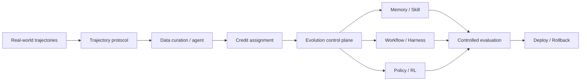

# Agentic RL 与系统基础设施

> 本目录关注真实 Agent 自进化如何从算法走向系统：轨迹如何记录、数据如何治理、更新对象如何选择、线上版本如何评测与回滚。

## 研究链路



## 待深读论文清单

本方向尚未发布完整单篇解读。以下论文需要分别核对系统架构、数据协议、在线评测和回滚条件。

| 论文 | 核心对象 | 重点阅读问题 |
| --- | --- | --- |
| [Next-Generation Agentic RL Systems](https://arxiv.org/abs/2607.01120) | 企业轨迹与演化控制平面 | 生产轨迹如何被治理、归因和回滚？ |
| [WebEvolver](https://aclanthology.org/2025.emnlp-main.454/) | Web Agent 与 World Model | 世界模型的模拟收益如何与真实网页收益区分？ |
| [AgentEvolver](https://arxiv.org/abs/2511.10395) | 自提问、探索与信用分配 | 长轨迹 credit assignment 如何被验证？ |
| [RLCER](https://arxiv.org/abs/2602.10885) | 自演化 Rubric 与训练信号 | Rubric 演化如何和系统级更新协同？ |

## 阅读原则

```text
轨迹是否可重放、可审计、可治理？
数据与评测是否分离？
Memory、Skill、Harness、权重更新是否被分别控制？
线上更新是否有版本、权限与回滚？
改进是否来自真实执行，而非模拟或额外测试预算？
```
