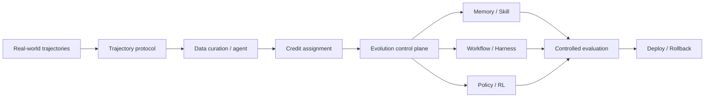

# Agentic RL 与系统基础设施

> 本目录关注真实 Agent 自进化如何从算法走向系统：轨迹如何记录、数据如何治理、更新对象如何选择、线上版本如何评测与回滚。

## 研究链路



## 单篇解读

| 论文 | 核心对象 | 单篇解读 |
| --- | --- | --- |
| Next-Generation Agentic RL Systems | 企业轨迹与演化控制平面 | [阅读](next-generation-agentic-rl.md) |
| WebEvolver | Web Agent 与 World Model | [阅读](webevolver.md) |
| AgentEvolver | 自提问、探索与信用分配 | [阅读](agentevolver.md) |
| RLCER | 自演化 Rubric 与训练信号 | [阅读](../verifier-rubric/rlcer.md) |

## 阅读原则

```text
轨迹是否可重放、可审计、可治理？
数据与评测是否分离？
Memory、Skill、Harness、权重更新是否被分别控制？
线上更新是否有版本、权限与回滚？
改进是否来自真实执行，而非模拟或额外测试预算？
```
