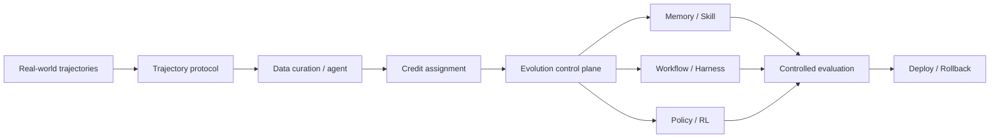

# Agentic RL 与系统基础设施

> 本目录关注真实 Agent 自进化如何从算法走向系统：轨迹如何记录、数据如何治理、更新对象如何选择、线上版本如何评测与回滚。

## 研究链路



## 单篇阅读

| 论文 | 核心对象 | 入口 |
| --- | --- | --- |
| [AgentEvolver](agentevolver.md) | 自提问、探索与信用分配 | 任务、经验与长轨迹归因 |
| [WebEvolver](webevolver.md) | Web Agent 与 World Model | 模拟轨迹与推理时 look-ahead |
| [Next-Generation Agentic RL Systems](next-generation-agentic-rl.md) | 企业轨迹与演化控制平面 | ATDP、Data Proxy、Control Plane、AReaL 2.0 |
| [RLCER](../verifier-rubric/rlcer.md) | 自演化 Rubric 与训练信号 | Reward 组件如何本身成为演化对象 |

## 阅读顺序

```text
AgentEvolver：训练回路的三个算法瓶颈
→ WebEvolver：加入环境 World Model 后如何训练和规划
→ Next-Generation Agentic RL Systems：如何把轨迹、数据治理和更新控制做成系统
```

## 阅读原则

```text
轨迹是否可重放、可审计、可治理？
数据与评测是否分离？
Memory、Skill、Harness、权重更新是否被分别控制？
线上更新是否有版本、权限与回滚？
改进是否来自真实执行，而非模拟或额外测试预算？
```

系统方向的论文尤其需要说明“更新发生在哪里”：模型权重、Memory、Skill、Tool Harness 或 workflow 的风险和回滚方式完全不同。
