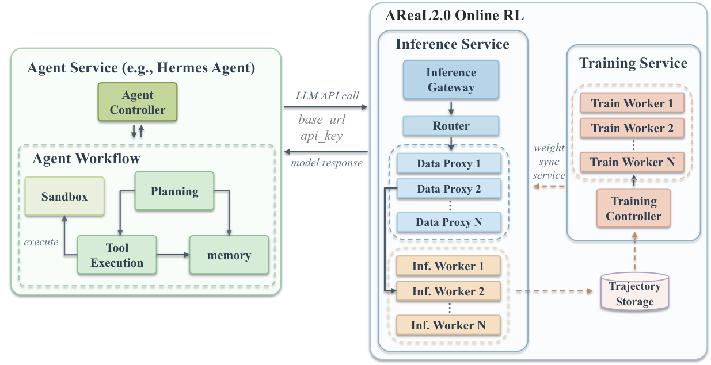

# Next-Generation Agentic RL Systems：让真实 Agent 经验可治理、可训练、可回滚

> 论文：**[Next-Generation Agentic Reinforcement Learning Systems Enable Self-Evolving Agents](https://arxiv.org/abs/2607.01120)**  
> 研究类型：系统架构论文 / AReaL 2.0 原型。  
> 重点不在提出一个新 reward 算法，而在回答：生产 Agent 的真实轨迹怎样变成具有来源、权限、信用分配和回滚能力的学习材料？

## 1. 为什么“收集日志再做 RL”不够

部署中的 Agent 轨迹往往跨越：模型调用、工具执行、检索、用户反馈、memory、权限控制和多个版本的 workflow。若只保存 prompt-response，许多训练所需信息已经丢失：

```text
当前观察是什么？
内部计划和工具参数是什么？
动作在环境中产生了什么后果？
奖励来自哪个 verifier 或用户？
这条轨迹是否包含敏感数据？
失败应该更新模型、Skill、Memory、Harness，还是根本不该更新？
```

论文提出：企业级自进化的瓶颈不只是更强 LLM 或更好 RL 算法，而是缺少把部署经验转成可审计、可归因、可重放数据的系统底座。

## 2. 三个支柱

### 2.1 Agent Trajectory Data Protocol（ATDP）

论文将一条轨迹写为事件序列：

\[
\boldsymbol\tau=(\mathbf e_1,\mathbf e_2,\ldots,\mathbf e_T)
\]

每个 step event 包含：

\[
\mathbf e_t=\langle\mathbf o_t,\mathbf h_t,\mathbf a_t,\mathbf y_t,r_t,\mathbf m_t\rangle
\]

可对应为：

| 字段 | 含义 |
| --- | --- |
| \(o_t\) | observation / 环境状态 |
| \(h_t\) | 历史与上下文 |
| \(a_t\) | Agent action / 工具调用决策 |
| \(y_t\) | 模型生成或执行输出 |
| \(r_t\) | reward / 反馈 |
| \(m_t\) | 元数据，如版本、来源、权限、治理状态 |

ATDP 的目的不是增加日志字段，而是让轨迹达到 RL-grade：能够重放、做 credit assignment、筛选数据，并追溯更新来源。

### 2.2 Comprehensive Agentic Data Proxy

Data Proxy 位于真实 Agent 服务与训练系统之间，负责：

```text
截获多模型、多工具、多 memory 的交互
脱敏和权限处理
记录来源与版本
聚合 reward、用户反馈和失败类型
筛选、标注、重放和构造训练样本
```

它的核心工程意义是把“生产日志”变成“可治理学习数据”。没有这层，模型训练通常会混入无法解释的轨迹、隐私问题和版本不一致。

### 2.3 Agent Evolution Control Plane

论文把某一时刻的 Agent 表示为：

\[
\mathcal A_t=
\langle\pi_{\theta_t},\mathcal H_{\psi_t},\mathcal M_t,\mathcal T_t,\mathcal G_t\rangle
\]

其中可以分别表示 policy、harness/workflow、memory、toolset 与治理/控制状态。控制平面要选择更新动作：

\[
u^*=\arg\max_{u\in\mathcal U}
\mathcal J_{\mathcal A}(u\mid\mathcal A_t,\mathcal D_t)
\]

换言之，面对同一条失败轨迹，系统要决定该修什么：

| 失败类型 | 可能的更新对象 |
| --- | --- |
| 工具参数或 schema 错误 | Tool wrapper / Harness |
| 重复多步流程 | Skill / SOP |
| 用户偏好、会话事实 | Memory |
| 规划策略缺口 | Prompt / Workflow |
| 可重复且有可靠 reward 的系统性问题 | Policy weights / RL |

这比“所有失败都 fine-tune 模型”更接近生产系统需要的最小变更原则。

## 3. AReaL 2.0：论文给出的在线 RL 原型

{ .paper-figure }

> 图源：论文 Figure 1。AReaL 2.0 演示 policy-model update 分支的在线闭环，而非覆盖全部多表面演化。

图中保留已有 Agent 服务的 planning、tool execution、sandbox 和 memory 模块，只把 LLM API 调用重定向到 gateway。gateway/router 将请求送往 serving、rollout、trajectory collection 和 RL worker，使线上执行与训练过程连接。

这是一种渐进式接入方式：不要求先重写整个 Agent 系统，先把 policy update 分支跑通。

## 4. 论文的贡献应如何理解

这是一篇系统定位论文，不像 benchmark 方法论文那样给出“某个算法在某数据集提升多少点”的主结果。其主要贡献是：

1. 规定 Agentic RL 需要的轨迹数据语义；
2. 提出数据代理如何处理真实生产交互的治理和重放；
3. 提出控制平面如何在 Memory、Skill、Harness、Tool、Policy 等更新表面之间选择；
4. 用 AReaL 2.0 展示在线 policy update 的可运行原型。

因此读这篇论文时，不应期待像 R-Zero 或 Socratic-SWE 那样的单一 benchmark 数字，而应审查系统边界是否清楚、控制面是否覆盖关键更新对象、上线后如何隔离和回滚。

## 5. 生产落地时最重要的检查项

| 问题 | 若缺失会怎样 |
| --- | --- |
| 轨迹能否携带版本和来源？ | 无法追溯某次更新来自哪些行为 |
| 数据是否可脱敏和按权限分区？ | 用户数据可能进入不应访问的训练集 |
| 奖励是否可归因到 step？ | 长轨迹 RL 只能依赖模糊的终局分数 |
| 评测集和线上采集是否分离？ | 模型会对收集/选择机制过拟合 |
| 更新是否 canary、比较、回滚？ | 一次坏更新影响所有用户 |
| 多种更新对象是否独立版本化？ | 修一个 Memory 问题可能误触发 weight update |

## 6. 证据边界

论文明确指出，AReaL 2.0 当前主要实现 policy model update 分支；完整的自进化基础设施仍需要 ATDP 的全面支持、治理式 replay 和自动多表面演化。

它没有证明：

```text
任意企业日志都能无损转化为高质量 RL 数据；
控制平面已经能自动做出正确的更新对象选择；
线上 RL 的收益一定大于风险和算力成本；
Memory、Skill、Harness 和 policy 的联合更新已被完全实现；
权限、隐私、偏差与安全问题已被系统性解决。
```

## 7. 高频问题

### Q1：ATDP 和普通 telemetry / tracing 有什么区别？

**回答：**普通 tracing 主要服务可观测性和排障；ATDP 还需要保存可用于 RL 的状态、动作、结果、奖励、来源和治理信息，使轨迹可被重放、筛选和做 credit assignment。

### Q2：为什么要有 Evolution Control Plane？

**回答：**因为失败原因对应的最小修复面不同。把所有问题都变成权重更新成本高、风险大且不可解释；控制平面负责选择 Memory、Skill、Harness、Tool 或 Policy 的合适更新与回滚路径。

### Q3：AReaL 2.0 是否已经是完整的自进化 Agent？

**回答：**不是。论文将它定位为在线 policy update 原型。完整愿景还要求跨组件轨迹协议、数据治理、受控 replay 和自动多表面更新。

## 8. 阅读结论

这篇论文将 Agent 自进化重新定义为系统问题：

> 只有当真实交互被记录成可治理、可归因、可重放的数据，并且系统知道该更新哪个组件、如何评测和回滚，Agentic RL 才可能从研究脚本走向生产闭环。
