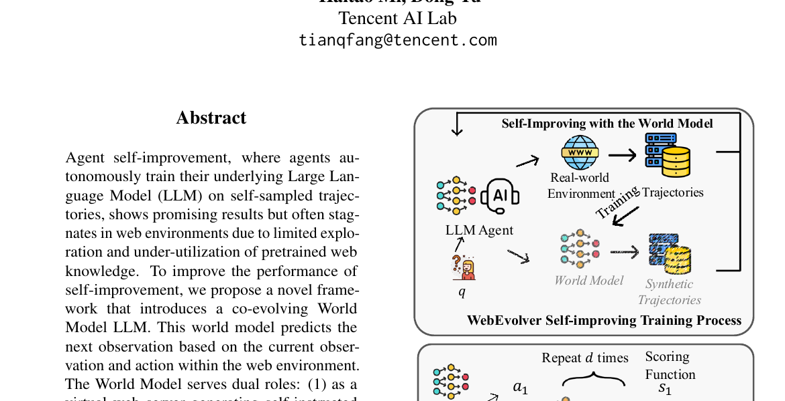

# WebEvolver：让 World Model 与 Web Agent 一起演化

> 论文：**[WebEvolver: Enhancing Web Agent Self-Improvement with Co-evolving World Model](https://aclanthology.org/2025.emnlp-main.454/)**  
> 发表：EMNLP 2025。研究对象：网页 Agent、下一观察预测 World Model、模拟训练轨迹与推理时 look-ahead。  
> 核心问题：真实网页探索昂贵且环境会变化，能否让模型学习网页状态转移，既扩增训练轨迹，又在推理时预演动作后果？

## 1. 为什么 Web Agent 容易在自改进中停滞

网页环境有两个核心困难：

```text
真实交互代价高：错误点击、登录、动态页面都会消耗尝试预算
探索覆盖窄：Agent 容易重复熟悉路径，难以发现新状态
```

纯靠真实网页收集轨迹，成本高且受网站变化影响；纯靠离线自训练，又可能缺少环境后果。WebEvolver 引入一个 World Model：给定当前观察和动作，预测下一观察。

## 2. 原文 Figure 1：World Model 的双重角色

{ .paper-figure }

> 图源：WebEvolver 原文 Figure 1 裁图。

World Model 同时被用作：

| 阶段 | 作用 |
| --- | --- |
| 训练期 | 虚拟网页服务器，生成更多自指令/模拟交互轨迹 |
| 推理期 | imagination engine，对候选动作进行多步 look-ahead |

推理时，Agent 先提出若干候选动作 \(a_1,\ldots,a_k\)，World Model 对每条动作链生成合成观察，再用 scoring function 选择预期更好的动作执行。

## 3. World Model 学的是什么

World Model 不是直接回答用户问题，而是学习近似：

\[
\hat o_{t+1}=f_{\operatorname{world}}(o_t,a_t)
\]

其中 \(o_t\) 是当前网页观察，\(a_t\) 是 Agent 动作。它与 Agent policy 一起更新：真实交互产生轨迹，轨迹训练 World Model；World Model 又生成模拟轨迹和 look-ahead 结果，帮助 policy 改善。

这是一种模型式自改进，风险是 simulation bias：如果预测网页状态偏离真实网站，Agent 可能在“想象环境”中学会错误策略。

## 4. 实验设置

论文以 Cognitive Kernel 的 Web Agent 为基础，使用 Llama-3.3-70B 作为策略和自改进 backbone。训练数据包括 Mind2Web 和 WebVoyager 网站上的 self-instructed queries，共 1,516 个 query；评分环节也尽量使用 Llama-3.3-70B，以避免借助更强闭源 judge。

评测主要使用：

| 基准 | 规模/特点 |
| --- | --- |
| Text-only WebVoyager | 473 queries |
| Mind2Web-Live filtered | 53 queries |
| GAIA-web | 需要网页浏览和推理的补充泛化集 |
| SimpleQA with web agent | 通过网页探索回答事实问题 |

真实网页会变化，论文因此在接近的时间窗口重复评测并报告平均结果；这也意味着该类结果的严格复现比静态 benchmark 更难。

## 5. 主结果应如何读

论文摘要报告 WebEvolver 相对既有 self-evolving agent 获得约 10% 的性能提升。Table 1 将结果拆为：

```text
OpenWebVoyager
WebEvolver
OpenWebVoyager + WMLA
WebEvolver + WMLA
```

因此应区分两种收益：

1. **Self-improvement benefit**：World Model 生成模拟训练数据后，基础 Agent policy 是否更强；
2. **WMLA benefit**：同一 policy 在推理时加入 world-model look-ahead 是否更强。

不能把两者合并后宣称“训练本身提升了全部幅度”。其中一部分来自额外的测试时模型调用和候选动作评估。

## 6. World Model 的预测深度不能无限加

论文对 World Model 内在质量评估结构正确性、网页内容相似度和功能/语义一致性。结果显示预测深度超过 2 时，质量明显下降到低于 0.50；WMLA 的性能增益也在深度大于等于 3 时减弱。

原因很直观：

```text
一步预测错误
→ 下一步以错误观察为条件
→ 误差级联放大
→ 更深的 imagined rollout 反而误导动作选择
```

这与经典 model-based RL 中的 model rollout horizon 问题一致。World Model 有用不意味着越长的模拟越好。

## 7. 外部泛化：GAIA-web 与 SimpleQA

论文 Table 3 的代表结果：

| 模型阶段 | GAIA Level 1 | GAIA Level 2 | SimpleQA |
| --- | ---: | ---: | ---: |
| Llama-3.3-70B | 19.2 | 10.9 | 36 |
| Iter 1 | 26.9 | 15.6 | 44 |

论文报告后续迭代在 Level 1、SimpleQA 上保持趋势，但 Level 2 的收益有限。这个差异很关键：World Model 更直接帮助网页状态预测和动作选择，而复杂的深层逻辑推理可能超出当前训练信号覆盖范围。

## 8. 论文证明与边界

论文支持：

1. 对网页 Agent，World Model 可同时用于训练期轨迹扩增和推理期 action look-ahead；
2. 在 WebVoyager、Mind2Web-Live 等真实网页评测中，方法优于相应 self-improving 基线；
3. 较浅的 look-ahead 有效，过深预测因 simulation bias 失效；
4. 部分收益迁移到 GAIA-web、SimpleQA。

它没有证明：

```text
模拟网页轨迹与真实网页完全等价；
真实网站更新后 World Model 不会迅速过期；
WMLA 的收益在等计算预算下必然优于更多真实采样；
世界模型能可靠支撑深度大于 2 的长规划；
网页环境中的改进可直接迁移到任意工具环境。
```

## 9. 高频问题

### Q1：WebEvolver 是训练 Agent，还是多做了几次推理？

**回答：**两者都有。World Model 在训练期生成合成交互来改进 policy；WMLA 在推理期额外预演候选动作。报告结果时必须区分基础 policy 的改进与 test-time look-ahead 的额外计算收益。

### Q2：为什么 World Model 不直接取代真实网页？

**回答：**它会产生 hallucinated 或过期状态。论文承认训练期可容忍一定噪声，但最终评测和执行仍需真实环境校准；模拟不能成为唯一证据。

### Q3：深度预测为什么会坏？

**回答：**每一步预测误差都会成为下一步输入，误差递推。网页状态复杂、动态且部分可观测，长 imagined rollout 更容易偏离真实轨迹。

## 10. 阅读结论

WebEvolver 将“自进化的对象”从 Agent policy 扩展到环境后果模型：

> 如果 Agent 能更好地预测自己的动作会让网页变成什么样，就能用较低的真实交互成本产生更多训练和规划信号；但所有收益都必须被真实环境持续校准。
