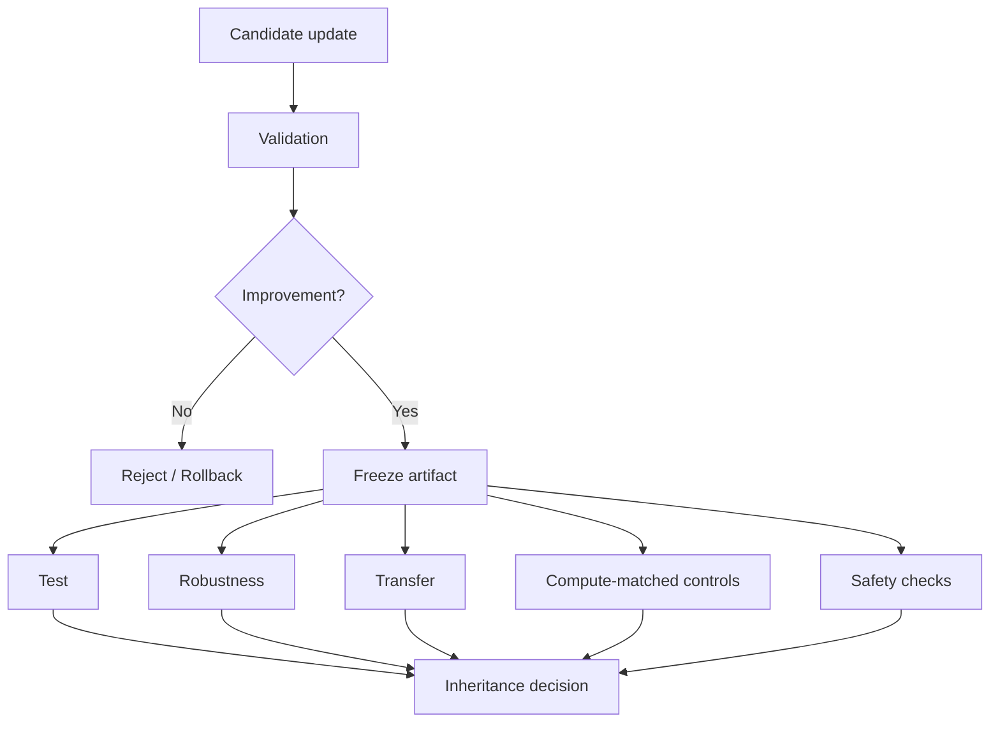

# 评测、安全与反过拟合

> 本目录讨论自进化闭环的继承机制：候选更新何时值得保留，如何排除 test-time sampling、validation 过拟合和错误经验传播，以及如何对长期风险建立控制。

## 核心问题



## 单篇阅读

| 论文 | 关注问题 | 文章 |
| --- | --- | --- |
| Rethinking Self-Evolving Agent Skills | 多轮反馈、验证门控、测试时对照 | [阅读笔记](../../rethinking-self-evolving-agent-skills.md) |
| [EvoMemBench](../memory/evomembench.md) | Memory 评测 | 时间尺度、知识/执行记忆与跨环境迁移 |
| [SkillEvoReg](../skill-sop/skillevoreg.md) | Skill 过拟合 | 复杂度、反例验证与长期库治理 |
| [SkillSandbox](../verifier-rubric/skillsandbox.md) | Skill 动态验证 | 场景合成和 with/without Skill 对照 |
| [Selection Is Not Learning](selection-is-not-learning.md) | 模型继承选择 | 新鲜 probe、经验归档与 HEIRCOMMIT |

## 阅读顺序

```text
Rethinking：先理解多轮演化为什么可能只是选择和采样效应
→ Selection Is Not Learning：确认“新模型是否值得继承”
→ SkillEvoReg：约束持久化 Skill 的结构膨胀和回归
→ SkillSandbox：用动态执行场景验证 Skill 可复用性
→ EvoMemBench：用统一评测轴检查不同记忆系统的真实能力
```

## 阅读原则

```text
候选是否与 Parent 真实不同？
Validation 是否仅用于选择而非最终报告？
是否存在独立 Test、Robustness 与 Transfer？
是否控制了 test-time sampling / tool-call budget？
错误经验是否可被回滚？
安全问题是否会跨任务长期传播？
```

长期安全不是单独的末尾检查。对任何持久化更新，都应记录来源、权限、验证证据、版本和回滚路径；否则一次局部错误可能通过 Memory、Skill 或参数状态跨任务放大。
