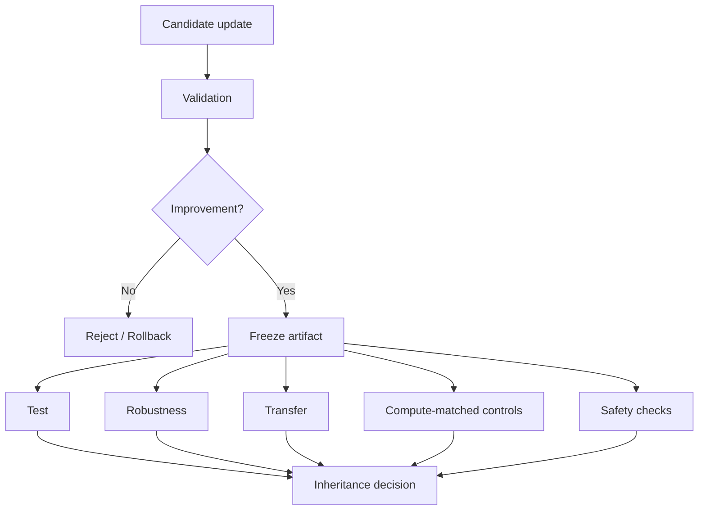

# 评测、安全与反过拟合

> 本目录讨论自进化闭环的继承机制：候选更新何时值得保留，如何排除 test-time sampling、validation 过拟合和错误经验传播，以及如何对长期风险建立控制。

## 核心问题



## 单篇解读

| 论文 | 关注问题 | 单篇解读 |
| --- | --- | --- |
| Rethinking Self-Evolving Agent Skills | 多轮反馈、验证门控、测试时对照 | [深度解读](../../rethinking-self-evolving-agent-skills.md) |
| EvoMemBench | Memory 评测 | [阅读](evomembench.md) |
| SkillEvoReg | Skill 过拟合 | [阅读](skillevoreg.md) |
| SkillSandbox | Skill 动态验证 | [阅读](skillsandbox.md) |
| Selection Is Not Learning | 更新继承选择 | [阅读](selection-is-not-learning.md) |
| Safety in Self-Evolving Agents | 长期安全风险 | [阅读](safety-survey.md) |

## 阅读原则

```text
候选是否与 Parent 真实不同？
Validation 是否仅用于选择而非最终报告？
是否存在独立 Test、Robustness 与 Transfer？
是否控制了 test-time sampling / tool-call budget？
错误经验是否可被回滚？
安全问题是否会跨任务长期传播？
```
