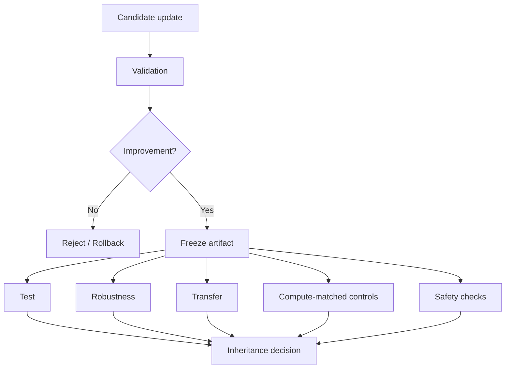

# 评测、安全与反过拟合

> 本目录讨论自进化闭环的继承机制：候选更新何时值得保留，如何排除 test-time sampling、validation 过拟合和错误经验传播，以及如何对长期风险建立控制。

## 核心问题



## 已完成单篇详细解读

| 论文 | 关注问题 | 文章 |
| --- | --- | --- |
| Rethinking Self-Evolving Agent Skills | 多轮反馈、验证门控、测试时对照 | [详细解读](../../rethinking-self-evolving-agent-skills.md) |

## 待深读论文清单

| 论文 | 关注问题 | 重点阅读问题 |
| --- | --- | --- |
| [EvoMemBench](https://arxiv.org/abs/2605.18421) | Memory 评测 | 评测轴是否覆盖记忆的时间与行为影响？ |
| [SkillEvoReg](https://arxiv.org/abs/2609.30861) | Skill 过拟合 | 正则化是否真正改善外部泛化？ |
| [SkillSandbox](https://arxiv.org/abs/2610.10088) | Skill 动态验证 | sandbox 对照的外部有效性如何验证？ |
| [Selection Is Not Learning](https://arxiv.org/abs/2610.22029) | 更新继承选择 | 新鲜评测题如何决定更新是否值得保留？ |
| 长期安全综述方向 | 长期安全风险 | 错误经验跨任务传播的机制与缓解措施是什么？ |

## 阅读原则

```text
候选是否与 Parent 真实不同？
Validation 是否仅用于选择而非最终报告？
是否存在独立 Test、Robustness 与 Transfer？
是否控制了 test-time sampling / tool-call budget？
错误经验是否可被回滚？
安全问题是否会跨任务长期传播？
```
