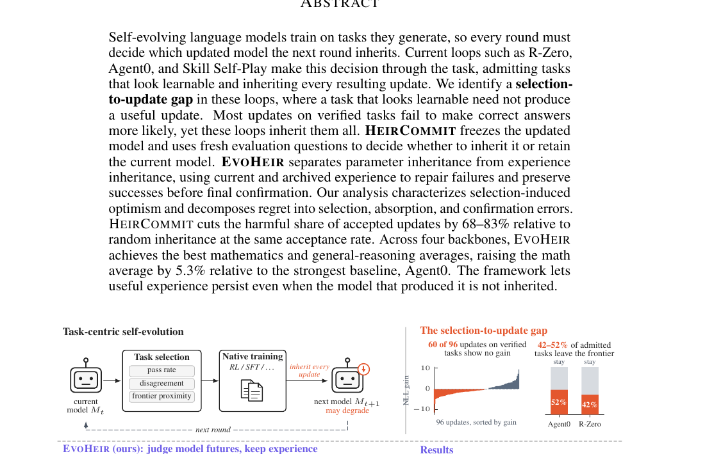

# Selection Is Not Learning：可学习任务不等于值得继承的模型更新

> 论文：**[Selection Is Not Learning: Choosing Model Futures](https://arxiv.org/abs/2610.22029)**  
> 研究对象：任务选择、参数继承、经验归档、fresh confirmation。  
> 核心观点：一条任务在更新前看起来可学，并不能说明这次优化后的模型状态更好；自进化系统必须评估“将要继承的未来模型”，而不是只评估任务本身。

## 1. Selection-to-update gap 是什么

自进化系统常根据任务难度、通过率、模型分歧或 frontier proximity 挑选训练题，然后默认继承由此产生的更新：

```text
选择一个看起来很有训练价值的任务
→ 做一次 SFT / RL 更新
→ 默认把新参数作为下一轮起点
```

论文指出，这里有逻辑跳跃：任务的可学习性是 **更新前** 的行为属性；是否应该继承，是 **更新后** 模型状态的价值问题。

```text
Task looks learnable
≠
The resulting update improves the next model
```

论文审计发现：Agent0 和 R-Zero 中 42% 到 52% 已被接纳的任务，在独立响应下离开了 frontier；Skill Self-Play 的 96 个已验证任务更新中，有 60 个没有带来正的 correct-target NLL gain。

## 2. 原文 Figure 1：先验证模型未来，再决定是否提交

{ .paper-figure }

> 图源：Selection Is Not Learning 原文 Figure 1 裁图。上半部分显示 task-centric loop 的风险，下半部分是 EVOHEIR 的四步流程。

传统循环会“inherit every update”。EVOHEIR 的关键改动是：无论候选怎样产生，先冻结候选 successor，再在**新鲜且独立的 probes**上与当前 root 比较，只有确实更好才提交。

## 3. HEIRCOMMIT：独立确认继承状态

设当前模型状态为 \(S_t\)，候选更新加上经验吸收后的最终 proposal 为 \(S_t^+\)。HEIRCOMMIT 的规则是：

\[
S_{t+1}=
\begin{cases}
S_t^+,&\widehat V^{\operatorname{con}}_t(S_t^+)>\tau_t\\
S_t,&\text{otherwise}
\end{cases}
\]

其中 \(\widehat V^{\operatorname{con}}\) 来自 confirmation pool，且这一 pool 与候选筛选、经验恢复和最终报告分离。

这一步的意义是避免 selection-induced optimism：如果用挑出候选时已经看过的数据来证明候选更好，实际上是在多分支中挑最高噪声；新鲜 probes 才能对“真实会被部署的模型状态”做近似独立判断。

## 4. EVOHEIR 的四步

### 4.1 Explore：构造多个原生候选分支

从当前 root 出发，执行原生 self-evolution 分支，例如 R-Zero、Agent0 或其他训练前缀 checkpoint。每个分支产生：

```text
候选模型状态
该分支的回答、题目、验证轨迹等经验
```

### 4.2 Screen：先选择参数 recipient

在 screening pool 上，将 root 与候选分支做成对比较，选择最有希望作为参数起点的 recipient。此时还不提交，只是决定“谁来吸收经验”。

### 4.3 Recover：经验可以继承，参数不一定继承

EVOHEIR 的重要设计是把两件事拆开：

```text
参数继承：某个候选模型是否值得成为下一轮 root
经验继承：某条成功/失败经验是否值得保留为训练材料
```

即使产生某条有价值经验的 donor 模型本身不够好，经验仍可被归档，供选中的 recipient 用于：

- `D_repair`：当前 recipient 失败、但 archive 中有可靠参考的样本；
- `D_keep`：当前 recipient 已经成功的样本，用于防止修复时遗忘。

论文用冻结的 recipient 作为 teacher，通过带参考的 repair teacher 和无参考的 keep teacher约束 student，避免只修失败任务而破坏既有能力。

### 4.4 Confirm：对最终 proposal 做新鲜比较

注意 confirmation 的对象不是原始分支，而是 **已经吸收经验后的最终 proposal**。这保证系统验证的确实是将要持久化的状态。

若 confirmation 失败，系统保留 root，但 archive 仍保留合格经验。这样“某个模型不值得继承”不会浪费它产生的所有知识。

## 5. 主结果：减少有害提交，而不是盲目多更新

论文摘要报告，在相同 acceptance rate 下，HEIRCOMMIT 相比随机继承，将有害 accepted updates 的比例降低 68% 到 83%。Figure 1 展示：

| Host loop | Commit all 的 harmful commits | HEIRCOMMIT |
| --- | ---: | ---: |
| R-Zero | 77% | 13% |
| Skill-SP | 58% | 16% |
| Agent0 | 47% | 15% |

这不是说 HEIRCOMMIT 消除了所有坏更新，而是说明独立确认显著减少了“看起来可学但实际让未来模型变差”的提交。

## 6. 十轮结果：为什么要看后期走势

Figure 1 的数学增益曲线以四个 backbone 的均值展示：

| 方法 | 最高十轮数学增益 |
| --- | ---: |
| EVOHEIR | +5.7 pp |
| Agent0 | +4.1 pp |
| R-Zero | +2.7 pp |

图中 R-Zero 在第 8 轮附近见顶后回落，EVOHEIR 则继续上升。论文将这归因于它拒绝坏参数更新、同时保留可用经验，避免后期课程中的噪声被直接写入下一代模型。

这类曲线比单轮最佳结果更重要：自进化的风险往往不是第一轮没提高，而是早期微小退化被连续继承后累积成崩塌。

## 7. 论文没有说什么

论文支持：

1. 任务筛选信号本身不能识别优化更新的价值；
2. 用 fresh probes 确认候选未来模型，可显著降低 harmful commits；
3. 应分离参数继承与经验继承；
4. EVOHEIR 在论文四个 backbone 的数学和通用推理平均上优于所比较基线，数学平均相对最强基线 Agent0 高 5.3%。

没有证明：

```text
fresh confirmation 完全没有统计噪声或数据泄漏；
确认池越大越好且成本可忽略；
所有应用都能构造“独立 probes”；
不继承参数时，归档经验一定不会带入错误偏差；
方法可直接处理持续变化的在线用户分布。
```

## 8. 高频问题

### Q1：为什么不直接用 validation 分数决定继承？

**回答：**如果 validation 参与了候选筛选，它已经包含选择偏差。候选是从很多分支中按该信号挑出来的，继续用同一证据确认会高估其价值。HEIRCOMMIT 要求用新鲜 probes 比较 root 和最终 proposal。

### Q2：候选模型被拒绝，为什么还要保留它的经验？

**回答：**一个 donor 可能整体变差，但仍产生了对其他模型有用的正确答案、失败案例或参考轨迹。EVOHEIR 将“模型状态是否继承”和“经验是否归档”分开，减少一刀切丢弃。

### Q3：HEIRCOMMIT 是否会阻碍探索？

**回答：**会降低坏更新的通过率，但并不阻止生成候选分支。它把风险前置为筛选与确认，并允许经验进入 archive；代价是需要额外评估预算和严格的数据分割。

### Q4：这和早停有什么区别？

**回答：**早停通常在单次训练曲线中停止继续优化；HEIRCOMMIT 是每一轮自进化后比较“继承新状态还是保留当前 root”的提交协议，关注多个候选与连续轮次的状态治理。

## 9. 阅读结论

Selection Is Not Learning 为自进化增加了一条必须的工程纪律：

> 不要因为某道题看上去可学，就自动相信训练后的模型值得被继承；应评估实际产生的未来状态，并用新鲜证据决定是否提交。

它与 SkillEvoReg、SkillSandbox 和 Rethinking Self-Evolving Agent Skills 共同构成“进化前必须验证继承价值”的一组工作。
