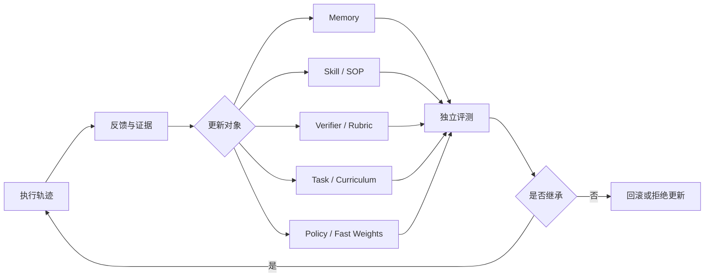

# Agent 自进化

> 收集范围：2025 年至 2026 年 10 月 19 日。本文专题中的“Agent 自进化”涵盖记忆、Skill、工具/SOP、Verifier、任务课程、在线 RL 与系统控制平面。它不等同于模型参数更新；不同论文更新的对象可能是 Prompt、Memory、Skill、Workflow、LoRA Fast Weights 或基础模型策略。

## 研究地图



2026 年的研究重点已从“Agent 能否根据经验改变行为”转向更细的工程与科学问题：

```text
经验是否值得记忆？
Skill 是否可执行、可验证、可淘汰？
Verifier 是否可靠，能否提供可归因的反馈？
自生成任务是否真的推动能力边界？
更新是否泛化，还是只在验证集或更多采样下变好？
```

## 方向总览

| 方向 | 进化对象 | 代表论文 | 关键问题 |
| --- | --- | --- | --- |
| [记忆演化](memory/index.md) | 外部记忆、参数记忆、记忆策略 | UMEM、TMEM、MemRL、MemSkill | 经验应该记什么、忘什么、如何写入？ |
| [Skill 与 SOP 演化](skill-sop/index.md) | 可执行 Skill、工具集、SOP | EvoSOP、Socratic-SWE、MUSE-Autoskill、CoEvoSkills | Skill 如何生成、验证、合并与剪枝？ |
| [Verifier 与 Rubric 演化](verifier-rubric/index.md) | 验证器、规则、证据链 | DeepVerifier、RLCER、EVE-Agent | 反馈是否可信，能否真正指向修复方向？ |
| [自生成任务与 Self-Play](self-play-curriculum/index.md) | 挑战任务、课程、角色策略 | R-Zero、Skill Self-Play、Native Evolution、SAGE | 谁出题，如何避免课程退化或无效更新？ |
| [Agentic RL 与系统](agentic-rl-systems/index.md) | 策略、轨迹数据、控制平面 | AReaL 2.0、WebEvolver、AgentEvolver | 如何在生产环境收集轨迹并安全更新系统？ |
| [评测、安全与反过拟合](evaluation-safety/index.md) | 选择规则、Skill 继承、评测器 | Rethinking、EvoMemBench、SkillEvoReg、SkillSandbox | 如何证明“进化”不是过拟合或额外采样？ |
| [Recursive Self-Improvement（RSI）](rsi/index.md) | Agent Harness、代码、改进机制 | DGM、SICA、Hyperagents、AIDE²、RRSI | 新版本能否递归地改进自身，并在独立证据下安全继承？ |

## 已核验的校企合作代表论文

以下论文作者单位中明确同时出现高校与中国大型互联网/AI 企业。该标记仅说明作者单位构成，不等同于论文结论已经被长期复现。

| 论文 | 作者单位组合 | 进化对象 | 论文状态 |
| --- | --- | --- | --- |
| [Inference-Time Scaling of Verification（DeepVerifier）](https://arxiv.org/abs/2601.15808) | 腾讯 AI Lab + 港中大 / 新管大 / 人大 | Verifier、推理时反馈 | ACL 2026 Findings / arXiv |
| [UMEM](https://arxiv.org/abs/2602.10652) | 厦门大学 + 阿里国际数字商业 + 通义实验室 | 长期记忆与记忆策略 | 2026 arXiv 预印本 |
| [RLCER](https://arxiv.org/abs/2602.10885) | 字节 Seed + NUS + 中科大 | Rubric 与推理训练策略 | 2026 arXiv 预印本 |
| [TMEM](https://arxiv.org/abs/2606.04536) | 阿里/Qwen + 北京大学 | LoRA Fast Weights 参数记忆 | 2026 arXiv 预印本 |
| [Socratic-SWE](https://arxiv.org/abs/2606.07412) | 阿里 AI Data + 上海交通大学 | 编码 Agent Skill 与课程 | 2026 arXiv 预印本 |
| [EvoSOP](https://arxiv.org/abs/2607.07321) | 中国人民大学 + 阿里巴巴 | SOP、工具集生命周期 | 2026 arXiv 预印本 |
| [Next-Generation Agentic RL Systems](https://arxiv.org/abs/2607.01120) | 蚂蚁集团 + 港科大 + 清华 | 轨迹、数据代理、控制平面 | 2026 arXiv 系统论文 |
| [R-Zero](https://arxiv.org/abs/2508.05004) | 腾讯 + WashU / UMD / UTD | Challenger-Solver 课程与推理策略 | 2025 预印本 / 2026 会议版本 |

## 阅读顺序

### 路线 A：理解完整 Agent 自进化闭环

```text
DeepVerifier
→ UMEM
→ EvoSOP
→ Socratic-SWE
→ Next-Generation Agentic RL Systems
```

### 路线 B：理解自演化训练与 Agentic RL

```text
R-Zero
→ RLCER
→ Socratic-SWE
→ AReaL 2.0
```

### 路线 C：理解“进化是否真的成立”

```text
Rethinking Self-Evolving Agent Skills
→ EvoMemBench
→ SkillEvoReg
→ SkillSandbox
→ Selection Is Not Learning
```

### 路线 D：理解严格 RSI

```text
UMEM
→ R-Zero
→ Selection Is Not Learning
→ Recursive Self-Improvement（RSI）专题
→ Darwin Godel Machine
```

## 阅读原则

每篇文章均明确区分以下内容：

- 论文直接报告的事实；
- 可从实验设计推导出的结论；
- 当前证据不足、仍需独立复现的判断；
- 是否属于严格校企合作；
- 是否为同行评审论文、系统论文或近期预印本。

## 使用方式

专题按“进化对象”而非年份组织。每篇论文使用统一的证据标准：研究问题、方法图、实验协议、原文结果、结果解释、消融或反例、证据边界和高频问题。需要比较路线时，先从方向总览进入；需要理解某一方法时，直接从左侧目录进入对应论文。
