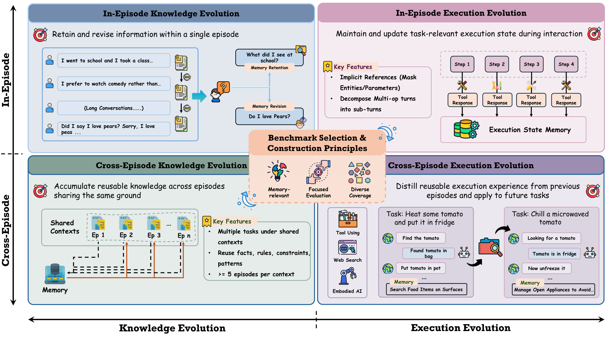
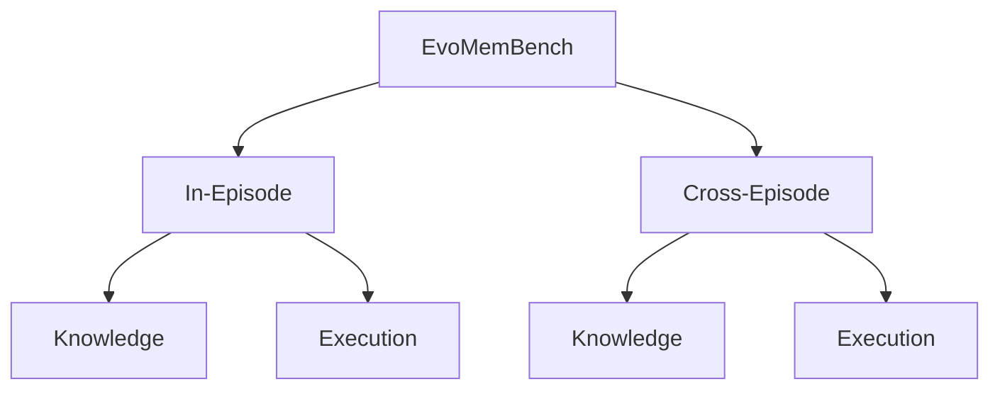
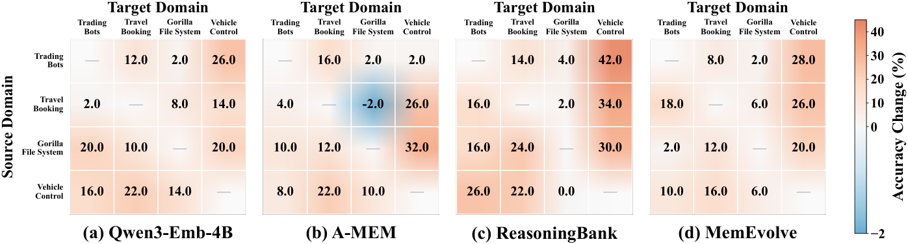

# EvoMemBench：从四个维度评估 Agent Memory

> 论文：**[EvoMemBench: Benchmarking Agent Memory from a Self-Evolving Perspective](https://arxiv.org/abs/2605.18421)**  
> 研究对象：记忆评测，而非新的记忆更新算法。  
> 文章的作用是提供一把尺子：把“记忆有效”拆成时间范围和内容类型，避免只用一个最终分数概括所有 Memory 方法。

## 1. 为什么需要专门的记忆评测

一个 Agent 在任务上得分提高，并不能直接说明它真的学会了长期记忆。提升可能来自：

```text
当前上下文更长
检索到了事实
复用了动作流程
偶然多采样了一次
跨 episode 保存了可迁移经验
```

如果这些来源不被区分，研究者很难回答：

- Agent 记住的是知识，还是记住了如何执行？
- 记忆只在当前对话内有用，还是能跨任务复用？
- 记忆系统是否真的改善了行为，而不是增加了输入文本？

EvoMemBench 不是提出一个新的 Memory 模块，而是建立统一协议，把这些问题放在同一评测框架中。

## 2. 两条评测轴

{ .paper-figure }

> 图源：EvoMemBench 原文 Figure 1。图中将记忆范围和记忆内容组合成四个核心设置。

### 2.1 记忆范围：In-Episode 与 Cross-Episode

| 范围 | 具体问题 |
| --- | --- |
| In-Episode | 在一次会话或当前任务内，Agent 能否记住前面出现的信息？ |
| Cross-Episode | 一个 episode 中学到的经验，能否在之后新的 episode 中被正确调用？ |

前者更接近上下文管理和短期工作记忆，后者才更直接涉及长期自进化。

### 2.2 记忆内容：Knowledge 与 Execution

| 内容 | 例子 |
| --- | --- |
| Knowledge-oriented | 事实、规则、人物信息、文档证据 |
| Execution-oriented | 工具调用顺序、操作流程、环境状态、动作前置条件 |

知识型记忆通常可以通过问答正确性评估；执行型记忆必须观察它是否改变了后续动作和任务成功率。

## 3. 四个核心设置



四个设置对应：

1. **InEp-Know**：当前 episode 内的知识记忆；
2. **InEp-Exec**：当前 episode 内的执行记忆；
3. **CrossEp-Know**：跨 episode 的知识累积；
4. **CrossEp-Exec**：跨 episode 的动作经验迁移。

论文还报告 CrossEp-Web 与 CrossEp-Emb 等具体环境，用于测试网页和具身交互中的跨环境表现。

## 4. 数据集与任务构成

原文 Table 2 的任务划分可以整理为：

| 设置 | 数据集 / 环境 | 主要任务 |
| --- | --- | --- |
| InEp-Know | MemoryAgentBench | Accurate Retrieval、Selective Forgetting |
| InEp-Exec | BFCL Multi-Turn Long Context | 文件系统、车辆控制、交易、旅行预订 |
| CrossEp-Know | CL-Bench | 领域知识、规则应用、程序执行、经验发现 |
| CrossEp-Tool | BFCL Multi-Turn Base | 四类工具环境的跨 episode 使用 |
| CrossEp-Web | xbench-DeepSearch、WebWalkerQA | 深度搜索与网页问答 |
| CrossEp-Emb | ALFWorld | Examine、Pick&Place、Clean&Place 等任务 |

论文比较 15 种代表性记忆方法，并加入强长上下文 LLM 作为基线。这个长上下文基线很重要：如果 Memory 方法只和“无记忆”比较，无法判断它是否真的优于直接扩大上下文窗口。

## 5. 评测结果应该如何理解

### 5.1 长上下文基线仍然很强

论文的总体结论之一是：在一些知识型任务上，强长上下文模型仍然具有竞争力。原因是它可以直接读取全部历史，避免记忆系统在提取、索引和检索过程中丢失信息。

这不是说 Memory 没有价值，而是说明 Memory 的优势应出现在：

```text
历史太长，无法直接放入上下文
任务需要跨 episode 复用
需要保存执行程序而不是事实文本
需要选择性遗忘和长期维护
```

### 5.2 Retrieval 与 Procedural Memory 的优势场景不同

论文观察到：

- 检索型方法在知识密集任务中通常更强；
- 程序化或长期记忆方法在执行型、跨 episode 任务中更有优势；
- 没有一种 Memory 形式在所有四个设置中都稳定占优。

因此不能只问“哪个 Memory 最强”，而应问：

> 这个任务需要存储什么类型的可复用信息，反馈发生在哪个时间尺度？

## 6. 原文图表：跨环境迁移热力图

{ .paper-figure }

图中的每个格子表示某种记忆方法在某个源环境、目标环境组合上的表现。读热力图时要注意三点：

1. 对角线通常是同环境或同类型迁移，不能等同于真正的跨环境泛化；
2. 非对角线表现可以揭示某类经验是否依赖源环境的表面细节；
3. 热力图中局部高值不等于方法具有普遍迁移能力，需要结合所有环境的平均值和方差。

在 CrossEp-Tool 中，任务结构决定了动作经验是否可迁移。例如，文件系统中的路径操作经验不能直接当成车辆控制的动作规则；若方法没有保存抽象的状态-动作关系，跨环境迁移就会下降。

## 7. 评测结果与方法论文的关系

EvoMemBench 最重要的价值是给其他论文提供了拆分问题的方式：

| 方法 | 需要重点检查的设置 |
| --- | --- |
| UMEM | CrossEp-Know：语义邻域记忆是否迁移到新任务 |
| MemRL | CrossEp-Exec：Q 值是否真正改善后续动作选择 |
| MemSkill | 四个设置：记忆 Skill 是知识型还是执行型 |
| TMEM | In-Episode 适应与 Cross-Episode 污染是否分离 |

例如，某方法在 InEp-Know 得分很高，不能直接说明它能做 CrossEp-Exec。前者可能只是一次会话内的读取，后者要求记忆在新的 episode 中改变行为。

## 8. 高频问题

### Q1：EvoMemBench 是一个新的 Memory 方法吗？

**回答：**不是。它是一个基准和评测协议，用于比较不同记忆系统在不同时间范围和内容类型上的能力。

### Q2：为什么不能只用最终任务成功率评估 Memory？

**回答：**最终成功率无法区分记忆的作用路径。成功可能来自长上下文、基础模型知识、随机探索或真正的跨 episode 经验复用。EvoMemBench 通过 In/Cross-Episode 和 Knowledge/Execution 两条轴，把这些情况拆开。

### Q3：为什么要加入长上下文 LLM 基线？

**回答：**因为 Memory 系统的实际价值不是超过“完全没有历史”，而是要在上下文预算有限或历史跨 episode 时，相比直接扩大上下文提供更好的质量、成本或可维护性。

### Q4：Cross-Episode 一定比 In-Episode 更难吗？

**回答：**通常更接近长期自进化问题，但难度还取决于任务设计。一个复杂的 In-Episode 执行任务可能比简单的 Cross-Episode 事实问答更难，不能只用标签判断难度。

## 9. 阅读结论

EvoMemBench 给“记忆有效”增加了必要的限定：

> 记忆系统必须说明自己记住了什么、在什么时候被使用、是否改变了行为，以及这种变化能否跨 episode 或跨环境保留。

它适合作为记忆演化专题的评测章节。阅读 UMEM、MemRL、MemSkill 和 TMEM 时，应回到这四个维度检查论文究竟证明了哪一种能力。
