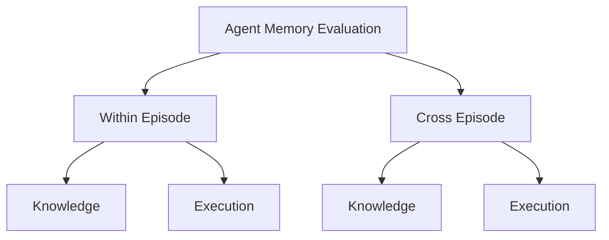

# EvoMemBench：Agent 记忆演化的评测框架

> 论文：**[EvoMemBench](https://arxiv.org/abs/2605.18421)**  
> 方向：Agent Memory 评测、episode 内/跨 episode、知识型/执行型记忆。

## 1. 研究问题

记忆方法常以最终任务分数作为唯一证据，但这不足以回答：

```text
Agent 是否正确抽取了记忆？
Agent 是否在后续行为中真正使用了记忆？
记忆帮助的是知识问答、操作流程，还是仅当前样本？
记忆能否跨 episode 或跨任务迁移？
```

EvoMemBench 的贡献不在于提出新的记忆更新算法，而在于构建评测视角。

## 2. 两条评测轴

### 时间范围

```text
Episode 内：当前会话或当前任务中的记忆使用
Cross-episode：跨任务、跨会话的长期经验积累
```

### 信息类型

```text
Knowledge memory：事实、规则、背景知识
Execution memory：动作序列、工具调用、操作程序
```



## 3. 评测设计

论文比较 15 种记忆方法与强长上下文基线。该比较的重点不是寻找绝对最强方法，而是观察：

```text
不同 memory 设计是否匹配不同任务结构？
```

摘要报告的趋势是：

- 检索式方法在知识密集任务中通常更强；
- 程序化或长期记忆方法在执行导向、跨 episode 任务中更有优势；
- 没有一种 memory 形式在所有任务轴上占优。

## 4. 为什么它对自进化重要

自进化 Memory 的论文需要回答“记忆是否带来能力变化”。EvoMemBench 提供了更细的评估框架：

```text
提升发生在知识检索？
还是执行流程复用？
发生在当前 episode？
还是跨 episode 的长期积累？
```

没有这样的区分，记忆系统很容易只在单一 benchmark 上获得表面收益。

## 5. 使用该评测视角审查 UMEM / TMEM / MemRL / MemSkill

| 方法 | 最应接受的 EvoMemBench 式检验 |
| --- | --- |
| UMEM | 记忆是否帮助语义邻域中的跨任务知识迁移 |
| TMEM | Fast Weights 是否改善 episode 内适应，且不造成跨任务污染 |
| MemRL | Episodic Memory 的 RL 更新是否提升跨 episode 执行任务 |
| MemSkill | 记忆操作 Skill 是否在知识与执行两类任务上均可迁移 |

## 6. 阅读结论

EvoMemBench 的核心意义是：

> Memory 不应被视为单一能力。自进化记忆系统需要在时间尺度和记忆内容类型两个维度上分别证明其效用。
