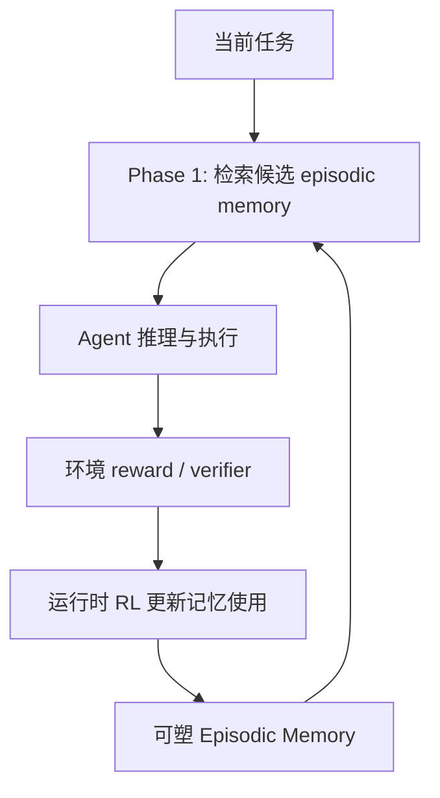

# MemRL：运行时强化学习下的 Episodic Memory

> 论文：**[MemRL: Self-Evolving Agents via Runtime Reinforcement Learning on Episodic Memory](https://arxiv.org/abs/2601.03192)**  
> 方向：运行时强化学习、非参数 Episodic Memory、长期适应。

## 1. 研究问题

固定参数 LLM Agent 在新环境中通常依赖 Prompt、检索或人工定义的 memory policy。MemRL 提出的问题是：

> 不改变基础模型参数时，是否可以通过运行时强化学习，让 Agent 的 Episodic Memory 在交互过程中自我改进？

这将“长期适应”从离线训练迁移到运行时状态更新。

## 2. 方法概览

MemRL 使用非参数 Episodic Memory 保存经验，并通过运行时 RL 调整记忆使用。摘要中强调 Two-Phase Retrieval，用于区分稳定推理过程与可塑记忆访问。



论文强调基础模型可以保持固定，而适应来自外部记忆及其使用策略。

## 3. Two-Phase Retrieval 的意义

从标题和摘要中的描述看，Two-Phase Retrieval 的目标是分离：

```text
Stable reasoning：基础模型已有、相对稳定的推理能力
Plastic memory：需要随任务经验持续更新的情节记忆
```

这种分离有助于避免每一次新经验都直接干扰基础推理路径。

## 4. 实验范围

论文摘要列出的评测包括：

```text
Humanity's Last Exam
BigCodeBench
ALFWorld
Lifelong Agent Bench
```

这些任务覆盖知识推理、代码、具身环境和长期 Agent 行为。阅读时应关注不同任务中 memory 的作用是否一致：

- 知识型任务：记忆可能更像事实或解题经验；
- 代码任务：记忆可能更像修复模式或 API 使用方式；
- ALFWorld：记忆可能更像环境操作序列；
- 长期 benchmark：应测试跨 episode 的能力保留。

## 5. 证据边界

MemRL 的核心主张是“Runtime RL on episodic memory”。需要审查：

```text
reward 是否能正确归因到记忆写入和检索动作？
记忆提升是否来自更多上下文或更多执行预算？
错误 memory 是否可被负反馈清理？
记忆策略是否对未见任务保持有效？
```

## 6. 与 TMEM 的区别

| 维度 | MemRL | TMEM |
| --- | --- | --- |
| 适应载体 | 非参数 Episodic Memory | LoRA Fast Weights |
| 更新方式 | Runtime RL on memory | 经验驱动参数适应 |
| 可解释性 | 记忆条目通常可检查 | 参数增量较难解释 |
| 风险 | 检索/写入污染 | 参数漂移与隔离 |

## 7. 阅读结论

MemRL 的重要价值在于展示：

> 不更新基础模型参数，也可以将强化学习用于 Agent 的运行时适应；但适应对象从“动作策略”转变为“记忆状态与记忆访问策略”。
