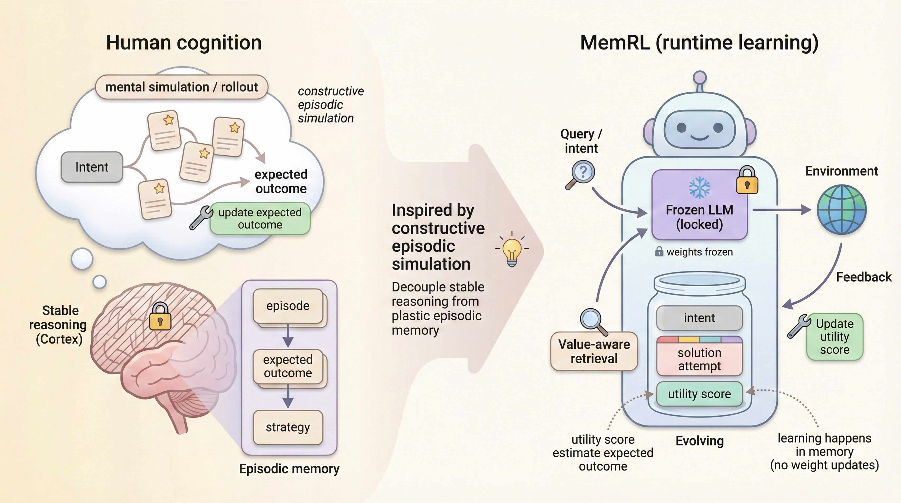
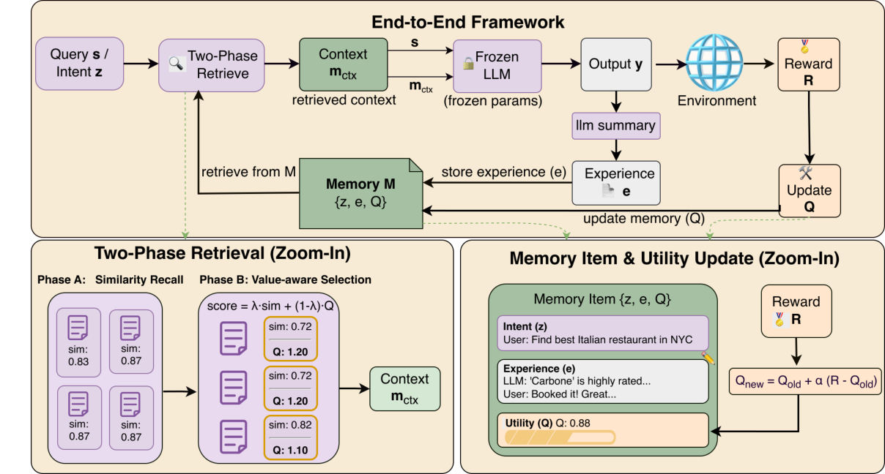

# MemRL：在情节记忆上进行运行时强化学习

> 论文：**[MemRL: Self-Evolving Agents via Runtime Reinforcement Learning on Episodic Memory](https://arxiv.org/abs/2601.03192)**  
> 研究对象：非参数情节记忆、记忆检索策略、运行时强化学习。  
> 这篇文章解决的不是“如何把更多历史塞进上下文”，而是“如何让 Agent 学会判断哪条历史经验真正值得使用”。

## 1. 先把问题说清楚

普通的 Memory Agent 通常执行下面的流程：

```text
历史轨迹
→ 写入记忆库
→ 按语义相似度检索
→ 把若干记忆拼进 Prompt
→ 让冻结的 LLM 继续回答
```

这套流程有一个很重要的隐含假设：

> 与当前问题语义相似的记忆，通常就是有用的记忆。

MemRL 认为这个假设不够可靠。两条经验可能都与当前问题相似，但一条经验在过去经常带来成功，另一条经验可能只是偶然成功，甚至在多步任务中会把 Agent 带入错误路径。仅用向量相似度，无法区分二者。

论文因此把记忆检索看成一个小型决策问题：

```text
语义相似度负责召回候选
Q 值负责判断候选的实际效用
环境反馈负责更新 Q 值
```

基础 LLM 保持冻结，变化发生在外部记忆和记忆条目的效用估计上。

## 2. MemRL 的核心结构

{ .paper-figure }

> 图源：论文 Figure 2。原图展示了冻结 LLM、情节记忆、检索策略和运行时更新之间的关系。

MemRL 把一个记忆条目写成三元组：

\[
\mathcal{M}=\{(z_i,e_i,Q_i)\}_{i=1}^{|\mathcal{M}|}
\]

其中：

- \(z_i\)：记忆条目的 intent 或语义索引，用于判断它与当前状态是否相关；
- \(e_i\)：具体经验，例如曾经采取过的策略、工具调用方式或解题过程；
- \(Q_i\)：这个经验在历史交互中带来的效用估计。

这里的 \(Q_i\) 不是基础模型参数，也不是一个额外的大型 Critic 网络。它是附着在记忆条目上的轻量统计量，用于表达“这条经验在类似状态下是否值得再次使用”。

## 3. 两阶段检索：相似度只负责第一轮筛选

{ .paper-figure }

### 3.1 第一阶段：语义召回

给定当前状态 \(s\)，先按照 intent 相似度筛选候选集合：

\[
\mathcal{C}(s)=\operatorname{TopK}_{k_1}\left(\{i\mid \operatorname{sim}(s,z_i)>\delta\},\operatorname{by}\ \operatorname{sim}\right)
\]

这一步的作用是缩小搜索空间。它不负责做最终决策，因为语义相似并不等价于经验有效。

### 3.2 第二阶段：相似度与效用联合排序

MemRL 对候选经验计算联合分数：

\[
\operatorname{score}(s,z_i,e_i)
=(1-\lambda)\widehat{\operatorname{sim}}(s,z_i)
+\lambda\widehat{Q}(z_i,e_i)
\]

再选择最终放入上下文的记忆：

\[
\mathcal{M}_{ctx}(s)=\operatorname{TopK}_{k_2}(\mathcal{C}(s),\operatorname{by}\ \operatorname{score})
\]

参数 \(\lambda\) 决定系统更相信“它看起来相似”，还是更相信“它在历史上产生过好的结果”。

这一区分很关键：

```text
k1 过小：可能漏掉真正有用的经验
k1 过大：候选噪声增加，检索开销变大
λ 过小：退化为普通语义检索
λ 过大：早期 Q 值不稳定，可能过早排除新经验
```

## 4. 运行时更新：Q 值如何从反馈中学习

MemRL 使用指数移动平均形式的更新：

\[
Q_{\text{new}}\leftarrow Q_{\text{old}}+\alpha(r-Q_{\text{old}})
\]

其中：

- \(r\)：本次执行得到的环境奖励或任务结果；
- \(\alpha\)：更新步长；
- \(Q_{\text{old}}\)：该经验在更新前的效用估计。

如果一条经验在相似任务中连续带来成功，它的 Q 值会逐渐升高；如果它经常导致失败，Q 值会下降。这样，系统不需要立即删除所有失败经验，而是可以保留它们作为候选，并让后续反馈逐渐改变其被选中的概率。

论文还从收敛性角度分析了该更新：在固定状态与记忆条目的条件下，Q 值的期望会趋近于该条经验的平均奖励；更新步长越大，适应速度越快，但由奖励随机性带来的方差也会更大。

## 5. 为什么它适合长轨迹任务

长轨迹任务中，最终成功往往由多个动作共同决定。单纯用“整条轨迹成功/失败”来训练一个大模型，容易出现两个问题：

1. 轨迹中有些动作本身是合理的，但最终由于后续动作错误而得到低奖励；
2. 语义检索只看当前问题和历史问题相似不相似，无法判断历史策略是否真的有效。

MemRL 的 Q 值至少提供了一个较细的记忆级别归因：

```text
哪一个 intent 调用了哪一条经验
这条经验之后得到了什么结果
下次遇到相近状态时是否还应优先使用它
```

这不是完整的动作级 credit assignment，但它比“所有检索到的记忆一视同仁”更接近行为反馈。

## 6. 实验设计：论文到底比较了什么

论文在四类任务上测试 MemRL：

| 任务 | 主要考察能力 | 典型指标 |
| --- | --- | --- |
| BigCodeBench | 代码生成 | Code Generation Accuracy |
| Lifelong Agent Bench | 持续交互与操作任务 | OS / DB Task Accuracy |
| ALFWorld | 多步具身执行 | Exploration Accuracy、Success Rate |
| Humanity's Last Exam | 知识与推理 | Knowledge Frontier Accuracy |

对照方法包括无记忆、普通 RAG、Self-RAG、Mem0 和 MemP。论文同时报告两种指标：

- **Last Epoch Accuracy**：最后一轮的准确率，反映训练结束时的即时表现；
- **Cumulative Success Rate（CSR）**：整个运行过程中至少成功过一次的任务比例，反映系统能否逐渐积累已解决任务。

CSR 不能简单当成普通准确率。一个 Agent 可能最后一轮没有重新答对某题，但之前已经成功过；这类任务仍会被 CSR 计入。对于持续学习系统，这个指标能够反映“是否曾经学会过”。

## 7. 原文主结果：Last 与 CSR 要分开看

下面摘录论文 Table 1 中的核心列。数值格式为 `Last / CSR`，不是两个独立实验的平均值。

| 方法 | BigCodeBench | OS Task | DB Task | Exploration | Knowledge Frontier |
| --- | ---: | ---: | ---: | ---: | ---: |
| No Memory | 0.485 / 0.577 | 0.674 / 0.756 | 0.860 / 0.928 | 0.278 / 0.462 | 0.357 / 0.524 |
| MemP | 0.578 / 0.602 | 0.736 / 0.742 | 0.960 / 0.966 | 0.324 / 0.456 | 0.528 / 0.582 |
| MemRL | **0.595 / 0.627** | **0.794 / 0.816** | **0.960 / 0.972** | **0.507 / 0.697** | **0.573 / 0.613** |

### 7.1 这张表说明了什么

第一，MemRL 并不是在每个 Last 指标上都大幅领先。例如 DB Task 的 Last Accuracy 与 MemP 同为 0.960。若只看最后一轮，容易低估运行时学习的价值。

第二，MemRL 在 Exploration 上的提升更明显：`0.278 → 0.507`，CSR 也从 `0.462 → 0.697`。这与论文的机制相符：当任务需要从多步交互经验中选择策略时，Q 值筛选比单纯相似度更有帮助。

第三，MemRL 的 CSR 普遍高于 Last Accuracy，说明运行过程中曾经解决过更多任务。这个现象本身也提醒我们：运行时学习的收益可能表现为“解决过更多不同任务”，而不只是“最后一次平均得分更高”。

## 8. 跨任务迁移与多步任务分析

论文 Table 2 的迁移结果中，MemRL 在以下指标上取得：

| 迁移任务 | MemRL |
| --- | ---: |
| BigCodeBench Code Generation | 0.508 |
| Lifelong Agent Bench OS Task | 0.746 |
| Lifelong Agent Bench DB Task | 0.942 |
| ALFWorld Exploration | 0.479 |

论文还比较了任务结构：

| 任务结构 | MemP | MemRL | 提升 |
| --- | ---: | ---: | ---: |
| ALFWorld Multi-step | 45.6 | 69.7 | +24.1 pp |
| OS Task Multi-step | 74.3 | 81.7 | +7.4 pp |
| HLE Single-step | 58.2 | 61.3 | +3.1 pp |

这个结果支持一个较克制的结论：**记忆效用学习对多步任务更重要**。单步任务中，当前问题本身往往已经包含了大部分需要的信息；多步任务则更依赖“哪条经验能把后续行为引向成功”。

## 9. 消融实验应该怎么读

论文还分析了 Q 值权重 \(\lambda\)、检索数量和记忆组成。

### 9.1 \(\lambda\) 不是越大越好

如果 \(\lambda=0\)，系统完全依赖语义相似度，退化为相似度检索；如果 \(\lambda=1\)，系统几乎只按历史效用排序，早期估计误差会被放大。论文报告中间权重通常取得更稳定的结果，说明语义相关性和经验效用需要共同参与检索。

### 9.2 检索更多记忆不等于更好

增加 \(k_1\) 或 \(k_2\) 可能提高召回率，但也会带来上下文噪声。MemRL 的贡献不是无限增加上下文，而是先召回，再利用 Q 值压缩到更小的有效集合。

### 9.3 Q 值可以成为轻量验证器

论文报告 Q 值与后续成功之间存在较强相关性，并观察到一部分历史失败记忆仍然可能处在高 Q 区间。这个现象不能简单理解为“失败记忆也有用”，更准确的解释是：某次轨迹最终失败，不代表其中使用的经验在所有相似状态下都无效。

## 10. MemRL 与 UMEM 的区别

| 维度 | MemRL | UMEM |
| --- | --- | --- |
| 主要学习对象 | 记忆条目的效用与检索策略 | 记忆提取与 Memory Bank 管理动作 |
| 运行时反馈 | 对已使用经验更新 Q 值 | 对候选记忆在语义邻域上的边际效用评分 |
| 基础 Executor | 冻结 | 冻结 |
| 记忆形式 | Intent-Experience-Utility | Key-Value Memory Bank |
| 主要优点 | 运行时更新轻量，适合连续使用 | 直接约束记忆的可泛化性 |
| 主要风险 | 早期 Q 值偏差、反馈污染 | 邻域构造偏差、记忆更新成本 |

可以把二者理解为两个不同层次：UMEM 更关注“怎样形成一条值得继承的记忆”，MemRL 更关注“已有记忆中当前应该选哪一条”。

## 11. 论文真正证明了什么

论文的实验支持以下结论：

1. 在冻结基础模型的条件下，仅优化外部情节记忆的使用策略，也可以带来运行时性能提升；
2. 两阶段检索比单纯的语义相似度检索更适合处理相似但质量不同的经验；
3. 对多步交互任务，记忆效用学习带来的收益通常比单步任务更明显；
4. CSR 能够补充 Last Epoch Accuracy，用于观察持续交互中的累积成功。

论文没有证明：

```text
Q 值天然等价于可靠的动作级 credit assignment；
所有失败经验都值得长期保留；
运行时记忆学习在任意环境中都能稳定收敛；
外部记忆一定比参数更新更节省总计算。
```

## 12. 高频问题

### Q1：MemRL 和普通 RAG 的本质区别是什么？

**回答：**普通 RAG 主要依据查询与文档的语义相似度完成召回；MemRL 在召回候选之后，还使用由环境反馈更新的 Q 值重新排序。它学习的不是“哪段文本更像当前问题”，而是“哪条经验在相似状态下更可能带来成功”。

### Q2：MemRL 是否更新了 LLM 参数？

**回答：**论文的运行时机制不更新冻结 LLM 的基础参数。自进化状态主要是外部情节记忆及其效用估计，因此它属于非参数记忆层面的运行时强化学习。

### Q3：为什么要同时保留相似度和 Q 值？

**回答：**仅使用相似度会召回“语义相关但策略无效”的经验；仅使用 Q 值又可能在早期估计不准时错过新经验。联合排序把语义相关性作为先验，把历史反馈作为行为证据。

### Q4：CSR 为什么不是普通准确率？

**回答：**CSR 统计整个运行周期内至少成功过一次的任务比例，Last Accuracy 只统计最后一轮。CSR 更适合观察 Agent 是否积累了可复用的成功经验，但也可能因为任务曾经被偶然解决而偏高，所以不能替代独立测试集指标。

## 13. 阅读结论

MemRL 的关键贡献可以概括为一句话：

> 让 Memory Agent 不仅检索“相似经验”，还根据经验在真实交互中的结果学习“哪些经验值得再次使用”。

它把记忆从静态资料库变成了一个带有行为反馈的轻量决策层，是理解“运行时自进化”与“参数训练”区别的一个很好的起点。

论文原文：[MemRL](https://arxiv.org/abs/2601.03192)
