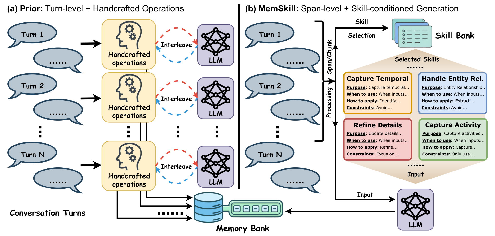
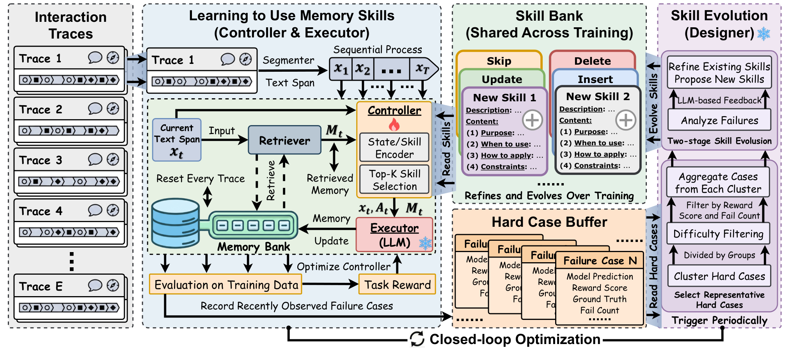

# MemSkill：把记忆管理本身变成可演化 Skill

> 论文：**[MemSkill: Learning and Evolving Memory Skills for Self-Evolving Agents](https://arxiv.org/abs/2602.02474)**  
> 研究对象：记忆提取、记忆更新、记忆删除与 Skill Bank。  
> 论文的关键转变是：记忆系统不再只学习“保存了什么”，还学习“应该用什么操作管理历史”。

## 1. 为什么固定的记忆操作不够

很多 Agent Memory 系统预先写好几种固定操作：

```text
从对话中总结
把新信息追加到记忆
用新信息覆盖旧信息
删除低价值内容
```

这些操作通常是人工设计的，优点是容易实现，缺点是把人的先验写死了。不同任务需要保存的信息并不一样：

- 对话记忆更关心人物、时间和事件关系；
- 具身任务更关心物体位置、动作前置条件和当前环境状态；
- 长文档问答更关心证据、主题和跨段落关联。

MemSkill 的问题定义是：**能否让 Agent 学习选择记忆操作，并根据失败案例持续扩展这组操作？**

## 2. 方法总览

{ .paper-figure }

{ .paper-figure }

> 图源：论文 Figure 1、Figure 2。第一张图强调 span-level、Skill-conditioned 的处理方式；第二张图展示 Controller、Executor、Memory Bank 和 Designer 的闭环。

MemSkill 同时维护两个库：

| 存储 | 内容 | 作用 |
| --- | --- | --- |
| Trace-specific Memory Bank | 当前对话或轨迹提炼出的具体记忆 | 服务某条历史或某个任务 |
| Shared Skill Bank | 可复用的记忆管理 Skill | 决定如何提取、更新和整理记忆 |

这样可以区分：

```text
“这次对话中发生了什么”是 Memory
“遇到这类信息时应该如何处理”是 Skill
```

## 3. 三个核心组件

### 3.1 Controller：选择当前上下文需要的 Skill

MemSkill 将一条交互轨迹按文本 span 处理。对于当前 span，Controller 从共享 Skill Bank 中选择 Top-K 个候选 Skill。它学习的是一个选择策略，而不是每次把全部 Skill 都塞给 Executor。

选择策略的意义在于减少无关指令：

```text
长对话中的时间信息 → 选择时间整理 Skill
出现新事实 → 选择 Insert / Update 类 Skill
旧事实被证伪 → 选择冲突处理或删除 Skill
没有可复用信息 → 选择 Skip
```

### 3.2 Executor：按照 Skill 生成记忆

Executor 是一个 LLM。它读取当前 span、已经检索到的记忆和 Controller 选出的 Skill，一次性生成这段轨迹的记忆更新。

初始 Skill Bank 包含四个基础操作：

```text
Insert：写入新的记忆
Update：修订已有记忆
Delete：删除不再可靠或不再需要的记忆
Skip：判断当前内容不值得写入
```

这四个操作只是稳定的起点，不是最终的 Skill 集合。

### 3.3 Designer：从 hard case 演化 Skill Bank

如果 Controller 选出的 Skill 导致记忆错误、不完整或遗漏关键信息，该案例会进入滑动 hard-case buffer。Designer 周期性读取这些案例：

```text
修订已有 Skill
或
提出新的专门 Skill
```

因此 MemSkill 的闭环不是简单的“训练 Controller”：

```text
Controller 学会使用当前 Skill
→ Executor 生成记忆
→ 任务结果暴露困难案例
→ Designer 修改 Skill Bank
→ Controller 在新 Skill Bank 上继续学习
```

## 4. 为什么要交替优化

如果每一步都同时修改 Controller 和 Skill Bank，系统很难判断性能变化来自哪里。MemSkill 采用交替过程：

1. 在当前 Skill Bank 上训练 Controller，学习何时选择哪些 Skill；
2. 用记忆依赖任务的奖励评价构造结果；
3. 收集失败或不完整案例；
4. Designer 根据 hard cases 修订或新增 Skill；
5. 在更新后的 Skill Bank 上继续训练 Controller。

这个设计把两个问题分开：

- **使用问题**：已有 Skill 是否被正确选择？
- **表示问题**：当前 Skill 集合是否覆盖了任务中的错误模式？

## 5. 实验设置

论文使用以下任务：

| 数据集 | 任务类型 | 论文关注点 |
| --- | --- | --- |
| LoCoMo | 多轮对话记忆 | 长期事实、事件和人物信息 |
| LongMemEval | 长期记忆问答 | 跨轮检索与记忆更新 |
| HotpotQA | 文档型多跳问答 | 分布变化下的 Skill 泛化 |
| ALFWorld | 具身交互 | 动作约束与对象位置 |

主要比较对象包括 No-Memory、CoN、ReadAgent、MemoryBank、A-MEM、Mem0、LangMem 和 MemoryOS。实验使用 LLaMA3.3 70B-Instruct，并额外测试 Qwen3-Next 80B-A3B-Instruct 的迁移表现。

评价指标同时包含：

- F1：答案与参考答案的词级重合；
- L-J：LLM judge 评分；
- SR：ALFWorld 成功率；
- Steps：完成任务所需的交互步数，越低越好。

## 6. 主结果：先看是否超过固定方法

原文 Table 1 的关键行如下。这里保留原表的列含义，`L-J` 是 judge 分数，`SR` 是成功率。

| 模型 / 方法 | LoCoMo F1 | LoCoMo L-J | LongMemEval F1 | LongMemEval L-J | ALF-Seen SR | ALF-Unseen SR | Avg SR |
| --- | ---: | ---: | ---: | ---: | ---: | ---: | ---: |
| LLaMA3.3 70B Mem0 | 10.18 | 33.01 | 29.94 | 45.54 | 32.86 | 32.09 | 37.32 |
| LLaMA3.3 70B MemoryOS | 38.68 | 44.59 | 14.19 | 36.50 | 15.71 | 14.18 | 44.54 |
| LLaMA3.3 70B MemSkill | **38.78** | **50.96** | **31.65** | **59.41** | **47.86** | **47.01** | **47.44** |
| Qwen3-Next 80B-A3B MemoryOS | 38.55 | 44.59 | 13.26 | 36.00 | 19.29 | 18.66 | 42.95 |
| Qwen3-Next 80B-A3B MemSkill | **39.28** | **52.07** | 23.75 | **59.90** | **60.00** | **64.18** | **62.09** |

### 6.1 表格中的一个容易误读的地方

ALFWorld 的列是 `SR / #Steps`，不是两个成功率。因此在 LLaMA3.3 70B 的 MemSkill 行中：

```text
ALF-Seen：SR 47.86，平均步骤 30.88
ALF-Unseen：SR 47.01，平均步骤 30.43
```

不能把 30.88、30.43 当成成功率。论文用这两个指标同时观察“成功了多少”和“完成任务需要走多少步”。

### 6.2 结果说明

1. MemSkill 在两个模型块中都取得较高的 L-J 和 ALF 成功率，说明 Skill-conditioned memory construction 不完全依赖某个单一底座。
2. LoCoMo 的绝对 F1 提升并不夸张，但 L-J 分数提升较明显，说明自动生成的记忆在完整性、相关性或组织方式上更符合 judge 的判断。
3. Qwen3-Next 的 ALF-Unseen SR 高于 ALF-Seen，不能简单解释成“未见任务更容易”。不同子集的任务分布和难度可能不同，必须结合原始评测协议理解。
4. Steps 较低并不自动代表策略更好，若 Agent 提前失败也可能走较少步数。因此成功率和步骤数必须同时读。

## 7. 消融实验：Controller 和 Designer 各自贡献什么

论文在 LoCoMo 上报告的 L-J 消融如下：

| 变体 | LLaMA | Qwen |
| --- | ---: | ---: |
| MemSkill（完整） | **50.96** | **52.07** |
| 去掉 Controller，随机选 Skill | 45.86 | 41.24 |
| 去掉 Designer，固定 Skill | 44.11 | 34.71 |
| 只做 Skill refinement，不新增 Skill | 44.90 | 46.97 |

这张表的逻辑不是“模块越多越好”，而是说明两种能力缺一不可：

- 去掉 Controller，Skill 仍然存在，但选择过程失去上下文适配；
- 去掉 Designer，Controller 只能在初始四种操作上工作，无法覆盖新的失败模式；
- 只 refinement 不新增 Skill，说明修订已有规则有价值，但无法完全替代新能力的发现。

Qwen 结果中的落差更大，尤其是去掉 Designer 后从 52.07 降至 34.71，说明在该底座上，Skill Bank 的演化对泛化尤其重要。

## 8. 分布外泛化：从对话迁移到 HotpotQA

论文将 LoCoMo 上训练出的 Skill Bank 直接迁移到 HotpotQA，不在 HotpotQA 上重新训练。这个实验要回答的不是“MemSkill 在另一个数据集上能否重新调好”，而是：

> Skill 是否学到了与输入表面形式无关的记忆管理行为？

论文报告在 50、100、200 篇文档的不同上下文长度下，MemSkill 都能超过 MemoryOS 和 A-MEM；并且选择的 Skill 数量 \(K=7\) 在这些设置下表现最好。随着上下文变长，组合多个 Skill 的收益更加明显，因为需要同时处理相关性、证据组织和冗余控制。

这仍然不是“完全通用”的证明。HotpotQA 与 LoCoMo 都属于语言任务，尚不能推出这些 Skill 可以直接迁移到任意工具环境。

## 9. 案例分析：Skill 会出现领域专门化

论文观察到不同数据域会形成不同的 Skill：

| 域 | 生成出的 Skill 更关注什么 |
| --- | --- |
| LoCoMo | 时间关系、人物、事件和活动细节 |
| ALFWorld | 对象位置、动作约束、任务前置条件 |

这说明 Skill Bank 不是一组固定的“通用总结提示”。它可能从错误案例中发现领域特有的记忆需求。

但也需要警惕：领域专门化既可能是有效适应，也可能是对训练分布的过拟合。判断标准应该是跨任务、跨环境和独立时间段的泛化，而不是只看 Skill 文本是否写得更具体。

## 10. 与 UMEM 的关系

| 维度 | MemSkill | UMEM |
| --- | --- | --- |
| 学习对象 | 记忆管理 Skill 与 Skill 选择器 | Mem-Optimizer 产生记忆和管理动作 |
| 演化触发 | hard-case buffer | 语义邻域边际效用 |
| 记忆操作 | Insert / Update / Delete / Skip 及其演化版本 | ADD / UPDATE 等 Memory Bank 动作 |
| 关键泛化问题 | Skill 能否跨输入结构迁移 | 记忆条目能否在语义邻域提升效用 |

MemSkill 关注“如何管理记忆的程序”，UMEM 关注“如何生成和更新具体记忆”。两者可以组合，但不能把它们的实验结论互相替代。

## 11. 高频问题

### Q1：MemSkill 是不是只把四个操作换成了几个 Prompt？

**回答：**不是。四个操作只是初始化 Skill Bank。训练过程中，Controller 学习根据上下文选择 Skill，Designer 还会从 hard cases 中修订已有 Skill、提出新 Skill。论文比较了固定 Skill、随机选择、只修订不新增等变体，说明演化过程是方法主体。

### Q2：为什么要把 Controller 和 Executor 分开？

**回答：**Controller 负责决定“用哪些记忆操作”，Executor 负责“按照这些操作生成记忆”。分开后可以分别观察选择错误和执行错误，也能减少把所有 Skill 都放进上下文造成的干扰。

### Q3：Designer 是不是一个人工专家？

**回答：**论文将 Designer 作为基于 LLM 的 Skill 演化组件，根据训练期间的困难案例修订或新增 Skill。它不是人工逐条编写规则，但其生成的 Skill 仍需通过下游任务结果和跨分布评测验证。

### Q4：MemSkill 解决了记忆污染吗？

**回答：**它降低了固定操作无法覆盖错误模式的问题，但没有从根本上消除污染。错误的 Executor 输出、错误的 hard-case 归因或 Designer 的过度具体化仍可能把坏规则写入 Skill Bank，因此需要独立测试、版本控制和回滚。

## 12. 阅读结论

MemSkill 把 Agent Memory 的学习对象从“记忆条目”扩展到了“记忆管理程序”：

> Agent 不仅需要记住事实，还需要逐渐学会在不同任务中何时插入、更新、删除或跳过信息，并根据失败案例改进这些操作。

论文的价值在于把 Memory Skill 的选择和演化明确拆成可实验的组件；其局限则是 Skill 仍由模型生成，长期可靠性依赖更严格的外部验证。
