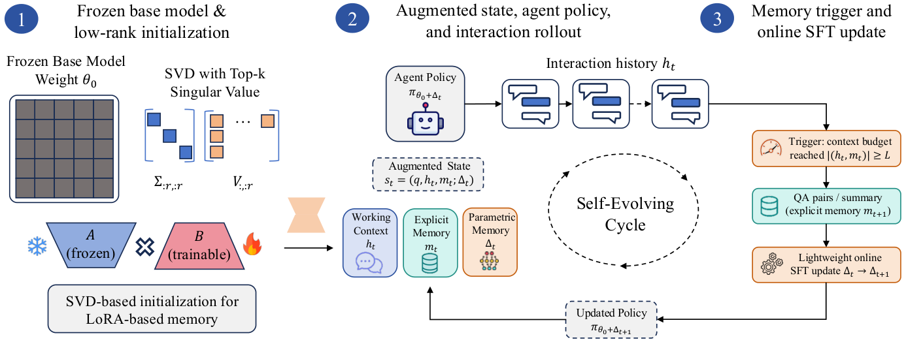

# TMEM：把 episode 内经验写入参数记忆

> 论文：**[Scaling Self-Evolving Agents via Parametric Memory](https://arxiv.org/abs/2606.04536)**  
> 研究对象：上下文记忆、在线 LoRA Fast Weights、Agent episode 内适应。  
> 核心区别：TMEM 不只把过去压缩成文本供模型重读，还在上下文达到边界时提炼监督样本，并用它在线更新一组临时 LoRA 参数。

## 1. 研究背景：文本记忆的上限在哪里

常见记忆 Agent 把历史保存为摘要或检索片段。推理时，模型仍然使用固定参数 \(\theta_0\)，只能在当前 Prompt 中阅读这些记录：

\[
\pi(a_t\mid q,h_t,m_t;\theta_0)
\]

其中 \(q\) 是任务，\(h_t\) 是当前工作上下文，\(m_t\) 是显式文本记忆。

文本记忆有两个优点：可读、可检查；但也有两个限制：

1. 历史一旦被摘要压缩，具体细节可能丢失；
2. 模型每次都要重新把记忆解释成行为，参数策略本身没有因经验而改变。

TMEM 要回答的问题是：**能不能保留显式文本记忆，同时把其中可监督的经验转成 episode 内可撤销的参数状态？**

## 2. 方法框架：三种状态同时演化

{ .paper-figure }

> 图源：TMEM 原文 Figure 2。点击图片可放大。

TMEM 在一个 episode 中维护三种不同的状态：

| 状态 | 含义 | 是否在 episode 内变化 |
| --- | --- | ---: |
| \(h_t\) | 最近交互形成的工作上下文 | 是 |
| \(m_t\) | 从历史提炼出的显式文本记忆 | 是 |
| \(\Delta_t\) | 由 LoRA 表示的 Fast Weights | 是 |

基础模型的参数为 \(\theta_0\)。当前策略写作：

\[
\pi_t=\pi_{\theta_0+\Delta_t}
\]

基础模型不是完全固定不变：论文的训练阶段会优化 \(\theta_0\)；但在一次测试 episode 中，在线变化的是临时的 \(\Delta_t\)。这一区分非常重要：TMEM 不是把每个用户的在线更新永久合并进基础模型。

## 3. 记忆写入如何触发

TMEM 给工作上下文设定长度上限 \(L_{\max}\)。当历史增长到触发边界时，模型收到一个 memory-writing prompt，将当前 session 转成有监督训练样本，例如 grounded QA 对或指令-回答样本：

```text
工作上下文超过长度阈值
→ 提取有明确证据支持的问答/指令样本
→ 更新显式文本记忆
→ 使用这些样本做轻量 LoRA 更新
→ 后续动作由 π(θ0 + Δt) 生成
```

样本生成不是“把所有历史都写进权重”。论文提示要求模型只生成由会话明确支持、没有重复、且能帮助未来任务的样本；没有可靠信息时允许返回空集合。

## 4. Fast Weights 的在线更新

把第 \(t_i\) 次记忆提取得到的监督数据记为 \(D_i\)，在线更新算子为 \(\mathcal{T}\)：

\[
\Delta_{t_i+1}=\mathcal{T}(\Delta_{t_i},D_i)
\]

之后的任务动作使用新参数状态：

\[
a_{t_i+1}\sim\pi_{\theta_0+\Delta_{t_i+1}}(\cdot\mid q,h_{t_i+1},m_{t_i+1})
\]

这说明参数记忆影响的是模型接下来生成动作的分布，而不只是给 Prompt 增加一段说明。

### 4.1 为什么需要 SVD 初始化

在线适应的步数很少。如果 LoRA 子空间随机初始化，小批量监督样本可能来不及形成有用方向。TMEM 使用 SVD-based initialization 预先构造 LoRA 更新子空间，目的是让少量更新更快落到有效的适应方向上。

论文的实验还发现，在多数设置中冻结一个 LoRA 因子、只更新另一个因子，性能仅略低或接近同时更新两者。作者据此将冻结因子作为较高效的默认选择。这个结果支持的是“当前子空间足以覆盖这些基准中的多数有用适应方向”，并不证明任何任务都可以只训练一个因子。

## 5. 训练目标：让模型学会生成有用的记忆数据

TMEM 的一个设计点是：基础策略训练不只关心普通任务动作，还会学习生成后续 Fast Weights 更新所需的监督样本。直觉上：

```text
最终任务奖励较高
→ 说明前面的行动和记忆提取整体上更有用
→ RL 更新基础策略，使它之后更可能生成有效的行动与记忆样本
```

因此 TMEM 的“慢变量”和“快变量”分工如下：

- \(\theta_0\)：通过训练数据与 RL 逐步改善，学会更好的任务策略和记忆提取行为；
- \(\Delta_t\)：在当前 episode 内从新经验快速形成，临时改变后续策略。

前者是跨训练阶段的慢更新，后者是单次交互中的快速适应。

## 6. 实验协议

论文评测覆盖不同形态的记忆任务：

| 基准 | 任务类型 | 主要观察指标 |
| --- | --- | --- |
| LoCoMo | 长对话记忆问答 | F1、EM |
| LongMemEval-S | 长期对话记忆 | F1、EM |
| Multi-Objective Search | 搜索 Agent 的多目标持续适应 | 任务成功/质量指标 |
| CL-Bench | 多类持续学习任务 | 按任务类别和总体结果计分 |

主要模型使用 Qwen3-4B、Qwen3-8B；对照包括无记忆、MemAgent/MEM1 与 A-MEM。记忆基线分别代表不保存历史、摘要/记忆压缩以及检索式记忆。论文同时分析 Fast Weights 的更新因子、触发阈值、显存与单 episode 耗时。

## 7. 原文结果：LoCoMo 与 LongMemEval-S

下面摘录原文 Table 1 的关键比较。数值为百分比，指标分别是 F1 与 Exact Match（EM）。

| 方法 / 模型 | LoCoMo F1 | LoCoMo EM | LongMemEval-S F1 | LongMemEval-S EM |
| --- | ---: | ---: | ---: | ---: |
| No Memory, Qwen3-4B | 23.33 | 8.30 | 5.30 | 0.00 |
| MemAgent, Qwen3-4B | 20.74 | 11.48 | 36.45 | 23.20 |
| A-MEM, Qwen3-4B | 25.66 | 11.33 | 29.22 | 17.76 |
| TMEM, Qwen3-4B | **25.72** | **15.40** | **41.24** | **25.54** |
| TMEM, Qwen3-8B | **26.75** | **20.24** | **41.87** | **25.42** |

### 7.1 如何读这组数字

- 在 LoCoMo 上，TMEM 的 F1 比 Qwen3-4B 无记忆高 2.39 个百分点，EM 高 7.10 个百分点。Exact Match 的增益更明显，说明它更容易直接产出完全匹配的答案。
- LongMemEval-S 上，无记忆模型的 F1 只有 5.30，而 TMEM 达到 41.24。这类任务会把历史信息拉得更长，文本压缩与跨轮利用的差异因此更明显。
- 对照模型间表现并不整齐。例如 MemAgent 在 LongMemEval-S 上明显优于无记忆，但在 LoCoMo F1 上并没有超过无记忆。这提醒我们不能把某一个基准上的优劣直接概括成“摘要记忆普遍有效/无效”。
- Qwen3-8B 的 TMEM 在 LongMemEval-S F1 略高于 4B，但 EM 基本接近；模型规模增大并不会让每项指标同步增长。

## 8. 消融与效率：性能并非没有代价

### 8.1 在线适应因子

论文比较只训练 LoRA 因子 \(B\) 与同时训练 \(A+B\)。LoCoMo 的差值约为 F1 +0.17、EM +0.18；LongMemEval-S 约为 F1 +0.27、EM +0.12。收益很小，因而只训练一个因子更划算。

### 8.2 每个 episode 的耗时与显存

原文 Table 7 在 Qwen3-4B、batch size 为 1 的本地评测设置下比较：

| 方法 | LoCoMo 秒/episode | LoCoMo 显存 GB | LongMemEval-S 秒/episode | LongMemEval-S 显存 GB |
| --- | ---: | ---: | ---: | ---: |
| No memory | 1.69 | 46.3 | 8.73 | 78.5 |
| A-MEM retrieval | 2.03 | 13.4 | 15.33 | 13.2 |
| MemAgent summary | 0.94 | 11.2 | 5.12 | 12.7 |
| TMEM | 1.53 | 21.3 | 6.55 | 22.9 |

TMEM 不是耗时或显存最低的方法。在线 LoRA 更新需要付出成本，但它比无记忆的长上下文显存峰值低，也比 LongMemEval-S 上的 A-MEM 检索耗时更短。性能与成本必须一起读，不能只用“更好”概括。

## 9. TMEM 的优点、风险与证据边界

### 优点

- 记忆不只是被读取，经验会通过 Fast Weights 改变 episode 内策略；
- 显式记忆仍保留，便于审计或回看；
- SVD 初始化与 LoRA 限制使在线适应成本低于完整微调；
- 实验同时报告质量、时延和显存，而不是只报告准确率。

### 风险与边界

- 在线生成的监督样本若不准确，会直接污染 Fast Weights；
- 更新状态需要按用户或任务隔离，不能默认跨用户共享；
- 适应效果与触发阈值 \(L_{\max}\)、提取提示和 LoRA 更新算子有关；
- 现有结果主要是特定记忆基准，不等于已证明开放环境下的长期策略学习；
- LoRA 更新会增加 episode 耗时和显存，且比外部文本记忆更难解释与回滚。

## 10. 与 UMEM、MemRL 的区别

| 方法 | 学习的主要对象 | 经验如何影响下一步 |
| --- | --- | --- |
| MemRL | 记忆条目的效用 Q 值 | 调整经验被检索的优先级 |
| UMEM | 记忆提取器与 Memory Bank 管理 | 生成/更新外部记忆条目 |
| TMEM | episode 内 LoRA Fast Weights | 直接改变后续策略分布 |

这三种方法不是同一技术的不同名字：它们分别在“选记忆、写记忆、把经验写进参数”三个层次上做适应。

## 11. 高频问题

### Q1：TMEM 是不是在线微调基础模型？

**回答：**不是永久微调。它在 episode 内更新 LoRA Fast Weights \(\Delta_t\)，基础模型参数 \(\theta_0\) 不会因每次用户交互而被永久改写。基础模型本身可以在离线 RL 训练阶段优化，但那和测试时 Fast Weights 是两个不同阶段。

### Q2：TMEM 和把 QA 记忆放进 Prompt 有什么区别？

**回答：**Prompt 记忆只改变模型的输入；TMEM 将历史提炼成监督样本并更新临时 LoRA 参数，所以接下来生成行为所依据的有效策略也会改变。TMEM 仍保留显式文本记忆，并非完全用参数替代文本。

### Q3：为什么在线参数记忆仍需要显式 Memory？

**回答：**显式 Memory 可读、可审计，适合保存证据；Fast Weights 更适合把重复经验压缩成能影响行为的策略偏移。两者承担不同功能，组合使用比单纯将所有内容写入参数更可控。

### Q4：论文是否证明 Fast Weights 永远优于检索记忆？

**回答：**没有。论文在选定基准上报告 TMEM 的性能优势，也报告了相应的时间与显存成本。它证明的是一种可行的 episode 内参数记忆路线，而不是对所有任务、模型和成本预算的普遍排序。

## 12. 阅读结论

TMEM 的核心贡献是把“长期记忆”的一部分从 Prompt 空间扩展到参数空间：**经验可在一个 episode 内形成临时策略变化，同时保留显式记忆作为可检查的依据。**真正的工程难点则落在更新数据质量、状态隔离、成本控制与回滚机制上。
