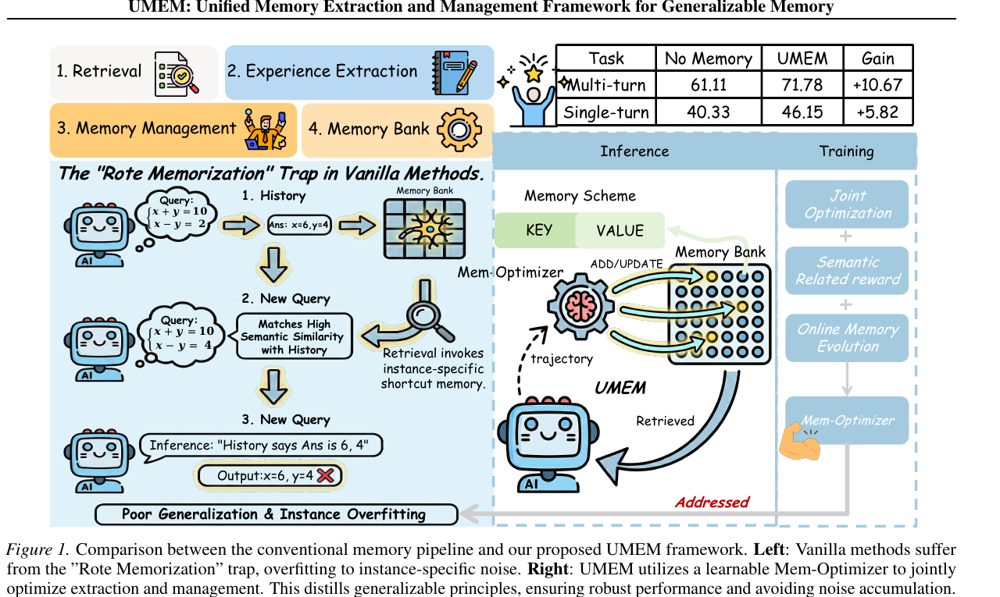
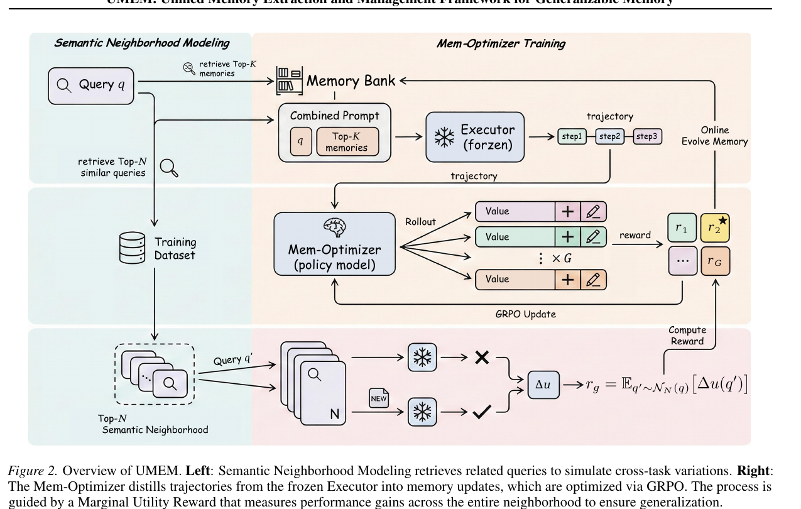
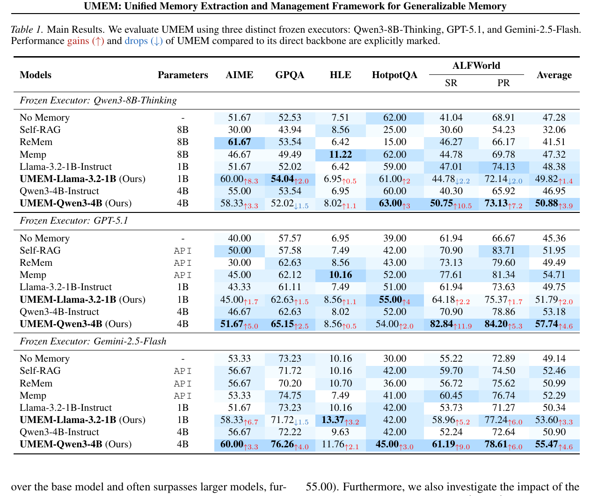
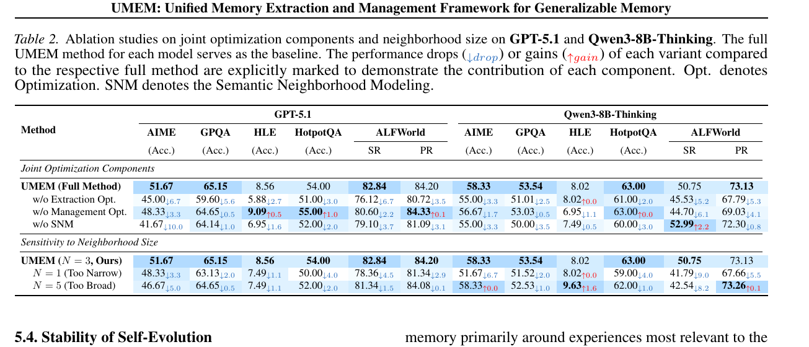
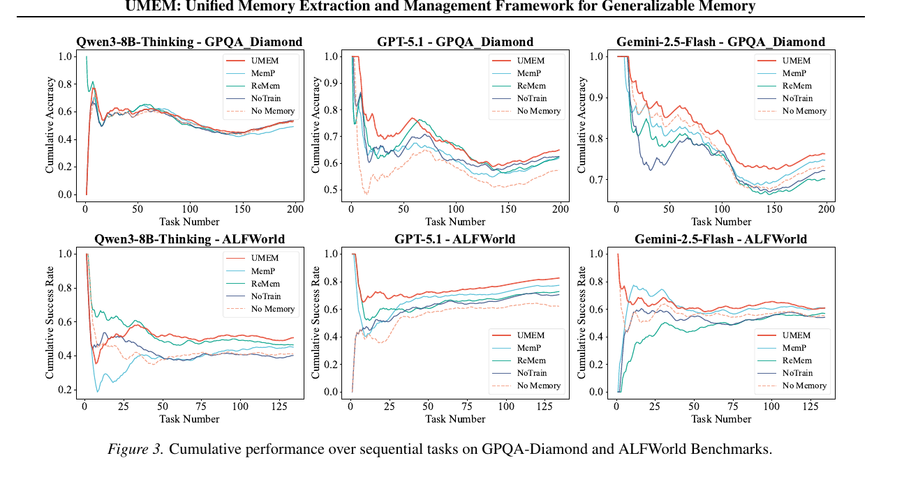
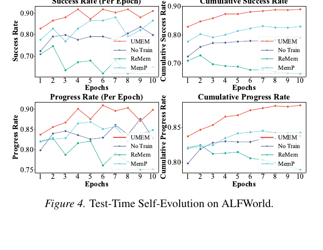
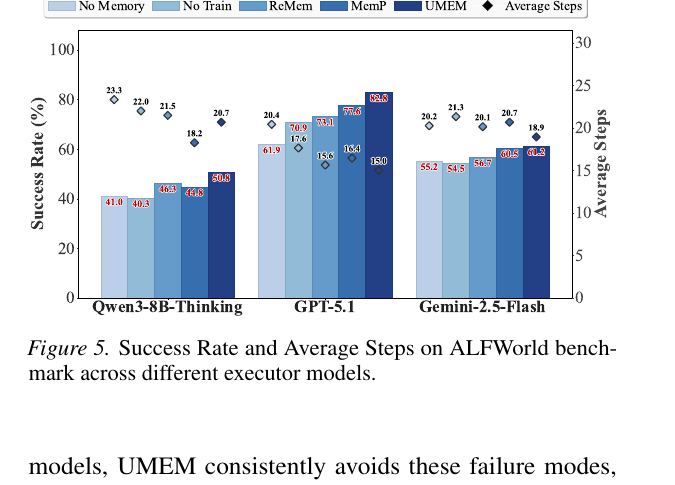

# UMEM：面向可泛化长期记忆的提取与管理联合优化

> 论文：**[UMEM: Unified Memory Extraction and Management Framework for Generalizable Memory](https://arxiv.org/abs/2602.10652)**<br>
> 作者：Yongshi Ye, Hui Jiang, Feihu Jiang, Tian Lan, Yichao Du, Biao Fu, Xiaodong Shi, Qianghuai Jia, Longyue Wang, Weihua Luo<br>
> 作者单位：厦门大学、Alibaba International Digital Commerce Group、Tongyi Lab。<br>
> 研究类型：Agent 长期记忆、外部 Memory Bank、记忆策略强化学习。<br>
> 阅读状态：**详细解读**。本文依据论文 PDF 的方法、实验和附录信息整理；图表均为原文 Figure/Table 裁图。

## 摘要

UMEM 研究一个看似简单、但长期 Agent 中很难的问题：**Agent 怎样把一次交互中的经验写入外部记忆，并确保这条记忆对未来相似任务有用，而不是只记住当前样本的偶然答案？**

论文提出将 Agent 的基础 Executor 固定，把外部 Memory Bank 视作可演化状态；再训练一个 Mem-Optimizer，从轨迹中同时决定：

```text
应该提炼什么记忆？
应该怎样对 Memory Bank 执行 ADD / UPDATE 等管理动作？
```

其关键设计包括：

1. **Semantic Neighborhood Modeling**：不只在当前题上评价新记忆，而是在语义相近的一组任务上评价；
2. **Marginal Utility Reward**：奖励能修复错误、保持正确性、同时缩短冗余推理的记忆；
3. **GRPO 训练 Mem-Optimizer**：联合优化记忆提取与记忆管理；
4. **Online Memory Evolution**：将高收益记忆更新立即写入 Memory Bank，形成连续任务流中的长期演化。

论文报告 UMEM 在 AIME、GPQA-Diamond、HLE、HotpotQA 和 ALFWorld 上优于多类 Memory 基线，并展示其在连续任务流中相较 ReMem、MemP 更稳定。不过这些结论依赖其特定的训练数据、邻域构造、冻结 Executor 与 benchmark 设置，不能直接推广到任意生产 Agent。

## 1. 研究背景：为什么普通 Agent Memory 会“死记硬背”？

许多 Memory Agent 使用如下管线：


问题在于，基于语义相似度的检索很容易召回与当前任务表面相似、但只对旧样本有效的经验。

### 一个简化例子

当前问题：

```text
x + y = 10
x - y = 2
求 x, y
```

一次成功执行可能提炼出两种不同质量的记忆。

**低质量、实例化记忆：**

```text
当 x + y = 10、x - y = 2 时，答案是 x = 6、y = 4。
```

**高质量、可迁移记忆：**

```text
对于二元一次方程组，可通过相加或相减消元；得到候选解后应代回两个方程验证。
```

后一条能帮助相近方程，前一条会在参数变化后造成误导。UMEM 将这种风险称为 **Rote Memorization Trap**：记忆看似与当前任务相关，但实际记录的是实例 shortcut，而不是可复用原则。

## 2. 原文 Figure 1：UMEM 与常规 Memory Pipeline 的差异

{ .paper-figure }

> 来源：UMEM, Figure 1。左侧为常规记忆流程，右侧为 UMEM。点击图片可放大查看。

### 2.1 左侧：常规记忆管线的问题

左侧展示了一个典型失败过程：

```text
历史任务
→ 提取出实例答案
→ 写入 Memory Bank
→ 新问题因语义相似被检索到该记忆
→ Agent 直接沿用旧答案
→ 在新问题上错误
```

图中的关键点不是“检索错误”，而是**被检索的记忆本身粒度错误**。若存入的是 `x=6, y=4` 这样的实例答案，再好的向量检索也无法把它变成通用解法。

### 2.2 右侧：UMEM 的结构

右侧包含三层：

```text
Inference：Executor 使用检索到的 Memory 完成任务
Memory Scheme：Memory Bank 采用 key-value 形式保存经验
Training：Mem-Optimizer 通过联合优化更新 Memory Bank
```

UMEM 不直接微调完成任务的 Executor，而是训练专门的 Mem-Optimizer，使其产生更可泛化的记忆条目和管理动作。

### 2.3 图右上角的数字

Figure 1 右上角给出论文摘要级结果：

| 任务类别 | No Memory | UMEM | Gain |
| --- | ---: | ---: | ---: |
| Multi-turn | 61.11 | 71.78 | +10.67 |
| Single-turn | 40.33 | 46.15 | +5.82 |

这组数字用于说明 UMEM 在论文汇总设置中的收益，但不能替代后文按 Executor 和 benchmark 分开的 Table 1。

## 3. 形式化：UMEM 更新的是什么？

论文将自进化 Agent 表示为：

```text
冻结的 Executor E(Θ0)
+
可演化、不可微的外部 Memory Bank B
```

Memory Bank 是 key-value 对集合：

\[
\mathcal{B}=\{(k_i,v_i)\}_{i=1}^{|\mathcal{B}|}
\]

其中：

- \(k_i\)：对应任务或查询的索引键；
- \(v_i\)：可被检索并放入上下文的记忆内容；
- \(\Theta_0\)：基础 Executor 的冻结参数；
- \(\mathcal{B}\)：随任务流持续变化的外部状态。

### 3.1 前向过程：带记忆执行

在时间步 \(t\)，给定查询 \(q\)，系统从当前记忆库中检索 Top-K 条目：

\[
\mathcal{B}^{\operatorname{top}K}_t \subset \mathcal{B}_t
\]

冻结 Executor 在查询和检索记忆条件下生成轨迹与预测：

\[
\tau_q,\hat{y}_q \leftarrow \mathcal{E}(q,\mathcal{B}^{\operatorname{top}K}_t;\Theta_0)
\]

这一步与普通 RAG / Memory Agent 相似：基础模型不变，当前表现取决于检索到的记忆质量。

### 3.2 反向过程：更新 Memory Bank

UMEM 将“反向优化”放在外部记忆上。Mem-Optimizer \(\pi_\phi\) 根据任务、轨迹和输出生成记忆更新动作：

\[
a_q=(\Delta_q,\operatorname{opt}_q)
\sim \pi_\phi(\cdot\mid q,\tau_q,\hat{y}_q)
\]

其中：

- \(\Delta_q\)：从轨迹中提炼出的候选记忆；
- \(\operatorname{opt}_q\)：记忆操作，例如 ADD、UPDATE；
- \(a_q\)：完整的 Memory Bank 更新动作。

更新后：

\[
\mathcal{B}_{t+1}\leftarrow \operatorname{Apply}(\mathcal{B}_t,a_q)
\]

因此 UMEM 的“学习”并不发生在 Executor 权重中，而是发生在：

```text
Mem-Optimizer 产生何种记忆
+
Memory Bank 接受何种更新
```

## 4. 原文 Figure 2：Semantic Neighborhood 与 Mem-Optimizer 训练

{ .paper-figure }

> 来源：UMEM, Figure 2。左侧是 Semantic Neighborhood Modeling，右侧是 GRPO 训练 Mem-Optimizer 的流程。点击图片可放大查看。

Figure 2 是理解 UMEM 的关键。可以分为三个区域。

### 4.1 左上：当前任务的正常执行

对于当前查询 \(q\)：

```text
从 Memory Bank 检索 Top-K memories
→ 拼接 q 与 memories
→ Frozen Executor 执行
→ 得到 trajectory
```

Executor 被雪花图标标注为 frozen，说明它不通过这条训练流程更新。

### 4.2 中间：Mem-Optimizer 的 Group Rollout

Mem-Optimizer 读取轨迹后，会产生一组 \(G\) 个候选更新：

```text
候选 1：提炼的 value + ADD / UPDATE
候选 2：另一种记忆内容或管理动作
...
候选 G：另一种候选更新
```

这些候选形成 GRPO 的 group。GRPO 不需要额外 critic 网络，而是通过组内候选的相对 reward 调整策略概率。

### 4.3 左下与右下：Semantic Neighborhood Reward

UMEM 不只用当前问题 \(q\) 验证记忆更新，而是从训练集语义空间中检索 \(N\) 个相近问题：

\[
\mathcal{N}_N(q)=\operatorname{TopNNeighbors}(q)
\]

对每个邻居查询 \(q'\)，比较两次执行：

```text
reference execution：不使用当前候选记忆
memory-augmented execution：使用当前候选记忆
```

二者差值形成 \(\Delta u(q')\)，再对整个邻域求平均：

\[
r_g=\mathbb{E}_{q'\sim\mathcal{N}_N(q)}[\Delta u(q')]
\]

直观含义：

> 一条记忆的 reward 不是“它是否恰好修复了源问题”，而是“它是否提升了这一类语义相近问题的平均效用”。

这就是 UMEM 试图抑制实例过拟合的核心机制。

## 5. Marginal Utility Reward：奖励什么，惩罚什么？

对邻域中的每个查询 \(q'\)，论文定义两部分效用。

### 5.1 Success Gain

\[
\mathcal{G}_{\operatorname{succ}}(q')=
c(\tau_{q'}^{\operatorname{mem}})-c(\tau_{q'}^{\operatorname{ref}})
\]

其中：

- \(c(\cdot)\in\{0,1\}\) 表示执行是否正确；
- `mem` 表示使用候选记忆的执行；
- `ref` 表示不使用候选记忆的参考执行。

含义：

| 情况 | Success Gain |
| --- | ---: |
| 原来错，使用记忆后对 | +1 |
| 原来对，使用记忆后错 | -1 |
| 两者都对或都错 | 0 |

因此该项既奖励“修复错误”，也惩罚“新记忆破坏原本正确的行为”。

### 5.2 Efficiency Regularization

论文还鼓励在**不损害正确性**的情况下减少冗余推理：

\[
\mathcal{R}_{\operatorname{eff}}(q')=
(c_{\operatorname{mem}}\cdot c_{\operatorname{ref}})
\left(1-\frac{\ell_{\operatorname{mem}}}{\ell_{\operatorname{ref}}}\right)
\]

其中 \(\ell\) 是生成轨迹长度。

这个门控项 \(c_{\operatorname{mem}}\cdot c_{\operatorname{ref}}\) 很重要：只有记忆版与参考版都正确时，缩短轨迹才得到奖励。它避免系统把“更短但错误”的输出误认为高效。

### 5.3 总边际效用

\[
\Delta u(q')=
\mathcal{G}_{\operatorname{succ}}(q')+
\mathcal{R}_{\operatorname{eff}}(q')
\]

再对邻域求平均：

\[
r_g=\mathbb{E}_{q'\sim\mathcal{N}_N(q)}[\Delta u(q')]
\]

最终，Mem-Optimizer 通过：

\[
r_{\operatorname{final}}=r_{\operatorname{fmt}}+r_g
\]

进行 GRPO 优化，其中 \(r_{\operatorname{fmt}}\) 检查记忆条目及管理操作是否满足预定义 XML 格式。

## 6. 训练设置：这篇论文实际如何训练？

### 6.1 训练数据

论文从 MMLU 训练划分中随机采样约 2,000 条查询。对每条查询，使用预训练语义编码器 BGE-M3 在训练集中检索：

\[
N=3
\]

个最近邻，构成语义邻域。

### 6.2 模型角色

| 角色 | 论文使用的模型 | 是否训练 |
| --- | --- | ---: |
| Frozen Executor | Qwen3-8B | 否 |
| Mem-Optimizer policy | Llama-3.2-1B-Instruct 或 Qwen3-4B-Instruct | 是 |
| 下游未见 Executor | GPT-5.1、Qwen3-8B、Gemini-2.5-Flash | 否，评测使用 |

这一设计的目的，是测试 Mem-Optimizer 产生的记忆是否具有 **executor-agnostic** 的可移植性：即记忆是否只能帮助训练时的 Qwen3-8B，还是也能帮助更强或不同家的执行器。

### 6.3 Benchmark 与指标

| Benchmark | 类型 | 指标 |
| --- | --- | --- |
| AIME 2024/2025 | 数学推理 | Exact Match Accuracy |
| GPQA-Diamond | 科学推理 | Accuracy |
| HLE | 跨学科复杂推理 | Accuracy |
| HotpotQA | 多跳问答与策略复用 | Exact Match Accuracy |
| ALFWorld | 多轮具身规划 | Cumulative Success Rate、Progress Rate |

单轮任务使用准确率；ALFWorld 则不仅看最终成功，还看中间进展，因此报告 SR 与 PR。

### 6.4 对照方法

论文主要比较：

| 方法 | 用途 |
| --- | --- |
| No Memory | 无外部记忆的冻结 Executor |
| No Train | 使用同类 Prompt 模板但不训练 Mem-Optimizer |
| Self-RAG | 推理时自我批判过滤检索上下文 |
| Memp | 将轨迹拆成细粒度指令和高层脚本的解耦式 memory pipeline |
| ReMem | 侧重离散记忆管理操作的轨迹记忆方法 |
| UMEM | 联合优化提取与管理，并使用邻域效用 reward |

比较时必须注意：UMEM-Qwen3-4B 的红色上升/下降箭头是相对 **Qwen3-4B-Instruct**，UMEM-Llama-3.2-1B 的箭头是相对 **Llama-3.2-1B-Instruct**，不是简单相对 No Memory。

## 7. 原文 Table 1：主结果如何阅读

{ .paper-figure }

> 来源：UMEM, Table 1。三大区块分别固定 Qwen3-8B-Thinking、GPT-5.1 与 Gemini-2.5-Flash 作为 Executor。红色箭头表示 UMEM 相对其直接 Mem-Optimizer backbone 的增减，蓝色深浅反映同一列内相对表现。点击图片可放大查看。

### 7.1 表格结构

每个 Executor 区块中包含：

```text
No Memory / Self-RAG / ReMem / Memp
Llama-3.2-1B-Instruct
UMEM-Llama-3.2-1B
Qwen3-4B-Instruct
UMEM-Qwen3-4B
```

其中 `UMEM-Llama-3.2-1B` 表示用 1B Llama 作为 Mem-Optimizer，`UMEM-Qwen3-4B` 表示用 Qwen3-4B 作为 Mem-Optimizer；它们共同为当前冻结 Executor 整理 Memory Bank。

### 7.2 Qwen3-8B-Thinking 作为 Executor

主结果中的代表数字：

| 方法 | AIME | GPQA | HotpotQA | ALFWorld SR | ALFWorld PR | Average |
| --- | ---: | ---: | ---: | ---: | ---: | ---: |
| No Memory | 51.67 | 52.53 | 62.00 | 41.04 | 68.91 | 47.28 |
| Qwen3-4B-Instruct | 55.00 | 53.54 | 60.00 | 40.30 | 65.92 | 46.95 |
| UMEM-Qwen3-4B | 58.33 | 52.02 | 63.00 | 50.75 | 73.13 | 50.88 |

这里应读出两件事：

1. 与 No Memory 相比，UMEM-Qwen3-4B 的平均分从 47.28 到 50.88；
2. 表中红色 `+3.9` 指的是 UMEM-Qwen3-4B 相对 Qwen3-4B-Instruct 的平均增益，而非相对 No Memory。

在该 Executor 下，AIME 和 GPQA 并非均提升；但 HotpotQA 与 ALFWorld 指标显著改善。这说明 UMEM 的收益并非每种任务都一致，尤其在需要多步状态更新或策略复用的任务上更明显。

### 7.3 GPT-5.1 作为 Executor

在 GPT-5.1 区块，UMEM-Qwen3-4B 的结果为：

```text
AIME: 51.67 (+5.0)
GPQA: 65.15 (+2.5)
ALFWorld SR: 82.84 (+11.9)
ALFWorld PR: 84.20 (+5.3)
Average: 57.74 (+4.6)
```

这里的关键证据是：Mem-Optimizer 在训练阶段没有用 GPT-5.1 作为 Executor，但其生成的记忆仍能帮助 GPT-5.1。这支持论文关于记忆具有一定跨 Executor 可移植性的主张。

不过不能据此说记忆“与模型无关”。不同 Executor 对记忆表达、工具调用和上下文指令的遵循能力不同，表中不同 Executor 的收益幅度也不同。

### 7.4 Gemini-2.5-Flash 作为 Executor

Gemini 区块中，UMEM-Qwen3-4B 的 Average 为 55.47，相对 Qwen3-4B-Instruct 的 50.90 增加 4.6；ALFWorld SR 与 PR 分别达到 61.19 和 78.61。

三种 Executor 上均出现一定改善，是论文用于支持跨模型泛化的主要证据。但该证据仍局限于论文选择的模型、提示与 benchmark，并不等价于对任意基础模型或真实生产任务的保证。

## 8. 原文 Table 2：消融实验说明了什么

{ .paper-figure }

> 来源：UMEM, Table 2。Full Method 是各设置的基准行；蓝色下标表示相对完整 UMEM 的下降，红色上标表示增益。点击图片可放大查看。

### 8.1 去掉 Extraction Optimization

`w/o Extraction Opt.` 表示不优化从轨迹中提炼记忆的过程。

论文在 GPT-5.1 设置中报告，去掉该部分会使 AIME 从 51.67 降到 45.00，下降 6.7；在多个指标上出现明显退化。正文报告，移除记忆提取优化后，所有指标平均下降约 4.7 点。

这支持：

```text
记忆质量
比
仅对已有记忆执行管理动作
更决定长期效果。
```

### 8.2 去掉 Management Optimization

`w/o Management Opt.` 表示仍能提炼记忆，但不联合学习如何管理 Memory Bank。

该消融同样会下降，但论文报告其平均退化约 0.73 点，小于去掉 Extraction Optimization 的退化。

这并不表示管理不重要，而是在论文的这组设定中，**提炼出可泛化记忆**比管理动作的边际贡献更大。

### 8.3 去掉 Semantic Neighborhood Modeling

`w/o SNM` 表示候选记忆仅围绕源问题优化，而不在邻域任务上检查泛化。

例如 GPT-5.1 设置的 AIME 从 51.67 降到 41.67，说明在推理强度较高的任务中，若没有邻域约束，记忆容易学习实例 shortcut。

### 8.4 邻域大小为什么是 N=3

论文比较：

```text
N = 1：Too Narrow
N = 3：Ours
N = 5：Too Broad
```

结果显示 N=3 是较好的平衡：

- `N=1` 的邻域过窄，无法充分模拟跨任务变化；
- `N=5` 的邻域过宽，可能混入过多无关任务，稀释 reward 信号；
- `N=3` 在任务特异性和跨任务泛化之间更平衡。

这一点也提示：Semantic Neighborhood 的收益高度依赖 embedding 质量和邻域规模，不是一个无需调参的通用机制。

## 9. 连续任务流：UMEM 是否能抑制长期退化？

### 9.1 原文 Figure 3

{ .paper-figure }

> 来源：UMEM, Figure 3。上排为 GPQA-Diamond，下排为 ALFWorld；横轴是任务序号，纵轴是累计 Accuracy 或累计 Success Rate。

Figure 3 使用 streaming protocol：任务按顺序进入，Memory Bank 不重置。这个设定比独立静态 benchmark 更接近长期 Agent，因为错误记忆会累积并影响后续任务。

图中 UMEM 曲线在大部分设置中位于更高位置，尤其在后期相对 ReMem 和 MemP 的差距更明显。论文据此主张 UMEM 的记忆更新更能避免噪声和实例 shortcut 的长期放大。

阅读这张图时需要注意：

```text
曲线更高：累计表现更好；
曲线更平稳：退化速度更慢；
但曲线不是独立随机种子置信区间，不能单靠视觉差异推断统计显著性。
```

### 9.2 原文 Figure 4：测试时自进化

{ .paper-figure }

> 来源：UMEM, Figure 4。图中比较不同方法在 10 个 epoch 中的 Success Rate、Progress Rate 及其累计曲线。

Figure 4 试图回答：不只训练时，在更长的测试时交互中，UMEM 是否还能保持稳定？论文报告 UMEM 在多个 epoch 中达到更高的成功率和累计表现，即便在线检索与更新带来波动，也能较快恢复。

### 9.3 原文 Figure 5：跨 Executor 的效率

{ .paper-figure }

> 来源：UMEM, Figure 5。柱状图为 Success Rate，菱形点为 Average Steps。

Figure 5 的关键不是只看成功率：UMEM 在不同 Executor 上同时表现为更高成功率和更少平均步骤。若该趋势可靠，说明收益不只是“多走几步、多调用工具”，而可能来自更有效的记忆指导。

## 10. UMEM 具体证明了什么

论文的实验证据支持以下较窄结论：

1. 在其五个 benchmark、三类冻结 Executor 和特定 Memory Bank 设定下，联合优化记忆提取与管理可以提高多数指标；
2. 以语义邻域评估候选记忆，能降低只对源问题有效的实例化记忆风险；
3. 记忆提取优化、语义邻域建模和联合优化均具有可观察的消融贡献；
4. 在连续任务流中，UMEM 相比论文比较的基线表现出更高或更稳定的累计表现；
5. Mem-Optimizer 生成的记忆在 GPT-5.1、Qwen3-8B-Thinking、Gemini-2.5-Flash 等不同 Executor 上表现出一定可移植性。

## 11. UMEM 没有证明什么

论文并未证明：

- 外部 Memory Bank 一定优于所有参数微调方案；
- Semantic Neighborhood 对任意领域、任意 query embedding 都有效；
- 记忆演化能在开放生产环境无限稳定运行；
- N=3 是所有数据集上的最优邻域大小；
- GRPO 是训练记忆管理策略的唯一或最优方法；
- 表中收益在所有随机种子、提示模板和工具环境下都显著；
- 更大的 Memory Bank 或更多更新一定带来更强能力。

## 12. 复现时应优先验证什么

若以最小代价复现 UMEM 的思想，建议分三步：

```text
第一步：冻结 Executor + 外部 key-value Memory Bank；
第二步：对同一候选记忆比较源任务与语义邻域任务的表现；
第三步：只接受在邻域平均效用上提升的更新。
```

之后再引入：

```text
组采样候选记忆
GRPO 优化 Mem-Optimizer
连续任务流
跨 Executor 测试
```

最小对照至少应包含：

| 对照 | 用于排除的解释 |
| --- | --- |
| No Memory | 外部记忆是否有总体收益 |
| No Train | 收益是否只是 Prompt 模板造成 |
| 仅源任务 reward | 邻域奖励是否真的减少过拟合 |
| 仅提取 / 仅管理 | 两个子过程是否都必要 |
| 不同 N | 邻域大小是否影响结果 |

## 13. 高频问题

### UMEM 与普通 RAG Memory 的根本区别是什么？

**回答：**普通 RAG Memory 主要在推理时检索并拼接已有记忆；UMEM 额外训练 Mem-Optimizer，从轨迹中联合学习记忆提取与管理，并用语义邻域上的边际效用奖励约束记忆泛化。它优化的是“记忆如何形成和演化”，而不只是“记忆如何被检索”。

### 为什么不只在当前任务上评估候选记忆？

**回答：**当前任务的成功可能来自实例化 shortcut。若候选记忆在语义相近任务上也能提升表现，才更可能包含可迁移原则。UMEM 用语义邻域近似未来相近任务，并以邻域平均边际效用作为 reward。

### 为什么要联合优化提取与管理？

**回答：**高质量记忆需要同时回答“存什么”和“如何修改记忆库”。只优化管理无法弥补低质量提取；只优化提取则可能无法控制长期库的增量、更新和噪声。论文消融显示，在其设置中去掉提取优化的退化更明显，但两者联合才取得完整结果。

### UMEM 是否更新基础模型权重？

**回答：**论文中 Executor 保持冻结；UMEM 训练的是 Mem-Optimizer，并通过其输出更新外部 Memory Bank。因此它属于外部记忆与记忆策略的自进化，而不是直接训练执行模型参数。

## 14. 最终评价

UMEM 的强点在于，它没有把 Memory 当作静态检索组件，而是明确提出：**一条记忆只有在未来相近任务中产生边际效用时，才值得被长期继承。**

它的实验设计也相对完整：主结果、联合优化消融、邻域大小消融、连续任务流、测试时自进化和跨 Executor 评测共同构成了论证链。

但该工作仍属于近期预印本。对于长期生产环境，记忆污染、邻域偏差、更新成本、提示格式敏感性、跨领域迁移和多租户隔离仍是需要独立验证的问题。

## 参考文献

- Ye et al., [UMEM: Unified Memory Extraction and Management Framework for Generalizable Memory](https://arxiv.org/abs/2602.10652)
- 原文 Figure 1、Figure 2、Table 1、Table 2、Figure 3、Figure 4、Figure 5 已在本文中以原图展示。
