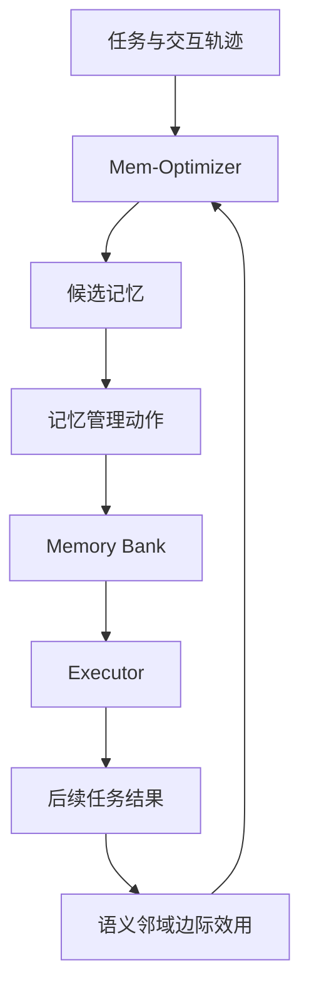

# UMEM：统一记忆提取与管理的可训练框架

> 论文：**[UMEM: Unified Memory Extraction and Management Framework for Generalizable Memory](https://arxiv.org/abs/2602.10652)**  
> 作者单位：厦门大学、阿里国际数字商业、通义实验室。  
> 方向：长期记忆提取、管理策略与跨任务泛化。

## 1. 研究问题

很多 Agent Memory 方法将“经验提取”和“记忆管理”拆成两个独立的启发式流程：先由 LLM 写出一条记忆，再按规则决定写入、保留或删除。这会产生两个问题：

```text
一条对当前任务有效的经验，不一定对相似任务有效；
记忆更新策略本身往往不是可学习的。
```

UMEM 的问题定义是：

> 能否将记忆提取和记忆管理统一为一个可优化过程，使 Agent 不只记住当前任务，而是学习对相近任务具有边际价值的长期记忆？

## 2. 方法概览

UMEM 将系统分为 Executor、Memory Bank 和 Mem-Optimizer。Executor 使用记忆完成任务；Mem-Optimizer 根据执行轨迹决定抽取什么经验以及如何调整 Memory Bank。



论文的关键不在于使用一个更大的记忆库，而在于将以下两个问题共同优化：

```text
Memory extraction：从轨迹中提炼什么内容；
Memory management：候选记忆如何进入、更新或影响长期库。
```

## 3. 关键机制：语义邻域边际效用

UMEM 认为，记忆不应仅根据当前任务是否成功来评估。若一条记忆只帮助当前样本，却无法帮助相近任务，那么它可能是过度特化的噪声。

论文通过语义邻域建模，评估一条记忆在相近任务集合上的边际效用。概念上可写为：

\[
\Delta U(m)=U(\mathcal{N}(x)\mid m)-U(\mathcal{N}(x)\mid \varnothing)
\]

其中：

- \(m\)：候选记忆；
- \(\mathcal{N}(x)\)：与当前任务 \(x\) 语义相近的任务邻域；
- \(U\)：任务效用或执行表现。

这并非论文中的唯一实现细节公式，而是其奖励设计的核心直觉：**记忆应被奖励为能够改善邻域任务，而非只解释当前样本。**

## 4. 更新对象

UMEM 的更新对象不是基础 Executor 的模型参数本身，而是：

```text
记忆内容
+
记忆提取与管理策略
```

论文使用 GRPO 优化 Mem-Optimizer，使其能够学习从轨迹中形成更具泛化性的记忆更新决策。

## 5. 实验设计

论文在五个 benchmark 上比较记忆基线与 UMEM，覆盖单轮和多轮交互任务。实验设计中需要关注三个层面：

| 层面 | 需要观察的内容 |
| --- | --- |
| 当前任务 | Memory 是否改善本次任务结果？ |
| 邻域任务 | 新记忆是否帮助相近但未见任务？ |
| 多轮过程 | Memory Bank 是否持续增长，且增长是否仍然有益？ |

论文摘要报告：UMEM 在多轮交互任务上最高提升 10.67%，并呈现随交互轮数增加的性能增长曲线。这个结果支持“记忆管理策略可学习”的主张，但仍需结合具体 benchmark 的任务分布理解。

## 6. 结果应如何解读

UMEM 的重要结论不是“长期记忆一定优于无记忆 Agent”，而是：

```text
记忆的价值取决于记忆质量；
记忆质量不能仅由单任务成功决定；
记忆提取和管理可以共同作为优化对象。
```

若性能提升只出现在当前轨迹或 validation，而未在语义邻域或未见任务出现，则不足以说明记忆具有泛化性。

## 7. 证据边界与阅读问题

阅读 UMEM 时需要继续核查：

- 语义邻域如何构造，是否依赖额外 embedding model；
- 邻域与真实未来任务分布是否一致；
- GRPO 奖励是否会偏向容易获得高分的记忆形式；
- Memory Bank 的规模增长、去重与遗忘如何控制；
- 当前基准上的多轮收益是否可迁移到开放式生产任务。

## 8. 与其他工作的位置

UMEM 是“外部记忆策略学习”路线的代表。与 TMEM 相比，它重点在显式 Memory Bank 的质量；与 MemRL 相比，它更强调记忆提取与管理的统一训练；与 EvoMemBench 相比，它是方法论文而非评测论文。

## 9. 阅读结论

UMEM 将 Agent Memory 从静态检索模块提升为可优化的策略组件。它最有价值的贡献是提出：

> 记忆是否应被继承，应取决于其对相近未来任务的边际效用，而非单个历史轨迹的叙述质量。
