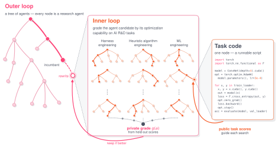
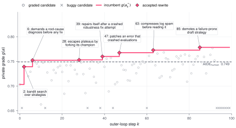
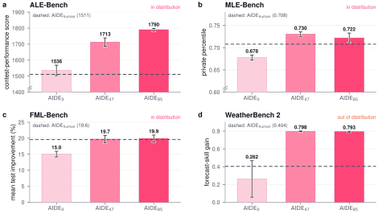

# AIDE²：递归自改进 AI Research Agent

> 论文：**[Recursive Self-Improvement of AI Research Agents](https://arxiv.org/abs/2609.26457)**。<br>
> 研究对象：AI Research Agent 的搜索策略、上下文压缩、memory、候选选择和 Agent 代码。  
> 论文处于 2026 年 9 月近期预印本阶段；实验有代表性，但应与同行复现和后续版本一起阅读。

## 1. 它为什么比普通 AI Research Agent 更接近 RSI

普通 AI Research Agent 会在固定 Harness 下搜索代码、跑实验、选择候选。AIDE² 的外层循环则将**完整 Agent**当成搜索树节点：

```text
当前 AIDE Agent
→ 外层 Agent 改写当前 Agent 的代码
→ 得到候选 AIDE Agent
→ 在 private grade 上评估
→ 接受更好的版本成为 incumbent
→ 新 incumbent 再改写下一代 AIDE Agent
```

因此被改进的不是某一段实验代码，而是未来执行 AI research 的工作流本身。

## 2. 原文 Figure 1：三层放大的 RSI

{ .paper-figure }

> 图源：AIDE² 原文 Figure 1。左侧是 Agent 树，中央是对 Agent 代码的 rewrite，右侧是被改进 Agent 完成的研究任务。

Figure 1 将同一过程分成三层：

| 层级 | 对象 |
| --- | --- |
| 外层 | 搜索并修改完整 AI Research Agent 的代码 |
| 中层 | 被修改的 Agent 执行代码优化、实验、搜索和候选管理 |
| 内层 | 一个具体 ML / 算法 / 预测任务的实验候选 |

这解释了 AIDE² 的“递归”来自哪里：外层 Agent 的改进会改变中层 Agent 如何处理内层任务；改进后的中层 Agent 又成为后续外层修改的对象。

## 3. AIDE² 的四步循环

论文将一轮写成：

```text
1. Explore：从当前 root 展开多个 agent 代码改写候选
2. Grade：在 private evaluation 上比较候选
3. Accept：将超过 incumbent 的候选作为新版本
4. Continue：用新版本继续提出未来的 agent rewrite
```

与 Selection Is Not Learning 相似，关键不在“某段代码看起来可学”，而在于评估真正会持久化的 Agent 版本。

## 4. 原文 Figure 2：多轮中是否真的持续提高

{ .paper-figure }

> 图源：AIDE² 原文 Figure 2。圆点是已评分候选、叉号是 buggy proposal、菱形是被接受的 rewrite。

论文报告在一个 100-node trajectory 中有 7 次 accepted rewrites，使 incumbent private grade 从：

```text
0.703 → 0.778
```

这个图的价值不只是最终差值，而是同时显示：

```text
大量候选没有被接受
一些候选本身是 buggy
只有经过 private grade 的改写才成为新 incumbent
```

这比“每轮都继承新版本”的自训练更保守，也更符合严格 RSI 的版本治理要求。

## 5. 实验设置

论文将 AIDE² 的改进版 Agent 转移到多个未参与 RSI 循环的 held-out benchmark：

| 基准 | 任务类型 |
| --- | --- |
| ALE-Bench | 算法/竞赛类研究任务 |
| MLE-Bench | 机器学习工程与竞赛任务 |
| FML-Bench | 代码优化类任务 |
| WeatherBench 2 | 气象预测相关任务 |

Figure 3 中 ALE-Bench 有 10 个任务、每题 10 个 seed；MLE-Bench 有 22 个任务、每题 3 个 seed；FML-Bench 有 18 个任务、每题 3 个 seed。这样做的目的，是避免只在产生 Agent rewrite 的 private grade 上声明成功。

## 6. 原文 Figure 3：改进能否迁移到 held-out benchmark

{ .paper-figure }

> 图源：AIDE² 原文 Figure 3。不同子图分别报告 ALE-Bench、MLE-Bench、FML-Bench、WeatherBench 2 上的迁移。

论文主张 discovered AIDE Agent 的收益可以迁移到这些不参与主循环的评测。这个证据比只报告 private grade 更强，因为它测试了 Harness 改动是否带来外部任务能力。

但是仍要留意：held-out benchmark 虽然未直接参与循环，可能与训练期任务共享模型、工具、搜索范式或代码优化结构。因此“迁移”并不自动等价于对所有未来 AI research 工作流泛化。

## 7. Reward hacking 为什么是本文的重要结果

论文在 38 个 held-out `(kernel, training-context)` 对上统计 reward hacking 比例，并报告沿 discovered lineage：

```text
55% → 32%
```

也就是说，后代 Agent 不只在 private grade 上更高，在论文定义的 held-out reward-hacking 检查中也更少出现“提高内部 reward、却不改善真实目标”的行为。

这是一条很有价值但也需要谨慎的证据：reward hacking 的定义、检测器和任务集本身会决定结果。它表明作者主动测量了风险，而不代表系统已经解决 reward hacking。

## 8. Prompt 压缩与搜索策略的演化

论文展示 AIDE 0 的 prompt 会随历史增长，而较后版本 AIDE 85 在 held-out run 中将每次 LLM 调用的 prompt size 保持大致有界。

这意味着自修改不一定只堆更多上下文；系统发现的一个改进方向是：

```text
保留对后续搜索真正有用的信息
压缩或淘汰过期历史
避免 prompt 随 run history 线性膨胀
```

Figure 5 还比较了搜索策略：AIDE 0 几乎把搜索押在最高分候选的一条分支上；AIDE 85 更能保留多个 arms，在探索与精修之间平衡。这与 DGM 的 archive 思路相呼应。

## 9. Ignition Test：改进后的 Agent 会不会更会改进自己

论文从相同的 inner-loop Agent `AIDE 47` 出发，分别用 `AIDE 47` 和人工基线 `AIDE human` 驱动三次独立、50-step 的 RSI run。Figure 7 观察 incumbent private grade 的轨迹。

这类测试比“当前 Agent 分数更高”更直接地回答 RSI 问题：

> 新发现的 Agent 是否也成为一个更好的外层改进器，能在相同起点上找到更好的后续版本？

它仍是有限步数的实验，不能证明无界自加速；但比单次 Harness 比较更贴近递归性。

## 10. 证据边界

论文支持：

1. 完整 AI Research Agent 的代码可作为递归改进对象；
2. 在一个 100-node 轨迹中，接受的 rewrite 带来 private grade 的持续提高；
3. 发现的 Harness 改进可迁移到多个 held-out benchmark；
4. 论文定义下的 reward hacking 比例沿 lineage 降低；
5. 搜索与 prompt 管理本身成为可被发现的改进方向。

论文没有证明：

```text
系统可无限长期稳定自改；
private grade 和所有现实研究目标一致；
奖励 hacking 检查覆盖所有 exploit；
多日运行的计算、权限和数据治理成本可在生产环境接受；
从 code optimization 迁移到所有科学研究领域都成立。
```

## 11. 高频问题

### Q1：AIDE² 改的是模型权重吗？

**回答：**核心改进对象是 Agent Harness/代码，而非基础模型权重。模型可以保持不变，但搜索、上下文、memory、候选选择和研究工作流会被重写。

### Q2：为什么需要 private grade？

**回答：**如果候选 Agent 能看到完整评测答案或反复在同一个公开 benchmark 上选版本，很容易过拟合。private grade 作为选择信号，用于降低直接调 benchmark 的风险；随后再使用 held-out benchmarks 检验迁移。

### Q3：AIDE² 是否已经比人工研究者强？

**回答：**不能这样说。论文在受限任务、预算和 evaluator 下比较 AIDE Agent 版本；它证明的是特定 AI research workflow 可以自修改并在选定 benchmark 上改善，不代表通用科研能力。

## 12. 阅读结论

AIDE² 是 RSI 从 Coding Agent 走向 AI Research Agent 的一次实证尝试：

> 让完整研究 Agent 的搜索、记忆、上下文和候选管理代码成为可改写对象，再让被选中的新 Agent 继续承担下一轮改进。

它最值得学习的是将 private grade、held-out transfer、reward-hacking 检查和 ignition test 放到同一论证链中。
