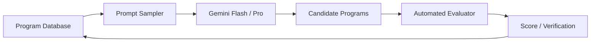

# AlphaEvolve：高影响力的算法进化系统，但不是严格 RSI

> 官方项目：**[AlphaEvolve: A Gemini-powered coding agent for designing advanced algorithms](https://deepmind.google/discover/blog/alphaevolve-a-gemini-powered-coding-agent-for-designing-advanced-algorithms/)**，Google DeepMind，2025 年 5 月。<br>
> 定位：必须学习的相邻工作。它演化外部算法和程序，但通常不修改自身 Agent Harness，因此不应与 DGM、AIDE² 直接混称为严格 RSI。

## 1. 为什么 AlphaEvolve 与 RSI 很像

AlphaEvolve 的循环具有典型进化结构：

```text
Prompt Sampler
→ Gemini 生成候选程序
→ 自动 evaluator 运行、验证、打分
→ Program Database 保存候选与分数
→ Evolutionary selection 选择哪些程序进入未来 prompt
→ 继续产生下一代程序
```

它会逐步改进一个程序代码库，而不是一次只改一个函数。因此它比早期“LLM 生成代码片段”更接近开放式程序进化。



## 2. 为什么它不是严格 RSI

关键区别在“被优化对象”：

| 系统 | 主要被优化的对象 |
| --- | --- |
| AlphaEvolve | 外部算法、kernel、调度启发式、数学构造 |
| DGM | Coding Agent 自身代码库 |
| AIDE² | AI Research Agent 的 Harness 与研究工作流 |
| RRSI | Prompt、工具、memory、控制流构成的 Agent Harness |

AlphaEvolve 可以帮助优化 AI 训练和推理基础设施，但论文/官方页面描述的核心循环并不是“AlphaEvolve 重写自己的 prompt sampler、evaluator 或 agent code，然后让后代继续改自己”。

因此更准确的定位是：

> AlphaEvolve 是高影响力的 Evolutionary Coding / Algorithm Discovery 系统，是理解 RSI 的重要邻居，但不是当前严格 RSI 定义的中心案例。

## 3. 双模型分工

官方描述中使用 Gemini 模型组合：

| 模型角色 | 作用 |
| --- | --- |
| Gemini Flash | 广泛探索，快速产生大量不同程序想法 |
| Gemini Pro | 提供更深、更有洞察的修改建议 |

这种分工不是简单的大模型/小模型 ensemble，而是对应进化搜索的两个需求：

```text
探索：尽可能覆盖多种新程序方向
利用：深入改善已有高潜力方向
```

候选程序必须通过自动 evaluator。正因为算法目标可以被客观运行、验证和打分，AlphaEvolve 适合数学、系统和 kernel 优化；对于主观写作或无法自动判定质量的开放任务，它的优势会明显下降。

## 4. 结果一：数据中心调度

Google DeepMind 报告 AlphaEvolve 为 Borg 数据中心调度系统发现了一个启发式策略，已在生产中运行超过一年，平均回收约：

```text
0.7% 的全球计算资源
```

这个数字的意义不在看似很小的百分比，而在 Google 规模的基础设施中，0.7% 可持续容量释放意味着大量任务可在同一硬件足迹上完成。

官方还强调生成代码的人类可读性、可调试性、可预测性和易部署性。这一点很重要：生产算法进化不能只优化离线 score；若工程师无法审核、无法维护，即使性能提高也难以安全落地。

## 5. 结果二：硬件和 AI 基础设施

官方案例包括：

### 5.1 TPU 电路设计

AlphaEvolve 提出一个 Verilog rewrite，移除了矩阵乘法关键算术电路中的不必要 bit；候选必须通过严格 functional verification，随后被纳入下一代 TPU。

### 5.2 Gemini 训练 kernel

通过优化大型矩阵乘法的分块方式，官方报告：

```text
关键 kernel 加速 23%
Gemini 训练时间减少 1%
```

二者不是矛盾。矩阵乘法 kernel 只是完整训练流程的一部分，因此 kernel 23% 加速最终折算为端到端训练时间 1% 缩短。

### 5.3 FlashAttention

官方报告在某些 FlashAttention kernel 实现上最高达到：

```text
32.5% speedup
```

这类结果表明 AlphaEvolve 适用于 evaluator 明确、性能可测、候选程序可运行的系统优化问题。

## 6. 结果三：算法发现与数学

官方介绍两个更接近研究发现的案例：

| 问题 | 报告结果 |
| --- | --- |
| 4x4 复数矩阵乘法 | 找到使用 48 次 scalar multiplications 的算法，优于此前已知方案 |
| 50 多个开放数学问题 | 约 75% 重新发现已知最好解；约 20% 改进此前最好解 |
| 11 维 kissing number | 找到 593 个外球配置，建立新的 lower bound |

这些数字很吸引人，但阅读时要区分：

```text
rediscover state-of-the-art
≠
在全新问题上独立发现未知真理
```

重新发现说明系统能在可验证搜索空间内找到高质量已知结构；改进最好解和新 lower bound 则是更强的发现证据，但仍需要数学/工程社区的独立验证和长期复现。

## 7. AlphaEvolve 与 DGM 的相同点和不同点

| 维度 | AlphaEvolve | DGM |
| --- | --- | --- |
| 候选对象 | 外部算法 / 程序 | Agent 自身代码 |
| 选择机制 | evaluator + program database + evolutionary selection | benchmark 评测 + Agent archive + parent selection |
| 主要目标 | 发现更优算法和系统实现 | 发现更优的 Coding Agent |
| 是否严格 RSI | 通常否 | 是 |
| 共同点 | 自动生成、自动评估、保留高价值候选、继续演化 | 自动生成、自动评估、保留高价值候选、继续演化 |

如果未来把 AlphaEvolve 的 evaluator、database 和 selection logic 本身也变为可被系统修改和独立确认的对象，它就会更接近严格 RSI。

## 8. 证据边界

官方项目页支持：

1. AlphaEvolve 可以在自动 evaluator 可用的算法问题上进化复杂代码库；
2. 它已报告数据中心调度、硬件设计、训练/推理 kernel 和数学发现的实际案例；
3. 人类可读代码和严格 verification 是部署的重要条件。

但不能直接推出：

```text
它可以解决任意开放问题；
所有生产部署都具有同等收益；
每次速度提升都可复制到其他硬件或模型；
它已经具备修改自身 Agent 的递归能力；
自动 evaluator 在所有领域都足以代表真实价值。
```

## 9. 高频问题

### Q1：AlphaEvolve 是不是 AlphaZero 的代码版本？

**回答：**两者都使用搜索和评价，但 AlphaEvolve 的候选是程序和算法，不是棋局动作。它结合 LLM 生成代码、自动 evaluator 和进化数据库，在程序空间搜索改进。

### Q2：为什么它特别适合系统和数学问题？

**回答：**这些领域往往有可运行、可验证、可量化的 objective，例如正确性测试、延迟、吞吐、资源占用、数学约束。自动 evaluator 越可靠，进化循环越能避免把流畅文本误当成进步。

### Q3：为什么不把它直接称为 RSI？

**回答：**严格 RSI 的改进对象应包括 Agent 自身能力结构，并由改进后的 Agent 继续产生后续自修改。AlphaEvolve 主要进化外部程序，Agent 架构本身并非该工作明确的递归优化对象。

## 10. 阅读结论

AlphaEvolve 展示了一个与 RSI 密切相关、但边界应保持清楚的事实：

> 当候选程序有可靠 evaluator 时，LLM 加进化搜索可以在真实系统、AI 基础设施和数学算法上产生有价值的改进。

它让我们看到“AI 改进 AI 基础设施”的现实路径；而 DGM、AIDE² 和 RRSI 则进一步追问：改进这套 Agent 本身，能否也成为可验证、可继承的演化过程？
