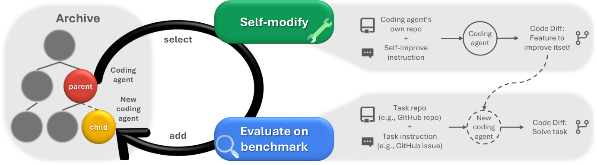
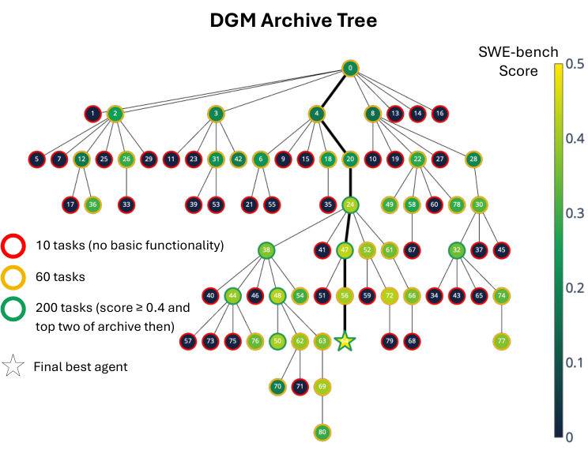
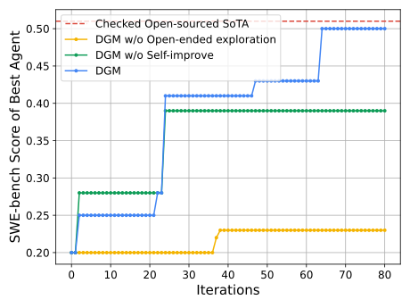

# Darwin Godel Machine：开放式演化的自修改 Coding Agent

> 论文：**[Darwin Godel Machine: Open-Ended Evolution of Self-Improving Agents](https://arxiv.org/abs/2505.22954)**，ICLR 2026。<br>
> 简称：DGM。它是当前 RSI 主线中最重要的实证工作之一：Agent 修改自身代码，并把通过评测的不同版本存入 archive，供未来多分支继续演化。

## 1. 从 Godel Machine 到 Darwin Godel Machine

理论上的 Godel Machine 要求系统证明一项自修改一定更好。这在真实 Agent 上几乎做不到：修改 Prompt、工具、代码编辑器或上下文管理后，很难形式化证明所有未来任务都会收益。

DGM 放弃“形式证明”，改用经验评测：

```text
候选 Agent 改写自身代码
→ 在 coding benchmark 上运行
→ 只把表现更好且有差异性的版本加入 archive
→ archive 中的任一 Agent 都可能成为下一轮 parent
```

因此它既是 self-improvement，也是 open-ended exploration。

## 2. 原文 Figure 1：DGM 的完整闭环

{ .paper-figure }

> 图源：DGM 原文 Figure 1。每个 archive 节点都是一个完整 Coding Agent，而不仅是一条记忆或一个 patch。

一个 Agent 同时有两种工作模式：

| 模式 | 输入 | 输出 |
| --- | --- | --- |
| 下游解决任务 | 外部代码仓库 + issue | 对外部仓库的 patch |
| 自修改 | 自己的 Agent repository + self-improve instruction | 新 Coding Agent 版本 |

这就是 DGM 的自指性：它使用 Coding Agent 原本具备的读、写、执行代码能力，来编辑**自己的**实现。

## 3. 为什么需要 Archive，而不是只保留最新版本

若每轮都让最新版本改自己：

```text
A0 → A1 → A2 → A3
```

一旦某次更新走向局部最优或退化，系统就很难回到更有潜力的历史分支。

DGM 保存不同父代产生、不同设计方向的高质量 Agent：

```text
archive = {A0, A3, A7, A11, ...}
```

未来可从不同 parent 出发继续变异：

```text
A3 → A12
A7 → A13
A11 → A14
```

这让搜索从单链爬山变成树状开放式探索。

## 4. 原文 Figure 3：Archive 中到底保存了什么

{ .paper-figure }

> 图源：DGM 原文 Figure 3。节点表示 Agent 版本，颜色表示 benchmark 表现；菱形表示最优 Agent。

Figure 3 说明 DGM 的结果不是一条平滑学习曲线，而是一组多样化的 Agent 设计：有些改进长上下文管理，有些改进代码编辑，有些加入 peer review 或修复 tool hallucination。archive 保留这些 stepping stones，即使它们不是某一时刻分数最高的 Agent，也可能成为未来有用 parent。

## 5. 实验设置

论文在两个 coding benchmark 上运行 DGM：

| 基准 | 特点 |
| --- | --- |
| SWE-bench Verified | Python 仓库 issue，常涉及多文件修改 |
| Polyglot | 多语言代码任务，主要单文件实现但需理解仓库上下文 |

关键配置：

```text
每个 benchmark 运行 80 次迭代
每轮生成一个新 Agent
SWE-bench 有 2 个并行迭代
Polyglot 有 4 个并行迭代
自修改阶段使用 Claude 3.5 Sonnet (New)
SWE-bench 评测使用 Claude 3.5 Sonnet
Polyglot 评测使用 o3-mini
```

初始 Agent 很轻，只提供 Bash 和 edit 工具。这样论文希望把后续性能变化尽量归因于自修改，而不是复杂人工初始化。

## 6. 原文 Figure 2 与 Table 1：self-improve 和 archive 都有作用

{ .paper-figure }

原文 Table 1：

| 方法 | SWE-bench | Polyglot |
| --- | ---: | ---: |
| DGM | **50.0%** | **38.0%** |
| DGM without open-ended exploration | 23.0% | 14.0% |
| DGM without self-improve | 39.0% | 28.0% |
| DGM Greedy | 39.7% | 30.0% |

### 6.1 这张表不能只读成“50% 很高”

它同时回答了两个机制问题：

1. **没有 self-improve**：固定 meta-agent 反复产生新 Agent，SWE-bench 只有 39.0%。说明“让一个固定设计器不断改下游 Agent”不如让新 Agent 自己也变成更好的修改者。
2. **没有 archive/open-ended exploration**：总是从最新 Agent 继续改，SWE-bench 只有 23.0%。说明单链搜索很容易停在差的局部路径。
3. **Greedy** 也低于完整 DGM，说明只选眼前最高分 parent 不如保留多样化路线。

因此 DGM 的主张不是单纯“LLM 会自改代码”，而是：

> 自修改能力与 archive 驱动的开放式探索结合，才更容易在多轮中持续取得进展。

## 7. 额外结果：基本代码编辑能力与稳定性

论文还统计生成 Agent 是否具备基础代码编辑能力：

| 方法 | 具备基础 code-editing 能力的生成 Agent 占比 |
| --- | ---: |
| DGM | **51.3%** |
| 无 open-ended exploration | 32.5% |
| 无 self-improve | 32.5% |

在 Polyglot 上重复三次运行，DGM 的平均准确率为 40.7%，标准差 2.3%。这说明结果并非单次完全偶然，但并不能代替更多随机种子、更多模型和成本匹配实验。

## 8. 原文 Figure 4：能否跨模型、跨任务迁移

论文进一步测试 DGM 发现的 Agent 设计能否：

```text
迁移到不同基础模型
迁移到不同 coding task
从 Python 迁移到 Rust、C++、Go 等语言
```

这一步很重要。若一个 Harness 只对生成它的模型或训练 benchmark 有效，它更像 benchmark patch；跨模型/跨语言迁移能提供更强的结构性证据。

但仍需要注意：迁移测试的任务数量、模型调用预算和工具环境会显著影响结论。

## 9. DGM 与 UMEM 的本质区别

| 维度 | UMEM | DGM |
| --- | --- | --- |
| 主要更新对象 | 外部 Memory Bank | Coding Agent 自身代码库 |
| Executor | 冻结 | 冻结 Foundation Model，但 Harness 不断变化 |
| 演化状态 | 记忆条目与管理动作 | 工具、Prompt、workflow、编辑策略、review 机制 |
| 搜索结构 | 每次记忆更新 | archive 上的多代、多分支探索 |
| 是否严格 RSI | 外部状态自进化 | 是，Harness/Agent 自修改 |

## 10. 安全与局限

论文在 sandbox 和 human oversight 下运行，并讨论自修改 traceability。即使如此，仍有明显边界：

```text
benchmark 评测可能被 exploit；
更多 Agent 版本意味着更大的执行与审计面；
archive 的“interestingness”定义会影响搜索方向；
自修改代码可能引入隐蔽权限或数据处理风险；
冻结基础模型不意味着系统整体不会获得危险的新能力组合。
```

## 11. 高频问题

### Q1：DGM 是不是在微调模型？

**回答：**不是。论文中的 Foundation Model 保持冻结；DGM 改写的是调用该模型的 Coding Agent 代码库，包括工具、编辑、Prompt、上下文处理和 review 等。

### Q2：为什么 archive 是 RSI 的核心？

**回答：**它保存多条高质量演化路线，允许未来从不同历史 Agent 继续探索。没有 archive，系统通常只从最新版本继续改，容易忘掉有潜力的替代设计。

### Q3：DGM 为什么比 SICA 更强？

**回答：**两者都自改代码，但 DGM 明确把“改进后的 Agent 也成为下一代修改者”与“archive 多分支探索”结合起来，并通过消融显示两部分都影响持续进展。

### Q4：50% 是否代表 DGM 能解决一半真实软件问题？

**回答：**不能。它是论文在 SWE-bench Verified 设置、指定模型、工具和预算下的准确率。它说明方法在该协议中有效，不等于现实工程任务的通用完成率。

## 12. 阅读结论

DGM 是严格 RSI 的代表，因为它实现了：

> Agent 改写自身实现；被验证的后代加入 archive；后代和其他历史分支继续产生下一轮自修改。

它把“不断变强”从单条训练曲线改写为一个可追溯的 Agent 演化树。后续的 Hyperagents、AIDE² 和 RRSI 则分别扩展了元级改进、AI Research Agent 和泛化/安全治理。
