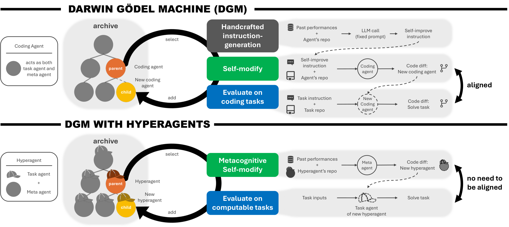
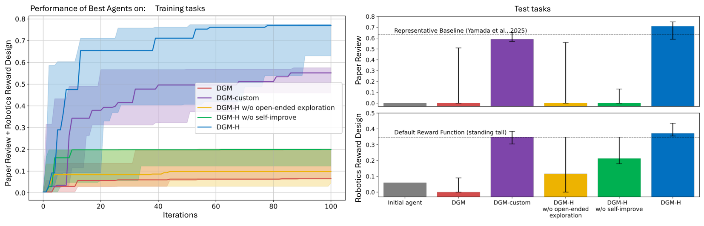
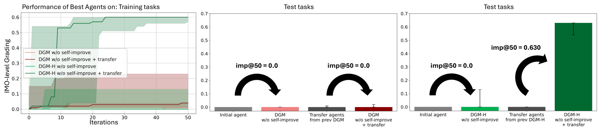

# Hyperagents：让“改进 Agent 的能力”也成为可演化对象

> 论文：**[HyperAgents](https://arxiv.org/abs/2603.19461)**。<br>
> 定位：DGM 的元级扩展。它不只改进某个任务 Agent，还尝试改进“产生、选择和组织未来 Agent 改进”的 Hyperagent。

## 1. DGM 的下一步问题

DGM 已经可以让 Coding Agent 改写自身代码，但原始 DGM 中仍有一个限制：

```text
同一个 Coding Agent
既解决下游任务
也扮演提出自修改的 meta-agent
```

这在 coding domain 中可以工作，因为“修改 Agent”和“解决代码任务”都是编程。但如果任务变成：

```text
论文评审
机器人 reward design
奥数证明评分
```

那么“任务执行能力”和“设计更好 Agent 的能力”不必是同一种能力。

Hyperagents 的关键思想是将两层分开：

| 层级 | 作用 |
| --- | --- |
| Task Agent | 完成具体下游任务，例如评审论文、写 reward、评分证明 |
| Hyperagent | 提出、选择、维护和改进 Task Agent 的修改机制 |

## 2. 原文 Figure 1：从 DGM 到 DGM-Hyperagents

{ .paper-figure }

> 图源：Hyperagents 原文 Figure 1。DGM-H 将 Task Agent 与负责 Agent 演化的 Hyperagent 解耦，并允许后者自身也被改写。

在 DGM-H 中，系统不只是问：

```text
怎样把当前 Task Agent 改得更强？
```

还问：

```text
怎样更好地选择 parent？
怎样组织 archive？
怎样写 self-modification instruction？
怎样评价候选 Agent？
怎样把一种领域中学到的改进策略迁移到另一领域？
```

这就是它比 DGM 更接近“improve the ability to improve”的原因。

## 3. 系统流程

可以把 DGM-H 简化为两条嵌套循环：

```text
内循环：Task Agent 改善下游任务表现
外循环：Hyperagent 改善产生内循环改进的机制
```

例如在 paper review domain：

```text
Task Agent：读取论文并给出结构化评审
Hyperagent：修改评审 Agent 的 Prompt、工具、反思步骤、证据组织和 parent selection
→ 新评审 Agent 进入 archive
→ 未来 Hyperagent 又可改进如何产生这些评审 Agent
```

这不意味着每一轮都同时更新所有层。论文强调使用 archive、开放式探索和经验选择，让不同层面的修改可以并行积累。

## 4. 如何衡量“改进能力”本身

普通 benchmark 测：

```text
某个 Agent 当前完成任务的分数是多少？
```

Hyperagents 还定义 `imp@50` 一类指标：给定一个起始 Agent、一个 agent-generation algorithm 和评测任务，运行 50 次迭代后，衡量该算法能否产出更好的 Agent。

它试图测的是：

```text
不是 A 本身有多强
而是 A / Hyperagent 能否更有效地产生 A'、A''、A'''。
```

这是 RSI 研究中非常重要的度量转变。否则一个当前很强、但无法再改进自身的 Agent，可能会被误认为具备强 RSI 能力。

## 5. 实验域与设置

论文将框架扩展到多个可计算任务：

| 域 | Task Agent 需要做什么 |
| --- | --- |
| Paper Review | 生成更高质量、更符合评测标准的论文评审 |
| Robotics Reward Design | 设计能诱导目标机器人行为的 reward function |
| Olympiad-level Math Grading | 判断数学证明和答案质量 |
| Coding / Polyglot | 延续 DGM 的代码 Agent 场景 |

跨域设置很关键：若 Hyperagent 只会针对单一 benchmark 改 Prompt，它更像自动提示搜索；论文要检验的是改进策略能否在不同任务中作为“可迁移的元能力”发挥作用。

## 6. 原文 Figure 2：Task Agent 表现会持续上升吗

{ .paper-figure }

> 图源：Hyperagents 原文 Figure 2。图中比较元认知自修改、开放式 archive 探索与不同任务上的最佳发现 Agent。

Figure 2 的重点不是某一个固定分数，而是曲线和 archive 中最佳节点是否继续改善。论文报告 DGM-H 能在同一次运行中优化多种任务，并不断发现更好的 Task Agent。

阅读时应注意两点：

1. 曲线进展必须用独立 validation 或 held-out 任务确认，否则可能只是在 evolution split 上适配；
2. 不同任务的 reward 尺度不同，不能把机器人 reward 分数、论文评审分数和代码通过率直接横向比较。

## 7. 原文 Figure 3 与 Figure 4：改进策略能不能迁移和累积

{ .paper-figure }

> 图源：Hyperagents 原文 Figure 3。以 imp@50 衡量一种 agent-generation algorithm 是否能在新设置中更快产生改进 Agent。

论文的核心主张是：在一个设置中形成的 Hyperagent 改进策略，可以迁移到另一个设置，使新领域更快找到强 Task Agent；进一步的运行还能继续积累这些策略。

这比“把已经训练好的 Prompt 转移到另一个任务”强一些，因为迁移的是产生未来修改的能力，而不仅是当前任务解法。

但这也是论文最需要严审的部分：

```text
两个域之间是否共享相似的任务结构？
迁移收益是否控制了额外 archive、额外模型调用和更长搜索预算？
imp@50 是否对生成算法和起始 Agent 都公平？
```

## 8. Hyperagents 与 DGM 的关系

| 维度 | DGM | Hyperagents |
| --- | --- | --- |
| 主要对象 | Coding Agent 自身代码 | Task Agent + Agent 生成/改进机制 |
| 任务范围 | 主要是 Coding | 多种可计算任务 |
| Meta Agent | Task Agent 自身承担 | 独立的 Hyperagent 可被改进 |
| RSI 强度 | Harness 自修改 | 元级自修改 |
| 关键新证据 | archive 支持持续编码能力进展 | 改进能力的迁移与跨域累积 |

## 9. 证据边界

论文支持：

1. 把 Task Agent 与 Hyperagent 分离后，可将 DGM 式演化扩展到非编码可计算任务；
2. 开放式 archive 与元认知自修改能推动多任务下的 Agent 改进；
3. 论文提出并测试了“改进能力”而非只看“当前能力”的指标；
4. 一些 self-improvement strategy 可以跨设置迁移并加速后续搜索。

仍需谨慎：

```text
Hyperagent 是否真的学到通用元策略，还是迁移了相似 benchmark 结构？
多层 archive 和搜索会不会只是在增加总计算？
各领域 evaluator 的可靠性是否足够支撑自修改？
更复杂的元机制是否更难审计、回滚和做权限隔离？
```

## 10. 高频问题

### Q1：Hyperagent 和普通 meta-agent 有什么不同？

**回答：**普通 meta-agent 通常由人固定设计，用于生成下游 Agent。Hyperagents 的特点是：生成和管理改进的机制本身也可以被纳入 archive 与自修改过程，因此它试图提高“如何改进”的能力。

### Q2：为什么需要 imp@50？

**回答：**最终任务分数只能评价当前 Agent；RSI 更关心它能否持续创造更好后代。imp@50 用固定迭代预算观察一个生成算法能否在 50 次机会内发现更强 Agent。

### Q3：它是否已经证明了无限递归改进？

**回答：**没有。论文展示有限预算、多轮实验中的持续改进和迁移证据；“无限”“自加速”需要远长时间、更强独立评测和严格安全治理才能讨论。

## 11. 阅读结论

Hyperagents 把 RSI 的问题提升了一层：

> 不只让 Agent 改进任务能力，还要让系统逐渐学会如何更有效地发现、选择和继承未来的改进。

它是连接 DGM 与 AIDE² 的关键工作：前者强调开放式 Agent archive，后者强调 AI Research Agent 在真实研究工作流中的递归重写。
