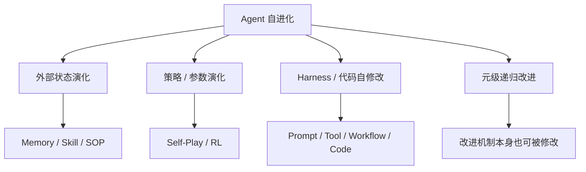
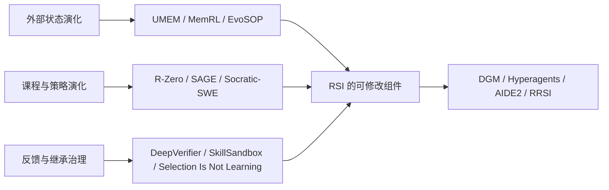

# Recursive Self-Improvement（RSI）

> 范围：以 Agent 或 Agent Harness 为对象的递归自我改进。本文主要覆盖 2025 年至 2026 年 10 月的代表性工作，并保留 STOP 作为概念起点。<br>
> 核心问题：一个系统能否改进自身的代码、工作流、工具、记忆和改进机制；被接受的新版本能否继续成为下一轮改进的主体；以及如何证明这种递归没有退化为 benchmark 过拟合、选择偏差或 reward hacking。

## 1. RSI 到底是什么

“自进化”“自我改进”和“RSI”经常被混用，但它们不是同一个强度的概念。

一个较严格的 RSI 闭环至少包含：

```text
当前 Agent / Harness A_t
→ 生成对自身的候选修改 Δ_t
→ 得到候选系统 A'_t = Apply(A_t, Δ_t)
→ 在独立评测中验证 A'_t
→ 选择并提交 A_(t+1)
→ A_(t+1) 再参与产生下一轮自身修改
```

可以写成：

\[
\mathcal{A}'_t=\operatorname{Apply}(\mathcal{A}_t,\Delta_t)
\]

\[
\mathcal{A}_{t+1}=
\operatorname{Commit}(\mathcal{A}'_t,\mathcal{A}_t,\mathcal{D}_{\operatorname{fresh}})
\]

其中最关键的不是“系统有更新”，而是两点：

1. 更新对象属于系统自身的能力结构，例如 Agent 代码、Prompt/Harness、工具接口、记忆机制、搜索策略或改进流程；
2. 被提交的改进版本会成为未来继续改进的主体，而不是只离线产出一次结果。

## 2. 先区分四类工作



| 类型 | 更新对象 | 是否属于严格 RSI | 当前专题中的例子 |
| --- | --- | ---: | --- |
| 外部状态演化 | Memory、Skill、SOP | 通常不严格 | UMEM、MemRL、EvoSOP |
| 策略/参数演化 | Policy、LoRA、训练数据分布 | 取决于是否递归修改改进机制 | R-Zero、SAGE、Socratic-SWE |
| Harness 自修改 | Prompt、工具、代码、控制流、上下文管理 | 是，若新 Harness 被继承 | SICA、DGM、RRSI |
| 元级递归改进 | 修改如何提出、评估和继承改进 | 最严格 | Hyperagents、部分 AIDE² 设定 |

### UMEM 为什么不是严格 RSI

UMEM 的 Executor 保持冻结，主要状态变化是：

\[
\mathcal{B}_{t+1}=\operatorname{Apply}(\mathcal{B}_t,a_t)
\]

其中 \(\mathcal B_t\) 是外部 Memory Bank。它属于重要的**外部记忆自进化**：后续行为会因记忆变化而变化；但 Mem-Optimizer 不会自主重写自己的训练逻辑、代码或 Agent Harness，因此不属于本专题所说的严格 RSI。

### R-Zero 为什么也不完全等于严格 RSI

R-Zero 会自生成课程并更新 Challenger/Solver 的策略，但其基本的训练回路、奖励形式、伪标签机制和 GRPO 框架由研究者预先固定。它属于强自演化训练系统；除非系统本身能修改“如何出题、如何筛选、如何更新”的机制，否则仍弱于 Harness 自修改型 RSI。

## 3. RSI 的最小可运行闭环

以一个会修改自身 Coding Agent 的系统为例：

```text
版本 A0：基础 Agent
→ 发现长上下文任务经常失败
→ 生成候选修改：改变上下文压缩策略
→ 得到 A1
→ 在独立任务集验证 A1 是否优于 A0
→ 若 A1 胜出，提交 A1
→ A1 再分析自身新失败模式
→ 改写工具选择、测试策略或记忆机制
→ 得到 A2
```

若系统只是：

```text
给定固定 Agent
→ 让它为外部问题找更好的代码
```

这更接近算法搜索或程序进化；只有当“被优化的对象”也包括改进 Agent 自己的能力结构时，才进入严格 RSI。

## 4. 代表性工作地图

| 工作 | 时间 | 改进对象 | 是否严格 RSI | 应如何定位 |
| --- | --- | --- | ---: | --- |
| [STOP](https://arxiv.org/abs/2310.02304) | 2023 | Improver program | 概念原型 | 递归改进的最小程序化表述 |
| [SICA](https://arxiv.org/abs/2504.15228) | 2025 | Coding Agent 自身代码 | 是 | 直接自编辑 Agent 的早期代表 |
| [Darwin Godel Machine](https://arxiv.org/abs/2505.22954) | 2025 / ICLR 2026 | Agent Code、工具、上下文策略与 archive | 是 | 当前最重要的开放式 RSI 路线之一 |
| [AlphaEvolve](https://deepmind.google/discover/blog/alphaevolve-a-gemini-powered-coding-agent-for-designing-advanced-algorithms/) | 2025 | 外部程序与算法 | 相邻工作 | 高影响力算法进化，不应与严格 RSI 混为一谈 |
| [Hyperagents](https://arxiv.org/abs/2603.19461) | 2026 | Agent 生成和修改机制本身 | 是，元级 | 更接近“改进如何改进”的递归结构 |
| [AIDE²](https://arxiv.org/abs/2609.26457) | 2026 | AI Research Agent 的代码和研究流程 | 是 | 将 RSI 放入 AI R&D Agent 的实证尝试 |
| [RRSI](https://arxiv.org/abs/2609.24972) | 2026 | Agent Harness 与其演化过程 | 是，带约束 | 关注 RSI 的泛化、复杂度和 reward hacking |

### 4.1 STOP：概念起点，而不是当前 SOTA

STOP 提出一个最小递归思想：让 improver program 优化目标程序，并允许它递归地调用自身来改进自身。它明确指出语言模型权重并不会被更新，因此并不是完整意义上的“模型递归自我改进”。但它给出了一个至今仍重要的问题：

> 一个改进器能否把自己也当作可优化对象？

### 4.2 SICA：直接编辑自己的 Coding Agent

SICA 允许 Coding Agent 读取并编辑自身代码，再用 benchmark 评估修改是否应保留。论文在随机抽取的 SWE-bench Verified 子集上报告由 17% 到 53% 的提升。阅读时应重点审查修改是否只适配了该子集、评测是否独立、以及自修改是否引入工具安全风险。

### 4.3 Darwin Godel Machine：开放式、多代 Agent 演化

DGM 让 Agent 直接修改自身的代码库，包括工具使用、代码编辑、上下文管理和 review 等能力；通过评估的子 Agent 进入 archive，并作为后续变异和改进的素材。论文报告 SWE-bench Verified 从 20.0% 提升至 50.0%，Polyglot 从 14.2% 提升至 30.7%。

它比单条自修改链更强，因为不是只保留一个线性 successor：

```text
多代候选 Agent
→ 评估和 archive
→ 从不同历史分支继续变异
→ 形成开放式演化搜索
```

这也是本专题后续单篇精读的第一篇。

### 4.4 AlphaEvolve：必须读，但要放在正确位置

AlphaEvolve 以 LLM 生成程序候选、自动 evaluator 验证和演化数据库选择为核心，并被 Google DeepMind 应用于算法发现、数据中心调度、芯片设计以及 AI 训练/推理优化。

它的重要性很高，但严格来说主要在改进**外部算法与程序**。除非被优化程序就是 Agent 自己的 Harness 或改进机制，否则不应直接当作严格 RSI 的实证。

### 4.5 Hyperagents：元级自修改

Hyperagents 进一步把“如何产生和管理 Agent 修改”的机制也暴露为可修改对象。它关注的不只是：

```text
怎样让 Agent 完成任务更好
```

还包括：

```text
怎样保存演化历史
怎样选择父代与候选
怎样提出下一轮修改
怎样组织用于改进的记忆和评测
```

这使它更接近递归自我改进的强定义，但仍属于近期预印本，需要特别审查评测独立性和迭代成本。

### 4.6 AIDE²：AI Research Agent 的递归自改进

AIDE² 将改进对象放在 AI Research Agent 本身，包括搜索、记忆、上下文压缩和研究工作流代码。论文报告一次多日自主运行中出现连续 Agent 改进，并在 held-out 任务上评估迁移；它也显式讨论 reward hacking。

这条路线值得关注，因为它的目标不是固定 benchmark 上的 Coding Agent，而是让系统改进“做 AI 研究的能力”。但它发布于 2026 年 9 月，现阶段应作为前沿预印本阅读，不能把单次长运行当成长期稳定性的充分证据。

### 4.7 RRSI：给 Harness 演化加上正则与安全门

RRSI 的目标是防止 Agent 在持续改 Prompt、控制流、工具和记忆后，逐渐变成针对当前评测集的补丁集合。它将候选 Harness 修改与 critic、复杂度控制、pruner 和泛化评估结合。

它与本专题的几篇工作具有对应关系：

| RSI 风险 | 对应阅读 |
| --- | --- |
| 选择到看似好的坏更新 | [Selection Is Not Learning](../evaluation-safety/selection-is-not-learning.md) |
| 长期 Skill 结构膨胀 | [SkillEvoReg](../skill-sop/skillevoreg.md) |
| 候选 Skill 是否值得入库 | [SkillSandbox](../verifier-rubric/skillsandbox.md) |
| Harness 自修改后的泛化与复杂度 | RRSI |

## 5. 如何判断一篇论文是否真的证明了 RSI

阅读 RSI 工作时，不能只看最终 benchmark 分数。至少检查以下七项：

| 检查项 | 要问的问题 |
| --- | --- |
| 修改对象 | 改的是外部任务，还是 Agent 自己的 Harness / 改进器？ |
| 递归性 | 被接受的新版本会不会参与产生下一轮自身修改？ |
| 评测隔离 | 修改选择、确认和最终报告是否使用独立数据？ |
| 继承规则 | 是否有明确的 commit / rollback，而不是默认继承每次更新？ |
| 多轮轨迹 | 迭代越多是否稳定，还是先升后崩？ |
| 计算控制 | 收益是否只是更多候选、更多工具调用或更长上下文带来的？ |
| 安全边界 | 自修改权限、sandbox、版本、日志和回滚是否可控？ |

其中“评测隔离”尤其关键。RSI 最容易出现的错误是：

```text
用同一个 benchmark 产生修改
→ 用同一个 benchmark 选择修改
→ 再用同一个 benchmark 宣称系统变强
```

这会把选择偏差误认为能力提升。

## 6. 与现有 Agent 自进化专题的连接



RSI 并不是和前面六个方向完全平行的孤岛。它更像把已有组件组合起来，并把组合方式本身变成可修改对象：

```text
Memory 可以修改
Skill 可以修改
Verifier 可以修改
Prompt / Tool / Workflow 可以修改
选择和继承机制也可以修改
```

当这些修改能够被独立评估、选择提交，并由新版本继续产生后续修改时，系统才逐渐接近严格 RSI。

## 7. 建议阅读顺序

```text
STOP
→ SICA
→ Darwin Godel Machine
→ Hyperagents
→ AIDE²
→ RRSI
→ AlphaEvolve
```

若只读一篇现代 RSI 主线论文，应先读：

```text
Darwin Godel Machine
```

它同时包含：

```text
Agent 自修改
多代 archive
评估选择
开放式搜索
跨 benchmark 结果
```

## 8. 当前结论

RSI 不是“模型会自己不断变强”的口号，而是一套需要严格验证的系统工程问题：

> 系统改了什么，为什么这次改动应被继承，新版本能否继续提出更好的改动，以及整个过程能否在独立任务、固定预算和安全边界下保持有效。

UMEM 可以看作 RSI 的一个受控前身：它只让外部 Memory Bank 演化；DGM、Hyperagents、AIDE² 和 RRSI 则把可修改面扩大到 Agent Harness 甚至改进机制本身。
