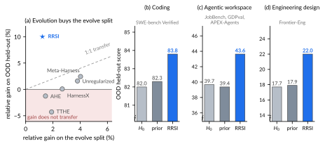
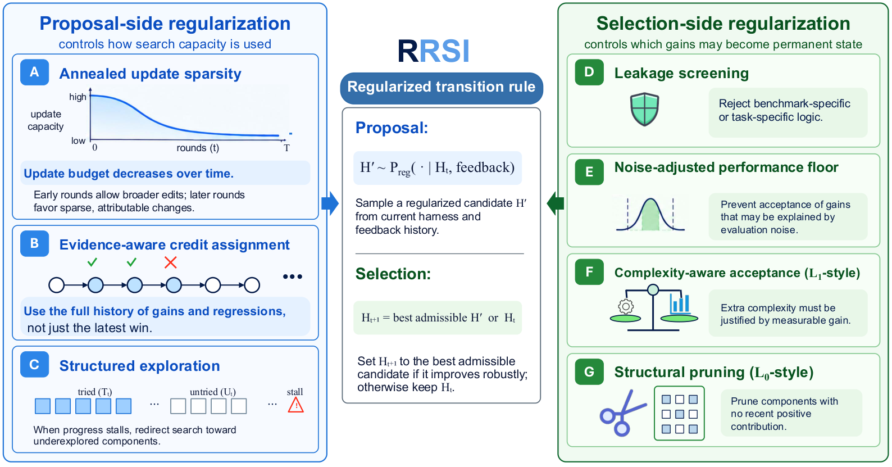
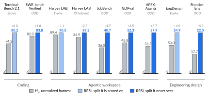

# RRSI：为 Agent Harness 的递归改进加上泛化与成本约束

> 论文：**[RRSI: Regularized Recursive Self-Improvement of Agent Harnesses](https://arxiv.org/abs/2609.24972)**。<br>
> 研究对象：Prompt、工具、控制流、memory 与上下文管理构成的 Agent Harness。<br>
> 核心问题：Harness 持续自改可能在演化集上越来越高分，却变成复杂的 benchmark-specific 补丁系统；怎样约束候选生成和提交规则，使 OOD 能力与成本更稳定？

## 1. 为什么 Harness Evolution 会过拟合

设当前 Harness 为 \(H_t\)。一个基础 evolver 根据历史反馈生成候选：

\[
\mathcal H_t=\{H_t^{(1)},\ldots,H_t^{(m_t)}\}
\]

传统方式直接在 evolution split 上选最高分候选：

\[
H_{t+1}=\arg\max_{H'\in\mathcal H_t\cup\{H_t\}}\widehat S(H';\mathcal D_{\operatorname{evolve}})
\]

问题是这个过程会逐步奖励：

```text
只适配当前任务格式的 Prompt 补丁
越来越长的 system prompt 与 memory
越来越多的工具调用和 policy token
偶然 exploit evaluator 的控制流改动
```

因此 evolution split 上升，OOD 可能下降，甚至低于初始 Harness \(H_0\)。

## 2. 原文 Figure 1：演化集提升不等于 OOD 提升

{ .paper-figure }

> 图源：RRSI 原文 Figure 1。图中强调 prior methods 在 evolve split 上的收益很难保留到 OOD，而 RRSI 试图让收益泛化。

这与 Selection Is Not Learning 的思想一致：

```text
某次候选在已有证据上得分更高
≠
该候选值得成为长期继承的 Harness
```

区别是 RRSI 同时控制：候选是怎样被提出的，以及候选是怎样被接纳的。

## 3. 原文 Figure 2：Proposal-side 与 Selection-side 正则

{ .paper-figure }

> 图源：RRSI 原文 Figure 2。RRSI 不直接限制 Harness 的可编辑空间，而是在搜索容量使用和永久提交两个位置加入约束。

### 3.1 Proposal-side regularization

约束候选改动的分布，避免每一轮都做激进、复杂、彼此重复的 rewrite。其目标是让搜索覆盖有意义的局部改动，而非仅增加 prompt/工具规模。

### 3.2 Selection-side regularization

候选即使在 evolve split 上升分，也不一定被接受。选择阶段同时考虑：

```text
性能增益 ΔS
成本变化 ΔC
复杂度与改动规模
跨任务或 held-out 行为
```

可以理解为对“哪些改动允许成为永久状态”加门槛。

## 4. 实验设置

论文在 Agentic Workspace 和多个 OOD benchmark 上研究 Harness 演化：

| 类别 | 基准 |
| --- | --- |
| Evolution / ID | Harvey LAB evolve、Harvey LAB ID held-out |
| OOD | JobBench、GDPval、APEX-Agents |
| 额外任务 | Terminal-Bench 2.1、SWE-bench Verified 等 |

对照包含 Meta-Harness、AHE、TTHE、HarnessX、未正则 evolution 与初始 Harness \(H_0\)。

重要的是：论文明确报告 OOD，而不是只报告生成候选时用到的 evolution split。

## 5. 原文 Table 1：OOD 才是主要证据

| 方法 | Harvey LAB Evolve | Harvey LAB ID Held-out | JobBench | GDPval | APEX-Agents |
| --- | ---: | ---: | ---: | ---: | ---: |
| H0，无演化 | 89.4 | 86.9 | 36.0 | 48.8 | 34.2 |
| Meta-Harness | **93.0** | 89.2 | 37.1 | 49.1 | 35.7 |
| AHE | 90.7 | 88.7 | 37.2 | 47.2 | 33.1 |
| TTHE | 91.1 | 88.5 | 35.2 | 47.0 | 31.7 |
| HarnessX | 91.8 | 89.1 | 36.3 | 48.5 | 34.3 |
| RRSI | 90.5 | **89.2** | **40.7** | **52.3** | **37.9** |

### 5.1 如何读这张表

- RRSI 在 evolve split 不是最高，Meta-Harness 为 93.0，高于 RRSI 的 90.5；
- 但 RRSI 在三个 OOD 任务上均最好；
- 这正是论文主张：不要为 evolution split 的局部最高分牺牲后续迁移。

若只看第一列，可能会错误认为 Meta-Harness 更好；若关注“自修改后的 Harness 是否值得长期使用”，OOD 结果更关键。

## 6. Table 2：性能和成本一起看

| 变体 | Harvey Evolve | Harvey ID Held-out | OOD Avg | Tokens/trial（M） |
| --- | ---: | ---: | ---: | ---: |
| H0 | 89.4 | 86.9 | 39.7 | 1.56 |
| Unregularized evolution | **92.8** | 88.9 | 40.3 | 3.80 |
| 去掉 proposal regularizers | 90.7 | 88.8 | 41.9 | 2.69 |
| 去掉 acceptance regularizers | 91.5 | 88.7 | 41.0 | 3.59 |
| RRSI | 90.5 | **89.2** | **43.6** | **2.42** |

几个重点：

1. 未正则 evolution 在 evolve split 最强，但 OOD Avg 只从 39.7 到 40.3；
2. 它每 trial 使用 3.80M tokens，是初始 Harness 的两倍以上；
3. RRSI 的 OOD Avg 为 43.6，同时 tokens 降到 2.42M；
4. proposal 与 acceptance 两侧的正则都重要，去掉任一侧都会损失 OOD 或成本控制。

## 7. Table 3：跨模型和跨 benchmark

| Policy | Benchmark | H0 | RRSI | 增益 |
| --- | --- | ---: | ---: | ---: |
| Claude Opus 4.8 | Terminal-Bench 2.1（evolve） | 74.2 | 80.2 | +6.0 |
| Claude Opus 4.8 | SWE-bench Verified（OOD） | 82.0 | 83.8 | +1.8 |
| Gemini 3.5 Flash | Terminal-Bench 2.1（evolve） | 64.6 | 78.7 | +14.1 |
| Gemini 3.5 Flash | SWE-bench Verified（OOD） | 76.8 | 79.0 | +2.2 |

这表明 RRSI 的收益并不只依赖某一个基础模型；但 OOD 增益比 evolve 增益小得多，也符合真实预期。强泛化不是“训练集提高多少，OOD 就提高多少”。

## 8. 原文 Figure 3 与 Figure 4

{ .paper-figure }

Figure 3 用图形汇总多域表现，Figure 4 则将 OOD Avg 与最终 Harness 的 policy tokens 放在一起。它的核心信息是：RRSI 不是用更长 prompt 换 OOD 分数；在论文设置中，它位于“更低 token、更高 OOD”的较优区域。

## 9. 证据边界

论文支持：

1. Harness 演化确实可能出现 ID/evolve 提升与 OOD 脱钩；
2. 对 proposal 与 acceptance 同时正则化，可以在多项任务上改善 OOD；
3. RRSI 在论文设置中避免了未正则演化的大量 token 膨胀；
4. OOD 检验与成本报告是评估 RSI Harness 的必要部分。

它没有证明：

```text
正则化可以覆盖所有 reward hacking；
未来未知任务都能被当前 OOD 集代表；
2.42M tokens/trial 已足够适合真实生产；
critic/pruner 本身不会偏向某种 Harness 风格；
复杂度约束不会压掉长期真正有价值的大改动。
```

## 10. 高频问题

### Q1：RRSI 是不是让 Agent 少改一点？

**回答：**不是简单减少改动。它不限制可编辑空间，而是正则化候选提议和永久接纳，使系统更少把高成本、低泛化的改动固化为长期 Harness。

### Q2：为什么 evolve split 高分反而不够？

**回答：**候选正是在 evolve split 上被生成和选择的，重复使用同一证据有选择偏差。一个 Harness 可以逐渐适配 benchmark 格式、工具细节或 evaluator 弱点，却不改善新任务。

### Q3：RRSI 和 Selection Is Not Learning 有什么区别？

**回答：**Selection Is Not Learning 更关注参数更新后“未来模型”是否值得继承；RRSI 专门处理 Prompt、工具、控制流、memory 等 Harness 的自修改，并额外将成本和复杂度纳入正则化。

## 11. 阅读结论

RRSI 为 RSI 加了一条务实原则：

> 自修改的目标不应是让当前演化集分数最大化，而是让被继承的 Harness 在新任务上仍有效，并且不靠无限增长的 Prompt、工具调用和复杂度换取表面收益。
