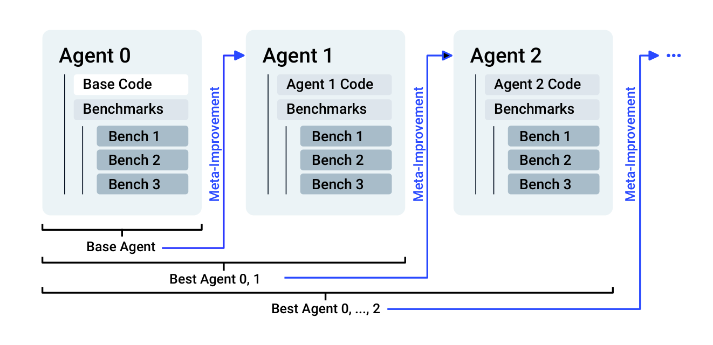

# SICA：一个可以编辑自身代码的 Coding Agent

> 论文：**[A Self-Improving Coding Agent](https://arxiv.org/abs/2504.15228)**。<br>
> 简称：SICA。研究对象是 Agent System 的代码、Prompt 和 LLM 调用编排，而不是底层模型权重。

## 1. SICA 的问题比 STOP 更具体

STOP 改进的是抽象 improver scaffold。SICA 则将对象落到一个真实 Coding Agent：

```text
Agent 自己的源代码
子 Agent Prompt
工具调用方式
benchmark 与 meta-improvement 流程
```

它要证明：只给 Agent 基础编码工具，它能否先跑 benchmark，找出自身系统的弱点，再直接修改自己的代码库，让下一代 Agent 更强。

## 2. 原文 Figure 1：Meta Agent Loop

{ .paper-figure }

> 图源：SICA 原文 Figure 1。

流程可理解为：

```text
当前 Agent 版本 A_t
→ 在 benchmark 上执行并记录分数、成本、时延与轨迹
→ Meta Agent 阅读自身 repository 和执行反馈
→ 直接编辑 Agent System 代码
→ 得到 A_(t+1)
→ 再次 benchmark
→ 若 utility 更高，继续下一轮
```

SICA 的 utility 不只考虑 benchmark score，还加入成本和时间项：

\[
U=w_{\operatorname{score}}p_{\operatorname{score}}
+w_{\operatorname{cost}}\left(1-\min(1,p_{\operatorname{cost}}/10)\right)
+w_{\operatorname{time}}\left(1-\min(1,p_{\operatorname{time}}/300s)\right)
\]

这避免系统只通过无限堆叠 Agent 调用提高分数。

## 3. 它实际改了什么

论文观察到的自修改包括：

```text
改进文件编辑与代码库浏览策略
调整子 Agent 分工
修改提示词和回答综合方式
改变缓存和工具调用编排
增加或删除用于长链任务的 scaffold 逻辑
```

这比 UMEM 写入一条记忆更强：UMEM 改的是外部状态；SICA 改的是“未来如何推理、如何调工具、如何组织子 Agent”的实现本身。

## 4. 实验设置

论文将 Agent 迭代版本评估在：

| 任务 | 用途 |
| --- | --- |
| File / Symbol 类任务 | 文件与代码库操作能力 |
| SWE-bench Verified 随机子集 | 真实仓库 issue 修复 |
| LiveCodeBench | 更通用的代码生成能力 |
| AIME 2024、GPQA Diamond | 更偏推理的外部测试 |

每次迭代记录准确率、每题平均成本、时间、token 和缓存比例。这样可以观察“分数提高是否只是更多预算换来的”。

## 5. 主结果：SWE-bench 的上升要怎样读

论文摘要报告随机抽取的 SWE-bench Verified 子集上，准确率从：

```text
17% → 53%
```

Table 1 的迭代轨迹也显示，SWE-Bv 指标会随着版本改变出现波动，而不是每一轮严格单调上升；同时每题平均耗时略有下降。

这支持的结论是：在该 Agent、该随机子集和该评测协议下，SICA 能找到对长程代码任务有用的 scaffold 改动。

但它不等于“完整 SWE-bench Verified 从 17% 到 53%”。随机子集规模、问题选择和元优化时是否接触到相似任务都决定了外推边界。

## 6. 为什么推理任务增益较弱

论文还在 AIME 2024、GPQA Diamond 上测试。对已经很强的 reasoning model，外层 scaffold 的边际收益较小，甚至有时会打断基础模型已有的推理过程。

这揭示一个重要结论：

```text
当基础模型在任务上很弱时，Agent scaffold 更可能补足工具、规划和文件操作。

当基础模型已经很强时，粗糙的多 Agent scaffold
可能反而干扰其内部推理。
```

因此 RSI 不应默认“更多 prompt、更多子 Agent、更多反思”总会提高性能。

## 7. 安全设计

SICA 在论文中强调两层控制：

1. **可观测性**：交互界面和异步 LLM overseer 记录/审查 Agent 轨迹；
2. **评测门控**：每轮修改必须在 benchmark 和可加入的安全评估上被验证。

论文也承认：如果系统不仅修改 scaffold，还允许更新基础模型权重，现有 observability 远远不够。

## 8. SICA 的证据边界

论文支持：

- Agent System 可以读取、编辑并评估自身代码；
- 在长程 Coding Agent 任务上，scaffold 自修改带来明显收益；
- 评测时加入成本/时间使优化目标不只追求分数；
- 对高能力 reasoning model，scaffold 的收益可能饱和或变负。

论文没有证明：

```text
修改一定能迁移到完整 benchmark 或真实工程任务；
自动提出的改动长期不会形成复杂脆弱的系统；
独立 evaluator 足以阻止 reward hacking；
通过代码级自修改的 Agent 能安全拥有更高权限。
```

## 9. 高频问题

### Q1：SICA 是不是微调模型？

**回答：**不是。基础模型权重不更新；变化发生在 Agent System 的代码、Prompt、工具与调用编排上，因此属于 Harness / scaffold 级自修改。

### Q2：为什么它比 UMEM 更接近严格 RSI？

**回答：**因为 SICA 修改的是未来 Agent 自己的能力实现，而不是只更新一份外部记忆。被保留的新代码版本会在下一轮继续作为修改者和任务执行者。

### Q3：SWE-bench 17% 到 53% 是否说明已经很强？

**回答：**说明该实验设置下的相对提升很大，但必须注意它是随机子集。应继续检查全量评测、held-out repo、运行成本和多次随机运行，才可判断泛化程度。

## 10. 阅读结论

SICA 给出了一个非常直接的 RSI 原型：

> Agent 不训练自身权重，而是像软件工程师一样阅读、改写、测试和保留自己的 Agent System 代码。

它的价值在于把“自我改进”从记忆更新推进到可执行 Harness 修改；DGM 则在此基础上加入了 archive 与开放式多代演化。
