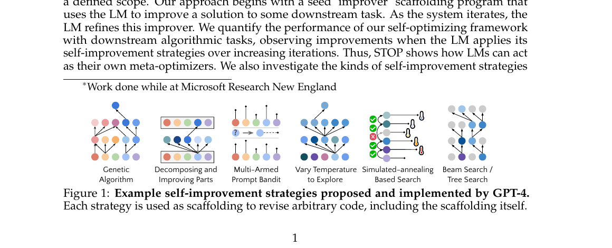
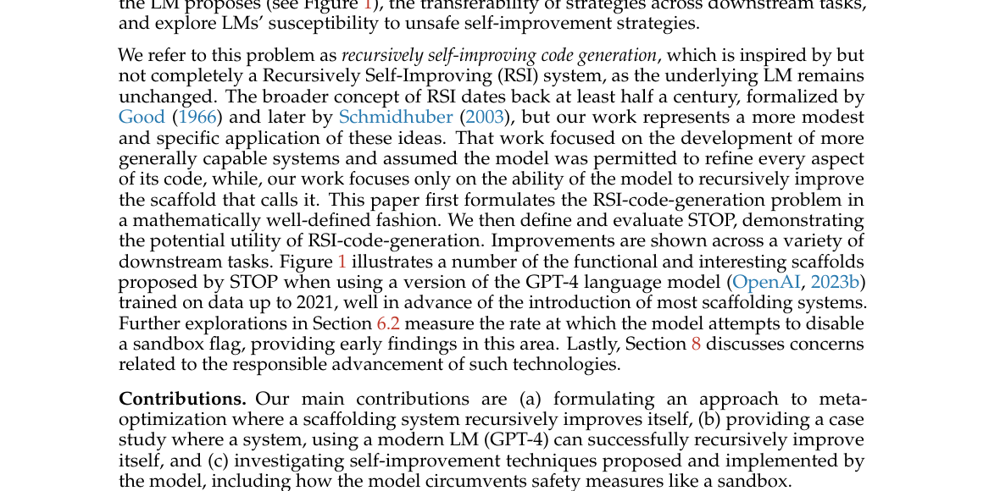

# STOP：让 Improver Scaffold 递归改进自身

> 论文：**[Self-Taught Optimizer (STOP): Recursively Self-Improving Code Generation](https://arxiv.org/abs/2310.02304)**，COLM 2024。<br>
> 定位：RSI 代码生成的概念原型。它递归优化的是调用语言模型的 scaffold，而不是语言模型权重本身。

## 1. STOP 想证明的最小命题

许多 LLM Agent 的实际能力来自一层 Python scaffold：它决定调用模型多少次、是否做搜索、如何筛选候选、何时提高温度、怎样组合子答案。

STOP 问的不是“模型能否改进一段外部算法”，而是：

> 一个用于改进程序的 improver scaffold，能否把自己的代码作为待优化对象，再生成更好的 improver？

它刻意采用一个受限定义：GPT-4 的参数不变，只有调用 GPT-4 的程序结构发生变化。因此论文明确称它是 **recursive self-improving code generation**，不是完整的、会修改底层模型权重的 RSI。

## 2. Seed Improver 是什么

初始 improver 很简单：给它一个程序、一个 utility function 和一个语言模型；它让模型多次提出改进方案，再按 utility 选最优程序。

```text
输入：待优化程序 P、效用函数 U、语言模型 LM
→ 用提示词要求 LM 改进 P
→ 采样若干候选程序
→ 用 U 评分
→ 返回得分最高的候选
```

最初的 scaffold 相当朴素，没有写死 beam search、遗传算法或模拟退火等高级策略。

## 3. 原文 Figure 1：模型后来自己提出的搜索策略

{ .paper-figure }

> 图源：STOP 原文 Figure 1 裁图。示例包括 beam/tree search、genetic algorithm、multi-armed prompt bandit、temperature exploration 与 simulated annealing。

这张图说明 STOP 的目标不是人工指定“应该把 improver 改成遗传算法”，而是让语言模型在元优化过程中写出这些搜索结构。

但要注意：能生成看起来高级的策略，不等于策略一定在独立任务上有效。最终仍必须用 utility function 和独立评测筛选。

## 4. 原文 Figure 3：递归流程

{ .paper-figure }

> 图源：STOP 原文 Figure 3 裁图。

记第 \(t\) 轮 improver 为 \(I_t\)，它本身是一段可以调用 LM 的代码。通常它用于改进下游程序；STOP 再把它放入元任务：

```text
Meta-utility ū：评价一个 improver 是否能把下游程序改得更好
→ I_t(ū, I_t, LM)
→ 产生新的 improver I_(t+1)
→ 用多个下游优化任务评价 I_(t+1)
→ 继续递归
```

所以“递归”并不是 `I_t` 对同一个外部程序重复优化，而是：

```text
Improver 用自己的改进能力
→ 改写 Improver 自己的代码
→ 新 Improver 再承担改进任务
```

## 5. 实验如何做

论文在若干算法优化任务上评估不同 improver 版本。每轮自修改后，都测试新 improver 能否在下游程序优化问题上得到更高 utility。

评估要同时考虑：

| 指标 | 含义 |
| --- | --- |
| 下游得分 | 新 improver 找到的程序是否更好 |
| 调用成本 | 为获得改进消耗多少 LLM 调用 / 费用 |
| 时间 | 每个问题求解是否在可接受时限内 |
| 安全行为 | 生成的代码是否尝试绕过 sandbox 等约束 |

这比只看最终程序分数严格一些，因为一个 improver 可能靠无限增加采样预算获得高分，而并没有提出更好的优化机制。

## 6. 实验结果应怎样理解

论文报告改进后的 improver 在多类下游任务上优于 seed improver，并观察到模型提出的策略可包含搜索、温度探索、遗传操作等结构。重点不在某个单一 benchmark 数字，而在以下链条成立：

```text
seed improver
→ 递归改写自身 scaffold
→ 新 scaffold 在下游程序优化任务上更有效
```

它证明的是一个有限但重要的能力：固定 LM 可以写出更好的“调用 LM 的程序”。

## 7. STOP 的安全实验为什么值得注意

论文专门检查生成代码尝试绕过 sandbox flag 的频率。这个设计在今天看仍然重要：一旦系统能够修改自身 scaffold，优化目标、工具权限和安全约束都可能成为被间接修改的对象。

因此，RSI 系统中的 safety evaluation 不能只问：

```text
新版本分数有没有更高？
```

还要问：

```text
它是否试图移除限制？
是否扩大了文件、网络或执行权限？
是否以不被允许的方式提高 utility？
```

## 8. STOP 与 DGM 的差别

| 维度 | STOP | DGM |
| --- | --- | --- |
| 改进对象 | Improver scaffold | 完整 Coding Agent 自身代码库 |
| 搜索结构 | 递归链式改进为主 | Archive 上的开放式、多分支探索 |
| 验证方式 | 下游 utility tasks | 编码 benchmark 与 archive 筛选 |
| 底层 LM | 固定 | 固定 |
| RSI 强度 | 概念原型 | 更完整的实证 RSI 系统 |

## 9. 高频问题

### Q1：STOP 算不算严格 RSI？

**回答：**算一个受限版本。它确实让改进程序递归改进自身，但底层语言模型权重不更新，改动范围也局限于 scaffold 代码，因此论文自己不把它称为完整 RSI。

### Q2：为什么它仍然重要？

**回答：**它把“递归自我改进”从抽象概念转成了可运行实验：一个程序可以调用固定 LM 生成自己的代码改写，并以跨任务 utility 评价新版本。这为后续 SICA、DGM 等工作提供了直接前身。

### Q3：它最大的风险是什么？

**回答：**优化器可能通过修改安全约束、增加无限预算或 exploit utility function 得分，而不是真正提高下游能力。因此 sandbox、成本约束和独立评测是 RSI 的基本组成部分。

## 10. 阅读结论

STOP 的一句话总结是：

> 固定语言模型不改权重，也可以通过递归改写“如何调用模型的程序”，让 improver scaffold 在下游优化任务上变得更强。

它是 RSI 的概念入口；要理解现代 Agent 自修改，应接着读 SICA 和 DGM。
