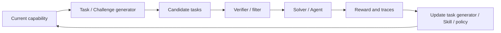

# 自生成任务与 Self-Play

> 本目录讨论 Agent 如何构造下一轮训练或探索环境。核心不是“任务越难越好”，而是如何生成接近能力边界、可验证、与目标分布相关的课程。

## 研究链路



## 单篇阅读

| 论文 | 关键角色 | 入口 |
| --- | --- | --- |
| [R-Zero](r-zero.md) | Challenger + Solver | 零人工题库、能力边界与伪标签 |
| [SAGE](sage.md) | Challenger + Planner + Solver + Critic | 多角色课程与质量过滤 |
| [Skill Self-Play](skill-self-play.md) | Proposer + Solver + Skill Controller | Skill 路由、任务契约与库维护 |
| [Native Evolution](native-evolution.md) | Explorer + World Knowledge | 任务前探索和环境知识 |
| [Socratic-SWE](../skill-sop/socratic-swe.md) | Skill → Task → Solver | 仓库环境中的可验证课程 |

## 阅读顺序

```text
R-Zero：先理解能力边界和伪标签的最小自博弈闭环
→ SAGE：增加规划和质量过滤如何稳定课程
→ Skill Self-Play：Skill 如何把开放生成连接到可验证契约
→ Native Evolution：将探索提前到任务到来之前
→ Socratic-SWE：将同样逻辑落在真实仓库和代码修复中
```

## 阅读原则

```text
生成任务是否可验证？
任务是否位于当前能力边界？
任务是否与外部目标分布相关？
Agent 是否只是在适应自己生成的题目？
新更新是否通过新鲜独立任务验证？
```

课程越难、轮数越多不等于模型越强。阅读结果时应同时检查任务有效性、伪标签/验证器质量、测试分布、训练预算和后期是否出现退化。
